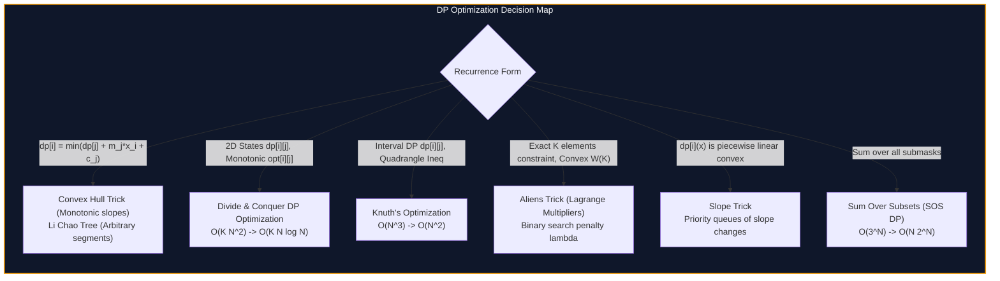

import { Callout } from "fumadocs-ui/components/callout";
import { Tabs, Tab } from "fumadocs-ui/components/tabs";
import { Steps, Step } from "fumadocs-ui/components/steps";
import { Cards, Card } from "fumadocs-ui/components/card";

## Breaking the Quadratic Barrier

Standard dynamic programming models often lead to transition recurrences with running times of $O(N^2)$, $O(K N^2)$, or $O(N^3)$. In competitive programming and high-throughput resource scheduling, $N \ge 10^5$, meaning quadratic complexity will timeout.

Dynamic Programming optimizations leverage algebraic and geometric monotonicity properties inherent in transition cost functions:

1. **Geometric Lower/Upper Envelopes (Convex Hull Trick & Li Chao):** When transitions have the linear form $dp[i] = \min_{j < i} \{ dp[j] + m_j x_i + c_j \}$, the optimal state corresponds to evaluating the lower envelope of a set of lines. We compress $O(N^2)$ to $O(N)$ or $O(N \log N)$.
2. **Quadrangle Inequality Monotonicity (D&C and Knuth):** When cost functions satisfy $C(a, c) + C(b, d) \le C(a, d) + C(b, c)$, optimal transition points $opt[i][j]$ move monotonically. Divide-and-conquer reduces 2D grid DP from $O(K N^2)$ to $O(K N \log N)$; Knuth's optimization reduces interval DP from $O(N^3)$ to $O(N^2)$.
3. **Lagrangian Relaxation (Aliens Trick):** Removing a hard cardinality constraint $K$ by applying a continuous penalty $\lambda$ and binary searching for the matching slope.
4. **Piecewise Linear Convex Splines (Slope Trick):** Maintaining continuous convex functions directly via multisets of inflection coordinates where slopes change.
5. **Bitmask Submask Aggregations (SOS DP):** Evaluating submask sums $F[mask] = \sum_{sub \subseteq mask} A[sub]$ in $O(N \cdot 2^N)$ rather than naive $O(3^N)$.
6. **Contour Frontier DP (Broken Profile):** Tiling irregular grids cell by cell, tracking only the active jagged boundary profile in $O(N M 2^M)$ states.

---

## Category Modules

<Cards>
  <Card
    title="Convex Hull Trick (CHT)"
    href="/docs/dsa/04-expert/dynamic-programming-optimizations/convex-hull-trick"
    description="Optimize linear DP transitions using deque-maintained convex hulls of lines from O(N^2) to O(N) or O(N log N)."
  />
  <Card
    title="Li Chao Trees"
    href="/docs/dsa/04-expert/dynamic-programming-optimizations/li-chao-trees"
    description="Segment tree maintaining upper or lower line envelopes, supporting dynamic line insertion and point evaluation in O(log N)."
  />
  <Card
    title="Divide and Conquer DP Optimization"
    href="/docs/dsa/04-expert/dynamic-programming-optimizations/divide-and-conquer-dp-optimization"
    description="Accelerate 2D partitioning DP satisfying monotonicity of optimal split indices from O(K N^2) to O(K N log N)."
  />
  <Card
    title="Knuth's Optimization"
    href="/docs/dsa/04-expert/dynamic-programming-optimizations/knuths-optimization"
    description="Narrow subproblem split searches for interval DP satisfying the quadrangle inequality, reducing complexity from O(N^3) to O(N^2)."
  />
  <Card
    title="Lagrangian Relaxation & Aliens Trick"
    href="/docs/dsa/04-expert/dynamic-programming-optimizations/aliens-trick-lagrangian-relaxation"
    description="Binary search over cost penalties to eliminate hard cardinality constraints K from dynamic programming state spaces."
  />
  <Card
    title="Slope Trick"
    href="/docs/dsa/04-expert/dynamic-programming-optimizations/slope-trick"
    description="Represent and maintain continuous convex cost functions using priority queues storing discrete slope inflection points."
  />
  <Card
    title="Sum Over Subsets (SOS) DP"
    href="/docs/dsa/04-expert/dynamic-programming-optimizations/sum-over-subsets-sos-dp"
    description="Multidimensional prefix sum over bitmask subproblems, evaluating submask sums in O(N 2^N) instead of O(3^N)."
  />
  <Card
    title="Broken Profile Dynamic Programming"
    href="/docs/dsa/04-expert/dynamic-programming-optimizations/broken-profile-dp"
    description="Transition cell-by-cell over jagged grid contours to solve grid tiling and path packing in O(N M 2^M) time."
  />
</Cards>
