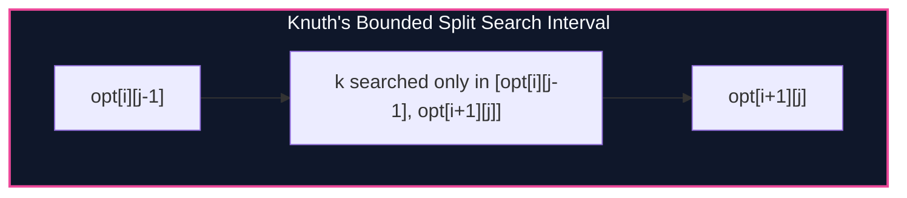

import { Callout } from "fumadocs-ui/components/callout";
import { Tabs, Tab } from "fumadocs-ui/components/tabs";
import { Steps, Step } from "fumadocs-ui/components/steps";
import { Cards, Card } from "fumadocs-ui/components/card";

## Interval DP and the Cubic Bottleneck

In optimal binary search trees, matrix chain multiplication, and polygon triangulation, dynamic programming states span intervals $[i, j]$:

$$dp[i][j] = \min_{i \le k < j} \{ dp[i][k] + dp[k + 1][j] \} + C(i, j)$$

Because there are $\mathcal{O}(N^2)$ intervals and searching for the optimal split index $k$ takes $\mathcal{O}(N)$, naive evaluation requires:

$$\mathcal{O}(N^3) \text{ time}$$

Donald Knuth proved in 1971 that if the cost function satisfies the **Quadrangle Inequality** and monotonicity on intervals, the optimal split index $opt[i][j]$ is tightly bounded by the optimal splits of smaller sub-intervals:

$$opt[i][j - 1] \le opt[i][j] \le opt[i + 1][j]$$



---

## The Telescoping Sum Proof of $O(N^2)$

For a fixed interval length $L = j - i$, summing the search ranges over all starting points $i$:

$$\sum_{i = 1}^{N - L} (opt[i + 1][i + L] - opt[i][i + L - 1]) = opt[N - L + 1][N] - opt[1][L] \le N$$

Because the summation **telescopes**, the total iterations of the $k$-loop across all intervals of length $L$ is at most $N$. Across all $N$ lengths:

$$\text{Total Time} = \sum_{L = 1}^N N = \mathcal{O}(N^2)$$

---

## Implementation

<Tabs items={["Python", "TypeScript", "C++"]}>
<Tab value="Python">
```python
from typing import List, Callable

def knuth*optimization(n: int, cost_fn: Callable[[int, int], int]) -> int:
dp = [[0] \* (n + 1) for * in range(n + 1)]
opt = [[0] \* (n + 1) for \_ in range(n + 1)]

    # Base cases: length 1
    for i in range(1, n + 1):
        opt[i][i] = i

    # Iterate over interval length L = 2 to n
    for length in range(2, n + 1):
        for i in range(1, n - length + 2):
            j = i + length - 1
            dp[i][j] = float('inf')

            # Knuth's bounded search range
            low_k = opt[i][j - 1]
            high_k = opt[i + 1][j] if i + 1 <= j else j

            for k in range(low_k, min(j - 1, high_k) + 1):
                val = dp[i][k] + dp[k + 1][j] + cost_fn(i, j)
                if val < dp[i][j]:
                    dp[i][j] = val
                    opt[i][j] = k

    return dp[1][n]

````
</Tab>
<Tab value="TypeScript">
```typescript
export function knuthOptimization(
  n: number,
  costFn: (i: number, j: number) => number
): number {
  const dp: number[][] = Array.from({ length: n + 1 }, () => new Array(n + 1).fill(0));
  const opt: number[][] = Array.from({ length: n + 1 }, () => new Array(n + 1).fill(0));

  for (let i = 1; i <= n; i++) {
    opt[i][i] = i;
  }

  for (let len = 2; len <= n; len++) {
    for (let i = 1; i <= n - len + 1; i++) {
      const j = i + len - 1;
      dp[i][j] = Infinity;

      const lowK = opt[i][j - 1];
      const highK = i + 1 <= j ? opt[i + 1][j] : j;

      for (let k = lowK; k <= Math.min(j - 1, highK); k++) {
        const val = dp[i][k] + dp[k + 1][j] + costFn(i, j);
        if (val < dp[i][j]) {
          dp[i][j] = val;
          opt[i][j] = k;
        }
      }
    }
  }

  return dp[1][n];
}
````

</Tab>
<Tab value="C++">
```cpp
#include <iostream>
#include <vector>
#include <algorithm>
#include <cstdint>

template<typename CostFunc>
int64_t knuthOptimization(int n, CostFunc cost) {
std::vector<std::vector<int64_t>> dp(n + 1, std::vector<int64_t>(n + 1, 0));
std::vector<std::vector<int>> opt(n + 1, std::vector<int>(n + 1, 0));

    for (int i = 1; i <= n; ++i) {
        opt[i][i] = i;
    }

    for (int len = 2; len <= n; ++len) {
        for (int i = 1; i <= n - len + 1; ++i) {
            int j = i + len - 1;
            dp[i][j] = 1e18;

            int lowK = opt[i][j - 1];
            int highK = (i + 1 <= j) ? opt[i + 1][j] : j;

            for (int k = lowK; k <= std::min(j - 1, highK); ++k) {
                int64_t val = dp[i][k] + dp[k + 1][j] + cost(i, j);
                if (val < dp[i][j]) {
                    dp[i][j] = val;
                    opt[i][j] = k;
                }
            }
        }
    }

    return dp[1][n];

}

```
</Tab>
</Tabs>

---

## Complexity Breakdown

| Metric | Naive Interval DP | Knuth's Optimization |
| :--- | :--- | :--- |
| **Time Complexity** | $\mathcal{O}(N^3)$ | $\mathcal{O}(N^2)$ strictly guaranteed |
| **Auxiliary Memory** | $\mathcal{O}(N^2)$ DP matrix | $\mathcal{O}(N^2)$ DP & opt matrices |
```
