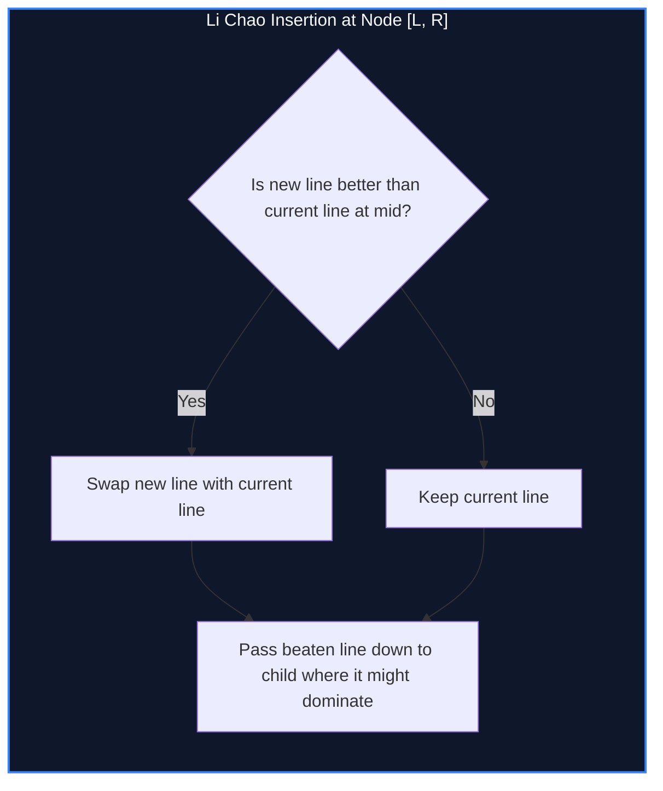

import { Callout } from "fumadocs-ui/components/callout";
import { Tabs, Tab } from "fumadocs-ui/components/tabs";
import { Steps, Step } from "fumadocs-ui/components/steps";
import { Cards, Card } from "fumadocs-ui/components/card";

## Arbitrary Line Envelopes without Sorting

When dynamic programming slopes $m$ or query coordinates $x$ arrive in arbitrary, non-monotonic order, classical deque-based CHT fails. While dynamic hulls using balanced search trees (`std::set` line slope comparisons) work, they require complex floating-point intersection logic.

A **Li Chao Tree** (invented by Li Chao) is a segment tree defined over the coordinate space $x \in [X_{\min}, X_{\max}]$. Each node stores the **single line that is dominant at the interval midpoint**:

$$mid = \left\lfloor \frac{L + R}{2} \right\rfloor$$

Supporting both:

- `add_line(m, c)`: Add arbitrary line in $\mathcal{O}(\log C)$ time.
- `query(x)`: Evaluate minimum/maximum at point $x$ in $\mathcal{O}(\log C)$ time.



---

## Li Chao Insertion Invariant

When inserting line $L_{\text{new}}$ into a node with existing line $L_{\text{curr}}$ over domain $[L, R]$:

1. Compare $L_{\text{new}}(mid)$ and $L_{\text{curr}}(mid)$.
2. If $L_{\text{new}}(mid) < L_{\text{curr}}(mid)$, swap them so $L_{\text{curr}}$ is always the superior line at $mid$.
3. Check the endpoints $L$ and $R$:
   - If the beaten line is superior at $L$, it must intersect in $[L, mid]$; recursively push it into the left child.
   - If the beaten line is superior at $R$, it must intersect in $[mid + 1, R]$; recursively push it into the right child.

Because the beaten line only descends into **at most one child**, insertion takes strictly $\mathcal{O}(\log C)$ time!

---

## Implementation

<Tabs items={["Python", "TypeScript", "C++"]}>
<Tab value="Python">
```python
class Line:
    __slots__ = ('m', 'c')
    def __init__(self, m: int = 0, c: int = float('inf')):
        self.m = m
        self.c = c

    def eval(self, x: int) -> int:
        return self.m * x + self.c

class LiChaoTree: # Segment tree over integer coordinates [x_min, x_max]
def **init**(self, x_min: int, x_max: int):
self.x_min = x_min
self.x_max = x_max
self.tree = {}

    def add_line(self, m: int, c: int):
        new_line = Line(m, c)
        self._insert(1, self.x_min, self.x_max, new_line)

    def _insert(self, u: int, l: int, r: int, new_line: Line):
        if u not in self.tree:
            self.tree[u] = new_line
            return

        mid = l + (r - l) // 2
        curr_line = self.tree[u]

        # Ensure curr_line is better at mid
        if new_line.eval(mid) < curr_line.eval(mid):
            self.tree[u], new_line = new_line, curr_line

        if l == r:
            return

        # Check endpoints to find where the beaten line can dominate
        if new_line.eval(l) < self.tree[u].eval(l):
            self._insert(2 * u, l, mid, new_line)
        elif new_line.eval(r) < self.tree[u].eval(r):
            self._insert(2 * u + 1, mid + 1, r, new_line)

    def query(self, x: int) -> int:
        return self._query(1, self.x_min, self.x_max, x)

    def _query(self, u: int, l: int, r: int, x: int) -> int:
        if u not in self.tree:
            return float('inf')
        ans = self.tree[u].eval(x)
        if l == r:
            return ans
        mid = l + (r - l) // 2
        if x <= mid:
            ans = min(ans, self._query(2 * u, l, mid, x))
        else:
            ans = min(ans, self._query(2 * u + 1, mid + 1, r, x))
        return ans

````
</Tab>
<Tab value="TypeScript">
```typescript
interface Line {
  m: number;
  c: number;
}

export class LiChaoTree {
  private tree: Map<number, Line> = new Map();

  constructor(private xMin: number, private xMax: number) {}

  private eval(line: Line, x: number): number {
    return line.m * x + line.c;
  }

  public addLine(m: number, c: number): void {
    this.insert(1, this.xMin, this.xMax, { m, c });
  }

  private insert(u: number, l: number, r: number, newLine: Line): void {
    if (!this.tree.has(u)) {
      this.tree.set(u, newLine);
      return;
    }

    const mid = l + ((r - l) >> 1);
    let curr = this.tree.get(u)!;

    if (this.eval(newLine, mid) < this.eval(curr, mid)) {
      this.tree.set(u, newLine);
      const temp = curr; curr = newLine; newLine = temp;
    }

    if (l === r) return;

    if (this.eval(newLine, l) < this.eval(this.tree.get(u)!, l)) {
      this.insert(2 * u, l, mid, newLine);
    } else if (this.eval(newLine, r) < this.eval(this.tree.get(u)!, r)) {
      this.insert(2 * u + 1, mid + 1, r, newLine);
    }
  }

  public query(x: number): number {
    return this.queryPoint(1, this.xMin, this.xMax, x);
  }

  private queryPoint(u: number, l: number, r: number, x: number): number {
    if (!this.tree.has(u)) return Infinity;
    let ans = this.eval(this.tree.get(u)!, x);
    if (l === r) return ans;

    const mid = l + ((r - l) >> 1);
    if (x <= mid) {
      ans = Math.min(ans, this.queryPoint(2 * u, l, mid, x));
    } else {
      ans = Math.min(ans, this.queryPoint(2 * u + 1, mid + 1, r, x));
    }
    return ans;
  }
}
````

</Tab>
<Tab value="C++">
```cpp
#include <iostream>
#include <vector>
#include <algorithm>
#include <cstdint>

struct Line {
int64_t m = 0, c = 1e18;
int64_t eval(int64_t x) const { return m \* x + c; }
};

class LiChaoTree {
int64_t xMin, xMax;
std::vector<Line> tree;

public:
LiChaoTree(int64_t minX, int64_t maxX, size_t maxNodes = 4000005)
: xMin(minX), xMax(maxX), tree(maxNodes) {}

    void addLine(int64_t m, int64_t c) {
        insert(1, xMin, xMax, Line{m, c});
    }

    void insert(int u, int64_t l, int64_t r, Line newLine) {
        int64_t mid = l + (r - l) / 2;
        if (newLine.eval(mid) < tree[u].eval(mid)) {
            std::swap(tree[u], newLine);
        }

        if (l == r) return;

        if (newLine.eval(l) < tree[u].eval(l)) {
            insert(2 * u, l, mid, newLine);
        } else if (newLine.eval(r) < tree[u].eval(r)) {
            insert(2 * u + 1, mid + 1, r, newLine);
        }
    }

    int64_t query(int64_t x) const {
        return queryPoint(1, xMin, xMax, x);
    }

    int64_t queryPoint(int u, int64_t l, int64_t r, int64_t x) const {
        int64_t ans = tree[u].eval(x);
        if (l == r) return ans;

        int64_t mid = l + (r - l) / 2;
        if (x <= mid) {
            ans = std::min(ans, queryPoint(2 * u, l, mid, x));
        } else {
            ans = std::min(ans, queryPoint(2 * u + 1, mid + 1, r, x));
        }
        return ans;
    }

};

```
</Tab>
</Tabs>

---

## Complexity Breakdown

| Operation | Time Complexity | Auxiliary Space |
| :--- | :--- | :--- |
| **Line Insertion** | $\mathcal{O}(\log C)$ | $\mathcal{O}(C)$ or $\mathcal{O}(Q \log C)$ dynamic |
| **Point Evaluation** | $\mathcal{O}(\log C)$ | $\mathcal{O}(1)$ |
```
