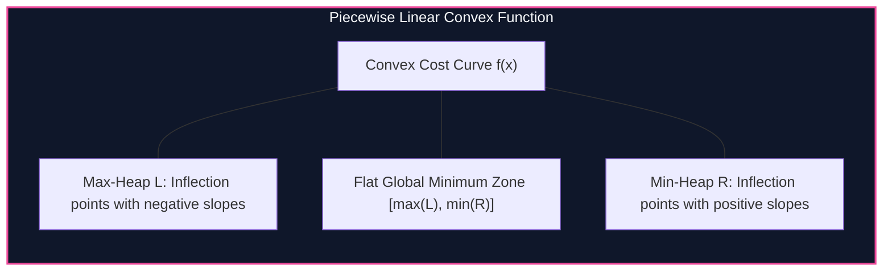

import { Callout } from "fumadocs-ui/components/callout";
import { Tabs, Tab } from "fumadocs-ui/components/tabs";
import { Steps, Step } from "fumadocs-ui/components/steps";
import { Cards, Card } from "fumadocs-ui/components/card";

## Representing Convex Functions via Inflection Points

In inventory control, sequence alignment, and time-series smoothing, dynamic programming cost functions $f(x)$ are continuous, piecewise-linear, and **convex**:

$$f(x) \text{ has integer slopes changing at discrete coordinates } x_1 \le x_2 \le \dots \le x_m$$

Instead of discretizing coordinate space into thousands of table entries, **Slope Trick** represents the entire continuous function $f(x)$ using three components:

1. $y_{\min}$: The global minimum value of $f(x)$.
2. $L$: A max-heap storing all inflection coordinates where the slope increases in the range $(-\infty, x_{\text{opt}}]$.
3. $R$: A min-heap storing all inflection coordinates where the slope increases in the range $[x_{\text{opt}}, +\infty)$.



---

## Inflection Point Mechanics

When adding an absolute cost term $|x - a|$ to $f(x)$:

- If $a < \max(L)$, $a$ falls in the left downward slope region. Push $a$ and $\max(L)$ into $L$, push $\max(L)$ into $R$, and increase $y_{\min}$ by $\max(L) - a$.
- If $a > \min(R)$, $a$ falls in the right upward slope region. Push $a$ and $\min(R)$ into $R$, push $\min(R)$ into $L$, and increase $y_{\min}$ by $a - \min(R)$.
- If $\max(L) \le a \le \min(R)$, $a$ lands in the optimal minimum trough. Push $a$ into both $L$ and $R$.

Each operation executes in $\mathcal{O}(\log N)$, reducing continuous optimization over $N$ states to:

$$\mathcal{O}(N \log N) \text{ total time}$$

---

## Implementation

<Tabs items={["Python", "TypeScript", "C++"]}>
<Tab value="Python">
```python
import heapq

class SlopeTrick:
def **init**(self):
self.min_y = 0 # max_heap for L (stored negated)
self.left_heap = [] # min_heap for R
self.right_heap = []

    def add_abs(self, a: int):
        """Adds |x - a| to the convex function f(x)"""
        max_l = -self.left_heap[0] if self.left_heap else -float('inf')
        min_r = self.right_heap[0] if self.right_heap else float('inf')

        if a < max_l:
            self.min_y += max_l - a
            heapq.heappop(self.left_heap)
            heapq.heappush(self.left_heap, -a)
            heapq.heappush(self.left_heap, -a)
            heapq.heappush(self.right_heap, max_l)
        elif a > min_r:
            self.min_y += a - min_r
            heapq.heappop(self.right_heap)
            heapq.heappush(self.right_heap, a)
            heapq.heappush(self.right_heap, a)
            heapq.heappush(self.left_heap, -min_r)
        else:
            heapq.heappush(self.left_heap, -a)
            heapq.heappush(self.right_heap, a)

    def get_min(self) -> int:
        return self.min_y

````
</Tab>
<Tab value="TypeScript">
```typescript
export class SlopeTrick {
  private minY: number = 0;
  private leftHeap: number[] = []; // Max-heap
  private rightHeap: number[] = []; // Min-heap

  private pushLeft(val: number): void {
    this.leftHeap.push(val);
    this.leftHeap.sort((a, b) => b - a);
  }

  private pushRight(val: number): void {
    this.rightHeap.push(val);
    this.rightHeap.sort((a, b) => a - b);
  }

  public addAbs(a: number): void {
    const maxL = this.leftHeap.length > 0 ? this.leftHeap[0] : -Infinity;
    const minR = this.rightHeap.length > 0 ? this.rightHeap[0] : Infinity;

    if (a < maxL) {
      this.minY += maxL - a;
      this.leftHeap.shift();
      this.pushLeft(a);
      this.pushLeft(a);
      this.pushRight(maxL);
    } else if (a > minR) {
      this.minY += a - minR;
      this.rightHeap.shift();
      this.pushRight(a);
      this.pushRight(a);
      this.pushLeft(minR);
    } else {
      this.pushLeft(a);
      this.pushRight(a);
    }
  }

  public getMin(): number {
    return this.minY;
  }
}
````

</Tab>
<Tab value="C++">
```cpp
#include <iostream>
#include <queue>
#include <cstdint>

class SlopeTrick {
int64_t minY = 0;
std::priority_queue<int64_t> leftHeap; // Max-heap
std::priority_queue<int64_t, std::vector<int64_t>, std::greater<>> rightHeap; // Min-heap

public:
void addAbs(int64_t a) {
int64_t maxL = leftHeap.empty() ? -1e18 : leftHeap.top();
int64_t minR = rightHeap.empty() ? 1e18 : rightHeap.top();

        if (a < maxL) {
            minY += maxL - a;
            leftHeap.pop();
            leftHeap.push(a);
            leftHeap.push(a);
            rightHeap.push(maxL);
        } else if (a > minR) {
            minY += a - minR;
            rightHeap.pop();
            rightHeap.push(a);
            rightHeap.push(a);
            leftHeap.push(minR);
        } else {
            leftHeap.push(a);
            rightHeap.push(a);
        }
    }

    int64_t getMin() const {
        return minY;
    }

};

```
</Tab>
</Tabs>

---

## Complexity Breakdown

| Operation | Time Complexity | Auxiliary Space |
| :--- | :--- | :--- |
| **Add Term $|x - a|$** | $\mathcal{O}(\log N)$ priority queue | Two values stored per operation |
| **Query Minimum Cost** | $\mathcal{O}(1)$ direct lookup | $\mathcal{O}(1)$ |
```
