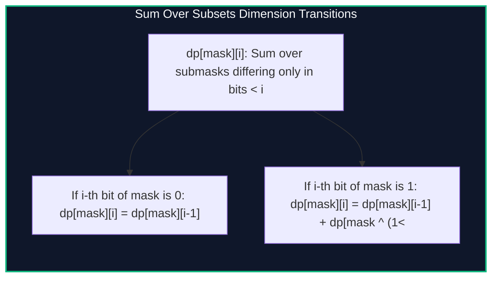

import { Callout } from "fumadocs-ui/components/callout";
import { Tabs, Tab } from "fumadocs-ui/components/tabs";
import { Steps, Step } from "fumadocs-ui/components/steps";
import { Cards, Card } from "fumadocs-ui/components/card";

## The Submask Aggregation Challenge

Given an array $A$ of size $2^N$, compute for every bitmask $mask \in [0, 2^N - 1]$ the sum of values of all its submasks:

$$F[mask] = \sum_{sub \subseteq mask} A[sub]$$

- **Naive Submask Enumeration:**
  $$\sum_{mask = 0}^{2^N - 1} 2^{\text{popcount}(mask)} = (1 + 2)^N = \mathcal{O}(3^N)$$
  For $N = 22$, $3^{22} \approx 3.1 \times 10^{10}$, causing severe timeouts.

The **Sum Over Subsets (SOS) DP** algorithm treats the bitmask as an **$N$-dimensional hypercube** of dimensions $\{0, 1\}^N$ and performs an $N$-dimensional prefix sum in:

$$\mathcal{O}(N \cdot 2^N) \text{ time}$$

For $N = 22$, $22 \cdot 2^{22} \approx 9.2 \times 10^7$ operations, completing in **0.05 seconds**!



---

## Mathematical Formulation

Define $dp[mask][i]$ as the sum over all $sub \subseteq mask$ such that $mask$ and $sub$ differ only in the first $i$ bits ($0 \le \text{bit} < i$):

$$
dp[mask][i] = \begin{cases}
dp[mask][i - 1] & \text{if } (mask \ \& \ (1 \ll i)) = 0 \\
dp[mask][i - 1] + dp[mask \oplus (1 \ll i)][i - 1] & \text{if } (mask \ \& \ (1 \ll i)) \neq 0
\end{cases}
$$

Notice that the second dimension $i$ can be collapsed into a single 1D array by iterating $i$ from $0$ to $N - 1$ in the outer loop!

---

## Implementation

<Tabs items={["Python", "TypeScript", "C++"]}>
<Tab value="Python">
```python
from typing import List

def sum*over_subsets(n_bits: int, arr: List[int]) -> List[int]:
"""
Computes F[mask] = sum*{sub in mask} arr[sub] in O(N \* 2^N) time.
"""
total = 1 << n_bits
sos = list(arr)

    for i in range(n_bits):
        bit = 1 << i
        for mask in range(total):
            if mask & bit:
                sos[mask] += sos[mask ^ bit]

    return sos

````
</Tab>
<Tab value="TypeScript">
```typescript
export function sumOverSubsets(nBits: number, arr: number[]): number[] {
  const total = 1 << nBits;
  const sos = [...arr];

  for (let i = 0; i < nBits; i++) {
    const bit = 1 << i;
    for (let mask = 0; mask < total; mask++) {
      if ((mask & bit) !== 0) {
        sos[mask] += sos[mask ^ bit];
      }
    }
  }

  return sos;
}
````

</Tab>
<Tab value="C++">
```cpp
#include <iostream>
#include <vector>
#include <cstdint>

std::vector<int64_t> sumOverSubsets(int nBits, const std::vector<int64_t>& arr) {
int total = 1 << nBits;
std::vector<int64_t> sos = arr;

    for (int i = 0; i < nBits; ++i) {
        int bit = 1 << i;
        for (int mask = 0; mask < total; ++mask) {
            if (mask & bit) {
                sos[mask] += sos[mask ^ bit];
            }
        }
    }

    return sos;

}

```
</Tab>
</Tabs>

---

## Complexity Breakdown

| Approach | Operations for $N = 20$ | Time Complexity |
| :--- | :--- | :--- |
| **Naive Submask Loops** | $3^{20} \approx 3.5 \times 10^9$ | $\mathcal{O}(3^N)$ |
| **Sum Over Subsets DP** | $20 \cdot 2^{20} \approx 2.1 \times 10^7$ | $\mathcal{O}(N \cdot 2^N)$ |
```
