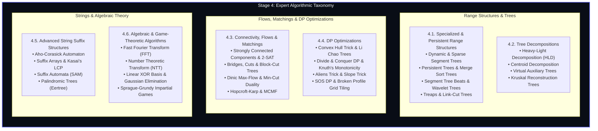

import { Callout } from "fumadocs-ui/components/callout";
import { Tabs, Tab } from "fumadocs-ui/components/tabs";
import { Steps, Step } from "fumadocs-ui/components/steps";
import { Cards, Card } from "fumadocs-ui/components/card";

Welcome to **Stage 4: Expert** — the apex tier of algorithmic mastery.

In early algorithmic studies, computation is analyzed under an abstract, idealized **Random Access Machine (RAM)** model with elementary constraints. Stage 4 dismantles those simplifications. Here, you master the theoretical and competitive paradigms engineered for international olympiads (IOI), collegiate world finals (ICPC), and real-time distributed analytical engines.

---

## The Six Expert Algorithmic Domains

The diagram below maps the taxonomy across all six expert algorithmic domains:

---

## Curriculum Categories

<Cards>
  <Card
    title="4.1. Specialized & Persistent Range Structures"
    href="/docs/dsa/04-expert/specialized-and-persistent-range-structures"
    description="Dynamic and sparse segment trees, versioned persistent trees, merge sort trees, segment tree beats, wavelet trees, sqrt decomposition, Mo's algorithm, treaps, and link-cut trees."
  />
  <Card
    title="4.2. Tree Decompositions"
    href="/docs/dsa/04-expert/tree-decompositions"
    description="Heavy-Light Decomposition (HLD) for path queries, Centroid Decomposition for path distances, Virtual Trees for LCA-compressed subsets, and Kruskal Reconstruction Trees."
  />
  <Card
    title="4.3. Connectivity, Flows & Matchings"
    href="/docs/dsa/04-expert/connectivity-flows-and-matchings"
    description="Kosaraju & Tarjan SCC, 2-SAT solvers, bridges & articulation points, block-cut trees, Dinic's blocking flow, Hopcroft-Karp bipartite matching, MCMF, and offline dynamic connectivity."
  />
  <Card
    title="4.4. Dynamic Programming Optimizations"
    href="/docs/dsa/04-expert/dynamic-programming-optimizations"
    description="Convex Hull Trick, Li Chao Trees, Divide & Conquer DP, Knuth's quadrangle inequality, Aliens Trick Lagrangian relaxation, Slope Trick, SOS DP, and Broken Profile DP."
  />
  <Card
    title="4.5. Advanced String Suffix Structures"
    href="/docs/dsa/04-expert/advanced-string-suffix-structures"
    description="Aho-Corasick multi-pattern automaton, Suffix Arrays with linear-time Kasai LCP, minimal Suffix Automata (SAM), and Palindromic Trees (Eertree)."
  />
  <Card
    title="4.6. Algebraic & Game-Theoretic Algorithms"
    href="/docs/dsa/04-expert/algebraic-and-game-theoretic-algorithms"
    description="Fast Fourier Transform (FFT) and Number Theoretic Transform (NTT) polynomial multiplication, Linear XOR Basis over F_2, Gaussian elimination, and Sprague-Grundy theorem."
  />
  <Card
    title="Expert Algorithmic Quick Reference"
    href="/docs/dsa/04-expert/quick-reference"
    description="Comprehensive cheat sheet of formulas, asymptotic complexities, optimization preconditions, and template architectures."
  />
</Cards>
