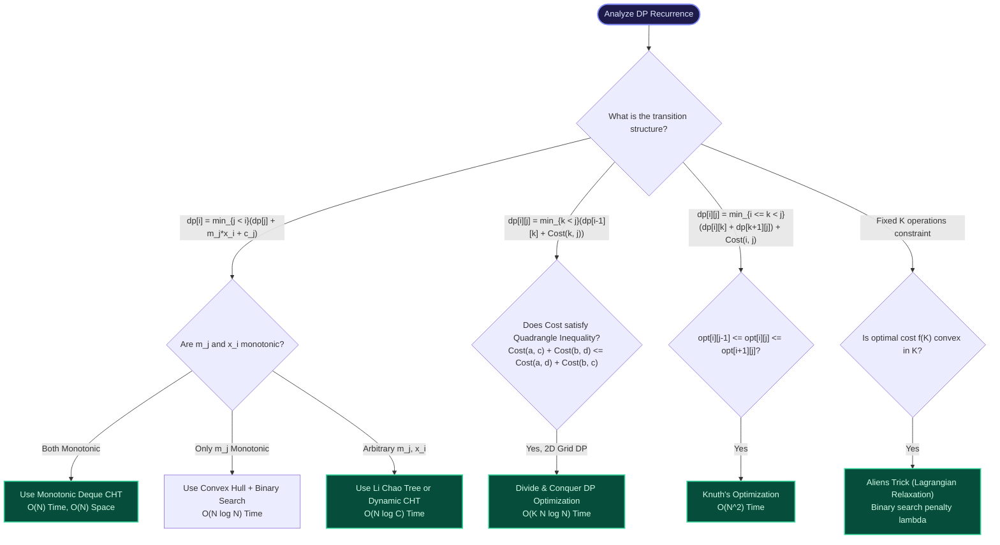
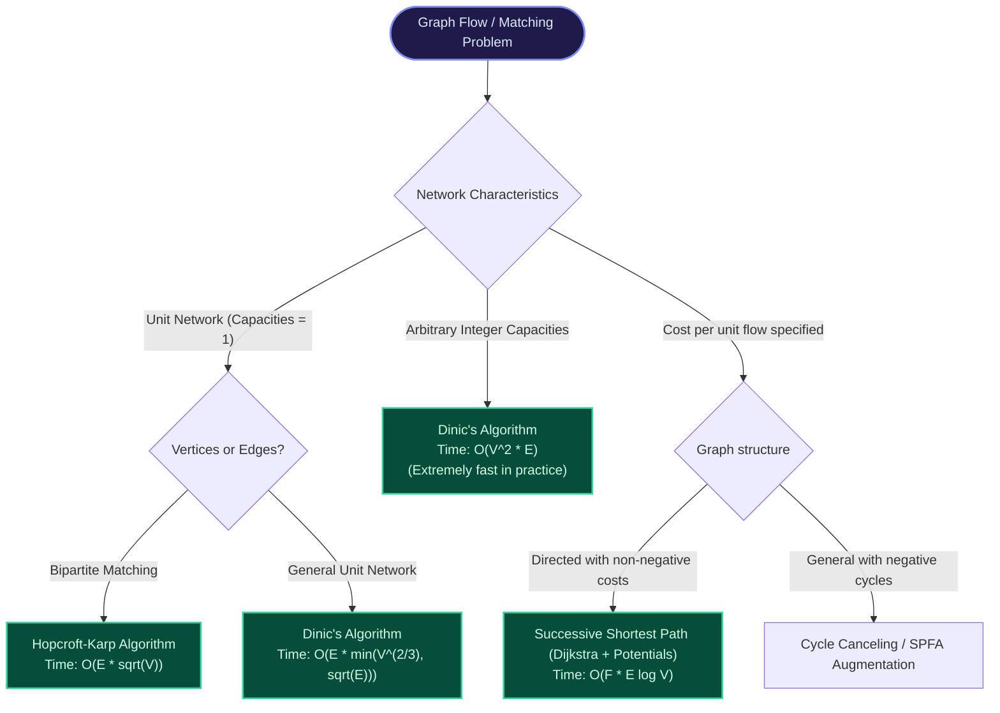

import { Callout } from "fumadocs-ui/components/callout";
import { Tabs, Tab } from "fumadocs-ui/components/tabs";
import { Steps, Step } from "fumadocs-ui/components/steps";
import { Cards, Card } from "fumadocs-ui/components/card";

This quick-reference guide serves as your authoritative reference for competitive programming, advanced system design, and algorithmic problem-solving across all six Expert domains.

---

## 1. Domain Complexity & Invariant Matrix

| Domain / Algorithm          | Primary Operation                                      | Time Complexity                         | Space Complexity        | Key Mathematical Invariant / Precondition                                         |
| :-------------------------- | :----------------------------------------------------- | :-------------------------------------- | :---------------------- | :-------------------------------------------------------------------------------- | ---- | --- | -------------------- | --- | --- | -------------------------------------------------------- |
| **Dynamic SegTree**         | Point/Range Update & Query                             | $O(\log C)$ per query                   | $O(Q \log C)$ nodes     | Range coordinate $C \le 10^{18}$; lazily allocates children                       |
| **Persistent SegTree**      | Versioned Range Query                                  | $O(\log N)$                             | $O(N \log N)$ total     | Path copying preserves historical versions immutably                              |
| **Merge Sort Tree**         | Range Rank / Frequency                                 | $O(\log^2 N)$ query                     | $O(N \log N)$           | Each node contains sorted vectors; binary search per node                         |
| **Segment Tree Beats**      | Range Min/Max Clipping                                 | $O((N+Q) \log N)$                       | $O(N)$                  | Maintains max, strict second max, and count of max values                         |
| **Wavelet Tree**            | Range Quantile / Rank / Select                         | $O(\log \Sigma)$ query                  | $O(N \log \Sigma)$      | Alphabet bisection via bit vectors and rank structures                            |
| **Mo's Algorithm**          | Offline Range Queries                                  | $O((N+Q)\sqrt{N})$                      | $O(N + Q)$              | Block size $B = N / \sqrt{Q}$; odd/even block sorting or Hilbert curve            |
| **Implicit Treap**          | Sequence Split & Merge                                 | $O(\log N)$ expected                    | $O(N)$                  | BST on sequence index, Max-Heap on random priorities                              |
| **Link-Cut Tree**           | Link, Cut, Path Query                                  | $O(\log N)$ amortized                   | $O(N)$                  | Splay trees over preferred paths in dynamic forest                                |
| **Heavy-Light Decomp**      | Path Update & Query                                    | $O(\log^2 N)$                           | $O(N)$                  | Any root-to-node path intersects $\le \log_2 N$ light edges                       |
| **Centroid Decomp**         | Tree Distance / Paths                                  | $O(N \log N)$ total                     | $O(N \log N)$           | Centroid removal divides tree into components of size $\le N/2$                   |
| **Virtual Tree**            | Auxiliary Tree on $K$ nodes                            | $O(K \log K)$                           | $O(K)$                  | Preserves pairwise LCAs for marked subset using DFS entry order                   |
| **Kruskal Reconstruction**  | Bottleneck Capacity Query                              | $O(\log N)$                             | $O(N)$                  | Binary tree where internal node represents merged edge weight                     |
| **Tarjan / Kosaraju SCC**   | Find Maximal SCCs                                      | $O(V + E)$                              | $O(V + E)$              | Directed cycle condensation yields a DAG                                          |
| **2-SAT Solver**            | Satisfiability of 2-CNF                                | $O(V + E)$                              | $O(V + E)$              | Satisfiable iff $x$ and $\neg x$ belong to distinct SCCs                          |
| **Bridges & Articulations** | Critical Graph Failures                                | $O(V + E)$                              | $O(V + E)$              | Bridge: $low[v] > disc[u]$; Cut: $low[v] \ge disc[u]$ (non-root)                  |
| **Block-Cut Tree**          | Biconnected Tree Skeleton                              | $O(V + E)$                              | $O(V + E)$              | Alternating tree of cut vertices and 2-connected blocks                           |
| **Dinic's Algorithm**       | Maximum Network Flow                                   | $O(V^2 E)$ general, $O(E\sqrt{V})$ unit | $O(V + E)$              | BFS level graph + DFS blocking flows along admissible edges                       |
| **Hopcroft-Karp**           | Max Bipartite Matching                                 | $O(E \sqrt{V})$                         | $O(V + E)$              | Multi-source BFS discovers shortest augmenting paths                              |
| **Min-Cost Max-Flow**       | Min Cost Flow                                          | $O(F \cdot E \log V)$                   | $O(V + E)$              | Reduced cost potentials: $cost^\pi(u,v) = cost(u,v) + \pi(u) - \pi(v) \ge 0$      |
| **Offline Dyn. Connec.**    | Add/Del Edge + Query                                   | $O(Q \log Q \log V)$                    | $O(V + Q \log Q)$       | Time interval segment tree + DSU with size rollback                               |
| **Convex Hull Trick**       | $dp[i] = \min(dp[j] + m_j x_i + c_j)$                  | $O(N)$ sorted, $O(N \log N)$ general    | $O(N)$                  | Monotonic slopes / queries; upper/lower line envelope                             |
| **Li Chao Tree**            | Insert Line & Point Min/Max                            | $O(\log C)$ per op                      | $O(C)$ or $O(Q \log C)$ | Segment tree maintaining dominant segment at midpoint                             |
| **D&C DP Optimization**     | $dp[i][j] = \min_{k} \{dp[i-1][k] + C(k, j)\}$         | $O(K N \log N)$                         | $O(K N)$                | Quadrangle monotonicity: $opt[i][j] \le opt[i][j+1]$                              |
| **Knuth's Optimization**    | $dp[i][j] = \min_{k} \{dp[i][k] + dp[k][j]\} + C(i,j)$ | $O(N^2)$                                | $O(N^2)$                | Quadrangle inequality: $opt[i][j-1] \le opt[i][j] \le opt[i+1][j]$                |
| **Aliens Trick**            | Exact $K$ constraints                                  | $O(N \log(\text{Range}))$               | $O(N)$                  | Cost function $f(k)$ is strictly convex; binary search penalty $\lambda$          |
| **Slope Trick**             | Min of convex piecewise linear                         | $O(N \log N)$                           | $O(N)$                  | Maintain slope change inflection points via priority queues                       |
| **SOS DP**                  | Submask Sum $\sum_{sub \subseteq mask} A[sub]$         | $O(N \cdot 2^N)$                        | $O(2^N)$                | Prefix DP over bit dimensions $0 \le i < N$                                       |
| **Broken Profile DP**       | Grid tiling / Hamiltonian paths                        | $O(N M 2^M)$                            | $O(2^M)$                | Contour profile across current column frontier                                    |
| **Aho-Corasick**            | Multi-Pattern Dictionary Match                         | $O(\sum                                 | P_i                     | +                                                                                 | Text | )$  | $O(\Sigma \cdot \sum | P_i | )$  | Trie + KMP failure links + dictionary suffix match links |
| **Suffix Array + Kasai**    | Sorted Suffixes & LCP                                  | $O(N \log N)$ + $O(N)$                  | $O(N)$                  | Doubling prefix sorting + Kasai's theorem ($LCP[rank[i]] \ge LCP[rank[i-1]] - 1$) |
| **Suffix Automata (SAM)**   | Minimal All-Substring DAWG                             | $O(N)$ time & space                     | $O(N \cdot \Sigma)$     | At most $2N - 1$ states, $3N - 4$ transitions                                     |
| **Palindromic Tree**        | Distinct Palindromes                                   | $O(N)$ time & space                     | $O(N \cdot \Sigma)$     | Two roots (length $-1$ and $0$) with suffix palindrome transitions                |
| **FFT / NTT**               | Polynomial Multiplication                              | $O(N \log N)$                           | $O(N)$                  | Cooley-Tukey bit reversal; complex roots vs modulo 998244353                      |
| **Linear XOR Basis**        | Max XOR Subset Sum                                     | $O(B)$ per insert                       | $O(B)$ where $B = 64$   | High-bit triangular basis over vector space $\mathbb{F}_2^B$                      |
| **Sprague-Grundy**          | Impartial Game Equivalence                             | $O(\text{Transitions})$                 | $O(\text{States})$      | $G(v) = mex(\{G(u) : v \to u\})$; Combined games via XOR sum                      |

---

## 2. Dynamic Programming Monotonicity Decision Flowchart

---

## 3. Network Flow & Matching Algorithm Selector

