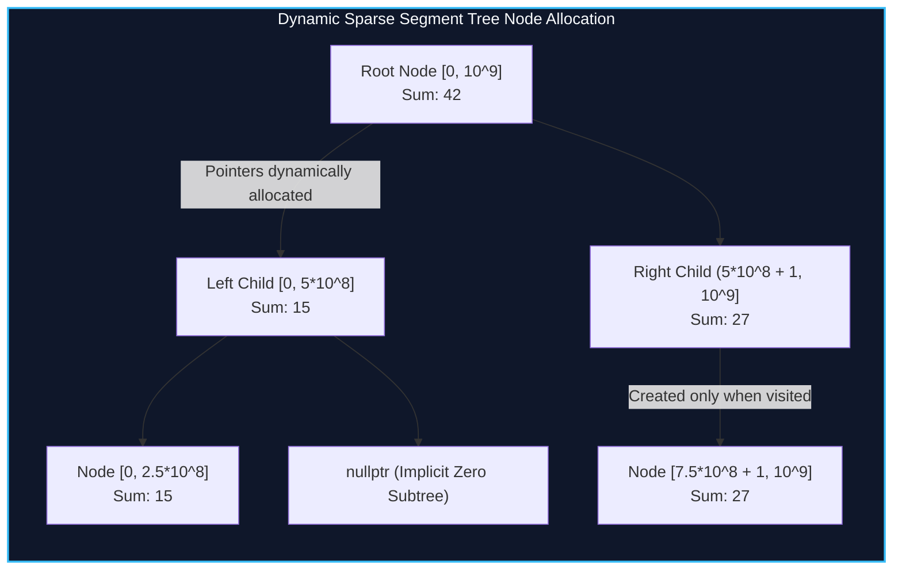

import { Callout } from "fumadocs-ui/components/callout";
import { Tabs, Tab } from "fumadocs-ui/components/tabs";
import { Steps, Step } from "fumadocs-ui/components/steps";
import { Cards, Card } from "fumadocs-ui/components/card";

## The Curse of Coordinate Scale

Traditional array-backed segment trees require contiguous pre-allocation of $4N$ nodes. When modeling problem domains where coordinates represent timestamps, physical spatial coordinates, or 64-bit integer keys:

$$C \in [0, 10^{18}]$$

Pre-allocating an array of size $4 \times 10^{18}$ exceeds all available memory on Earth.

While **offline coordinate compression** works if all $Q$ queries are known before execution, many mission-critical systems—such as real-time financial order books, online collision detection engines, and streaming telemetry aggregators—must answer updates and range queries **interleaved online**.

The **Dynamic (Sparse) Segment Tree** allocates nodes strictly on-demand. If an interval is never queried or updated, its corresponding subtree never exists in physical memory.



---

## Mathematical Foundations & Node Complexity

Let $C$ denote the total size of the coordinate universe (e.g. $10^{18}$ or $10^9$) and $Q$ denote the total number of update operations.

### Height & Node Bounds

1. The height of the segment tree is exactly:
   $$H = \lceil \log_2(C) \rceil$$
2. Each point update descends along exactly one path from root to leaf, allocating at most:
   $$\Delta V \le \lceil \log_2(C) \rceil + 1 \text{ new nodes}$$
3. For $Q$ updates, the maximum number of allocated nodes is bounded strictly by:
   $$V_{\max} \le Q \cdot (\lceil \log_2(C) \rceil + 1) + 1$$
   For $C = 10^9$, $\log_2(10^9) \approx 30$. With $Q = 10^5$, total nodes created $\le 3 \times 10^6$, comfortably fitting in under 64 MB of RAM.

---

## Implementation

<Tabs items={["Python", "TypeScript", "C++"]}>
<Tab value="Python">
```python
from typing import Optional

class SparseNode:
**slots** = ('left', 'right', 'val', 'lazy')
def **init**(self):
self.left: Optional['SparseNode'] = None
self.right: Optional['SparseNode'] = None
self.val: int = 0
self.lazy: int = 0

class DynamicSegmentTree: # Dynamic segment tree supporting range addition and range sum queries # over an arbitrary coordinate space [0, 10^18].
def **init**(self, low: int, high: int):
self.low = low
self.high = high
self.root = SparseNode()

    def _push_down(self, node: SparseNode, l: int, r: int):
        if node.lazy == 0 or l == r:
            return
        mid = l + (r - l) // 2
        if not node.left:
            node.left = SparseNode()
        if not node.right:
            node.right = SparseNode()

        # Propagate lazy tag
        node.left.lazy += node.lazy
        node.left.val += node.lazy * (mid - l + 1)
        node.right.lazy += node.lazy
        node.right.val += node.lazy * (r - mid)
        node.lazy = 0

    def update_range(self, ql: int, qr: int, delta: int):
        self._update(self.root, self.low, self.high, ql, qr, delta)

    def _update(self, node: SparseNode, l: int, r: int, ql: int, qr: int, delta: int):
        if ql <= l and r <= qr:
            node.val += delta * (r - l + 1)
            node.lazy += delta
            return

        self._push_down(node, l, r)
        mid = l + (r - l) // 2

        if ql <= mid:
            if not node.left:
                node.left = SparseNode()
            self._update(node.left, l, mid, ql, qr, delta)
        if qr > mid:
            if not node.right:
                node.right = SparseNode()
            self._update(node.right, mid + 1, r, ql, qr, delta)

        left_val = node.left.val if node.left else 0
        right_val = node.right.val if node.right else 0
        node.val = left_val + right_val

    def query_range(self, ql: int, qr: int) -> int:
        return self._query(self.root, self.low, self.high, ql, qr)

    def _query(self, node: Optional[SparseNode], l: int, r: int, ql: int, qr: int) -> int:
        if not node or ql > r or qr < l:
            return 0
        if ql <= l and r <= qr:
            return node.val

        self._push_down(node, l, r)
        mid = l + (r - l) // 2
        total = 0
        if ql <= mid:
            total += self._query(node.left, l, mid, ql, qr)
        if qr > mid:
            total += self._query(node.right, mid + 1, r, ql, qr)
        return total

````
</Tab>
<Tab value="TypeScript">
```typescript
class SparseNode {
  left: SparseNode | null = null;
  right: SparseNode | null = null;
  val: bigint = 0n;
  lazy: bigint = 0n;
}

export class DynamicSegmentTree {
  private root: SparseNode = new SparseNode();
  constructor(private low: bigint, private high: bigint) {}

  private pushDown(node: SparseNode, l: bigint, r: bigint): void {
    if (node.lazy === 0n || l === r) return;
    const mid = l + (r - l) / 2n;
    if (!node.left) node.left = new SparseNode();
    if (!node.right) node.right = new SparseNode();

    node.left.lazy += node.lazy;
    node.left.val += node.lazy * (mid - l + 1n);
    node.right.lazy += node.lazy;
    node.right.val += node.lazy * (r - mid);
    node.lazy = 0n;
  }

  public updateRange(ql: bigint, qr: bigint, delta: bigint): void {
    this.update(this.root, this.low, this.high, ql, qr, delta);
  }

  private update(node: SparseNode, l: bigint, r: bigint, ql: bigint, qr: bigint, delta: bigint): void {
    if (ql <= l && r <= qr) {
      node.val += delta * (r - l + 1n);
      node.lazy += delta;
      return;
    }

    this.pushDown(node, l, r);
    const mid = l + (r - l) / 2n;

    if (ql <= mid) {
      if (!node.left) node.left = new SparseNode();
      this.update(node.left, l, mid, ql, qr, delta);
    }
    if (qr > mid) {
      if (!node.right) node.right = new SparseNode();
      this.update(node.right, mid + 1n, r, ql, qr, delta);
    }

    node.val = (node.left?.val ?? 0n) + (node.right?.val ?? 0n);
  }

  public queryRange(ql: bigint, qr: bigint): bigint {
    return this.query(this.root, this.low, this.high, ql, qr);
  }

  private query(node: SparseNode | null, l: bigint, r: bigint, ql: bigint, qr: bigint): bigint {
    if (!node || ql > r || qr < l) return 0n;
    if (ql <= l && r <= qr) return node.val;

    this.pushDown(node, l, r);
    const mid = l + (r - l) / 2n;
    let total = 0n;
    if (ql <= mid) total += this.query(node.left, l, mid, ql, qr);
    if (qr > mid) total += this.query(node.right, mid + 1n, r, ql, qr);
    return total;
  }
}
````

</Tab>
<Tab value="C++">
```cpp
#include <iostream>
#include <vector>
#include <cstdint>

class DynamicSegmentTree {
struct Node {
int left = 0;
int right = 0;
int64_t val = 0;
int64_t lazy = 0;
};

    std::vector<Node> tree;
    int64_t low, high;

    int allocateNode() {
        tree.emplace_back();
        return static_cast<int>(tree.size()) - 1;
    }

    void pushDown(int u, int64_t l, int64_t r) {
        if (tree[u].lazy == 0 || l == r) return;
        int64_t mid = l + (r - l) / 2;

        if (!tree[u].left) tree[u].left = allocateNode();
        if (!tree[u].right) tree[u].right = allocateNode();

        int lc = tree[u].left, rc = tree[u].right;
        int64_t lz = tree[u].lazy;

        tree[lc].lazy += lz;
        tree[lc].val += lz * (mid - l + 1);

        tree[rc].lazy += lz;
        tree[rc].val += lz * (r - mid);

        tree[u].lazy = 0;
    }

public:
DynamicSegmentTree(int64_t lowCoord, int64_t highCoord, size_t reserveCapacity = 2000000)
: low(lowCoord), high(highCoord) {
tree.reserve(reserveCapacity);
allocateNode(); // 0 is dummy null node
allocateNode(); // 1 is root
}

    void update(int64_t ql, int64_t qr, int64_t delta) {
        update(1, low, high, ql, qr, delta);
    }

    void update(int u, int64_t l, int64_t r, int64_t ql, int64_t qr, int64_t delta) {
        if (ql <= l && r <= qr) {
            tree[u].val += delta * (r - l + 1);
            tree[u].lazy += delta;
            return;
        }

        pushDown(u, l, r);
        int64_t mid = l + (r - l) / 2;

        if (ql <= mid) {
            if (!tree[u].left) tree[u].left = allocateNode();
            update(tree[u].left, l, mid, ql, qr, delta);
        }
        if (qr > mid) {
            if (!tree[u].right) tree[u].right = allocateNode();
            update(tree[u].right, mid + 1, r, ql, qr, delta);
        }

        int64_t lval = tree[u].left ? tree[tree[u].left].val : 0;
        int64_t rval = tree[u].right ? tree[tree[u].right].val : 0;
        tree[u].val = lval + rval;
    }

    int64_t query(int64_t ql, int64_t qr) {
        return query(1, low, high, ql, qr);
    }

    int64_t query(int u, int64_t l, int64_t r, int64_t ql, int64_t qr) {
        if (!u || ql > r || qr < l) return 0;
        if (ql <= l && r <= qr) return tree[u].val;

        pushDown(u, l, r);
        int64_t mid = l + (r - l) / 2;
        int64_t sum = 0;
        if (ql <= mid) sum += query(tree[u].left, l, mid, ql, qr);
        if (qr > mid) sum += query(tree[u].right, mid + 1, r, ql, qr);
        return sum;
    }

};

```
</Tab>
</Tabs>

---

## Complexity Breakdown

| Metric | Point Update | Range Update (Lazy) | Range Query | Memory Allocation |
| :--- | :--- | :--- | :--- | :--- |
| **Time Complexity** | $\mathcal{O}(\log C)$ | $\mathcal{O}(\log C)$ | $\mathcal{O}(\log C)$ | $\mathcal{O}(1)$ amortized per node |
| **Space Complexity** | $\mathcal{O}(Q \log C)$ | $\mathcal{O}(Q \log C)$ | $\mathcal{O}(1)$ auxiliary | Static node pool `std::vector` eliminates heap thrashing |

---

## Failure Modes & Systems Optimization

1. **Heap Thrashing via `new`/`malloc`:** Calling individual heap allocations inside recursive tree traversals causes CPU cache fragmentation and catastrophic allocator overhead. Always pre-allocate a contiguous memory buffer (`std::vector<Node>` pool or static arena).
2. **Coordinate Overflow in Midpoint:** When coordinates reach $10^{18}$, calculating `(l + r) / 2` overflows signed 64-bit integers if $l + r > 2^{63}-1$. Always compute `mid = l + (r - l) / 2`.
3. **Empty Node Queries:** When querying non-overlapping ranges, explicitly check if the child pointer is null before descending to avoid unnecessary node allocations during read operations.
```
