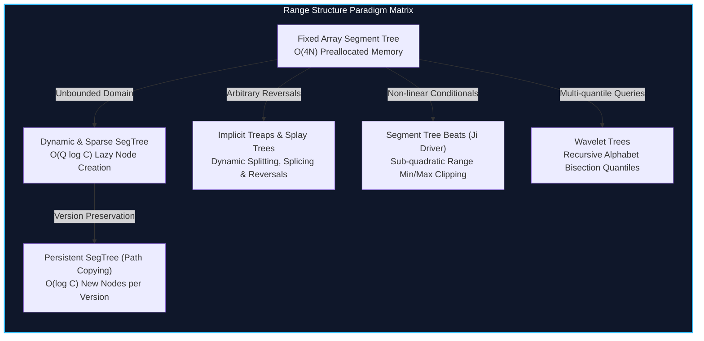

import { Callout } from "fumadocs-ui/components/callout";
import { Tabs, Tab } from "fumadocs-ui/components/tabs";
import { Steps, Step } from "fumadocs-ui/components/steps";
import { Cards, Card } from "fumadocs-ui/components/card";

## The Limits of Classical Range Querying

Standard binary segment trees and Fenwick trees assume a static, pre-allocated coordinate domain $N \in [1, 10^5]$ where all elements exist in contiguous memory. In high-performance systems and competitive informatics, three catastrophic challenges shatter this assumption:

1. **Unbounded Coordinate Ranges ($[0, 10^9]$ or $[-10^{18}, 10^{18}]$):** Allocating $4N$ memory upfront is physically impossible. When queries arrive online without allowing offline coordinate compression, nodes must be instantiated lazily upon traversal.
2. **Temporal and Version Invariance (Persistence):** Historical states must be queried without rolling back modifications. Every write produces a delta version that shares unchanged structural paths with preceding versions.
3. **Dynamic Topology and Splitting:** Range mutations are not limited to arithmetic additions. Arrays must be dynamically split, concatenated, reversed, or transformed under non-associative clipping operations ($A[i] = \min(A[i], X)$).

---

## Category Modules

<Cards>
  <Card
    title="Dynamic and Sparse Segment Trees"
    href="/docs/dsa/04-expert/specialized-and-persistent-range-structures/dynamic-and-sparse-segment-trees"
    description="Lazy node allocation over coordinates up to 10^18 without pre-allocated coordinate compression arrays."
  />
  <Card
    title="Persistent Segment Trees"
    href="/docs/dsa/04-expert/specialized-and-persistent-range-structures/persistent-segment-trees"
    description="Path-copying version trees, answering range k-th smallest queries (Chairman Tree) and temporal point lookups."
  />
  <Card
    title="Merge Sort Trees & 2D Range Queries"
    href="/docs/dsa/04-expert/specialized-and-persistent-range-structures/merge-sort-trees"
    description="Vector-augmented range hierarchies answering fractional cascading rank and 2D orthogonal window queries."
  />
  <Card
    title="Segment Tree Beats"
    href="/docs/dsa/04-expert/specialized-and-persistent-range-structures/segment-tree-beats"
    description="Ji Driver's historic technique: maintaining range min/max and modulo operations in amortized O((N+Q) log N)."
  />
  <Card
    title="Wavelet Trees"
    href="/docs/dsa/04-expert/specialized-and-persistent-range-structures/wavelet-trees"
    description="Succinct alphabet-partitioning data structures supporting rank, select, and quantile queries."
  />
  <Card
    title="Square Root Decomposition"
    href="/docs/dsa/04-expert/specialized-and-persistent-range-structures/square-root-decomposition"
    description="Chunk-based block partitions balancing point updates and block queries in O(sqrt(N)) time."
  />
  <Card
    title="Mo's Algorithm"
    href="/docs/dsa/04-expert/specialized-and-persistent-range-structures/mos-algorithm"
    description="Offline query reordering via Hilbert curves and block coordinate transforms running in O((N+Q) sqrt(N))."
  />
  <Card
    title="Randomized & Implicit Treaps"
    href="/docs/dsa/04-expert/specialized-and-persistent-range-structures/randomized-and-implicit-treaps"
    description="Cartesian trees using randomized heap priorities for O(log N) dynamic sequence insertion, deletion, and split-merge."
  />
  <Card
    title="Splay Trees and Link-Cut Trees"
    href="/docs/dsa/04-expert/specialized-and-persistent-range-structures/splay-and-link-cut-trees"
    description="Self-adjusting amortized binary search trees and Sleator-Tarjan dynamic forests maintaining paths in dynamic graphs."
  />
</Cards>
