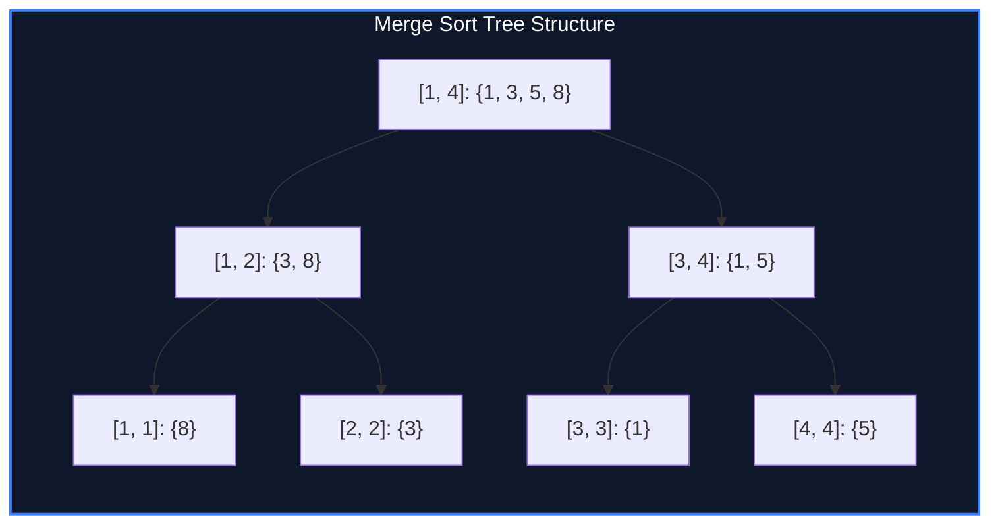

import { Callout } from "fumadocs-ui/components/callout";
import { Tabs, Tab } from "fumadocs-ui/components/tabs";
import { Steps, Step } from "fumadocs-ui/components/steps";
import { Cards, Card } from "fumadocs-ui/components/card";

## The Architectural Challenge of 2D Range Queries

Standard segment trees aggregate associative scalars (e.g., sums, minimums, greatest common divisors). However, queries of the form:

> "How many elements in subarray $A[L \dots R]$ are strictly less than $K$?"

cannot be answered by maintaining a single scalar per segment tree node. Answering this requires knowledge of the **sorted distribution** within every interval.

A **Merge Sort Tree** is a segment tree where each tree node stores a sorted array of all elements within its interval range $[l, r]$.



---

## Space & Time Analysis

### Space Complexity

At level $d$ of the tree, all nodes combined contain exactly $N$ elements. Since a complete binary segment tree has depth $\lceil \log_2 N \rceil + 1$, the total memory footprint across all levels is strictly:

$$\text{Total Elements} = N \cdot (\lceil \log_2 N \rceil + 1) = \Theta(N \log N)$$

### Query Time Complexity

A range query $[L, R]$ decomposes into at most $O(\log N)$ canonical disjoint segment tree nodes. At each node, we binary search (`std::lower_bound`) to count elements $< K$ in $O(\log N)$ time.
$$\text{Total Query Time} = O(\log N) \times O(\log N) = O(\log^2 N)$$

---

## Implementation

<Tabs items={["Python", "TypeScript", "C++"]}>
<Tab value="Python">
```python
import bisect
from typing import List

class MergeSortTree:
def **init**(self, arr: List[int]):
self.n = len(arr)
self.tree = [[] for \_ in range(4 \* self.n)]
self.\_build(arr, 1, 0, self.n - 1)

    def _build(self, arr: List[int], u: int, l: int, r: int):
        if l == r:
            self.tree[u] = [arr[l]]
            return
        mid = l + (r - l) // 2
        lc, rc = 2 * u, 2 * u + 1
        self._build(arr, lc, l, mid)
        self._build(arr, rc, mid + 1, r)

        # Merge sorted child vectors
        left_vec = self.tree[lc]
        right_vec = self.tree[rc]
        merged = []
        i = j = 0
        while i < len(left_vec) and j < len(right_vec):
            if left_vec[i] <= right_vec[j]:
                merged.append(left_vec[i])
                i += 1
            else:
                merged.append(right_vec[j])
                j += 1
        merged.extend(left_vec[i:])
        merged.extend(right_vec[j:])
        self.tree[u] = merged

    def count_less_or_equal(self, ql: int, qr: int, k: int) -> int:
        return self._query(1, 0, self.n - 1, ql, qr, k)

    def _query(self, u: int, l: int, r: int, ql: int, qr: int, k: int) -> int:
        if ql <= l and r <= qr:
            return bisect.bisect_right(self.tree[u], k)
        mid = l + (r - l) // 2
        total = 0
        if ql <= mid:
            total += self._query(2 * u, l, mid, ql, qr, k)
        if qr > mid:
            total += self._query(2 * u + 1, mid + 1, r, ql, qr, k)
        return total

````
</Tab>
<Tab value="TypeScript">
```typescript
export class MergeSortTree {
  private tree: number[][];
  private n: number;

  constructor(arr: number[]) {
    this.n = arr.length;
    this.tree = Array.from({ length: 4 * this.n }, () => []);
    this.build(arr, 1, 0, this.n - 1);
  }

  private build(arr: number[], u: number, l: number, r: number): void {
    if (l === r) {
      this.tree[u] = [arr[l]];
      return;
    }
    const mid = l + ((r - l) >> 1);
    const lc = 2 * u, rc = 2 * u + 1;
    this.build(arr, lc, l, mid);
    this.build(arr, rc, mid + 1, r);

    const leftVec = this.tree[lc], rightVec = this.tree[rc];
    const merged: number[] = [];
    let i = 0, j = 0;
    while (i < leftVec.length && j < rightVec.length) {
      if (leftVec[i] <= rightVec[j]) merged.push(leftVec[i++]);
      else merged.push(rightVec[j++]);
    }
    while (i < leftVec.length) merged.push(leftVec[i++]);
    while (j < rightVec.length) merged.push(rightVec[j++]);
    this.tree[u] = merged;
  }

  public countLessOrEqual(ql: number, qr: number, k: number): number {
    return this.query(1, 0, this.n - 1, ql, qr, k);
  }

  private query(u: number, l: number, r: number, ql: number, qr: number, k: number): number {
    if (ql <= l && r <= qr) {
      return this.binarySearchCount(this.tree[u], k);
    }
    const mid = l + ((r - l) >> 1);
    let total = 0;
    if (ql <= mid) total += this.query(2 * u, l, mid, ql, qr, k);
    if (qr > mid) total += this.query(2 * u + 1, mid + 1, r, ql, qr, k);
    return total;
  }

  private binarySearchCount(vec: number[], k: number): number {
    let l = 0, r = vec.length - 1;
    let ans = 0;
    while (l <= r) {
      const mid = (l + r) >> 1;
      if (vec[mid] <= k) {
        ans = mid + 1;
        l = mid + 1;
      } else {
        r = mid - 1;
      }
    }
    return ans;
  }
}
````

</Tab>
<Tab value="C++">
```cpp
#include <iostream>
#include <vector>
#include <algorithm>

class MergeSortTree {
int n;
std::vector<std::vector<int>> tree;

    void build(const std::vector<int>& arr, int u, int l, int r) {
        if (l == r) {
            tree[u] = {arr[l]};
            return;
        }
        int mid = l + (r - l) / 2;
        int lc = 2 * u, rc = 2 * u + 1;
        build(arr, lc, l, mid);
        build(arr, rc, mid + 1, r);

        tree[u].resize(tree[lc].size() + tree[rc].size());
        std::merge(tree[lc].begin(), tree[lc].end(),
                   tree[rc].begin(), tree[rc].end(),
                   tree[u].begin());
    }

    int query(int u, int l, int r, int ql, int qr, int k) const {
        if (ql <= l && r <= qr) {
            return static_cast<int>(std::upper_bound(tree[u].begin(), tree[u].end(), k) - tree[u].begin());
        }
        int mid = l + (r - l) / 2;
        int count = 0;
        if (ql <= mid) count += query(2 * u, l, mid, ql, qr, k);
        if (qr > mid) count += query(2 * u + 1, mid + 1, r, ql, qr, k);
        return count;
    }

public:
explicit MergeSortTree(const std::vector<int>& arr) : n(static_cast<int>(arr.size())) {
tree.resize(4 \* n);
build(arr, 1, 0, n - 1);
}

    int countLessOrEqual(int ql, int qr, int k) const {
        return query(1, 0, n - 1, ql, qr, k);
    }

};

```
</Tab>
</Tabs>

---

## Complexity Breakdown

| Operation | Time Complexity | Space Complexity |
| :--- | :--- | :--- |
| **Construction** | $\mathcal{O}(N \log N)$ via bottom-up linear merges | $\mathcal{O}(N \log N)$ total elements |
| **Range Frequency ($< K$)** | $\mathcal{O}(\log^2 N)$ without fractional cascading | $\mathcal{O}(1)$ auxiliary memory |
| **Range $k$-th Smallest** | $\mathcal{O}(\log^3 N)$ via binary search over value range | Prefer Chairman Tree for $\mathcal{O}(\log N)$ |
```
