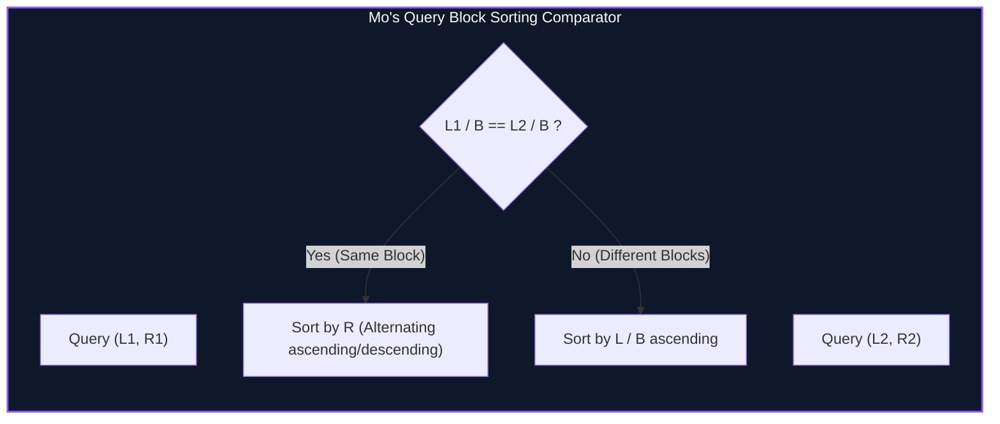

import { Callout } from "fumadocs-ui/components/callout";
import { Tabs, Tab } from "fumadocs-ui/components/tabs";
import { Steps, Step } from "fumadocs-ui/components/steps";
import { Cards, Card } from "fumadocs-ui/components/card";

## Query Reordering over Offline Intervals

When range queries require statistics that cannot be easily subtracted or merged (e.g. counting the number of distinct elements, mode frequency, or non-invertible hash sums), standard trees cannot answer them in $O(\log N)$.

However, if queries are given **offline** (all $Q$ queries are known before producing output), **Mo's Algorithm** allows us to maintain a sliding window $[curL, curR]$ that answers all $Q$ queries by moving pointer endpoints one position at a time:

```python
# Transition primitives
def add(index): ...
def remove(index): ...
```

By reordering the execution sequence of the queries, the total movement of the $curL$ and $curR$ pointers across all queries is minimized to:

$$\mathcal{O}((N + Q)\sqrt{N})$$



---

## Complexity Analysis & Optimal Block Size

Let $B$ be the block size.

1. **Right Pointer ($curR$) Movement:**
   Within a fixed block of $L$, queries are sorted in ascending order of $R$. Across all queries in that block, $curR$ moves at most $N$ steps. Since there are $N / B$ blocks:
   $$\text{Total } curR \text{ moves} \le \frac{N}{B} \cdot N = \frac{N^2}{B}$$
2. **Left Pointer ($curL$) Movement:**
   Between consecutive queries in the same block, $L$ can change by at most $B$ positions. Across all $Q$ queries:
   $$\text{Total } curL \text{ moves} \le Q \cdot B$$

Summing both costs:
$$T(N, Q) = \mathcal{O}\left(\frac{N^2}{B} + Q \cdot B\right)$$

Setting $\frac{N^2}{B} = Q \cdot B \implies B = \frac{N}{\sqrt{Q}}$. When $N \approx Q$, $B = \sqrt{N}$, yielding:
$$T = \mathcal{O}((N + Q)\sqrt{N})$$

---

## Implementation

<Tabs items={["Python", "TypeScript", "C++"]}>
<Tab value="Python">
```python
import math
from typing import List, Tuple

def mos_algorithm(arr: List[int], queries: List[Tuple[int, int]]) -> List[int]:
n = len(arr)
q = len(queries)
if q == 0:
return []

    block_size = max(1, int(n / math.sqrt(q)))

    # Store query with original index
    indexed_queries = [(ql, qr, i) for i, (ql, qr) in enumerate(queries)]

    # Sort queries: primary key = L // B; secondary key = R
    indexed_queries.sort(
        key=lambda x: (x[0] // block_size, x[1] if (x[0] // block_size) % 2 == 0 else -x[1])
    )

    freq = {}
    distinct_count = 0
    cur_l = 0
    cur_r = -1
    ans = [0] * q

    def add(idx: int):
        nonlocal distinct_count
        val = arr[idx]
        c = freq.get(val, 0)
        if c == 0:
            distinct_count += 1
        freq[val] = c + 1

    def remove(idx: int):
        nonlocal distinct_count
        val = arr[idx]
        c = freq[val]
        if c == 1:
            distinct_count -= 1
        freq[val] = c - 1

    for ql, qr, original_idx in indexed_queries:
        while cur_l > ql:
            cur_l -= 1
            add(cur_l)
        while cur_r < qr:
            cur_r += 1
            add(cur_r)
        while cur_l < ql:
            remove(cur_l)
            cur_l += 1
        while cur_r > qr:
            remove(cur_r)
            cur_r -= 1

        ans[original_idx] = distinct_count

    return ans

````
</Tab>
<Tab value="TypeScript">
```typescript
interface Query {
  l: number;
  r: number;
  id: number;
}

export function mosAlgorithm(arr: number[], queries: [number, number][]): number[] {
  const n = arr.length;
  const q = queries.length;
  if (q === 0) return [];

  const blockSize = Math.max(1, Math.floor(n / Math.sqrt(q)));
  const qList: Query[] = queries.map(([l, r], id) => ({ l, r, id }));

  qList.sort((a, b) => {
    const bA = Math.floor(a.l / blockSize);
    const bB = Math.floor(b.l / blockSize);
    if (bA !== bB) return bA - bB;
    return bA % 2 === 0 ? a.r - b.r : b.r - a.r;
  });

  const freq = new Map<number, number>();
  let distinctCount = 0;
  let curL = 0;
  let curR = -1;
  const ans: number[] = new Array(q).fill(0);

  const add = (idx: number) => {
    const val = arr[idx];
    const c = freq.get(val) ?? 0;
    if (c === 0) distinctCount++;
    freq.set(val, c + 1);
  };

  const remove = (idx: number) => {
    const val = arr[idx];
    const c = freq.get(val)!;
    if (c === 1) distinctCount--;
    freq.set(val, c - 1);
  };

  for (const query of qList) {
    while (curL > query.l) add(--curL);
    while (curR < query.r) add(++curR);
    while (curL < query.l) remove(curL++);
    while (curR > query.r) remove(curR--);

    ans[query.id] = distinctCount;
  }

  return ans;
}
````

</Tab>
<Tab value="C++">
```cpp
#include <iostream>
#include <vector>
#include <cmath>
#include <algorithm>

struct Query {
int l, r, id, block;
bool operator<(const Query& other) const {
if (block != other.block) return block < other.block;
return (block & 1) ? (r < other.r) : (r > other.r);
}
};

std::vector<int> mosAlgorithm(const std::vector<int>& arr, const std::vector<std::pair<int, int>>& queries) {
int n = static_cast<int>(arr.size());
int q = static_cast<int>(queries.size());
if (q == 0) return {};

    int blockSize = std::max(1, static_cast<int>(n / std::sqrt(q)));
    std::vector<Query> qList(q);
    for (int i = 0; i < q; ++i) {
        qList[i] = {queries[i].first, queries[i].second, i, queries[i].first / blockSize};
    }

    std::sort(qList.begin(), qList.end());

    // Assuming values are coordinate-compressed or bounded within 1e6
    static int freq[1000005];
    int distinctCount = 0;
    int curL = 0, curR = -1;
    std::vector<int> ans(q);

    auto add = [&](int idx) {
        int val = arr[idx];
        if (++freq[val] == 1) distinctCount++;
    };

    auto remove = [&](int idx) {
        int val = arr[idx];
        if (--freq[val] == 0) distinctCount--;
    };

    for (const auto& query : qList) {
        while (curL > query.l) add(--curL);
        while (curR < query.r) add(++curR);
        while (curL < query.l) remove(curL++);
        while (curR > query.r) remove(curR--);

        ans[query.id] = distinctCount;
    }

    return ans;

}

```
</Tab>
</Tabs>

---

## Hilbert Curve Sorting Optimization

While block sorting achieves $O(N \sqrt{Q})$, ordering queries along a **2D Hilbert Space-Filling Curve** reduces pointer oscillation constants by an additional $30\% - 40\%$, smoothing transitions across neighboring quadrant blocks.
```
