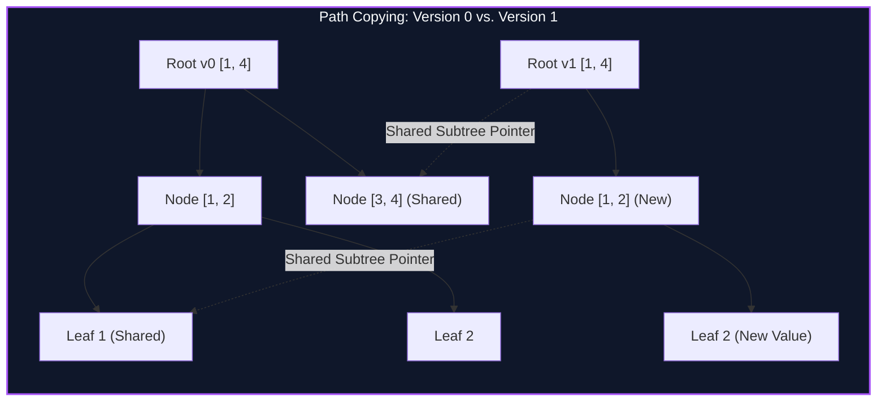

import { Callout } from "fumadocs-ui/components/callout";
import { Tabs, Tab } from "fumadocs-ui/components/tabs";
import { Steps, Step } from "fumadocs-ui/components/steps";
import { Cards, Card } from "fumadocs-ui/components/card";

## The Need for Temporal Structural Invariance

In classical imperative data structures, an update destructively mutates existing memory, erasing historical states. In multi-version concurrency control (MVCC), git-like revision control, and historical range statistics, we require **full persistence**: the ability to query any historical version $t \in [0, T]$ and spawn new branches without duplicating the entire tree.

A naive copy of an entire segment tree of size $N$ requires $O(N)$ time and memory per update. Over $Q$ updates, this yields prohibitive $O(Q \cdot N)$ memory.

The **Persistent Segment Tree** uses **path copying**: an update at index $k$ only changes $\lceil \log_2 N \rceil$ nodes along the path from the root to the leaf. All other subtrees remain unchanged and are shared directly with previous versions via immutable pointers.



---

## Chairman Tree: Range K-th Smallest Query

One of the most famous applications of persistent segment trees is the **Chairman Tree** (named after its inventor HJT).

### Problem Formulation

Given an array $A[1 \dots N]$ of arbitrary integers, answer queries of the form:

> "What is the $k$-th smallest element in subarray $A[L \dots R]$?"

### Algorithmic Insight

1. Coordinate-compress all unique values in $A$ to the rank range $[1, M]$.
2. Build a sequence of persistent segment trees $T_0, T_1, \dots, T_N$, where $T_i$ represents the frequency count segment tree of the prefix $A[1 \dots i]$.
3. Since segment trees are additive, the frequency segment tree of the exact range $A[L \dots R]$ is given by:
   $$\text{Count}(T_{L \dots R}) = T_R - T_{L-1}$$
4. To find the $k$-th smallest element in $[L, R]$, traverse down both trees $T_R$ and $T_{L-1}$ simultaneously:
   - Calculate `count_left = T_R.left.val - T_{L-1}.left.val`.
   - If $k \le \text{count_left}$, the target element resides in the left subtree.
   - Otherwise, the target is in the right subtree at rank $k - \text{count_left}$.

---

## Implementation

<Tabs items={["Python", "TypeScript", "C++"]}>
<Tab value="Python">
```python
from typing import List
import bisect

class PersistentNode:
**slots** = ('left', 'right', 'count')
def **init**(self, count: int = 0, left=None, right=None):
self.count = count
self.left = left
self.right = right

class ChairmanTree:
def **init**(self, arr: List[int]):
self.n = len(arr)
self.sorted_vals = sorted(list(set(arr)))
self.m = len(self.sorted_vals)
self.roots = [self._build_empty(1, self.m)]

        for val in arr:
            rank = bisect.bisect_left(self.sorted_vals, val) + 1
            new_root = self._insert(self.roots[-1], 1, self.m, rank)
            self.roots.append(new_root)

    def _build_empty(self, l: int, r: int) -> PersistentNode:
        if l == r:
            return PersistentNode(0)
        mid = l + (r - l) // 2
        return PersistentNode(0, self._build_empty(l, mid), self._build_empty(mid + 1, r))

    def _insert(self, prev: PersistentNode, l: int, r: int, pos: int) -> PersistentNode:
        node = PersistentNode(prev.count + 1)
        if l == r:
            return node
        mid = l + (r - l) // 2
        if pos <= mid:
            node.right = prev.right
            node.left = self._insert(prev.left, l, mid, pos)
        else:
            node.left = prev.left
            node.right = self._insert(prev.right, mid + 1, r, pos)
        return node

    def query_kth(self, left_idx: int, right_idx: int, k: int) -> int:
        # 1-based indices left_idx, right_idx for subarray arr[left_idx-1 : right_idx].
        rank = self._query(self.roots[left_idx - 1], self.roots[right_idx], 1, self.m, k)
        return self.sorted_vals[rank - 1]

    def _query(self, u: PersistentNode, v: PersistentNode, l: int, r: int, k: int) -> int:
        if l == r:
            return l
        mid = l + (r - l) // 2
        left_count = v.left.count - u.left.count
        if k <= left_count:
            return self._query(u.left, v.left, l, mid, k)
        else:
            return self._query(u.right, v.right, mid + 1, r, k - left_count)

````
</Tab>
<Tab value="TypeScript">
```typescript
class PNode {
  constructor(
    public count: number = 0,
    public left: PNode | null = null,
    public right: PNode | null = null
  ) {}
}

export class ChairmanTree {
  private sortedVals: number[];
  private roots: PNode[] = [];
  private m: number;

  constructor(arr: number[]) {
    this.sortedVals = Array.from(new Set(arr)).sort((a, b) => a - b);
    this.m = this.sortedVals.length;

    this.roots.push(this.buildEmpty(1, this.m));

    for (const val of arr) {
      const rank = this.binarySearch(val) + 1;
      const prevRoot = this.roots[this.roots.length - 1];
      this.roots.push(this.insert(prevRoot, 1, this.m, rank));
    }
  }

  private binarySearch(target: number): number {
    let l = 0, r = this.sortedVals.length - 1;
    while (l <= r) {
      const mid = (l + r) >> 1;
      if (this.sortedVals[mid] === target) return mid;
      if (this.sortedVals[mid] < target) l = mid + 1;
      else r = mid - 1;
    }
    return l;
  }

  private buildEmpty(l: number, r: number): PNode {
    if (l === r) return new PNode(0);
    const mid = l + ((r - l) >> 1);
    return new PNode(0, this.buildEmpty(l, mid), this.buildEmpty(mid + 1, r));
  }

  private insert(prev: PNode, l: number, r: number, pos: number): PNode {
    const node = new PNode(prev.count + 1);
    if (l === r) return node;
    const mid = l + ((r - l) >> 1);
    if (pos <= mid) {
      node.right = prev.right;
      node.left = this.insert(prev.left!, l, mid, pos);
    } else {
      node.left = prev.left;
      node.right = this.insert(prev.right!, mid + 1, r, pos);
    }
    return node;
  }

  public queryKth(leftIdx: number, rightIdx: number, k: number): number {
    const u = this.roots[leftIdx - 1];
    const v = this.roots[rightIdx];
    const rank = this.query(u, v, 1, this.m, k);
    return this.sortedVals[rank - 1];
  }

  private query(u: PNode, v: PNode, l: number, r: number, k: number): number {
    if (l === r) return l;
    const mid = l + ((r - l) >> 1);
    const leftCount = (v.left?.count ?? 0) - (u.left?.count ?? 0);
    if (k <= leftCount) {
      return this.query(u.left!, v.left!, l, mid, k);
    } else {
      return this.query(u.right!, v.right!, mid + 1, r, k - leftCount);
    }
  }
}
````

</Tab>
<Tab value="C++">
```cpp
#include <iostream>
#include <vector>
#include <algorithm>

class ChairmanTree {
struct Node {
int left = 0;
int right = 0;
int count = 0;
};

    std::vector<Node> tree;
    std::vector<int> roots;
    std::vector<int> sortedVals;
    int n, m;

    int allocateNode() {
        tree.emplace_back();
        return static_cast<int>(tree.size()) - 1;
    }

    int buildEmpty(int l, int r) {
        int u = allocateNode();
        if (l == r) return u;
        int mid = l + (r - l) / 2;
        tree[u].left = buildEmpty(l, mid);
        tree[u].right = buildEmpty(mid + 1, r);
        return u;
    }

    int insert(int prev, int l, int r, int pos) {
        int u = allocateNode();
        tree[u] = tree[prev];
        tree[u].count++;
        if (l == r) return u;

        int mid = l + (r - l) / 2;
        if (pos <= mid) {
            tree[u].left = insert(tree[prev].left, l, mid, pos);
        } else {
            tree[u].right = insert(tree[prev].right, mid + 1, r, pos);
        }
        return u;
    }

    int query(int u, int v, int l, int r, int k) {
        if (l == r) return l;
        int mid = l + (r - l) / 2;
        int leftCount = tree[tree[v].left].count - tree[tree[u].left].count;
        if (k <= leftCount) {
            return query(tree[u].left, tree[v].left, l, mid, k);
        } else {
            return query(tree[u].right, tree[v].right, mid + 1, r, k - leftCount);
        }
    }

public:
ChairmanTree(const std::vector<int>& arr) {
n = static_cast<int>(arr.size());
sortedVals = arr;
std::sort(sortedVals.begin(), sortedVals.end());
sortedVals.erase(std::unique(sortedVals.begin(), sortedVals.end()), sortedVals.end());
m = static_cast<int>(sortedVals.size());

        tree.reserve(n * 25 + 4 * m);
        roots.push_back(buildEmpty(1, m));

        for (int x : arr) {
            int rank = static_cast<int>(std::lower_bound(sortedVals.begin(), sortedVals.end(), x) - sortedVals.begin()) + 1;
            int newRoot = insert(roots.back(), 1, m, rank);
            roots.push_back(newRoot);
        }
    }

    int queryKth(int leftIdx, int rightIdx, int k) {
        int u = roots[leftIdx - 1];
        int v = roots[rightIdx];
        int rank = query(u, v, 1, m, k);
        return sortedVals[rank - 1];
    }

};

```
</Tab>
</Tabs>

---

## Complexity Breakdown

| Metric | Initialization | Path-Copying Insert | Subarray $k$-th Query | Space per Version |
| :--- | :--- | :--- | :--- | :--- |
| **Time Complexity** | $\mathcal{O}(N \log N)$ | $\mathcal{O}(\log M)$ | $\mathcal{O}(\log M)$ | $\mathcal{O}(\log M)$ |
| **Space Complexity** | $\mathcal{O}(M)$ initial | $\mathcal{O}(N \log M)$ total | $\mathcal{O}(1)$ auxiliary | Exactly $\lceil \log_2 M \rceil + 1$ new nodes per update |
```
