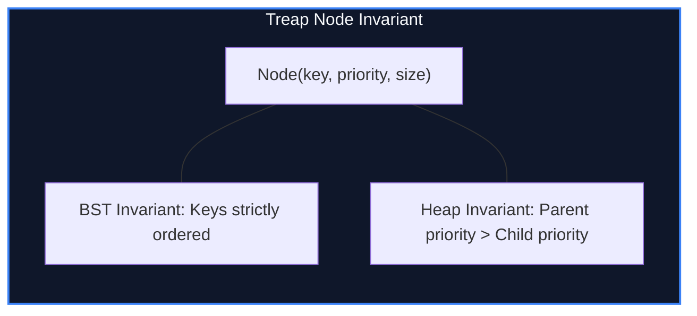

import { Callout } from "fumadocs-ui/components/callout";
import { Tabs, Tab } from "fumadocs-ui/components/tabs";
import { Steps, Step } from "fumadocs-ui/components/steps";
import { Cards, Card } from "fumadocs-ui/components/card";

## The Synthesis of Binary Search Trees & Heaps

A standard Binary Search Tree (BST) can degenerate into a linked list with $O(N)$ height under adversarial sorted inputs. Red-Black and AVL trees guarantee $O(\log N)$ balance, but implementing rotations during arbitrary range splits and concatenations is notoriously intricate.

A **Treap** (Tree + Heap), invented by Raimund Seidel and Cecilia R. Aragon in 1989, provides guaranteed $O(\log N)$ expected height through a dual invariant:

1. **BST Property on Keys:** For any node $u$, $\text{left.key} < u.\text{key} < \text{right.key}$.
2. **Heap Property on Priorities:** For any node $u$, $u.\text{priority} > \text{left.priority}$ and $u.\text{priority} > \text{right.priority}$, where priorities are assigned uniformly at random from a large integer space.



---

## The Power of Implicit Treaps (Array without Keys)

In an **Implicit Treap**, the explicit search key is eliminated entirely. Instead, a node's key is defined **implicitly by the number of nodes preceding it in an in-order traversal**:

$$\text{Implicit Key}(u) = \text{Size}(u.\text{left}) + 1$$

This transforms the treap into a dynamic array that supports:

- Split array at index $k$ into two independent arrays in $O(\log N)$.
- Merge two arrays in $O(\log N)$.
- Reverse an arbitrary subarray in $O(\log N)$ using lazy propagation!

---

## Implementation

<Tabs items={["Python", "TypeScript", "C++"]}>
<Tab value="Python">
```python
import random
from typing import Optional, Tuple

class TreapNode:
**slots** = ('val', 'prio', 'size', 'rev', 'left', 'right')
def **init**(self, val: int):
self.val = val
self.prio = random.randint(0, 2\*\*31 - 1)
self.size = 1
self.rev = False
self.left: Optional['TreapNode'] = None
self.right: Optional['TreapNode'] = None

class ImplicitTreap:
def **init**(self):
self.root: Optional[TreapNode] = None

    def _size(self, node: Optional[TreapNode]) -> int:
        return node.size if node else 0

    def _push_up(self, node: Optional[TreapNode]):
        if node:
            node.size = 1 + self._size(node.left) + self._size(node.right)

    def _push_down(self, node: Optional[TreapNode]):
        if node and node.rev:
            node.left, node.right = node.right, node.left
            if node.left:
                node.left.rev = not node.left.rev
            if node.right:
                node.right.rev = not node.right.rev
            node.rev = False

    def split(self, node: Optional[TreapNode], k: int) -> Tuple[Optional[TreapNode], Optional[TreapNode]]:
        # Splits implicit treap into left (k elements) and right (remaining)
        if not node:
            return None, None
        self._push_down(node)
        left_sz = self._size(node.left)
        if left_sz >= k:
            l, r = self.split(node.left, k)
            node.left = r
            self._push_up(node)
            return l, node
        else:
            l, r = self.split(node.right, k - left_sz - 1)
            node.right = l
            self._push_up(node)
            return node, r

    def merge(self, left: Optional[TreapNode], right: Optional[TreapNode]) -> Optional[TreapNode]:
        if not left or not right:
            return left if left else right
        self._push_down(left)
        self._push_down(right)
        if left.prio > right.prio:
            left.right = self.merge(left.right, right)
            self._push_up(left)
            return left
        else:
            right.left = self.merge(left, right.left)
            self._push_up(right)
            return right

    def insert(self, idx: int, val: int):
        l, r = self.split(self.root, idx)
        new_node = TreapNode(val)
        self.root = self.merge(self.merge(l, new_node), r)

    def reverse(self, l_idx: int, r_idx: int):
        # 0-based range [l_idx, r_idx]
        t1, rest = self.split(self.root, l_idx)
        t2, t3 = self.split(rest, r_idx - l_idx + 1)
        if t2:
            t2.rev = not t2.rev
        self.root = self.merge(self.merge(t1, t2), t3)

````
</Tab>
<Tab value="TypeScript">
```typescript
class TreapNode {
  prio: number = Math.random();
  size: number = 1;
  rev: boolean = false;
  left: TreapNode | null = null;
  right: TreapNode | null = null;

  constructor(public val: number) {}
}

export class ImplicitTreap {
  private root: TreapNode | null = null;

  private size(node: TreapNode | null): number {
    return node ? node.size : 0;
  }

  private pushUp(node: TreapNode | null): void {
    if (node) {
      node.size = 1 + this.size(node.left) + this.size(node.right);
    }
  }

  private pushDown(node: TreapNode | null): void {
    if (node && node.rev) {
      const temp = node.left;
      node.left = node.right;
      node.right = temp;
      if (node.left) node.left.rev = !node.left.rev;
      if (node.right) node.right = !node.right.rev;
      node.rev = false;
    }
  }

  public split(node: TreapNode | null, k: number): [TreapNode | null, TreapNode | null] {
    if (!node) return [null, null];
    this.pushDown(node);
    const leftSize = this.size(node.left);
    if (leftSize >= k) {
      const [l, r] = this.split(node.left, k);
      node.left = r;
      this.pushUp(node);
      return [l, node];
    } else {
      const [l, r] = this.split(node.right, k - leftSize - 1);
      node.right = l;
      this.pushUp(node);
      return [node, r];
    }
  }

  public merge(left: TreapNode | null, right: TreapNode | null): TreapNode | null {
    if (!left || !right) return left ?? right;
    this.pushDown(left);
    this.pushDown(right);
    if (left.prio > right.prio) {
      left.right = this.merge(left.right, right);
      this.pushUp(left);
      return left;
    } else {
      right.left = this.merge(left, right.left);
      this.pushUp(right);
      return right;
    }
  }

  public insert(idx: number, val: number): void {
    const [l, r] = this.split(this.root, idx);
    const node = new TreapNode(val);
    this.root = this.merge(this.merge(l, node), r);
  }

  public reverse(lIdx: number, rIdx: number): void {
    const [t1, rest] = this.split(this.root, lIdx);
    const [t2, t3] = this.split(rest, rIdx - lIdx + 1);
    if (t2) t2.rev = !t2.rev;
    this.root = this.merge(this.merge(t1, t2), t3);
  }
}
````

</Tab>
<Tab value="C++">
```cpp
#include <iostream>
#include <random>

struct TreapNode {
int val;
uint32_t prio;
int size = 1;
bool rev = false;
TreapNode *left = nullptr, *right = nullptr;

    explicit TreapNode(int v) : val(v) {
        static std::mt19937 rng(1337);
        prio = rng();
    }

};

class ImplicitTreap {
TreapNode\* root = nullptr;

    int size(TreapNode* t) { return t ? t->size : 0; }

    void pushUp(TreapNode* t) {
        if (t) t->size = 1 + size(t->left) + size(t->right);
    }

    void pushDown(TreapNode* t) {
        if (t && t->rev) {
            std::swap(t->left, t->right);
            if (t->left) t->left->rev ^= true;
            if (t->right) t->right->rev ^= true;
            t->rev = false;
        }
    }

public:
void split(TreapNode* t, int k, TreapNode*& l, TreapNode\*& r) {
if (!t) { l = r = nullptr; return; }
pushDown(t);
if (size(t->left) >= k) {
split(t->left, k, l, t->left);
r = t;
} else {
split(t->right, k - size(t->left) - 1, t->right, r);
l = t;
}
pushUp(t);
}

    void merge(TreapNode*& t, TreapNode* l, TreapNode* r) {
        if (!l || !r) { t = l ? l : r; return; }
        pushDown(l);
        pushDown(r);
        if (l->prio > r->prio) {
            merge(l->right, l->right, r);
            t = l;
        } else {
            merge(r->left, l, r->left);
            t = r;
        }
        pushUp(t);
    }

    void insert(int idx, int val) {
        TreapNode *l = nullptr, *r = nullptr;
        split(root, idx, l, r);
        TreapNode* newNode = new TreapNode(val);
        merge(l, l, newNode);
        merge(root, l, r);
    }

    void reverse(int lIdx, int rIdx) {
        TreapNode *t1 = nullptr, *t2 = nullptr, *t3 = nullptr;
        split(root, lIdx, t1, t2);
        split(t2, rIdx - lIdx + 1, t2, t3);
        if (t2) t2->rev ^= true;
        merge(t1, t1, t2);
        merge(root, t1, t3);
    }

};

```
</Tab>
</Tabs>

---

## Complexity Breakdown

| Operation | Expected Time | Auxiliary Space |
| :--- | :--- | :--- |
| **Split by Key / Size** | $\mathcal{O}(\log N)$ expected | $\mathcal{O}(\log N)$ call stack |
| **Merge Two Treaps** | $\mathcal{O}(\log N)$ expected | $\mathcal{O}(\log N)$ call stack |
| **Range Reversal** | $\mathcal{O}(\log N)$ | $\mathcal{O}(1)$ lazy propagation |
```
