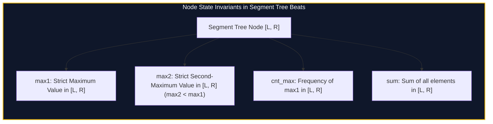

import { Callout } from "fumadocs-ui/components/callout";
import { Tabs, Tab } from "fumadocs-ui/components/tabs";
import { Steps, Step } from "fumadocs-ui/components/steps";
import { Cards, Card } from "fumadocs-ui/components/card";

## The Non-Associative Range Update Barrier

In classical segment trees, lazy tags require updates to be distributive and associative over range aggregations (e.g., addition over sum: $(A_i + v) + (A_j + v) = (A_i + A_j) + 2v$).

However, consider the **Range Chmin** update:
$$A[i] = \min(A[i], X) \quad \forall i \in [L, R]$$

This operation is neither additive nor linear. If an interval contains heterogeneous values, some numbers change while others remain untouched. A naive update would be forced to traverse all the way to the leaves, degenerating into $O(N)$ per operation and $O(Q \cdot N)$ total time.

In 2016, Chinese competitive programmer Ji Ruzhi (**Ji Driver**) introduced **Segment Tree Beats** (also known as the Historical Information Segment Tree), proving that maintaining three specific auxiliary statistics per node reduces the amortized complexity of range chmin/chmax updates to:

$$\mathcal{O}((N + Q) \log N)$$



---

## Ji Driver's Three Branching Conditions

When applying a range chmin update with threshold $X$ to node $u$:

1. **Condition 1 ($X \ge \text{max1}$):**
   Every value in the range is already $\le X$. The update has zero effect. Return immediately (**break condition**).
2. **Condition 2 ($\text{max2} < X < \text{max1}$):**
   Only elements equal to $\text{max1}$ are strictly greater than $X$. They must all be clipped down to $X$. The new sum becomes:
   $$\text{sum} \leftarrow \text{sum} - \text{cnt\_max} \times (\text{max1} - X)$$
   Update $\text{max1} \leftarrow X$, register a lazy tag on this node, and return (**tag condition**).
3. **Condition 3 ($X \le \text{max2}$):**
   Elements equal to $\text{max1}$ and elements equal to $\text{max2}$ (and potentially smaller) are affected differently. The update is non-uniform. Push down lazy tags, recursively update left and right children, and pull up results (**recursion condition**).

Because each execution of Condition 3 strictly decreases the number of distinct values in the segment tree, the total number of non-terminal recursive calls is bounded amortized by $O((N + Q) \log N)$.

---

## Implementation

<Tabs items={["Python", "TypeScript", "C++"]}>
<Tab value="Python">
```python
from typing import List

class SegTreeBeats:
def **init**(self, arr: List[int]):
self.n = len(arr)
self.max1 = [0] _ (4 _ self.n)
self.max2 = [0] _ (4 _ self.n)
self.cnt = [0] _ (4 _ self.n)
self.total = [0] _ (4 _ self.n)
self.lazy = [-1] _ (4 _ self.n)
self.\_build(arr, 1, 0, self.n - 1)

    def _push_up(self, u: int):
        lc, rc = 2 * u, 2 * u + 1
        self.total[u] = self.total[lc] + self.total[rc]
        if self.max1[lc] == self.max1[rc]:
            self.max1[u] = self.max1[lc]
            self.max2[u] = max(self.max2[lc], self.max2[rc])
            self.cnt[u] = self.cnt[lc] + self.cnt[rc]
        elif self.max1[lc] > self.max1[rc]:
            self.max1[u] = self.max1[lc]
            self.max2[u] = max(self.max2[lc], self.max1[rc])
            self.cnt[u] = self.cnt[lc]
        else:
            self.max1[u] = self.max1[rc]
            self.max2[u] = max(self.max1[lc], self.max2[rc])
            self.cnt[u] = self.cnt[rc]

    def _build(self, arr: List[int], u: int, l: int, r: int):
        if l == r:
            self.max1[u] = arr[l]
            self.max2[u] = -float('inf')
            self.cnt[u] = 1
            self.total[u] = arr[l]
            return
        mid = l + (r - l) // 2
        self._build(arr, 2 * u, l, mid)
        self._build(arr, 2 * u + 1, mid + 1, r)
        self._push_up(u)

    def _apply_chmin(self, u: int, x: int):
        if self.max1[u] <= x:
            return
        self.total[u] -= self.cnt[u] * (self.max1[u] - x)
        self.max1[u] = x
        self.lazy[u] = x

    def _push_down(self, u: int):
        if self.lazy[u] == -1:
            return
        self._apply_chmin(2 * u, self.lazy[u])
        self._apply_chmin(2 * u + 1, self.lazy[u])
        self.lazy[u] = -1

    def chmin(self, ql: int, qr: int, x: int):
        self._chmin(1, 0, self.n - 1, ql, qr, x)

    def _chmin(self, u: int, l: int, r: int, ql: int, qr: int, x: int):
        if ql <= l and r <= qr and self.max1[u] <= x:
            return
        if ql <= l and r <= qr and self.max2[u] < x:
            self._apply_chmin(u, x)
            return

        self._push_down(u)
        mid = l + (r - l) // 2
        if ql <= mid:
            self._chmin(2 * u, l, mid, ql, qr, x)
        if qr > mid:
            self._chmin(2 * u + 1, mid + 1, r, ql, qr, x)
        self._push_up(u)

    def query_sum(self, ql: int, qr: int) -> int:
        return self._query_sum(1, 0, self.n - 1, ql, qr)

    def _query_sum(self, u: int, l: int, r: int, ql: int, qr: int) -> int:
        if ql <= l and r <= qr:
            return self.total[u]
        self._push_down(u)
        mid = l + (r - l) // 2
        res = 0
        if ql <= mid:
            res += self._query_sum(2 * u, l, mid, ql, qr)
        if qr > mid:
            res += self._query_sum(2 * u + 1, mid + 1, r, ql, qr)
        return res

````
</Tab>
<Tab value="TypeScript">
```typescript
export class SegTreeBeats {
  private max1: number[];
  private max2: number[];
  private cnt: number[];
  private sum: number[];
  private lazy: number[];
  private n: number;

  constructor(arr: number[]) {
    this.n = arr.length;
    const sz = 4 * this.n;
    this.max1 = new Array(sz).fill(0);
    this.max2 = new Array(sz).fill(-Infinity);
    this.cnt = new Array(sz).fill(0);
    this.sum = new Array(sz).fill(0);
    this.lazy = new Array(sz).fill(-1);
    this.build(arr, 1, 0, this.n - 1);
  }

  private pushUp(u: number): void {
    const lc = 2 * u, rc = 2 * u + 1;
    this.sum[u] = this.sum[lc] + this.sum[rc];
    if (this.max1[lc] === this.max1[rc]) {
      this.max1[u] = this.max1[lc];
      this.max2[u] = Math.max(this.max2[lc], this.max2[rc]);
      this.cnt[u] = this.cnt[lc] + this.cnt[rc];
    } else if (this.max1[lc] > this.max1[rc]) {
      this.max1[u] = this.max1[lc];
      this.max2[u] = Math.max(this.max2[lc], this.max1[rc]);
      this.cnt[u] = this.cnt[lc];
    } else {
      this.max1[u] = this.max1[rc];
      this.max2[u] = Math.max(this.max1[lc], this.max2[rc]);
      this.cnt[u] = this.cnt[rc];
    }
  }

  private build(arr: number[], u: number, l: number, r: number): void {
    if (l === r) {
      this.max1[u] = arr[l];
      this.max2[u] = -Infinity;
      this.cnt[u] = 1;
      this.sum[u] = arr[l];
      return;
    }
    const mid = l + ((r - l) >> 1);
    this.build(arr, 2 * u, l, mid);
    this.build(arr, 2 * u + 1, mid + 1, r);
    this.pushUp(u);
  }

  private applyChmin(u: number, x: number): void {
    if (this.max1[u] <= x) return;
    this.sum[u] -= this.cnt[u] * (this.max1[u] - x);
    this.max1[u] = x;
    this.lazy[u] = x;
  }

  private pushDown(u: number): void {
    if (this.lazy[u] === -1) return;
    this.applyChmin(2 * u, this.lazy[u]);
    this.applyChmin(2 * u + 1, this.lazy[u]);
    this.lazy[u] = -1;
  }

  public chmin(ql: number, qr: number, x: number): void {
    this.updateChmin(1, 0, this.n - 1, ql, qr, x);
  }

  private updateChmin(u: number, l: number, r: number, ql: number, qr: number, x: number): void {
    if (ql <= l && r <= qr && this.max1[u] <= x) return;
    if (ql <= l && r <= qr && this.max2[u] < x) {
      this.applyChmin(u, x);
      return;
    }

    this.pushDown(u);
    const mid = l + ((r - l) >> 1);
    if (ql <= mid) this.updateChmin(2 * u, l, mid, ql, qr, x);
    if (qr > mid) this.updateChmin(2 * u + 1, mid + 1, r, ql, qr, x);
    this.pushUp(u);
  }

  public querySum(ql: number, qr: number): number {
    return this.query(1, 0, this.n - 1, ql, qr);
  }

  private query(u: number, l: number, r: number, ql: number, qr: number): number {
    if (ql <= l && r <= qr) return this.sum[u];
    this.pushDown(u);
    const mid = l + ((r - l) >> 1);
    let res = 0;
    if (ql <= mid) res += this.query(2 * u, l, mid, ql, qr);
    if (qr > mid) res += this.query(2 * u + 1, mid + 1, r, ql, qr);
    return res;
  }
}
````

</Tab>
<Tab value="C++">
```cpp
#include <iostream>
#include <vector>
#include <algorithm>
#include <cstdint>

class SegTreeBeats {
const int64_t INF = 1e18;
int n;
std::vector<int64_t> max1, max2, cnt, sum, lazy;

    void pushUp(int u) {
        int lc = 2 * u, rc = 2 * u + 1;
        sum[u] = sum[lc] + sum[rc];
        if (max1[lc] == max1[rc]) {
            max1[u] = max1[lc];
            max2[u] = std::max(max2[lc], max2[rc]);
            cnt[u] = cnt[lc] + cnt[rc];
        } else if (max1[lc] > max1[rc]) {
            max1[u] = max1[lc];
            max2[u] = std::max(max2[lc], max1[rc]);
            cnt[u] = cnt[lc];
        } else {
            max1[u] = max1[rc];
            max2[u] = std::max(max1[lc], max2[rc]);
            cnt[u] = cnt[rc];
        }
    }

    void applyChmin(int u, int64_t x) {
        if (max1[u] <= x) return;
        sum[u] -= cnt[u] * (max1[u] - x);
        max1[u] = x;
        lazy[u] = x;
    }

    void pushDown(int u) {
        if (lazy[u] == -1) return;
        applyChmin(2 * u, lazy[u]);
        applyChmin(2 * u + 1, lazy[u]);
        lazy[u] = -1;
    }

    void build(const std::vector<int64_t>& arr, int u, int l, int r) {
        lazy[u] = -1;
        if (l == r) {
            max1[u] = arr[l];
            max2[u] = -INF;
            cnt[u] = 1;
            sum[u] = arr[l];
            return;
        }
        int mid = l + (r - l) / 2;
        build(arr, 2 * u, l, mid);
        build(arr, 2 * u + 1, mid + 1, r);
        pushUp(u);
    }

public:
explicit SegTreeBeats(const std::vector<int64_t>& arr) : n(static_cast<int>(arr.size())) {
int sz = 4 \* n;
max1.assign(sz, 0);
max2.assign(sz, -INF);
cnt.assign(sz, 0);
sum.assign(sz, 0);
lazy.assign(sz, -1);
build(arr, 1, 0, n - 1);
}

    void chmin(int ql, int qr, int64_t x) {
        updateChmin(1, 0, n - 1, ql, qr, x);
    }

    void updateChmin(int u, int l, int r, int ql, int qr, int64_t x) {
        if (ql <= l && r <= qr && max1[u] <= x) return;
        if (ql <= l && r <= qr && max2[u] < x) {
            applyChmin(u, x);
            return;
        }

        pushDown(u);
        int mid = l + (r - l) / 2;
        if (ql <= mid) updateChmin(2 * u, l, mid, ql, qr, x);
        if (qr > mid) updateChmin(2 * u + 1, mid + 1, r, ql, qr, x);
        pushUp(u);
    }

    int64_t querySum(int ql, int qr) {
        return query(1, 0, n - 1, ql, qr);
    }

    int64_t query(int u, int l, int r, int ql, int qr) {
        if (ql <= l && r <= qr) return sum[u];
        pushDown(u);
        int mid = l + (r - l) / 2;
        int64_t res = 0;
        if (ql <= mid) res += query(2 * u, l, mid, ql, qr);
        if (qr > mid) res += query(2 * u + 1, mid + 1, r, ql, qr);
        return res;
    }

};

```
</Tab>
</Tabs>

---

## Complexity Breakdown

| Operation | Time Complexity | Amortized Guarantee |
| :--- | :--- | :--- |
| **Range Chmin / Chmax** | $\mathcal{O}((N + Q) \log N)$ total | Amortized $\mathcal{O}(\log N)$ per query |
| **Range Sum Query** | $\mathcal{O}(\log N)$ worst-case | Standard segment tree bound |
| **Auxiliary Space** | $\mathcal{O}(N)$ contiguous memory | Compact flat arrays, zero heap allocation |
```
