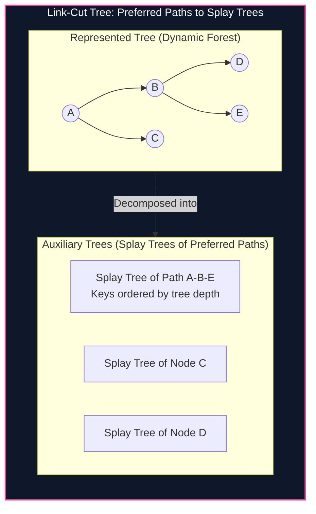

import { Callout } from "fumadocs-ui/components/callout";
import { Tabs, Tab } from "fumadocs-ui/components/tabs";
import { Steps, Step } from "fumadocs-ui/components/steps";
import { Cards, Card } from "fumadocs-ui/components/card";

## Self-Adjusting Trees & Dynamic Forests

Traditional balanced search trees maintain strict invariants (e.g. balance factors or color balance) to ensure $O(\log N)$ worst-case height. In 1985, Daniel Sleator and Robert Tarjan introduced the **Splay Tree**: a self-adjusting binary search tree that stores zero balance metadata. Every access brings the target node to the root via a sequence of double rotations (**Zig-Zig**, **Zig-Zag**), achieving:

$$\mathcal{O}(\log N) \text{ amortized time per operation}$$

Building directly upon Splay Trees, Sleator and Tarjan designed the **Link-Cut Tree (LCT)**: a data structure maintaining a forest of dynamic rooted trees subject to online structural modifications:

- `link(u, v)`: Add an edge connecting node $u$ to node $v$.
- `cut(u, v)`: Delete the edge between $u$ and $v$.
- `query_path(u, v)`: Aggregate values (e.g., sum, max, XOR) along the path from $u$ to $v$ in $O(\log N)$ amortized time.



---

## Core Link-Cut Tree Primitives

An auxiliary tree is a Splay Tree storing a **preferred path** where nodes are keyed strictly by their depth in the represented tree.

1. **`access(u)`:** Makes the path from the root to node $u$ a single preferred path. After `access(u)`, $u$ has no preferred child, and $u$ is splayed to the root of its auxiliary tree.
2. **`make_root(u)`:** Reverses the path from root to $u$, making $u$ the new root of the represented tree.
3. **`find_root(u)`:** Returns the root of the tree containing $u$ to test connectivity.
4. **`link(u, v)`:** Makes $u$ a child of $v$ (`make_root(u); u.parent = v`).
5. **`cut(u, v)`:** Disconnects the edge between $u$ and $v$.

---

## Implementation

<Tabs items={["Python", "TypeScript", "C++"]}>
<Tab value="Python">
```python
class LCTNode:
    __slots__ = ('p', 'ch', 'val', 'sum_val', 'rev')
    def __init__(self, val: int = 0):
        self.p: int = 0
        self.ch: list = [0, 0]
        self.val: int = val
        self.sum_val: int = val
        self.rev: bool = False

class LinkCutTree:
def **init**(self, n: int):
self.nodes = [LCTNode() for _ in range(n + 1)]

    def _is_root(self, u: int) -> bool:
        p = self.nodes[u].p
        return self.nodes[p].ch[0] != u and self.nodes[p].ch[1] != u

    def _push_up(self, u: int):
        node = self.nodes[u]
        lc = node.ch[0]
        rc = node.ch[1]
        node.sum_val = node.val ^ self.nodes[lc].sum_val ^ self.nodes[rc].sum_val

    def _push_down(self, u: int):
        node = self.nodes[u]
        if node.rev:
            node.ch[0], node.ch[1] = node.ch[1], node.ch[0]
            if node.ch[0]: self.nodes[node.ch[0]].rev ^= True
            if node.ch[1]: self.nodes[node.ch[1]].rev ^= True
            node.rev = False

    def _rotate(self, u: int):
        p = self.nodes[u].p
        g = self.nodes[p].p
        k = 1 if self.nodes[p].ch[1] == u else 0
        w = self.nodes[u].ch[k ^ 1]

        if not self._is_root(p):
            self.nodes[g].ch[1 if self.nodes[g].ch[1] == p else 0] = u
        self.nodes[u].p = g

        self.nodes[u].ch[k ^ 1] = p
        self.nodes[p].p = u

        self.nodes[p].ch[k] = w
        if w: self.nodes[w].p = p

        self._push_up(p)
        self._push_up(u)

    def _splay(self, u: int):
        stack = []
        curr = u
        while not self._is_root(curr):
            stack.append(curr)
            curr = self.nodes[curr].p
        stack.append(curr)
        while stack:
            self._push_down(stack.pop())

        while not self._is_root(u):
            p = self.nodes[u].p
            g = self.nodes[p].p
            if not self._is_root(p):
                if (self.nodes[p].ch[1] == u) ^ (self.nodes[g].ch[1] == p):
                    self._rotate(u)
                else:
                    self._rotate(p)
            self._rotate(u)

    def access(self, u: int):
        last = 0
        curr = u
        while curr:
            self._splay(curr)
            self.nodes[curr].ch[1] = last
            self._push_up(curr)
            last = curr
            curr = self.nodes[curr].p
        self._splay(u)

    def make_root(self, u: int):
        self.access(u)
        self.nodes[u].rev ^= True

    def find_root(self, u: int) -> int:
        self.access(u)
        while self.nodes[u].ch[0]:
            self._push_down(u)
            u = self.nodes[u].ch[0]
        self._splay(u)
        return u

    def link(self, u: int, v: int):
        self.make_root(u)
        if self.find_root(v) != u:
            self.nodes[u].p = v

    def cut(self, u: int, v: int):
        self.make_root(u)
        if self.find_root(v) == u and self.nodes[v].p == u and not self.nodes[v].ch[0]:
            self.nodes[v].p = 0
            self.nodes[u].ch[1] = 0
            self._push_up(u)

    def query_path(self, u: int, v: int) -> int:
        self.make_root(u)
        self.access(v)
        return self.nodes[v].sum_val

````
</Tab>
<Tab value="TypeScript">
```typescript
class LNode {
  p: number = 0;
  ch: [number, number] = [0, 0];
  val: number = 0;
  sumVal: number = 0;
  rev: boolean = false;
}

export class LinkCutTree {
  private nodes: LNode[];

  constructor(n: number) {
    this.nodes = Array.from({ length: n + 1 }, () => new LNode());
  }

  private isRoot(u: number): boolean {
    const p = this.nodes[u].p;
    return this.nodes[p].ch[0] !== u && this.nodes[p].ch[1] !== u;
  }

  private pushUp(u: number): void {
    const node = this.nodes[u];
    node.sumVal = node.val ^ this.nodes[node.ch[0]].sumVal ^ this.nodes[node.ch[1]].sumVal;
  }

  private pushDown(u: number): void {
    const node = this.nodes[u];
    if (node.rev) {
      const temp = node.ch[0];
      node.ch[0] = node.ch[1];
      node.ch[1] = temp;
      if (node.ch[0]) this.nodes[node.ch[0]].rev = !this.nodes[node.ch[0]].rev;
      if (node.ch[1]) this.nodes[node.ch[1]].rev = !this.nodes[node.ch[1]].rev;
      node.rev = false;
    }
  }

  private rotate(u: number): void {
    const p = this.nodes[u].p;
    const g = this.nodes[p].p;
    const k = this.nodes[p].ch[1] === u ? 1 : 0;
    const w = this.nodes[u].ch[k ^ 1];

    if (!this.isRoot(p)) {
      this.nodes[g].ch[this.nodes[g].ch[1] === p ? 1 : 0] = u;
    }
    this.nodes[u].p = g;
    this.nodes[u].ch[k ^ 1] = p;
    this.nodes[p].p = u;
    this.nodes[p].ch[k] = w;
    if (w) this.nodes[w].p = p;

    this.pushUp(p);
    this.pushUp(u);
  }

  private splay(u: number): void {
    const stack: number[] = [];
    let curr = u;
    while (!this.isRoot(curr)) {
      stack.push(curr);
      curr = this.nodes[curr].p;
    }
    stack.push(curr);
    while (stack.length > 0) this.pushDown(stack.pop()!);

    while (!this.isRoot(u)) {
      const p = this.nodes[u].p;
      const g = this.nodes[p].p;
      if (!this.isRoot(p)) {
        if ((this.nodes[p].ch[1] === u) !== (this.nodes[g].ch[1] === p)) {
          this.rotate(u);
        } else {
          this.rotate(p);
        }
      }
      this.rotate(u);
    }
  }

  public access(u: number): void {
    let last = 0;
    for (let curr = u; curr !== 0; curr = this.nodes[curr].p) {
      this.splay(curr);
      this.nodes[curr].ch[1] = last;
      this.pushUp(curr);
      last = curr;
    }
    this.splay(u);
  }

  public makeRoot(u: number): void {
    this.access(u);
    this.nodes[u].rev = !this.nodes[u].rev;
  }

  public findRoot(u: number): number {
    this.access(u);
    let curr = u;
    while (this.nodes[curr].ch[0] !== 0) {
      this.pushDown(curr);
      curr = this.nodes[curr].ch[0];
    }
    this.splay(curr);
    return curr;
  }

  public link(u: number, v: number): void {
    this.makeRoot(u);
    if (this.findRoot(v) !== u) {
      this.nodes[u].p = v;
    }
  }

  public cut(u: number, v: number): void {
    this.makeRoot(u);
    if (this.findRoot(v) === u && this.nodes[v].p === u && this.nodes[v].ch[0] === 0) {
      this.nodes[v].p = 0;
      this.nodes[u].ch[1] = 0;
      this.pushUp(u);
    }
  }

  public queryPath(u: number, v: number): number {
    this.makeRoot(u);
    this.access(v);
    return this.nodes[v].sumVal;
  }
}
````

</Tab>
<Tab value="C++">
```cpp
#include <iostream>
#include <vector>
#include <algorithm>

class LinkCutTree {
struct Node {
int p = 0;
int ch[2] = {0, 0};
int val = 0;
int sumVal = 0;
bool rev = false;
};

    std::vector<Node> tree;

    bool isRoot(int u) const {
        int p = tree[u].p;
        return tree[p].ch[0] != u && tree[p].ch[1] != u;
    }

    void pushUp(int u) {
        tree[u].sumVal = tree[u].val ^ tree[tree[u].ch[0]].sumVal ^ tree[tree[u].ch[1]].sumVal;
    }

    void pushDown(int u) {
        if (tree[u].rev) {
            std::swap(tree[u].ch[0], tree[u].ch[1]);
            if (tree[u].ch[0]) tree[tree[u].ch[0]].rev ^= true;
            if (tree[u].ch[1]) tree[tree[u].ch[1]].rev ^= true;
            tree[u].rev = false;
        }
    }

    void rotate(int u) {
        int p = tree[u].p, g = tree[p].p;
        int k = (tree[p].ch[1] == u);
        int w = tree[u].ch[k ^ 1];

        if (!isRoot(p)) tree[g].ch[tree[g].ch[1] == p] = u;
        tree[u].p = g;

        tree[u].ch[k ^ 1] = p;
        tree[p].p = u;

        tree[p].ch[k] = w;
        if (w) tree[w].p = p;

        pushUp(p);
        pushUp(u);
    }

    void splay(int u) {
        std::vector<int> stk;
        int curr = u;
        while (!isRoot(curr)) {
            stk.push_back(curr);
            curr = tree[curr].p;
        }
        stk.push_back(curr);
        while (!stk.empty()) {
            pushDown(stk.back());
            stk.pop_back();
        }

        while (!isRoot(u)) {
            int p = tree[u].p, g = tree[p].p;
            if (!isRoot(p)) {
                if ((tree[p].ch[1] == u) ^ (tree[g].ch[1] == p)) rotate(u);
                else rotate(p);
            }
            rotate(u);
        }
    }

public:
explicit LinkCutTree(int n) : tree(n + 1) {}

    void setVal(int u, int val) {
        tree[u].val = val;
        pushUp(u);
    }

    void access(int u) {
        for (int last = 0; u; last = u, u = tree[u].p) {
            splay(u);
            tree[u].ch[1] = last;
            pushUp(u);
        }
    }

    void makeRoot(int u) {
        access(u);
        splay(u);
        tree[u].rev ^= true;
    }

    int findRoot(int u) {
        access(u);
        splay(u);
        while (tree[u].ch[0]) {
            pushDown(u);
            u = tree[u].ch[0];
        }
        splay(u);
        return u;
    }

    void link(int u, int v) {
        makeRoot(u);
        if (findRoot(v) != u) tree[u].p = v;
    }

    void cut(int u, int v) {
        makeRoot(u);
        if (findRoot(v) == u && tree[v].p == u && !tree[v].ch[0]) {
            tree[v].p = 0;
            tree[u].ch[1] = 0;
            pushUp(u);
        }
    }

    int queryPath(int u, int v) {
        makeRoot(u);
        access(v);
        splay(v);
        return tree[v].sumVal;
    }

};

```
</Tab>
</Tabs>

---

## Complexity Breakdown

| Operation | Amortized Time Complexity | Invariant Guarantee |
| :--- | :--- | :--- |
| **`access(u)`** | $\mathcal{O}(\log N)$ | Flattens root-to-$u$ into a single preferred path |
| **`link(u, v)`** | $\mathcal{O}(\log N)$ | Dynamic forest edge insertion |
| **`cut(u, v)`** | $\mathcal{O}(\log N)$ | Dynamic forest edge deletion |
| **`query_path(u, v)`** | $\mathcal{O}(\log N)$ | Arbitrary tree path aggregation |
```
