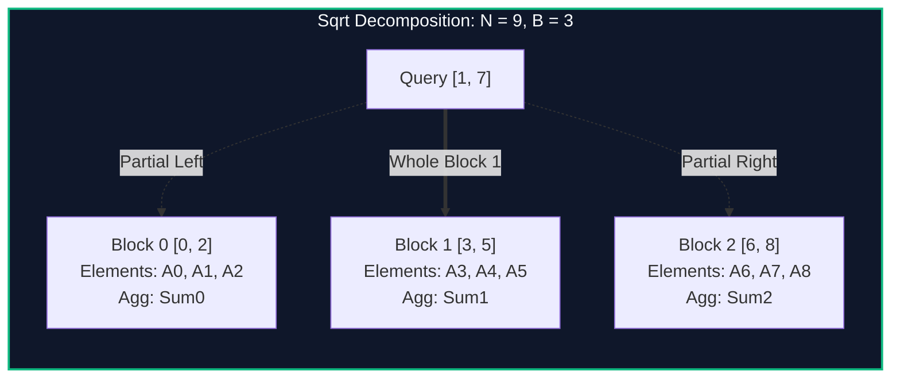

import { Callout } from "fumadocs-ui/components/callout";
import { Tabs, Tab } from "fumadocs-ui/components/tabs";
import { Steps, Step } from "fumadocs-ui/components/steps";
import { Cards, Card } from "fumadocs-ui/components/card";

## The Sqrt Tradeoff

When balanced tree structures (like Segment Trees or Fenwick Trees) are too rigid or complex to support exotic range modifications (such as sorting intervals or rebuilding dynamic collections), **Square Root Decomposition** provides an elegant, simple alternative.

Instead of maintaining a multi-level hierarchy, partition an array of length $N$ into $\lceil N / B \rceil$ contiguous blocks of size:

$$B \approx \lceil \sqrt{N} \rceil$$



---

## Query Mechanics

For any arbitrary range query $[L, R]$:

1. **Left Fringe (Partial Block):** Iterate through the elements at the end of block $\lfloor L / B \rfloor$. Maximum elements visited: $B - 1$.
2. **Internal Blocks (Full Blocks):** Query the pre-aggregated summary value of each completely covered block. Maximum blocks visited: $\lfloor N / B \rfloor$.
3. **Right Fringe (Partial Block):** Iterate through the prefix elements of block $\lfloor R / B \rfloor$. Maximum elements visited: $B - 1$.

$$\text{Total Operations} \le 2B + \frac{N}{B}$$

Choosing $B = \sqrt{N}$ minimizes the cost to:
$$2\sqrt{N} + \sqrt{N} = 3\sqrt{N} = \mathcal{O}(\sqrt{N})$$

---

## Implementation

<Tabs items={["Python", "TypeScript", "C++"]}>
<Tab value="Python">
```python
import math
from typing import List

class SqrtDecomposition:
def **init**(self, arr: List[int]):
self.n = len(arr)
self.arr = list(arr)
self.block_size = max(1, int(math.isqrt(self.n)))
self.num_blocks = (self.n + self.block_size - 1) // self.block_size
self.block_sum = [0] \* self.num_blocks

        for i, val in enumerate(self.arr):
            self.block_sum[i // self.block_size] += val

    def update(self, idx: int, new_val: int):
        b_idx = idx // self.block_size
        self.block_sum[b_idx] += new_val - self.arr[idx]
        self.arr[idx] = new_val

    def query(self, l: int, r: int) -> int:
        total = 0
        b_left = l // self.block_size
        b_right = r // self.block_size

        if b_left == b_right:
            for i in range(l, r + 1):
                total += self.arr[i]
            return total

        # Left partial block
        for i in range(l, (b_left + 1) * self.block_size):
            total += self.arr[i]

        # Intermediate complete blocks
        for b in range(b_left + 1, b_right):
            total += self.block_sum[b]

        # Right partial block
        for i in range(b_right * self.block_size, r + 1):
            total += self.arr[i]

        return total

````
</Tab>
<Tab value="TypeScript">
```typescript
export class SqrtDecomposition {
  private arr: number[];
  private blockSum: number[];
  private blockSize: number;
  private n: number;

  constructor(arr: number[]) {
    this.n = arr.length;
    this.arr = [...arr];
    this.blockSize = Math.max(1, Math.floor(Math.sqrt(this.n)));
    const numBlocks = Math.ceil(this.n / this.blockSize);
    this.blockSum = new Array(numBlocks).fill(0);

    for (let i = 0; i < this.n; i++) {
      this.blockSum[Math.floor(i / this.blockSize)] += this.arr[i];
    }
  }

  public update(idx: number, newVal: number): void {
    const bIdx = Math.floor(idx / this.blockSize);
    this.blockSum[bIdx] += newVal - this.arr[idx];
    this.arr[idx] = newVal;
  }

  public query(l: number, r: number): number {
    let total = 0;
    const bLeft = Math.floor(l / this.blockSize);
    const bRight = Math.floor(r / this.blockSize);

    if (bLeft === bRight) {
      for (let i = l; i <= r; i++) total += this.arr[i];
      return total;
    }

    // Left fringe
    for (let i = l; i < (bLeft + 1) * this.blockSize; i++) total += this.arr[i];

    // Middle full blocks
    for (let b = bLeft + 1; b < bRight; b++) total += this.blockSum[b];

    // Right fringe
    for (let i = bRight * this.blockSize; i <= r; i++) total += this.arr[i];

    return total;
  }
}
````

</Tab>
<Tab value="C++">
```cpp
#include <iostream>
#include <vector>
#include <cmath>
#include <cstdint>

class SqrtDecomposition {
int n;
int blockSize;
std::vector<int64_t> arr;
std::vector<int64_t> blockSum;

public:
explicit SqrtDecomposition(const std::vector<int64_t>& input) : n(static_cast<int>(input.size())), arr(input) {
blockSize = std::max(1, static_cast<int>(std::sqrt(n)));
int numBlocks = (n + blockSize - 1) / blockSize;
blockSum.assign(numBlocks, 0);

        for (int i = 0; i < n; ++i) {
            blockSum[i / blockSize] += arr[i];
        }
    }

    void update(int idx, int64_t newVal) {
        int bIdx = idx / blockSize;
        blockSum[bIdx] += newVal - arr[idx];
        arr[idx] = newVal;
    }

    int64_t query(int l, int r) const {
        int64_t total = 0;
        int bLeft = l / blockSize;
        int bRight = r / blockSize;

        if (bLeft == bRight) {
            for (int i = l; i <= r; ++i) total += arr[i];
            return total;
        }

        // Left fringe
        for (int i = l; i < (bLeft + 1) * blockSize; ++i) total += arr[i];

        // Complete intermediate blocks
        for (int b = bLeft + 1; b < bRight; ++b) total += blockSum[b];

        // Right fringe
        for (int i = bRight * blockSize; i <= r; ++i) total += arr[i];

        return total;
    }

};

```
</Tab>
</Tabs>

---

## Complexity Breakdown

| Operation | Time Complexity | Auxiliary Space |
| :--- | :--- | :--- |
| **Point Update** | $\mathcal{O}(1)$ direct modification | $\mathcal{O}(1)$ |
| **Range Query** | $\mathcal{O}(\sqrt{N})$ worst-case | $\mathcal{O}(1)$ |
| **Precomputation** | $\mathcal{O}(N)$ linear scan | $\mathcal{O}(\sqrt{N})$ block array |
```
