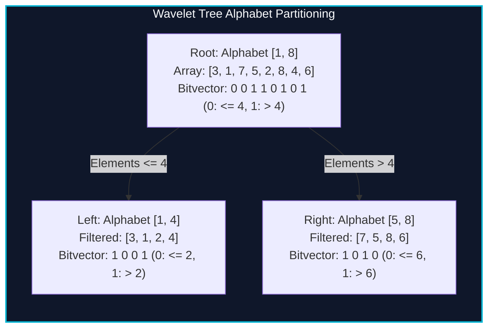

import { Callout } from "fumadocs-ui/components/callout";
import { Tabs, Tab } from "fumadocs-ui/components/tabs";
import { Steps, Step } from "fumadocs-ui/components/steps";
import { Cards, Card } from "fumadocs-ui/components/card";

## Succinct Alphabet Partitioning

In sequence bioinformatics, full-text indexing, and database columnar storage, we frequently need to answer three foundational primitives over an array $A[0 \dots N-1]$ drawn from an alphabet $\Sigma = [\sigma_{\min}, \sigma_{\max}]$:

1. **$\text{access}(i)$:** Retrieve $A[i]$.
2. **$\text{rank}_c(i)$:** Count occurrences of character/value $c$ in prefix $A[0 \dots i]$.
3. **$\text{select}_c(k)$:** Find the index of the $k$-th occurrence of character/value $c$.
4. **$\text{quantile}(L, R, k)$:** Return the $k$-th smallest element in subarray $A[L \dots R]$.

The **Wavelet Tree** (invented by Roberto Grossi, Ankur Gupta, and Jeffrey Scott Vitter in 2003) answers all these queries in:

$$\mathcal{O}(\log |\Sigma|) \text{ time}$$

using only $N \log |\Sigma| + o(N \log |\Sigma|)$ bits of space!



---

## Core Algorithmic Mechanics

At each node representing alphabet range $[\sigma_{\text{low}}, \sigma_{\text{high}}]$:

- Calculate alphabet midpoint: $M = \lfloor (\sigma_{\text{low}} + \sigma_{\text{high}}) / 2 \rfloor$.
- For every element in the node's sequence, append `0` if $x \le M$, or `1` if $x > M$.
- Store a prefix sum or succinct bitvector supporting $O(1)$ rank queries over this bit sequence.
- Recurse left with all elements mapped to `0`, and recurse right with all elements mapped to `1`.

### Range $K$-th Smallest Query in $[L, R]$

To find the $k$-th smallest value in range $[L, R]$:

1. Count the number of zeros in the range $[L, R]$ at the current bitvector:
   $$\text{zeros} = \text{rank}_0(R) - \text{rank}_0(L - 1)$$
2. If $k \le \text{zeros}$, the target value is $\le M$. Project interval $[L, R]$ into the left child:
   $$L' = \text{rank}_0(L - 1), \quad R' = \text{rank}_0(R) - 1$$
   Recurse on the left child.
3. Otherwise, the target value is $> M$. Project interval $[L, R]$ into the right child:
   $$L' = L - \text{rank}_0(L - 1), \quad R' = R - \text{rank}_0(R), \quad k' = k - \text{zeros}$$
   Recurse on the right child.

---

## Implementation

<Tabs items={["Python", "TypeScript", "C++"]}>
<Tab value="Python">
```python
from typing import List

class WaveletTree:
def **init**(self, arr: List[int]):
self.lo = min(arr) if arr else 0
self.hi = max(arr) if arr else 0
self.\_init(arr, self.lo, self.hi)

    def _init(self, arr: List[int], lo: int, hi: int):
        self.lo = lo
        self.hi = hi
        self.left = None
        self.right = None
        if self.lo == self.hi or not arr:
            return

        mid = self.lo + (self.hi - self.lo) // 2
        # b[i] stores count of elements <= mid in prefix arr[0...i-1]
        self.b = [0]
        left_arr, right_arr = [], []

        for x in arr:
            if x <= mid:
                left_arr.append(x)
                self.b.append(self.b[-1] + 1)
            else:
                right_arr.append(x)
                self.b.append(self.b[-1])

        self.left = WaveletTree([])
        self.left._init(left_arr, self.lo, mid)
        self.right = WaveletTree([])
        self.right._init(right_arr, mid + 1, hi)

    def quantile(self, l: int, r: int, k: int) -> int:
        """
        0-based index l, r inclusive. Returns the k-th (1-based) smallest element.
        """
        if self.lo == self.hi:
            return self.lo

        # Count elements <= mid in arr[l...r]
        zeros_in_range = self.b[r + 1] - self.b[l]
        if k <= zeros_in_range:
            new_l = self.b[l]
            new_r = self.b[r + 1] - 1
            return self.left.quantile(new_l, new_r, k)
        else:
            new_l = l - self.b[l]
            new_r = r - self.b[r + 1]
            return self.right.quantile(new_l, new_r, k - zeros_in_range)

````
</Tab>
<Tab value="TypeScript">
```typescript
export class WaveletTree {
  private lo: number;
  private hi: number;
  private b: number[] = [0];
  private left: WaveletTree | null = null;
  private right: WaveletTree | null = null;

  constructor(arr: number[], lo?: number, hi?: number) {
    if (arr.length === 0) {
      this.lo = lo ?? 0;
      this.hi = hi ?? 0;
      return;
    }
    this.lo = lo ?? Math.min(...arr);
    this.hi = hi ?? Math.max(...arr);

    if (this.lo === this.hi) return;

    const mid = this.lo + ((this.hi - this.lo) >> 1);
    const leftArr: number[] = [];
    const rightArr: number[] = [];

    for (const x of arr) {
      if (x <= mid) {
        leftArr.push(x);
        this.b.push(this.b[this.b.length - 1] + 1);
      } else {
        rightArr.push(x);
        this.b.push(this.b[this.b.length - 1]);
      }
    }

    this.left = new WaveletTree(leftArr, this.lo, mid);
    this.right = new WaveletTree(rightArr, mid + 1, this.hi);
  }

  public quantile(l: number, r: number, k: number): number {
    if (this.lo === this.hi) return this.lo;

    const zerosInRange = this.b[r + 1] - this.b[l];
    if (k <= zerosInRange) {
      const newL = this.b[l];
      const newR = this.b[r + 1] - 1;
      return this.left!.quantile(newL, newR, k);
    } else {
      const newL = l - this.b[l];
      const newR = r - this.b[r + 1];
      return this.right!.quantile(newL, newR, k - zerosInRange);
    }
  }
}
````

</Tab>
<Tab value="C++">
```cpp
#include <iostream>
#include <vector>
#include <algorithm>

class WaveletTree {
int lo, hi;
WaveletTree *left = nullptr, *right = nullptr;
std::vector<int> b;

public:
WaveletTree(std::vector<int>::iterator from, std::vector<int>::iterator to, int lowVal, int highVal)
: lo(lowVal), hi(highVal) {
if (from >= to || lo == hi) return;

        int mid = lo + (hi - lo) / 2;
        b.reserve(std::distance(from, to) + 1);
        b.push_back(0);

        for (auto it = from; it != to; ++it) {
            b.push_back(b.back() + (*it <= mid ? 1 : 0));
        }

        auto pivot = std::stable_partition(from, to, [mid](int x) {
            return x <= mid;
        });

        left = new WaveletTree(from, pivot, lo, mid);
        right = new WaveletTree(pivot, to, mid + 1, hi);
    }

    ~WaveletTree() {
        delete left;
        delete right;
    }

    int quantile(int l, int r, int k) const {
        if (lo == hi) return lo;

        int zeros = b[r] - b[l - 1];
        if (k <= zeros) {
            int newL = b[l - 1] + 1;
            int newR = b[r];
            return left->quantile(newL, newR, k);
        } else {
            int newL = l - b[l - 1];
            int newR = r - b[r];
            return right->quantile(newL, newR, k - zeros);
        }
    }

};

```
</Tab>
</Tabs>

---

## Complexity Breakdown

| Operation | Time Complexity | Bit Space Complexity |
| :--- | :--- | :--- |
| **Construction** | $\mathcal{O}(N \log |\Sigma|)$ | $N \log |\Sigma| + \mathcal{O}(N)$ bits |
| **Quantile ($k$-th smallest)** | $\mathcal{O}(\log |\Sigma|)$ | In-place projection without allocations |
| **Rank / Count Occurrences** | $\mathcal{O}(\log |\Sigma|)$ | Prefix bitvector lookups |
```
