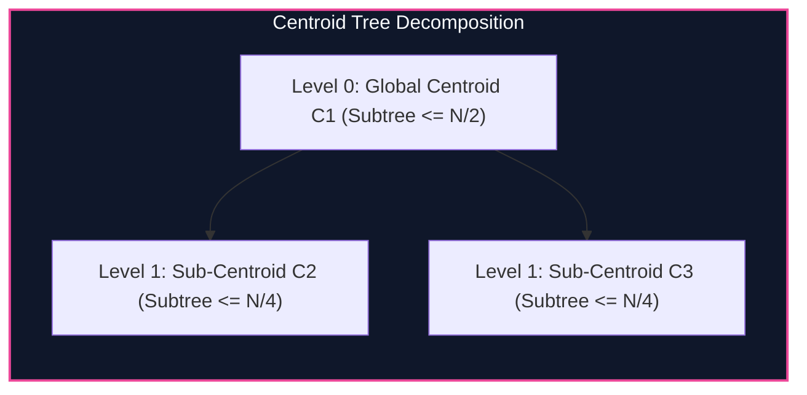

import { Callout } from "fumadocs-ui/components/callout";
import { Tabs, Tab } from "fumadocs-ui/components/tabs";
import { Steps, Step } from "fumadocs-ui/components/steps";
import { Cards, Card } from "fumadocs-ui/components/card";

## Divide and Conquer on Trees

In arrays, the midpoint $M = (L + R) / 2$ divides the problem into two subproblems of size $N/2$. In trees, picking an arbitrary vertex could result in a skewed subtree of size $N - 1$.

A **Tree Centroid** is a vertex $C$ whose removal divides the tree into disconnected components, each of size at most:

$$\text{Size}(\text{Component}) \le \left\lfloor \frac{N}{2} \right\rfloor$$

By recursively finding the centroid of each component, we construct a **Centroid Tree** of height at most:

$$H \le \lceil \log_2 N \rceil$$



---

## Path Categorization Paradigm

Any path between two vertices $u$ and $v$ in a tree falls into exactly one category relative to centroid $C$:

1. The path passes through $C$ ($u \to C \to v$).
2. The path lies entirely within the component of one of $C$'s neighbors.

In case 1, $\text{dist}(u, v) = \text{dist}(u, C) + \text{dist}(C, v)$, reducing path analysis to measuring distances from the centroid! In case 2, the subproblem is handled recursively.

---

## Implementation

<Tabs items={["Python", "TypeScript", "C++"]}>
<Tab value="Python">
```python
from typing import List

class CentroidDecomposition:
def **init**(self, n: int, adj: List[List[int]]):
self.n = n
self.adj = adj
self.sz = [0] _ (n + 1)
self.removed = [False] _ (n + 1)
self.centroid_parent = [0] \* (n + 1)

        self.root = self._decompose(1, 0)

    def _get_sz(self, u: int, p: int) -> int:
        self.sz[u] = 1
        for v in self.adj[u]:
            if v != p and not self.removed[v]:
                self.sz[u] += self._get_sz(v, u)
        return self.sz[u]

    def _find_centroid(self, u: int, p: int, total_nodes: int) -> int:
        for v in self.adj[u]:
            if v != p and not self.removed[v]:
                if self.sz[v] > total_nodes // 2:
                    return self._find_centroid(v, u, total_nodes)
        return u

    def _decompose(self, u: int, p: int) -> int:
        total = self._get_sz(u, 0)
        c = self._find_centroid(u, 0, total)
        self.removed[c] = True
        self.centroid_parent[c] = p

        for v in self.adj[c]:
            if not self.removed[v]:
                self._decompose(v, c)

        return c

````
</Tab>
<Tab value="TypeScript">
```typescript
export class CentroidDecomposition {
  private sz: number[];
  private removed: boolean[];
  public centroidParent: number[];
  public root: number;

  constructor(private n: number, private adj: number[][]) {
    this.sz = new Array(n + 1).fill(0);
    this.removed = new Array(n + 1).fill(false);
    this.centroidParent = new Array(n + 1).fill(0);

    this.root = this.decompose(1, 0);
  }

  private getSz(u: number, p: number): number {
    this.sz[u] = 1;
    for (const v of this.adj[u]) {
      if (v !== p && !this.removed[v]) {
        this.sz[u] += this.getSz(v, u);
      }
    }
    return this.sz[u];
  }

  private findCentroid(u: number, p: number, total: number): number {
    for (const v of this.adj[u]) {
      if (v !== p && !this.removed[v]) {
        if (this.sz[v] > total >> 1) {
          return this.findCentroid(v, u, total);
        }
      }
    }
    return u;
  }

  private decompose(u: number, p: number): number {
    const total = this.getSz(u, 0);
    const c = this.findCentroid(u, 0, total);
    this.removed[c] = true;
    this.centroidParent[c] = p;

    for (const v of this.adj[c]) {
      if (!this.removed[v]) {
        this.decompose(v, c);
      }
    }

    return c;
  }
}
````

</Tab>
<Tab value="C++">
```cpp
#include <iostream>
#include <vector>

class CentroidDecomposition {
int n;
const std::vector<std::vector<int>>& adj;
std::vector<int> sz;
std::vector<bool> removed;
std::vector<int> centroidParent;

    int getSz(int u, int p) {
        sz[u] = 1;
        for (int v : adj[u]) {
            if (v != p && !removed[v]) {
                sz[u] += getSz(v, u);
            }
        }
        return sz[u];
    }

    int findCentroid(int u, int p, int total) {
        for (int v : adj[u]) {
            if (v != p && !removed[v]) {
                if (sz[v] > total / 2) {
                    return findCentroid(v, u, total);
                }
            }
        }
        return u;
    }

    int decompose(int u, int p) {
        int total = getSz(u, 0);
        int c = findCentroid(u, 0, total);
        removed[c] = true;
        centroidParent[c] = p;

        for (int v : adj[c]) {
            if (!removed[v]) {
                decompose(v, c);
            }
        }
        return c;
    }

public:
int root;
CentroidDecomposition(int numNodes, const std::vector<std::vector<int>>& graph)
: n(numNodes), adj(graph), sz(n + 1), removed(n + 1, false), centroidParent(n + 1, 0) {
root = decompose(1, 0);
}

    int getParent(int u) const { return centroidParent[u]; }

};

```
</Tab>
</Tabs>

---

## Complexity Breakdown

| Metric | Bound |
| :--- | :--- |
| **Centroid Tree Height** | $\le \lceil \log_2 N \rceil$ levels |
| **Total Decomposition Time** | $\mathcal{O}(N \log N)$ total work |
| **Path Distance Query per Node** | $\mathcal{O}(\log N)$ ascending centroid parents |
```
