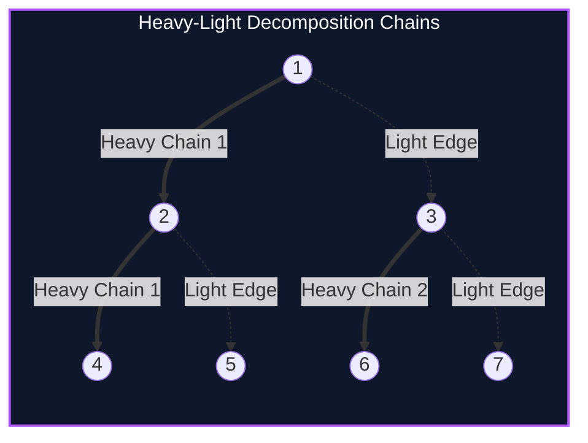

import { Callout } from "fumadocs-ui/components/callout";
import { Tabs, Tab } from "fumadocs-ui/components/tabs";
import { Steps, Step } from "fumadocs-ui/components/steps";
import { Cards, Card } from "fumadocs-ui/components/card";

## Linearizing Tree Paths

In an unstructured tree, paths between arbitrary nodes $u$ and $v$ can curve through the Lowest Common Ancestor (LCA) across arbitrary branching branches. Performing point/range modifications and path queries on an uncompressed tree takes $O(N)$ worst-case time.

**Heavy-Light Decomposition (HLD)** (introduced by Sleator and Tarjan in 1983) partitions the vertices of any tree of size $N$ into disjoint linear chains such that:

> **Fundamental Theorem of HLD:** Any path from any vertex $u$ to the root passes through at most $\lfloor \log_2 N \rfloor$ light edges!

By assigning contiguous DFS entry timestamps (`tin[u]`) to nodes along each heavy chain, any path between any two arbitrary vertices $(u, v)$ is decomposed into at most $\mathcal{O}(\log N)$ contiguous array intervals. These intervals can then be queried directly using standard Segment Trees in:

$$\mathcal{O}(\log^2 N) \text{ time}$$



---

## The Two-Pass DFS Algorithm

### DFS 1: Subtree Sizes and Heavy Edges

- Calculate subtree sizes `sz[u]`.
- For each vertex $u$, the child $v$ with the maximum `sz[v]` is designated the **heavy child** (`heavy[u] = v`). The edge $(u, v)$ is a **heavy edge**.
- All other edges leaving $u$ are **light edges**.

### DFS 2: Chain Heads and Contiguous Layout

- Assign a continuous discovery timestamp `tin[u]` to each vertex.
- Traverse the heavy child immediately before any light children. This guarantees that all vertices along the same heavy chain receive contiguous indices in the flattened array!
- Maintain `head[u]`, the top-most vertex of the heavy chain containing $u$.

---

## Implementation

<Tabs items={["Python", "TypeScript", "C++"]}>
<Tab value="Python">
```python
from typing import List

class HLD:
def **init**(self, n: int, adj: List[List[int]], root: int = 1):
self.n = n
self.adj = adj
self.parent = [0] _ (n + 1)
self.depth = [0] _ (n + 1)
self.sz = [0] _ (n + 1)
self.heavy = [0] _ (n + 1)
self.head = [0] _ (n + 1)
self.pos = [0] _ (n + 1)
self.timer = 0

        self._dfs1(root, 0, 0)
        self._dfs2(root, root)

    def _dfs1(self, u: int, p: int, d: int):
        self.parent[u] = p
        self.depth[u] = d
        self.sz[u] = 1
        max_c_sz = 0
        for v in self.adj[u]:
            if v != p:
                self._dfs1(v, u, d + 1)
                self.sz[u] += self.sz[v]
                if self.sz[v] > max_c_sz:
                    max_c_sz = self.sz[v]
                    self.heavy[u] = v

    def _dfs2(self, u: int, h: int):
        self.head[u] = h
        self.timer += 1
        self.pos[u] = self.timer

        if self.heavy[u]:
            # Heavy child continues the chain head
            self._dfs2(self.heavy[u], h)

        for v in self.adj[u]:
            if v != self.parent[u] and v != self.heavy[u]:
                # Light child starts a new heavy chain
                self._dfs2(v, v)

    def query_path(self, u: int, v: int) -> List[tuple]:
        # Returns list of contiguous intervals [pos_l, pos_r] covering path u-v
        intervals = []
        while self.head[u] != self.head[v]:
            if self.depth[self.head[u]] > self.depth[self.head[v]]:
                intervals.append((self.pos[self.head[u]], self.pos[u]))
                u = self.parent[self.head[u]]
            else:
                intervals.append((self.pos[self.head[v]], self.pos[v]))
                v = self.parent[self.head[v]]

        # u and v are now on the same heavy chain
        l, r = (self.pos[u], self.pos[v]) if self.pos[u] <= self.pos[v] else (self.pos[v], self.pos[u])
        intervals.append((l, r))
        return intervals

````
</Tab>
<Tab value="TypeScript">
```typescript
export class HeavyLightDecomposition {
  public parent: number[];
  public depth: number[];
  public sz: number[];
  public heavy: number[];
  public head: number[];
  public pos: number[];
  private timer: number = 0;

  constructor(private n: number, private adj: number[][], root: number = 1) {
    this.parent = new Array(n + 1).fill(0);
    this.depth = new Array(n + 1).fill(0);
    this.sz = new Array(n + 1).fill(0);
    this.heavy = new Array(n + 1).fill(0);
    this.head = new Array(n + 1).fill(0);
    this.pos = new Array(n + 1).fill(0);

    this.dfs1(root, 0, 0);
    this.dfs2(root, root);
  }

  private dfs1(u: number, p: number, d: number): void {
    this.parent[u] = p;
    this.depth[u] = d;
    this.sz[u] = 1;
    let maxChildSz = 0;

    for (const v of this.adj[u]) {
      if (v !== p) {
        this.dfs1(v, u, d + 1);
        this.sz[u] += this.sz[v];
        if (this.sz[v] > maxChildSz) {
          maxChildSz = this.sz[v];
          this.heavy[u] = v;
        }
      }
    }
  }

  private dfs2(u: number, h: number): void {
    this.head[u] = h;
    this.pos[u] = ++this.timer;

    if (this.heavy[u] !== 0) {
      this.dfs2(this.heavy[u], h);
    }

    for (const v of this.adj[u]) {
      if (v !== this.parent[u] && v !== this.heavy[u]) {
        this.dfs2(v, v);
      }
    }
  }

  public getPathIntervals(u: number, v: number): [number, number][] {
    const intervals: [number, number][] = [];
    while (this.head[u] !== this.head[v]) {
      if (this.depth[this.head[u]] > this.depth[this.head[v]]) {
        intervals.push([this.pos[this.head[u]], this.pos[u]]);
        u = this.parent[this.head[u]];
      } else {
        intervals.push([this.pos[this.head[v]], this.pos[v]]);
        v = this.parent[this.head[v]];
      }
    }

    const l = Math.min(this.pos[u], this.pos[v]);
    const r = Math.max(this.pos[u], this.pos[v]);
    intervals.push([l, r]);
    return intervals;
  }
}
````

</Tab>
<Tab value="C++">
```cpp
#include <iostream>
#include <vector>
#include <algorithm>

class HeavyLightDecomposition {
int n, timer = 0;
const std::vector<std::vector<int>>& adj;
std::vector<int> parent, depth, sz, heavy, head, pos;

    void dfs1(int u, int p, int d) {
        parent[u] = p;
        depth[u] = d;
        sz[u] = 1;
        int maxChildSz = 0;
        for (int v : adj[u]) {
            if (v != p) {
                dfs1(v, u, d + 1);
                sz[u] += sz[v];
                if (sz[v] > maxChildSz) {
                    maxChildSz = sz[v];
                    heavy[u] = v;
                }
            }
        }
    }

    void dfs2(int u, int h) {
        head[u] = h;
        pos[u] = ++timer;
        if (heavy[u]) dfs2(heavy[u], h);

        for (int v : adj[u]) {
            if (v != parent[u] && v != heavy[u]) {
                dfs2(v, v);
            }
        }
    }

public:
HeavyLightDecomposition(int numNodes, const std::vector<std::vector<int>>& graph, int root = 1)
: n(numNodes), adj(graph), parent(n + 1), depth(n + 1), sz(n + 1), heavy(n + 1, 0), head(n + 1), pos(n + 1) {
dfs1(root, 0, 0);
dfs2(root, root);
}

    std::vector<std::pair<int, int>> getPathIntervals(int u, int v) const {
        std::vector<std::pair<int, int>> intervals;
        while (head[u] != head[v]) {
            if (depth[head[u]] > depth[head[v]]) {
                intervals.emplace_back(pos[head[u]], pos[u]);
                u = parent[head[u]];
            } else {
                intervals.emplace_back(pos[head[v]], pos[v]);
                v = parent[head[v]];
            }
        }
        intervals.emplace_back(std::min(pos[u], pos[v]), std::max(pos[u], pos[v]));
        return intervals;
    }

    std::pair<int, int> getSubtreeInterval(int u) const {
        return {pos[u], pos[u] + sz[u] - 1};
    }

};

```
</Tab>
</Tabs>

---

## Complexity Breakdown

| Phase | Time Complexity | Auxiliary Space |
| :--- | :--- | :--- |
| **Preprocessing (DFS 1 & 2)** | $\mathcal{O}(N)$ linear scan | $\mathcal{O}(N)$ tree attributes |
| **Path Decomposition** | $\mathcal{O}(\log N)$ disjoint intervals | $\mathcal{O}(\log N)$ interval pairs |
| **Path Query with SegTree** | $\mathcal{O}(\log^2 N)$ worst-case | In-place segment tree query |
```
