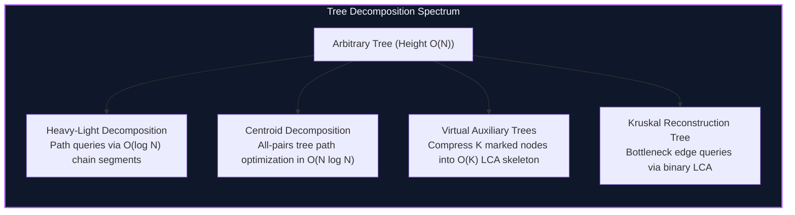

import { Callout } from "fumadocs-ui/components/callout";
import { Tabs, Tab } from "fumadocs-ui/components/tabs";
import { Steps, Step } from "fumadocs-ui/components/steps";
import { Cards, Card } from "fumadocs-ui/components/card";

## Transforming Unstructured Trees into Linear Domains

General trees present irregular topologies with arbitrary branching factors and heights up to $O(N)$. Linear range structures like Segment Trees and Fenwick Trees cannot be directly applied across arbitrary paths or subtrees without structural decomposition.

Tree decomposition algorithms partition trees into structured, predictable sub-units:

1. **Heavy-Light Chains:** Partition vertices such that any path from any node to the root crosses at most $O(\log N)$ light edges, mapping arbitrary path queries to $O(\log N)$ contiguous array intervals.
2. **Centroid Trees:** Recursively divide trees into subtrees of size at most $N/2$, reducing recursive search depths to at most $O(\log N)$ across arbitrary unrooted path distance queries.
3. **Virtual / Auxiliary Trees:** Given $K$ key nodes scattered across a massive tree of $N$ nodes, compress the topology into a minimal tree of size $O(K)$ preserving exact Lowest Common Ancestor (LCA) relationships.
4. **Kruskal Reconstruction Trees (Reachability Trees):** Transform Minimum Spanning Tree edge additions into ancestor-tree structures where bottleneck path capacities reduce to simple LCA queries.

---

## Category Modules

<Cards>
  <Card
    title="Heavy-Light Decomposition (HLD)"
    href="/docs/dsa/04-expert/tree-decompositions/heavy-light-decomposition"
    description="Decompose trees into heavy and light chains, flattening paths into contiguous segments for O(log^2 N) path updates and queries."
  />
  <Card
    title="Centroid Decomposition"
    href="/docs/dsa/04-expert/tree-decompositions/centroid-decomposition"
    description="Divide-and-conquer on trees by finding balance centroids (subtrees <= N/2), solving path counting and distance queries in O(N log N)."
  />
  <Card
    title="Virtual Trees (Auxiliary Trees)"
    href="/docs/dsa/04-expert/tree-decompositions/virtual-trees"
    description="Compress a subset of K key nodes and their pairwise LCAs into an auxiliary tree of size O(K) in O(K log K) time."
  />
  <Card
    title="Kruskal Reconstruction Tree"
    href="/docs/dsa/04-expert/tree-decompositions/kruskal-reconstruction-tree"
    description="Build binary reachability trees over Kruskal MST operations to convert bottleneck edge weight constraints into LCA lookups."
  />
</Cards>
