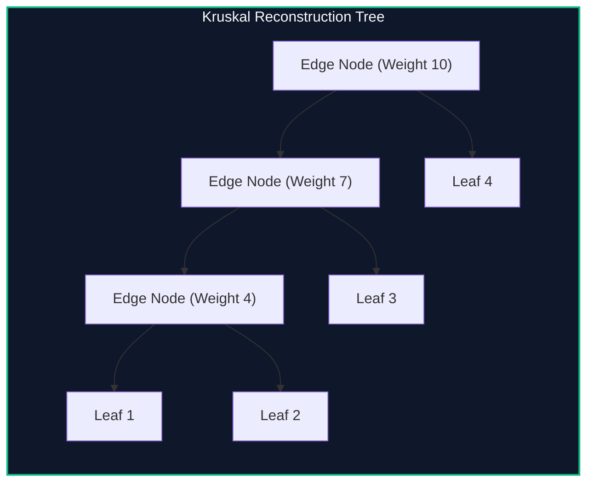

import { Callout } from "fumadocs-ui/components/callout";
import { Tabs, Tab } from "fumadocs-ui/components/tabs";
import { Steps, Step } from "fumadocs-ui/components/steps";
import { Cards, Card } from "fumadocs-ui/components/card";

## The Bottleneck Path Capacity Problem

Given an undirected weighted graph, answer queries of the form:

> "What is the minimum bottleneck edge weight on any path between vertex $u$ and vertex $v$?"
> "Which vertices are reachable from $u$ using edges of weight at most $W$?"

A naive answer requires Dijkstra or binary searching over MST subtrees in $\mathcal{O}(N)$.

The **Kruskal Reconstruction Tree (KRT)** (also known as the Reachability Tree) transforms this optimization problem into a static Lowest Common Ancestor (LCA) query.



---

## Construction Mechanics

During Kruskal's algorithm:

1. Initialize $N$ disjoint leaf nodes, one for each original vertex in $V$.
2. When considering edge $e = (u, v)$ with weight $w$:
   - If $\text{Find}(u) \neq \text{Find}(v)$:
     - Create a **new internal node** $T_{\text{new}}$ with value $w$.
     - Set the left child of $T_{\text{new}}$ to $\text{Find}(u)$ and the right child to $\text{Find}(v)$.
     - Merge sets: the new root in the DSU is $T_{\text{new}}$.

### Properties

- The reconstructed tree has exactly $2N - 1$ vertices (original vertices are leaves, internal vertices are edges).
- It is a **Min/Max-Heap** with respect to node values.
- **Bottleneck Invariant:** The bottleneck weight between $u$ and $v$ is exactly the value of $\text{LCA}(u, v)$ in the KRT!

---

## Implementation

<Tabs items={["Python", "TypeScript", "C++"]}>
<Tab value="Python">
```python
from typing import List, Tuple

class KruskalReconstructionTree:
def **init**(self, n: int, edges: List[Tuple[int, int, int]]):
self.n = n # Sort edges ascending by weight
edges.sort(key=lambda x: x[2])

        self.parent = list(range(2 * n))
        self.val = [0] * (2 * n)
        self.ch = [[0, 0] for _ in range(2 * n)]
        self.node_count = n

        for u, v, w in edges:
            ru = self._find(u)
            rv = self._find(v)
            if ru != rv:
                self.node_count += 1
                curr = self.node_count
                self.val[curr] = w
                self.ch[curr] = [ru, rv]
                self.parent[ru] = curr
                self.parent[rv] = curr
                self.parent[curr] = curr

    def _find(self, i: int) -> int:
        if self.parent[i] == i:
            return i
        self.parent[i] = self._find(self.parent[i])
        return self.parent[i]

````
</Tab>
<Tab value="TypeScript">
```typescript
export class KruskalReconstructionTree {
  private parent: number[];
  public val: number[];
  public ch: [number, number][];
  public nodeCount: number;

  constructor(n: number, edges: [number, number, number][]) {
    edges.sort((a, b) => a[2] - b[2]);

    this.parent = Array.from({ length: 2 * n }, (_, i) => i);
    this.val = new Array(2 * n).fill(0);
    this.ch = Array.from({ length: 2 * n }, () => [0, 0]);
    this.nodeCount = n;

    for (const [u, v, w] of edges) {
      const ru = this.find(u);
      const rv = this.find(v);
      if (ru !== rv) {
        this.nodeCount++;
        const curr = this.nodeCount;
        this.val[curr] = w;
        this.ch[curr] = [ru, rv];
        this.parent[ru] = curr;
        this.parent[rv] = curr;
        this.parent[curr] = curr;
      }
    }
  }

  public find(i: number): number {
    if (this.parent[i] === i) return i;
    this.parent[i] = this.find(this.parent[i]);
    return this.parent[i];
  }
}
````

</Tab>
<Tab value="C++">
```cpp
#include <iostream>
#include <vector>
#include <algorithm>

struct Edge {
int u, v, w;
bool operator<(const Edge& other) const { return w < other.w; }
};

class KruskalReconstructionTree {
int n;
std::vector<int> parent;

    int find(int i) {
        if (parent[i] == i) return i;
        return parent[i] = find(parent[i]);
    }

public:
int nodeCount;
std::vector<int> val;
std::vector<std::pair<int, int>> ch;

    KruskalReconstructionTree(int numNodes, std::vector<Edge>& edges)
        : n(numNodes), parent(2 * n), val(2 * n, 0), ch(2 * n, {0, 0}), nodeCount(n) {
        for (int i = 0; i < 2 * n; ++i) parent[i] = i;
        std::sort(edges.begin(), edges.end());

        for (const auto& e : edges) {
            int ru = find(e.u);
            int rv = find(e.v);
            if (ru != rv) {
                int curr = ++nodeCount;
                val[curr] = e.w;
                ch[curr] = {ru, rv};
                parent[ru] = curr;
                parent[rv] = curr;
                parent[curr] = curr;
            }
        }
    }

};

```
</Tab>
</Tabs>

---

## Complexity Breakdown

| Phase | Time Complexity | Space Complexity |
| :--- | :--- | :--- |
| **Kruskal Edge Sorting** | $\mathcal{O}(M \log M)$ | $\mathcal{O}(M)$ edges |
| **Tree Construction** | $\mathcal{O}(M \alpha(N))$ | Exactly $2N - 1$ nodes |
| **Bottleneck Query via LCA** | $\mathcal{O}(\log N)$ or $\mathcal{O}(1)$ RMQ | $\mathcal{O}(N \log N)$ binary lifting table |
```
