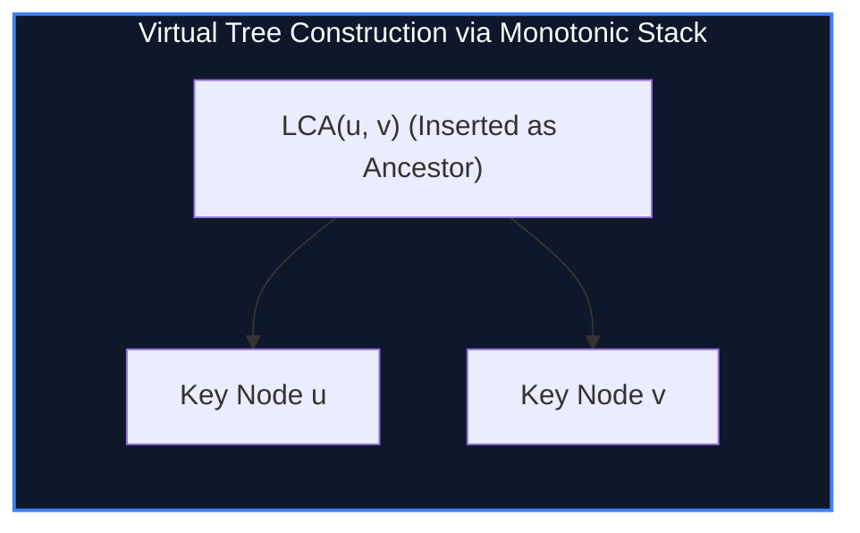

import { Callout } from "fumadocs-ui/components/callout";
import { Tabs, Tab } from "fumadocs-ui/components/tabs";
import { Steps, Step } from "fumadocs-ui/components/steps";
import { Cards, Card } from "fumadocs-ui/components/card";

## Compressing Trees for Sparse Dynamic Queries

In many tree problems, queries specify a subset of $K$ marked vertices:

$$\{v_1, v_2, \dots, v_K\} \subset V \quad \text{where } \sum K \le 10^5 \ll N$$

Running tree DP over the entire tree of size $N$ per query yields catastrophic $\mathcal{O}(Q \cdot N)$ runtime.

A **Virtual Tree (Auxiliary Tree)** condenses the massive tree into a minimal skeleton containing **only the $K$ marked vertices and their pairwise Lowest Common Ancestors (LCAs)**.

> **Structural Invariant:** A virtual tree over $K$ marked vertices contains at most $2K - 1$ vertices and $2K - 2$ edges!



---

## Construction Mechanics via DFS Order & Monotonic Stack

1. Sort the $K$ marked vertices by their original **DFS entry discovery time** (`tin[v]`).
2. Maintain a monotonic stack representing the rightmost branch of the virtual tree.
3. For each vertex $v$ in sorted order:
   - Compute $A = \text{LCA}(v, \text{stack.top()})$.
   - If $A \neq \text{stack.top()}$, pop nodes off the stack whose `tin` is greater than $A$'s, adding edges between popped nodes.
   - Insert $A$ if not already on the stack, then push $v$.

---

## Implementation

<Tabs items={["Python", "TypeScript", "C++"]}>
<Tab value="Python">
```python
from typing import List

class VirtualTreeBuilder:
def **init**(self, n: int, tin: List[int], lca_func):
self.tin = tin
self.lca = lca_func

    def build(self, key_nodes: List[int]) -> List[List[int]]:
        # Sort key nodes strictly by DFS entry time
        nodes = sorted(list(set(key_nodes)), key=lambda x: self.tin[x])
        if not nodes:
            return []

        adj = {}
        def add_edge(u, v):
            if u not in adj: adj[u] = []
            adj[u].append(v)

        stack = [nodes[0]]
        for v in nodes[1:]:
            anc = self.lca(v, stack[-1])
            if anc != stack[-1]:
                while len(stack) > 1 and self.tin[stack[-2]] >= self.tin[anc]:
                    add_edge(stack[-2], stack[-1])
                    stack.pop()
                if stack[-1] != anc:
                    add_edge(anc, stack[-1])
                    stack.pop()
                    stack.append(anc)
            stack.append(v)

        while len(stack) > 1:
            add_edge(stack[-2], stack[-1])
            stack.pop()

        return adj

````
</Tab>
<Tab value="TypeScript">
```typescript
export class VirtualTreeBuilder {
  constructor(
    private tin: number[],
    private lca: (u: number, v: number) => number
  ) {}

  public build(keyNodes: number[]): Map<number, number[]> {
    const nodes = Array.from(new Set(keyNodes)).sort(
      (a, b) => this.tin[a] - this.tin[b]
    );
    const adj = new Map<number, number[]>();

    const addEdge = (u: number, v: number) => {
      if (!adj.has(u)) adj.set(u, []);
      adj.get(u)!.push(v);
    };

    if (nodes.length === 0) return adj;

    const stack: number[] = [nodes[0]];

    for (let i = 1; i < nodes.length; i++) {
      const v = nodes[i];
      const anc = this.lca(v, stack[stack.length - 1]);

      if (anc !== stack[stack.length - 1]) {
        while (stack.length > 1 && this.tin[stack[stack.length - 2]] >= this.tin[anc]) {
          addEdge(stack[stack.length - 2], stack[stack.length - 1]);
          stack.pop();
        }
        if (stack[stack.length - 1] !== anc) {
          addEdge(anc, stack[stack.length - 1]);
          stack.pop();
          stack.push(anc);
        }
      }
      stack.push(v);
    }

    while (stack.length > 1) {
      addEdge(stack[stack.length - 2], stack[stack.length - 1]);
      stack.pop();
    }

    return adj;
  }
}
````

</Tab>
<Tab value="C++">
```cpp
#include <iostream>
#include <vector>
#include <algorithm>

struct VirtualTree {
int n;
const std::vector<int>& tin;

    VirtualTree(int numNodes, const std::vector<int>& dfsTime) : n(numNodes), tin(dfsTime) {}

    template<typename LCAFunc>
    std::vector<std::pair<int, int>> build(std::vector<int> nodes, LCAFunc lca) {
        std::sort(nodes.begin(), nodes.end(), [this](int a, int b) {
            return tin[a] < tin[b];
        });
        nodes.erase(std::unique(nodes.begin(), nodes.end()), nodes.end());

        std::vector<std::pair<int, int>> edges;
        if (nodes.empty()) return edges;

        std::vector<int> stk;
        stk.push_back(nodes[0]);

        for (size_t i = 1; i < nodes.size(); ++i) {
            int v = nodes[i];
            int anc = lca(v, stk.back());

            if (anc != stk.back()) {
                while (stk.size() > 1 && tin[stk[stk.size() - 2]] >= tin[anc]) {
                    edges.emplace_back(stk[stk.size() - 2], stk.back());
                    stk.pop_back();
                }
                if (stk.back() != anc) {
                    edges.emplace_back(anc, stk.back());
                    stk.pop_back();
                    stk.push_back(anc);
                }
            }
            stk.push_back(v);
        }

        while (stk.size() > 1) {
            edges.emplace_back(stk[stk.size() - 2], stk.back());
            stk.pop_back();
        }

        return edges;
    }

};

```
</Tab>
</Tabs>

---

## Complexity Breakdown

| Phase | Time Complexity | Node Count Bound |
| :--- | :--- | :--- |
| **Sorting Marked Nodes** | $\mathcal{O}(K \log K)$ | Exactly $K$ unique elements |
| **Monotonic Stack Assembly** | $\mathcal{O}(K)$ amortized pops | $\le 2K - 1$ total vertices |
```
