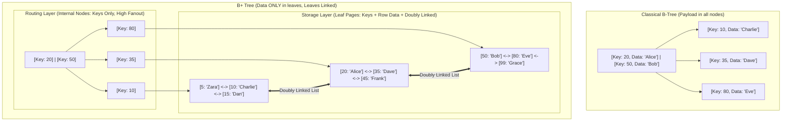
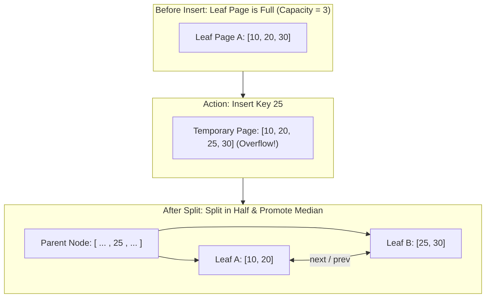

import { Callout } from "fumadocs-ui/components/callout";
import { Tabs, Tab } from "fumadocs-ui/components/tabs";
import { Steps, Step } from "fumadocs-ui/components/steps";
import { Cards, Card } from "fumadocs-ui/components/card";

When software engineers learn data structures in school, they fall in love with balanced binary search trees (AVL Trees, Red-Black Trees). With a time complexity of $O(\log_2 N)$, searching through a billion records takes only $\approx 30$ comparisons.

Yet, if you look inside **PostgreSQL**, **MySQL InnoDB**, **SQLite**, or the **Linux ext4 filesystem**, you will not find a single binary search tree storing primary table data on disk. Instead, you find **B-Trees** and **B+ Trees**.

Why did binary trees fail when applied to real-world persistent storage, and how does the architectural design of B+ Trees power the relational database industry?

---

## The Physical Hardware Reality: Memory Paging vs. Disk Blocks

The CPU does not read or write individual bytes to secondary storage (NVMe SSDs or mechanical hard drives). It operates in fixed-size blocks called **pages**:

- **Operating System Virtual Memory:** Typically **4 KB** pages.
- **MySQL InnoDB Storage Engine:** Default **16 KB** pages (`innodb_page_size`).
- **PostgreSQL Storage Engine:** Default **8 KB** disk blocks (`BLCKSZ`).

```
+-------------------------------------------------------------------------------+
| Storage Tier    | Latency        | Transfer Granularity | Access Penalty      |
+-------------------------------------------------------------------------------+
| L1/L2/L3 Cache  | 0.5 - 10 ns    | 64 bytes (Cache Line)| Negligible          |
| Main Memory     | ~100 ns        | 64 bytes             | 1x (Baseline)       |
| NVMe Flash SSD  | 10 - 100 µs    | 4 KB - 16 KB (Page)  | 100x - 1,000x       |
| Spinning Platter| 5 - 10 ms      | 4 KB Sector          | 50,000x - 100,000x  |
+-------------------------------------------------------------------------------+
```

When an application asks for a single 8-byte integer from disk, the hardware controller reads the **entire 4 KB to 16 KB block** into operating system kernel page buffers.

---

## Why Balanced Binary Search Trees Fail on Disk

Consider a Red-Black Tree or AVL Tree containing $N = 1,000,000,000$ (one billion) rows stored on disk.

Because a binary tree has a **fanout of 2**, its height $h$ is:

$$h = \lceil \log_2(1,000,000,000) \rceil \approx 30$$

Every node in a binary tree contains:

1. One key
2. One satellite payload / row reference
3. Two child pointers (`left`, `right`)

In memory, this node consumes around 32 to 64 bytes. If stored on disk, each node sits in an arbitrary memory address or disk page. Because child pointers point to randomly allocated memory addresses, traversing down one level of the binary tree requires a **random I/O seek**.

```
Traversing Binary Tree (Height = 30):
Root Page -> Random Seek -> Child 1 -> Random Seek -> Child 2 -> ... -> 30 Random Seeks!

On a mechanical HDD (10 ms per seek): 30 * 10 ms = 300 ms per single primary key lookup!
On an NVMe SSD (50 µs per seek):      30 * 50 µs = 1.5 ms per lookup (severe read amplification).
```

Furthermore, reading a 32-byte node forces the disk controller to read a whole 4,096-byte page. We throw away $99.2\%$ of the transferred data ($4064 / 4096$).

### The Multi-Way Search Tree Solution: High Fanout

To minimize disk I/O, we must drastically reduce tree height $h$. To reduce height, we must **increase the fanout (branching factor)**.

Instead of 2 children per node, what if each node contains hundreds of keys and matches the exact size of a physical disk block (e.g., 16 KB)?

If each node holds 1,000 keys and points to 1,001 children ($B = 1,000$):

$$h = \lceil \log_{1000}(1,000,000,000) \rceil = \mathbf{3}$$

A search through **one billion records** requires at most **3 disk reads**:

1. Read Root Page (almost always pinned in RAM buffer pool).
2. Read Intermediate Index Page (cached or single SSD read).
3. Read Leaf Data Page containing the target record.

Total disk I/O operations drop from **30 down to 1 or 2**.

---

## B-Tree vs. B+ Tree Architectural Comparison

Although Rudolf Bayer and Edward M. McCreight invented the standard B-Tree in 1970, modern database engines almost universally implement the **B+ Tree** variant.



### Why Databases Exclusively Choose B+ Trees:

1. **Significantly Higher Fanout in Internal Nodes:**
   In a classic B-Tree, internal nodes store keys **and full row payloads** (or row pointers). In a B+ Tree, internal nodes store **only search keys and child page pointers**. Because an 8-byte integer key and an 8-byte page pointer take only 16 bytes, a single 16 KB internal page can hold:
   $$\text{Fanout } B \approx \frac{16,384 \text{ bytes}}{16 \text{ bytes}} \approx 1,024 \text{ child pointers}$$
   Higher fanout means shallower trees and fewer disk page fetches.

2. **Ultra-Fast Range Scans (`BETWEEN`, `>`, `<`):**
   In a classic B-Tree, a range scan like `SELECT * FROM users WHERE id BETWEEN 10 AND 500` requires an in-order tree traversal jumping up and down parent and child nodes across dozens of non-contiguous disk pages.
   In a B+ Tree, the engine traverses down to find the starting key ($10$) in $O(\log_B N)$, and then **simply walks the leaf doubly linked list linearly** across disk pages until reaching $500$.

3. **Predictable Query Latency:**
   Every search query traverses exactly the same distance from root to leaf, providing consistent, deterministic latency profiles.

---

## B+ Tree Mechanics: Search, Insert & Node Splitting

A B+ Tree of order $M$ satisfies the following invariant:

- Every node has at most $M$ children.
- Every internal node (except root) has at least $\lceil M/2 \rceil$ children.
- The root node has at least 2 children if it is not a leaf.
- All leaf nodes appear at the exact same depth.
- A leaf node holds between $\lceil (M-1)/2 \rceil$ and $M-1$ key-value pairs.

### Node Splitting Walkthrough

When an insert causes a leaf page to exceed its maximum capacity ($M$ keys):

1. Allocate a brand new leaf node page.
2. Distribute the sorted keys evenly: the lower half stays in the existing leaf, and the upper half moves to the new leaf.
3. **Copy (promote)** the smallest key of the new leaf into the parent internal node to serve as the routing boundary.
4. Update the leaf pointers (`prev` and `next`) to preserve the contiguous doubly linked list.
5. If the parent internal node is also full, it splits recursively. If the root splits, a new root is created, increasing the tree height by 1.



---

## Complexity Analysis

Let $N$ be the total number of items, and $B$ be the node branching factor (fanout, typically $500 \le B \le 2000$).

| Operation                    | In-Memory Time    | Disk I/O Operations                                      | Space Complexity (Auxiliary) |
| :--------------------------- | :---------------- | :------------------------------------------------------- | :--------------------------- |
| **Point Lookup** (`id = 42`) | $O(\log_2 N)$     | $O(\log_B N) \le 3 \text{ to } 4$                        | $O(1)$                       |
| **Insertion**                | $O(\log_2 N)$     | $O(\log_B N)$ amortized                                  | $O(\log_B N)$ stack          |
| **Deletion**                 | $O(\log_2 N)$     | $O(\log_B N)$ amortized                                  | $O(\log_B N)$ stack          |
| **Range Scan ($K$ keys)**    | $O(\log_B N + K)$ | $O(\log_B N + \lceil K / \text{keys\_per\_page} \rceil)$ | $O(1)$                       |

<Callout type="info" title="Why Binary Search within Page is Negligible">
  Searching through 1,024 keys inside a 16 KB page loaded into L1 CPU cache
  takes $\approx 10$ binary search comparisons ($\approx 15 \text{nanoseconds}
  $). Compared to an NVMe flash fetch ($\approx 50,000 \text{nanoseconds}$),
  in-page compute cost is mathematically zero.
</Callout>

---

## Production Multi-Language Implementation

Here is a complete, working implementation of a self-balancing B+ Tree of configurable order $M$ supporting search, insertion with recursive page splitting, and linked-leaf range scanning.

<Tabs items={['Python', 'TypeScript', 'C++']}>
  <Tab value="Python">
```python
from __future__ import annotations
from typing import Any, List, Optional, Tuple

class BPlusTreeNode:
def **init**(self, is_leaf: bool = False):
self.is_leaf: bool = is_leaf
self.keys: List[int] = [] # For internal nodes: children are BPlusTreeNode pointers # For leaf nodes: children are data values
self.children: List[Any] = []
self.next: Optional[BPlusTreeNode] = None
self.prev: Optional[BPlusTreeNode] = None

class BPlusTree:
def **init**(self, order: int = 4):
if order < 3:
raise ValueError("Order must be at least 3")
self.order: int = order
self.root: BPlusTreeNode = BPlusTreeNode(is_leaf=True)

    def search(self, key: int) -> Optional[Any]:
        """Find value associated with key in O(log_B N) disk-page traversals."""
        leaf = self._find_leaf(self.root, key)
        for i, k in enumerate(leaf.keys):
            if k == key:
                return leaf.children[i]
        return None

    def range_query(self, start_key: int, end_key: int) -> List[Tuple[int, Any]]:
        """Fast range scan using leaf doubly linked list."""
        results: List[Tuple[int, Any]] = []
        leaf = self._find_leaf(self.root, start_key)

        while leaf is not None:
            for i, k in enumerate(leaf.keys):
                if start_key <= k <= end_key:
                    results.append((k, leaf.children[i]))
                elif k > end_key:
                    return results
            leaf = leaf.next
        return results

    def _find_leaf(self, node: BPlusTreeNode, key: int) -> BPlusTreeNode:
        if node.is_leaf:
            return node
        # Binary search or linear scan over keys to find routing child
        idx = 0
        while idx < len(node.keys) and key >= node.keys[idx]:
            idx += 1
        return self._find_leaf(node.children[idx], key)

    def insert(self, key: int, value: Any) -> None:
        """Insert key-value pair and handle page splitting upward."""
        # Note: The `delete` operation (including node merging and key borrowing)
        # is intentionally omitted for brevity. A production B+ Tree would need to
        # implement redistribution and merging when nodes underflow.
        root = self.root
        split_result = self._insert_internal(root, key, value)

        if split_result is not None:
            # Root had to split; create brand new root
            promoted_key, new_right_child = split_result
            new_root = BPlusTreeNode(is_leaf=False)
            new_root.keys = [promoted_key]
            new_root.children = [root, new_right_child]
            self.root = new_root

    def _insert_internal(self, node: BPlusTreeNode, key: int, value: Any) -> Optional[Tuple[int, BPlusTreeNode]]:
        if node.is_leaf:
            # Insert key and value maintaining sorted order
            idx = 0
            while idx < len(node.keys) and node.keys[idx] < key:
                idx += 1
            if idx < len(node.keys) and node.keys[idx] == key:
                # Update existing key
                node.children[idx] = value
                return None

            node.keys.insert(idx, key)
            node.children.insert(idx, value)

            # Check for page capacity overflow
            if len(node.keys) >= self.order:
                return self._split_leaf(node)
            return None
        else:
            # Internal routing node
            idx = 0
            while idx < len(node.keys) and key >= node.keys[idx]:
                idx += 1

            split = self._insert_internal(node.children[idx], key, value)
            if split is not None:
                promoted_key, new_child = split
                node.keys.insert(idx, promoted_key)
                node.children.insert(idx + 1, new_child)

                if len(node.keys) >= self.order:
                    return self._split_internal(node)
            return None

    def _split_leaf(self, leaf: BPlusTreeNode) -> Tuple[int, BPlusTreeNode]:
        mid = len(leaf.keys) // 2
        new_leaf = BPlusTreeNode(is_leaf=True)
        new_leaf.keys = leaf.keys[mid:]
        new_leaf.children = leaf.children[mid:]

        leaf.keys = leaf.keys[:mid]
        leaf.children = leaf.children[:mid]

        # Splice linked list pointers
        new_leaf.next = leaf.next
        if leaf.next:
            leaf.next.prev = new_leaf
        leaf.next = new_leaf
        new_leaf.prev = leaf

        # In B+ Tree, promoted key is copied from new_leaf[0]
        promoted_key = new_leaf.keys[0]
        return promoted_key, new_leaf

    def _split_internal(self, node: BPlusTreeNode) -> Tuple[int, BPlusTreeNode]:
        mid = len(node.keys) // 2
        promoted_key = node.keys[mid]

        new_internal = BPlusTreeNode(is_leaf=False)
        # In internal nodes, promoted key moves up (is NOT retained in right node)
        new_internal.keys = node.keys[mid + 1:]
        new_internal.children = node.children[mid + 1:]

        node.keys = node.keys[:mid]
        node.children = node.children[:mid + 1]

        return promoted_key, new_internal

````
  </Tab>
  <Tab value="TypeScript">
```typescript
export class BPlusTreeNode<K, V> {
  isLeaf: boolean;
  keys: K[] = [];
  children: (BPlusTreeNode<K, V> | V)[] = [];
  next: BPlusTreeNode<K, V> | null = null;
  prev: BPlusTreeNode<K, V> | null = null;

  constructor(isLeaf: boolean) {
    this.isLeaf = isLeaf;
  }
}

export class BPlusTree<K, V> {
  private root: BPlusTreeNode<K, V>;
  private readonly order: number;

  constructor(order: number = 4) {
    if (order < 3) throw new Error("Order must be >= 3");
    this.order = order;
    this.root = new BPlusTreeNode<K, V>(true);
  }

  public search(key: K): V | null {
    const leaf = this.findLeaf(this.root, key);
    for (let i = 0; i < leaf.keys.length; i++) {
      if (leaf.keys[i] === key) {
        return leaf.children[i] as V;
      }
    }
    return null;
  }

  public rangeQuery(startKey: K, endKey: K): Array<{ key: K; value: V }> {
    const results: Array<{ key: K; value: V }> = [];
    let leaf: BPlusTreeNode<K, V> | null = this.findLeaf(this.root, startKey);

    while (leaf !== null) {
      for (let i = 0; i < leaf.keys.length; i++) {
        const k = leaf.keys[i];
        if (k >= startKey && k <= endKey) {
          results.push({ key: k, value: leaf.children[i] as V });
        } else if (k > endKey) {
          return results;
        }
      }
      leaf = leaf.next;
    }
    return results;
  }

  private findLeaf(node: BPlusTreeNode<K, V>, key: K): BPlusTreeNode<K, V> {
    if (node.isLeaf) return node;
    let idx = 0;
    while (idx < node.keys.length && key >= node.keys[idx]) {
      idx++;
    }
    return this.findLeaf(node.children[idx] as BPlusTreeNode<K, V>, key);
  }

  public insert(key: K, value: V): void {
    // Note: The `delete` operation (including node merging and key borrowing)
    // is intentionally omitted for brevity. A production B+ Tree would need to
    // implement redistribution and merging when nodes underflow.
    const split = this.insertInternal(this.root, key, value);
    if (split) {
      const [promotedKey, newRight] = split;
      const newRoot = new BPlusTreeNode<K, V>(false);
      newRoot.keys = [promotedKey];
      newRoot.children = [this.root, newRight];
      this.root = newRoot;
    }
  }

  private insertInternal(
    node: BPlusTreeNode<K, V>,
    key: K,
    value: V
  ): [K, BPlusTreeNode<K, V>] | null {
    if (node.isLeaf) {
      let idx = 0;
      while (idx < node.keys.length && node.keys[idx] < key) idx++;
      if (idx < node.keys.length && node.keys[idx] === key) {
        node.children[idx] = value;
        return null;
      }
      node.keys.splice(idx, 0, key);
      node.children.splice(idx, 0, value);

      if (node.keys.length >= this.order) {
        return this.splitLeaf(node);
      }
      return null;
    } else {
      let idx = 0;
      while (idx < node.keys.length && key >= node.keys[idx]) idx++;
      const child = node.children[idx] as BPlusTreeNode<K, V>;
      const split = this.insertInternal(child, key, value);

      if (split) {
        const [promotedKey, newChild] = split;
        node.keys.splice(idx, 0, promotedKey);
        node.children.splice(idx + 1, 0, newChild);

        if (node.keys.length >= this.order) {
          return this.splitInternal(node);
        }
      }
      return null;
    }
  }

  private splitLeaf(leaf: BPlusTreeNode<K, V>): [K, BPlusTreeNode<K, V>] {
    const mid = Math.floor(leaf.keys.length / 2);
    const newLeaf = new BPlusTreeNode<K, V>(true);

    newLeaf.keys = leaf.keys.splice(mid);
    newLeaf.children = leaf.children.splice(mid);

    newLeaf.next = leaf.next;
    if (leaf.next) leaf.next.prev = newLeaf;
    leaf.next = newLeaf;
    newLeaf.prev = leaf;

    return [newLeaf.keys[0], newLeaf];
  }

  private splitInternal(node: BPlusTreeNode<K, V>): [K, BPlusTreeNode<K, V>] {
    const mid = Math.floor(node.keys.length / 2);
    const promotedKey = node.keys[mid];
    const newInternal = new BPlusTreeNode<K, V>(false);

    newInternal.keys = node.keys.splice(mid + 1);
    newInternal.children = node.children.splice(mid + 1);
    node.keys.pop(); // Remove promoted key from left node

    return [promotedKey, newInternal];
  }
}
````

  </Tab>
  <Tab value="C++">
```cpp
#include <iostream>
#include <vector>
#include <memory>
#include <algorithm>

template <typename K, typename V>
struct BPlusNode {
bool is_leaf;
std::vector<K> keys;
std::vector<std::shared_ptr<BPlusNode<K, V>>> children; // for internal
std::vector<V> values; // for leaf
std::shared_ptr<BPlusNode<K, V>> next = nullptr;
std::weak_ptr<BPlusNode<K, V>> prev;

    explicit BPlusNode(bool leaf) : is_leaf(leaf) {}

};

template <typename K, typename V>
class BPlusTree {
public:
explicit BPlusTree(size*t order = 4) : order*(order) {
root\_ = std::make_shared<BPlusNode<K, V>>(true);
}

    bool search(const K& key, V& out_value) const {
        auto leaf = find_leaf(root_, key);
        for (size_t i = 0; i < leaf->keys.size(); ++i) {
            if (leaf->keys[i] == key) {
                out_value = leaf->values[i];
                return true;
            }
        }
        return false;
    }

    std::vector<std::pair<K, V>> range_query(const K& start, const K& end) const {
        std::vector<std::pair<K, V>> results;
        auto leaf = find_leaf(root_, start);

        while (leaf != nullptr) {
            for (size_t i = 0; i < leaf->keys.size(); ++i) {
                const auto& k = leaf->keys[i];
                if (k >= start && k <= end) {
                    results.emplace_back(k, leaf->values[i]);
                } else if (k > end) {
                    return results;
                }
            }
            leaf = leaf->next;
        }
        return results;
    }

    void insert(const K& key, const V& value) {
        // Note: The `delete` operation (including node merging and key borrowing)
        // is intentionally omitted for brevity. A production B+ Tree would need to
        // implement redistribution and merging when nodes underflow.
        auto split = insert_recursive(root_, key, value);
        if (split.second != nullptr) {
            auto new_root = std::make_shared<BPlusNode<K, V>>(false);
            new_root->keys.push_back(split.first);
            new_root->children.push_back(root_);
            new_root->children.push_back(split.second);
            root_ = new_root;
        }
    }

private:
size*t order*;
std::shared*ptr<BPlusNode<K, V>> root*;

    std::shared_ptr<BPlusNode<K, V>> find_leaf(std::shared_ptr<BPlusNode<K, V>> node, const K& key) const {
        if (node->is_leaf) return node;
        size_t idx = 0;
        while (idx < node->keys.size() && key >= node->keys[idx]) idx++;
        return find_leaf(node->children[idx], key);
    }

    std::pair<K, std::shared_ptr<BPlusNode<K, V>>> insert_recursive(
        std::shared_ptr<BPlusNode<K, V>> node, const K& key, const V& value) {

        if (node->is_leaf) {
            auto it = std::lower_bound(node->keys.begin(), node->keys.end(), key);
            size_t idx = std::distance(node->keys.begin(), it);

            if (it != node->keys.end() && *it == key) {
                node->values[idx] = value;
                return {K{}, nullptr};
            }

            node->keys.insert(it, key);
            node->values.insert(node->values.begin() + idx, value);

            if (node->keys.size() >= order_) {
                return split_leaf(node);
            }
            return {K{}, nullptr};
        } else {
            size_t idx = 0;
            while (idx < node->keys.size() && key >= node->keys[idx]) idx++;

            auto split = insert_recursive(node->children[idx], key, value);
            if (split.second != nullptr) {
                node->keys.insert(node->keys.begin() + idx, split.first);
                node->children.insert(node->children.begin() + idx + 1, split.second);

                if (node->keys.size() >= order_) {
                    return split_internal(node);
                }
            }
            return {K{}, nullptr};
        }
    }

    std::pair<K, std::shared_ptr<BPlusNode<K, V>>> split_leaf(std::shared_ptr<BPlusNode<K, V>> leaf) {
        size_t mid = leaf->keys.size() / 2;
        auto new_leaf = std::make_shared<BPlusNode<K, V>>(true);

        new_leaf->keys.assign(leaf->keys.begin() + mid, leaf->keys.end());
        new_leaf->values.assign(leaf->values.begin() + mid, leaf->values.end());

        leaf->keys.erase(leaf->keys.begin() + mid, leaf->keys.end());
        leaf->values.erase(leaf->values.begin() + mid, leaf->values.end());

        new_leaf->next = leaf->next;
        leaf->next = new_leaf;

        return {new_leaf->keys[0], new_leaf};
    }

    std::pair<K, std::shared_ptr<BPlusNode<K, V>>> split_internal(std::shared_ptr<BPlusNode<K, V>> node) {
        size_t mid = node->keys.size() / 2;
        K promoted_key = node->keys[mid];

        auto new_internal = std::make_shared<BPlusNode<K, V>>(false);
        new_internal->keys.assign(node->keys.begin() + mid + 1, node->keys.end());
        new_internal->children.assign(node->children.begin() + mid + 1, node->children.end());

        node->keys.erase(node->keys.begin() + mid, node->keys.end());
        node->children.erase(node->children.begin() + mid + 1, node->children.end());

        return {promoted_key, new_internal};
    }

};

````
  </Tab>
</Tabs>

---

## Production Systems Case Studies

### 1. MySQL InnoDB: Clustered Index Mechanics
In MySQL's default storage engine (**InnoDB**), every table is structured physically as a B+ Tree known as the **Clustered Index**:
- The **PRIMARY KEY** forms the search key of the clustered B+ Tree.
- The leaf pages of the clustered index contain the **entire row data** (all columns).
- **Secondary Indexes** (e.g., `INDEX (email)`) are also B+ Trees, but their leaf pages do **not** contain row data; they store the matching `PRIMARY KEY` value. Finding a row via `email` requires two traversals (**Index Lookup $\rightarrow$ Clustered Key Lookup** or "bookmark lookup").

<Callout type="warn" title="Why Random UUID Primary Keys Destroy InnoDB Write Throughput">
If you use random UUIDv4 strings as primary keys instead of auto-incrementing integers (`BIGINT AUTO_INCREMENT` or ordered UUIDv7):
1. New inserts land at random locations throughout the tree instead of sequentially appending to the rightmost leaf page.
2. Pages fill up randomly, triggering continuous, expensive **page splits** and severe disk fragmentation.
3. Cold pages must constantly be read from disk into the InnoDB Buffer Pool, causing massive cache eviction thrashing.
</Callout>

### 2. PostgreSQL: Heap Files vs. B-Tree Indexes
Unlike MySQL InnoDB, PostgreSQL does **not** cluster tables by primary key by default:
- Primary table data is stored in unordered append-friendly disk pages called **Heap Files**.
- All indexes (including the primary key index) are separate B+ Trees whose leaves contain **Tuple IDs (TIDs)**: a pair of `(Page Number, Item Offset)` pointing directly into the Heap.
- To handle range query updates without page fragmentation, PostgreSQL indexes support a configurable **`fillfactor`** (default $90\%$), leaving $10\%$ empty headroom in each page for future updates.

---

## Technical Interview Patterns & Pitfalls

### Pattern 1: Composite Index & Leftmost Prefix Rule
When a database index is created on multiple columns:
```sql
CREATE INDEX idx_user ON users (country, city, age);
````

The B+ Tree sorts keys lexicographically by `country`, then `city`, then `age`.

- `WHERE country = 'US' AND city = 'Austin'` uses the B+ Tree index efficiently.
- `WHERE city = 'Austin'` **cannot** use this index, because the root routing decisions are ordered by `country`. It will trigger a full table scan.

### Pattern 2: B-Tree Height Calculation for System Design Interviews

In a system design interview, when asked how many disk seeks are needed to find a user among 500 million records:

1. Estimate page size: $16 \text{ KB}$.
2. Key size + pointer size: $8 \text{ B} + 8 \text{ B} = 16 \text{ B}$.
3. Page capacity (fanout): $\approx 16,384 / 16 \approx 1,024$.
4. Height: $\log_{1024}(500,000,000) \approx \frac{\log_{10}(5 \times 10^8)}{\log_{10}(1024)} \approx \frac{8.7}{3.01} \approx 2.89 \implies \mathbf{3 \text{ levels}}$.
5. Conclusion: With root and level 1 cached in RAM, exactly **1 physical disk read** is required!

---

## Hands-On Verification Challenge

Given the following parameters for an enterprise database table:

- Page size: $8,192 \text{ bytes}$ ($8 \text{ KB}$).
- Primary key: 64-bit integer ($8 \text{ bytes}$).
- Page pointer: 64-bit integer ($8 \text{ bytes}$).
- Leaf record payload: 256 bytes per user row.
- Table row count: $100,000,000$ (one hundred million rows).

**Calculate:**

1. What is the maximum fanout of internal routing nodes?
2. How many records fit in one leaf page?
3. What is the minimum height of this B+ Tree?
4. If the top 2 levels of the tree are pinned in the OS buffer cache, how many disk I/Os are required to execute `SELECT * WHERE id = 482910`?

<Callout type="info" title="Solution">
1. Internal fanout: $8192 / (8 + 8) = \mathbf{512 \text{ pointers}}$.
2. Leaf capacity: $\lfloor 8192 / 256 \rfloor = \mathbf{32 \text{ rows per leaf page}}$.
3. Total leaf pages needed: $100,000,000 / 32 = 3,125,000 \text{ leaves}$.
   Tree height above leaves: $\lceil \log_{512}(3,125,000) \rceil = \lceil 2.4 \rceil = 3$ levels of internal nodes $+ 1$ level of leaves = **4 levels total**.
4. With top 2 levels cached in RAM, exactly $4 - 2 = \mathbf{2 \text{ disk I/Os}}$ are required to fetch the leaf page.
</Callout>
