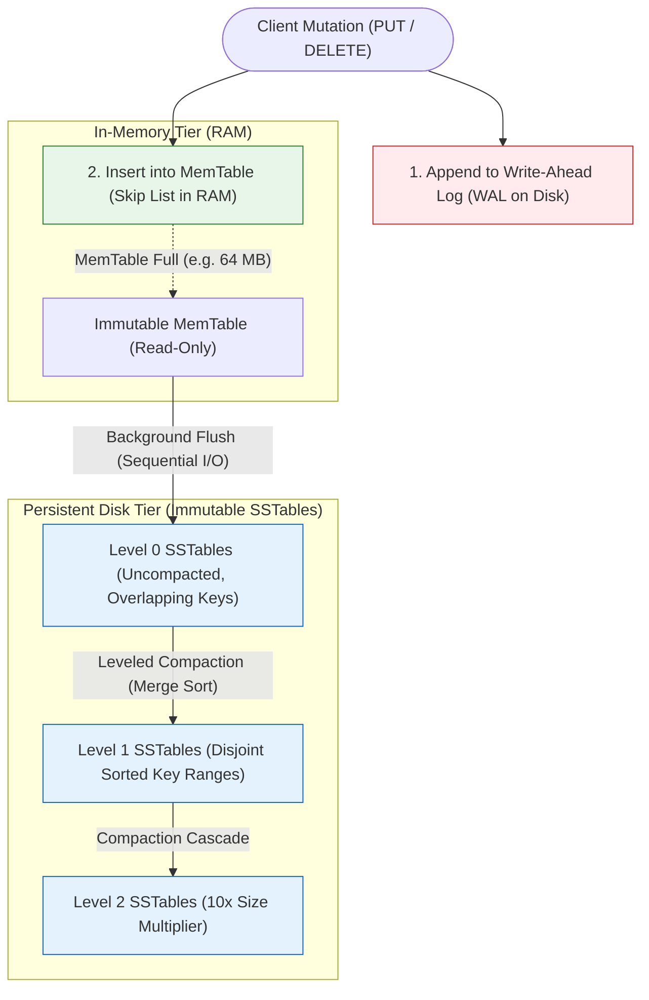
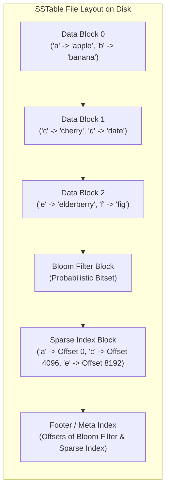
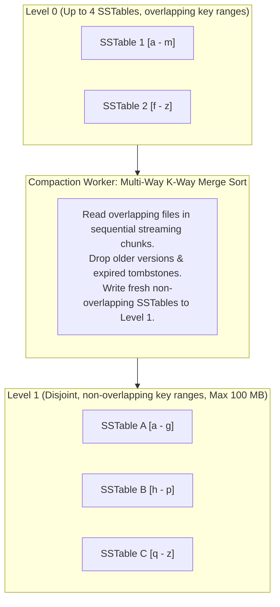

import { Callout } from "fumadocs-ui/components/callout";
import { Tabs, Tab } from "fumadocs-ui/components/tabs";
import { Steps, Step } from "fumadocs-ui/components/steps";
import { Cards, Card } from "fumadocs-ui/components/card";

While relational databases like **PostgreSQL** and **MySQL InnoDB** rely on B+ Trees for balanced read-heavy transactional workloads, modern high-throughput distributed systems—such as **RocksDB**, **Apache Cassandra**, **Google Bigtable**, **ScyllaDB**, and **ClickHouse**—rely on **Log-Structured Merge-Trees (LSM-Trees)**.

Why did modern systems abandon in-place B+ Tree updates when building write-intensive platforms? The answer lies in the fundamental physics of physical storage hardware: the staggering throughput difference between **sequential I/O** and **random I/O**, and the metric known as **Write Amplification**.

---

## The Hardware Dilemma: In-Place Updates vs. Sequential Appends

In a B+ Tree, modifying a single 32-byte record requires:

1. Locating the 16 KB page on disk containing that record.
2. Modifying the 32 bytes in memory.
3. Writing the **entire 16 KB page back to disk** at its physical block offset.

This phenomenon is known as **Write Amplification (WA)**:

$$\text{Write Amplification} = \frac{\text{Bytes Written to Underlying Storage Media}}{\text{Bytes Written by the Application}}$$

For a 32-byte update in a 16 KB page:
$$\text{Write Amplification} = \frac{16,384 \text{ bytes}}{32 \text{ bytes}} = \mathbf{512\times}$$

On modern flash NVMe SSDs, write amplification causes two critical problems:

1. **Bus & Controller Bottleneck:** Saturating the storage bus with redundant page writes limits write throughput.
2. **Flash Wear & Premature SSD Death:** NAND flash memory cannot be overwritten in-place; blocks must be erased before rewriting. A high write amplification rapidly burns through an SSD's Program/Erase (P/E) cycles.

```
+-----------------------------------------------------------------------------------------+
| Storage Operation (NVMe SSD)       | Throughput Profile   | IOPS Overhead               |
+-----------------------------------------------------------------------------------------+
| Random In-Place Page Overwrites    | 100 - 300 MB/s       | High (Lock contention & GC) |
| Sequential Append-Only Streaming   | 3,500 - 7,000 MB/s   | Minimal (Peak hardware bus) |
+-----------------------------------------------------------------------------------------+
```

**The Core LSM-Tree Insight:** Never update or delete existing data in-place on disk. Instead, turn **every single mutation (insert, update, delete)** into an **append-only sequential write**.

---

## LSM-Tree Architecture & End-to-End Write Path

An LSM-Tree engine splits its architecture across RAM and persistent storage into three foundational tiers:



<Steps>
  <Step>
    #### Step 1: Write-Ahead Log (WAL)
    Every mutation (`PUT user_101 '{"role":"admin"}'` or `DELETE user_99`) is immediately appended to an append-only file on disk. This is a pure sequential disk write—extremely fast. If power fails, the database recovers by replaying the log.
  </Step>
  <Step>
    #### Step 2: In-Memory MemTable
    Concurrently, the key-value pair is inserted into a sorted in-memory data structure called the **MemTable** (typically a concurrent **Skip List** or Red-Black Tree). Because it lives in RAM, writes complete in microseconds with zero random disk I/O.
  </Step>
  <Step>
    #### Step 3: MemTable Flush to SSTable
    When the MemTable reaches a configurable threshold (e.g., 64 MB), it is frozen into an **Immutable MemTable**. A new active MemTable is spun up to accept incoming writes without interruption. A background worker thread iterates through the frozen sorted structure and flushes it to disk as an **SSTable (Sorted String Table)**.
  </Step>
</Steps>

---

## Anatomy of an SSTable (Sorted String Table)

An **SSTable** is a strictly immutable, sequentially sorted file on disk. Because the keys are guaranteed to be sorted, the file does not require a full dense index of every key.



### Components of an SSTable:

1. **Data Blocks:** Chunks of contiguous sorted key-value pairs (usually 4 KB to 64 KB), compressed using lightweight codecs like LZ4 or Zstandard.
2. **Bloom Filter Block:** A compact probabilistic bit array. Before reading any data block from disk, the engine queries the Bloom filter. If the Bloom filter returns "Negative", the engine **guarantees** the key does not exist in this SSTable, skipping the disk read entirely!
3. **Sparse Index Block:** Stores the boundary keys and byte offsets of each Data Block (e.g., `"a"` starts at byte 0, `"c"` starts at byte 4096). The entire sparse index is kept loaded in RAM.
4. **Footer:** Fixed-size block at the very end of the file containing byte pointers to the Index Block and Meta/Bloom blocks.

---

## Deletions via Tombstones

How do you delete a key from an immutable file that cannot be modified?

In an LSM-Tree, a deletion is executed as an **append-only insertion of a Tombstone record**:

```
PUT key="user_42" value=TOMBSTONE (timestamp = 1718002000)
```

When a query searches for `user_42`, it reads the most recent entry from the MemTable or highest-level SSTable. Seeing the tombstone marker, it immediately returns `NOT FOUND`. The physical disk bytes of the deleted record are eventually reclaimed during **Compaction**.

---

## Leveled Compaction vs. Size-Tiered Compaction

As flushes occur, dozens of SSTables accumulate on disk. If left unmanaged:

- **Read Amplification explodes:** A point read would have to check dozens of files on disk.
- **Space Amplification explodes:** Multiple obsolete versions of updated keys and deleted tombstones consume storage.

**Compaction** is the background maintenance process that merges multiple SSTables into new sorted SSTables, discarding overwritten versions and tombstones (analogous to the Merge step of Merge Sort).



### 1. Leveled Compaction (RocksDB, LevelDB)

- **Level 0 (L0):** Created directly by flushes from MemTables. Keys can overlap between L0 files.
- **Level 1 to Level $K$:** Each level has a fixed capacity (e.g., L1 = 10 MB, L2 = 100 MB, L3 = 1 GB, multiplying by $10\times$ at each level).
- **Disjoint Invariant:** In Level 1 and higher, SSTables have **mutually exclusive, non-overlapping key ranges**.
- **Lookup Advantage:** To find a key in Level 1, the engine performs a single binary search over the level's file boundary metadata, checking at most **one SSTable per level**.

### 2. Size-Tiered Compaction (Apache Cassandra default)

- Accumulates SSTables of similar sizes within each tier.
- When $N$ files of similar size exist (e.g., 4 files of 100 MB), it merges them into one single 400 MB file.
- **Trade-off:** Lower write amplification, but requires up to $50\%$ transient free disk space during major compactions.

---

## Complexity & Algorithmic Trade-offs: The RUM Conjecture

The **RUM Conjecture** (Read, Update, Memory/Space) dictates that optimizing for any two storage dimensions comes at the expense of the third.

| Storage Architecture              | Write Amplification (Updates) | Read Amplification (Point Lookups)    | Space Amplification                | Primary Use Case                       |
| :-------------------------------- | :---------------------------- | :------------------------------------ | :--------------------------------- | :------------------------------------- |
| **B+ Tree (InnoDB, Postgres)**    | High ($50\times - 500\times$) | Low ($1 - 3$ disk reads)              | Moderate ($1.2\times - 1.5\times$) | Transactional OLTP, Read-heavy         |
| **LSM-Tree (RocksDB, Cassandra)** | Low ($10\times - 30\times$)   | Moderate ($1 - 5$ with Bloom filters) | Low ($1.1\times - 1.2\times$)      | High-throughput Ingestion, Time-series |

### Big-O Complexity Comparison

| Operation                 | Classical B+ Tree                  | LSM-Tree (with Bloom Filter)                                   |
| :------------------------ | :--------------------------------- | :------------------------------------------------------------- |
| **Write (Insert/Update)** | $O(\log_B N)$ random disk I/O      | $\mathbf{O(1)}$ amortized (sequential append)                  |
| **Point Lookup (`GET`)**  | $O(\log_B N)$ random disk I/O      | $O(L)$ where $L$ is number of levels (each filtered in $O(1)$) |
| **Range Scan**            | $O(\log_B N + K)$ linear leaf walk | $O(L \cdot \log N + K)$ multi-way heap merge                   |
| **Delete**                | $O(\log_B N)$ random page write    | $\mathbf{O(1)}$ append tombstone                               |

---

## Production Multi-Language Implementation

Here is a functional, end-to-end Mini LSM-Tree engine featuring an active **MemTable**, **WAL append logger**, **SSTable serialization with Sparse Index**, and **multi-level point query with Tombstone resolution**.

<Tabs items={['Python', 'TypeScript', 'C++']}>
  <Tab value="Python">
```python
from __future__ import annotations
import os
import bisect
from typing import Dict, List, Optional, Tuple

TOMBSTONE = "**LSM_TOMBSTONE_DELETED**"

class SSTable:
"""Simulates an immutable Sorted String Table on disk."""
def **init**(self, data: List[Tuple[str, str]], table_id: int):
self.table_id = table_id # Sorted data entries on disk
self.entries: List[Tuple[str, str]] = sorted(data, key=lambda x: x[0]) # Sparse index: stores key and offset every 'stride' items
self.sparse_index: List[Tuple[str, int]] = []
self.\_build_sparse_index(stride=2)

    def _build_sparse_index(self, stride: int) -> None:
        for idx in range(0, len(self.entries), stride):
            self.sparse_index.append((self.entries[idx][0], idx))

    def get(self, key: str) -> Optional[Tuple[bool, str]]:
        """
        Uses sparse index to binary search the target block,
        then performs localized scan. Returns (is_tombstone, value) or None.
        """
        if not self.entries:
            return None
        if key < self.entries[0][0] or key > self.entries[-1][0]:
            return None

        # Binary search sparse index
        sparse_keys = [k for k, _ in self.sparse_index]
        idx = bisect.bisect_right(sparse_keys, key) - 1
        if idx < 0:
            idx = 0

        start_offset = self.sparse_index[idx][1]
        end_offset = (
            self.sparse_index[idx + 1][1]
            if idx + 1 < len(self.sparse_index)
            else len(self.entries)
        )

        for i in range(start_offset, end_offset):
            curr_k, curr_v = self.entries[i]
            if curr_k == key:
                if curr_v == TOMBSTONE:
                    return (True, "")
                return (False, curr_v)
            elif curr_k > key:
                break
        return None

class LSMTree:
"""Production-modeled Log-Structured Merge Tree engine."""
def **init**(self, memtable_threshold: int = 4):
self.memtable_threshold = memtable_threshold
self.memtable: Dict[str, str] = {}
self.sstables: List[SSTable] = [] # Index 0 is most recent
self.table_counter = 0

    def put(self, key: str, value: str) -> None:
        """Sequential WAL log + MemTable insert."""
        self._append_to_wal(key, value)
        self.memtable[key] = value

        if len(self.memtable) >= self.memtable_threshold:
            self.flush()

    def delete(self, key: str) -> None:
        """Appends tombstone marker."""
        self.put(key, TOMBSTONE)

    def get(self, key: str) -> Optional[str]:
        """
        Read Path Hierarchy:
        1. Active MemTable (RAM)
        2. SSTables (from newest to oldest)
        """
        # 1. Check active MemTable
        if key in self.memtable:
            val = self.memtable[key]
            return None if val == TOMBSTONE else val

        # 2. Check SSTables from newest to oldest
        for sstable in self.sstables:
            res = sstable.get(key)
            if res is not None:
                is_tombstone, val = res
                return None if is_tombstone else val

        return None

    def flush(self) -> None:
        """Freezes MemTable and writes sorted immutable SSTable."""
        if not self.memtable:
            return
        self.table_counter += 1
        items = list(self.memtable.items())
        new_sstable = SSTable(items, self.table_counter)
        self.sstables.insert(0, new_sstable)  # Prepend newest
        self.memtable.clear()

    def _append_to_wal(self, key: str, value: str) -> None:
        # Sequential append to WAL file simulation
        pass

````
  </Tab>
  <Tab value="TypeScript">
```typescript
export const TOMBSTONE = "__LSM_TOMBSTONE_DELETED__";

export class SSTable {
  public readonly tableId: number;
  private readonly entries: Array<{ key: string; value: string }>;
  private readonly sparseIndex: Array<{ key: string; offset: number }> = [];

  constructor(data: Array<{ key: string; value: string }>, tableId: number) {
    this.tableId = tableId;
    this.entries = [...data].sort((a, b) => a.key.localeCompare(b.key));
    this.buildSparseIndex(2);
  }

  private buildSparseIndex(stride: number): void {
    for (let i = 0; i < this.entries.length; i += stride) {
      this.sparseIndex.push({ key: this.entries[i].key, offset: i });
    }
  }

  public get(key: string): { isTombstone: boolean; value: string } | null {
    if (this.entries.length === 0) return null;
    if (
      key < this.entries[0].key ||
      key > this.entries[this.entries.length - 1].key
    ) {
      return null;
    }

    // Binary search sparse index
    let low = 0;
    let high = this.sparseIndex.length - 1;
    let blockIdx = 0;

    while (low <= high) {
      const mid = Math.floor((low + high) / 2);
      if (this.sparseIndex[mid].key <= key) {
        blockIdx = mid;
        low = mid + 1;
      } else {
        high = mid - 1;
      }
    }

    const startOffset = this.sparseIndex[blockIdx].offset;
    const endOffset =
      blockIdx + 1 < this.sparseIndex.length
        ? this.sparseIndex[blockIdx + 1].offset
        : this.entries.length;

    for (let i = startOffset; i < endOffset; i++) {
      const item = this.entries[i];
      if (item.key === key) {
        return {
          isTombstone: item.value === TOMBSTONE,
          value: item.value === TOMBSTONE ? "" : item.value,
        };
      }
      if (item.key > key) break;
    }

    return null;
  }
}

export class LSMTree {
  private memtable = new Map<string, string>();
  private readonly sstables: SSTable[] = [];
  private readonly memtableThreshold: number;
  private tableCounter = 0;

  constructor(memtableThreshold: number = 4) {
    this.memtableThreshold = memtableThreshold;
  }

  public put(key: string, value: string): void {
    this.memtable.set(key, value);
    if (this.memtable.size >= this.memtableThreshold) {
      this.flush();
    }
  }

  public delete(key: string): void {
    this.put(key, TOMBSTONE);
  }

  public get(key: string): string | null {
    if (this.memtable.has(key)) {
      const val = this.memtable.get(key)!;
      return val === TOMBSTONE ? null : val;
    }

    for (const sstable of this.sstables) {
      const result = sstable.get(key);
      if (result !== null) {
        return result.isTombstone ? null : result.value;
      }
    }

    return null;
  }

  public flush(): void {
    if (this.memtable.size === 0) return;
    this.tableCounter++;

    const data: Array<{ key: string; value: string }> = [];
    this.memtable.forEach((value, key) => data.push({ key, value }));

    const sstable = new SSTable(data, this.tableCounter);
    this.sstables.unshift(sstable); // Prepend newest table
    this.memtable.clear();
  }
}
````

  </Tab>
  <Tab value="C++">
```cpp
#include <iostream>
#include <string>
#include <vector>
#include <map>
#include <algorithm>
#include <memory>
#include <optional>

const std::string TOMBSTONE = "**LSM_TOMBSTONE_DELETED**";

struct Entry {
std::string key;
std::string value;
};

struct SparseIndexEntry {
std::string key;
size_t offset;
};

class SSTable {
public:
SSTable(std::vector<Entry> data, int id) : table*id*(id), entries*(std::move(data)) {
std::sort(entries*.begin(), entries\_.end(), [](const Entry& a, const Entry& b) {
return a.key < b.key;
});
build_sparse_index(2);
}

    std::optional<std::pair<bool, std::string>> get(const std::string& key) const {
        if (entries_.empty() || key < entries_.front().key || key > entries_.back().key) {
            return std::nullopt;
        }

        // Binary search sparse index
        size_t block_idx = 0;
        int low = 0, high = static_cast<int>(sparse_index_.size()) - 1;
        while (low <= high) {
            int mid = low + (high - low) / 2;
            if (sparse_index_[mid].key <= key) {
                block_idx = mid;
                low = mid + 1;
            } else {
                high = mid - 1;
            }
        }

        size_t start = sparse_index_[block_idx].offset;
        size_t end = (block_idx + 1 < sparse_index_.size()) ? sparse_index_[block_idx + 1].offset : entries_.size();

        for (size_t i = start; i < end; ++i) {
            if (entries_[i].key == key) {
                bool is_tombstone = (entries_[i].value == TOMBSTONE);
                return std::make_pair(is_tombstone, is_tombstone ? "" : entries_[i].value);
            }
            if (entries_[i].key > key) break;
        }
        return std::nullopt;
    }

private:
int table*id*;
std::vector<Entry> entries*;
std::vector<SparseIndexEntry> sparse_index*;

    void build_sparse_index(size_t stride) {
        for (size_t i = 0; i < entries_.size(); i += stride) {
            sparse_index_.push_back({entries_[i].key, i});
        }
    }

};

class LSMTree {
public:
explicit LSMTree(size*t threshold = 4) : threshold*(threshold) {}

    void put(const std::string& key, const std::string& value) {
        memtable_[key] = value;
        if (memtable_.size() >= threshold_) {
            flush();
        }
    }

    void del(const std::string& key) {
        put(key, TOMBSTONE);
    }

    std::optional<std::string> get(const std::string& key) const {
        auto it = memtable_.find(key);
        if (it != memtable_.end()) {
            if (it->second == TOMBSTONE) return std::nullopt;
            return it->second;
        }

        for (const auto& sstable : sstables_) {
            auto res = sstable->get(key);
            if (res.has_value()) {
                if (res->first) return std::nullopt; // Tombstone found
                return res->second;
            }
        }
        return std::nullopt;
    }

    void flush() {
        if (memtable_.empty()) return;
        std::vector<Entry> entries;
        entries.reserve(memtable_.size());
        for (auto& [k, v] : memtable_) {
            entries.push_back({k, v});
        }
        counter_++;
        sstables_.insert(sstables_.begin(), std::make_shared<SSTable>(std::move(entries), counter_));
        memtable_.clear();
    }

private:
size*t threshold*;
int counter* = 0;
std::map<std::string, std::string> memtable*;
std::vector<std::shared*ptr<SSTable>> sstables*;
};

```
  </Tab>
</Tabs>

---

## Production Systems Case Studies

### 1. RocksDB (Meta): Leveled Compaction & Write Stalls
Developed at Meta as an embedded key-value engine, **RocksDB** powers MySQL MyRocks, CockroachDB, and Kafka Streams:
- **Write Stalls:** If incoming client write throughput outpaces background compaction threads, Level 0 accumulates dozens of files. RocksDB deliberately throttles or pauses client writes to avoid runaway read degradation.
- **Dynamic Level Base Size:** Automatically adjusts level sizes based on actual storage utilization to minimize Write Amplification ($WA \approx 10 - 25$).

### 2. Apache Cassandra: High-Volume Writes & GC Grace Seconds
In Apache Cassandra, every write hits an append-only commit log and an in-memory Memtable:
- Deletions create tombstones with a timestamp.
- **`gc_grace_seconds` (default 10 days):** Tombstones are intentionally kept alive during compaction for 10 days to guarantee that distributed nodes that were temporarily offline receive the deletion notice during gossip anti-entropy repair.

### 3. ClickHouse: MergeTree Engine
ClickHouse organizes columnar tables using the **MergeTree** family:
- Every insert batch forms a new immutable disk "part" containing compressed columns.
- Background merges asynchronously combine small parts into large parts, evaluating primary key ordering and columnar codecs.

---

## Technical Interview Patterns & Pitfalls

<Callout type="warn" title="The Tombstone Range Query Trap">
If an application frequently deletes records, millions of tombstones accumulate in Level 0 and Level 1.
When executing range queries (e.g., `SCAN key_001 TO key_999`), the iterator must inspect, compare, and discard thousands of tombstone records sequentially, degrading read latency from 2 ms to several seconds. Mitigate this by tuning compaction triggers or redesigning table partitions.
</Callout>

### Common Interview Question: "Design a High-Throughput Time-Series Metric Ingest Engine"
- **Answer Structure:**
  1. Highlight why B+ Trees fail (random I/O writes thrash the page cache).
  2. Propose an LSM-Tree architecture: MemTable in DRAM for microsecond writes.
  3. Append to sequential WAL on NVMe SSD for durability.
  4. Flush to SSTables partitioned by time windows (e.g., 2-hour buckets).
  5. Use Bloom filters to immediately discard non-existent metric IDs on queries.

---

## Hands-On Verification Challenge

**Scenario:** A real-time sensor ingestion platform receives $100,000$ writes/sec ($100$ bytes per write = $10 \text{ MB/sec}$).

1. **Calculate:** If using a B+ Tree with a 16 KB page size where each write lands in a random page, what is the theoretical disk write bandwidth required?
2. **Calculate:** If using an LSM-Tree where writes are sequentially appended to a WAL and flushed in 64 MB batches, what is the raw disk bandwidth required?
3. What is the ratio of write amplification reduction?

<Callout type="info" title="Solution">
1. B+ Tree random write bandwidth: $100,000 \text{ writes/sec} \times 16,384 \text{ bytes/write} = \mathbf{1.638 \text{ GB/sec}}$.
2. LSM-Tree sequential WAL bandwidth: $100,000 \times 100 \text{ bytes} = \mathbf{10 \text{ MB/sec}}$ (plus background flush at $\approx 10 \text{ MB/sec}$, total $\approx 20 \text{ MB/sec}$).
3. Reduction ratio: $1,638 \text{ MB/s} / 20 \text{ MB/s} \approx \mathbf{81.9\times \text{ bandwidth savings}}$.
</Callout>
```
