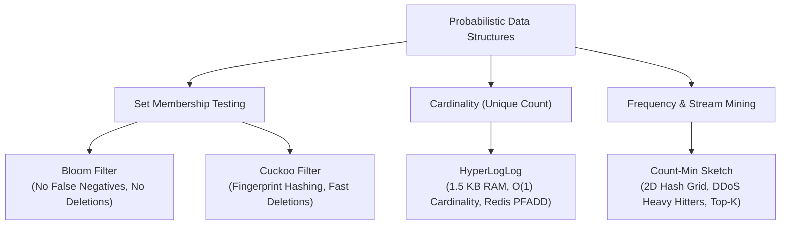
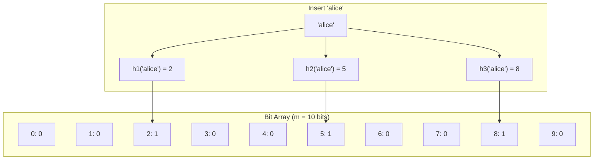
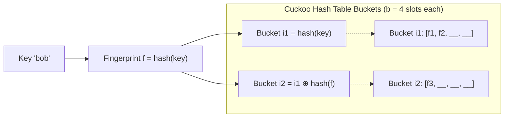
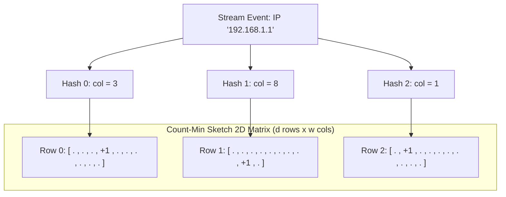

import { Callout } from "fumadocs-ui/components/callout";
import { Tabs, Tab } from "fumadocs-ui/components/tabs";
import { Steps, Step } from "fumadocs-ui/components/steps";
import { Cards, Card } from "fumadocs-ui/components/card";

When systems scale to hundreds of millions or billions of items, traditional deterministic data structures hit an immovable physical wall: **Memory Capacity**.

Consider tracking unique daily active users for a global service with 1 billion users:

- Storing 1 billion 64-bit integer IDs in a standard hash set requires at least:
  $$10^9 \times 8 \text{ bytes} = 8 \text{ GB}$$
  With hash table load factor padding and pointer overhead, real memory consumption easily balloons to **24 GB - 32 GB of RAM**.
- Run that across 50,000 live metrics, and no distributed cluster on Earth can afford the memory footprint.

**The Probabilistic Revolution:** What if you allow a microscopic, mathematically bounded margin of error (e.g., $0.8\%$ or $1\%$)?

- A **Bloom Filter** can test membership of 1 billion items in **1.1 GB**.
- A **HyperLogLog** can count 1 billion unique items using just **1.5 KB of RAM**—an astounding **$5,000,000\times$ compression ratio**.

---

## The Probabilistic Taxonomy



---

## 1. Bloom Filters: Zero False Negatives

A **Bloom Filter** (invented by Burton Howard Bloom in 1970) is a space-efficient probabilistic bit array used to test whether an element is a member of a set.



### The Invariant Principles:

1. **Adding an element:** Pass the key through $k$ independent hash functions, yielding indices $h_1(x), h_2(x), \dots, h_k(x) \pmod m$. Set all $k$ bits to `1`.
2. **Querying an element:** Pass the key through the same $k$ hash functions.
   - If **any** of the bits is `0`, the element is **definitely NOT in the set** (**Zero False Negatives**, 100% certainty).
   - If **all** bits are `1`, the element is **probably in the set** (Possibility of a False Positive due to hash collisions).
3. **Why Deletions are Impossible:** Setting a bit back to `0` could accidentally erase other elements that shared that exact bit position.

### The Mathematics of Optimal Sizing

Given $n$ expected items and a desired false positive probability $p$:

$$\text{Optimal Bit Array Size } m = -\frac{n \ln p}{(\ln 2)^2} \approx -1.44 \cdot n \log_2 p$$

$$\text{Optimal Number of Hash Functions } k = \frac{m}{n} \ln 2 \approx 0.7 \cdot \frac{m}{n}$$

**Rule of Thumb:** For a $1\%$ false positive rate ($p = 0.01$), you need approximately **$9.6$ bits per element** and **$k = 7$ hash functions**.

---

## 2. Cuckoo Filters: Dynamic Deletions

While Bloom filters cannot safely delete elements, the **Cuckoo Filter** (Fan et al., 2014) supports dynamic insertions and **deletions** while maintaining higher space efficiency at low false-positive rates ($p < 0.03$).



### How Cuckoo Filters Work:

1. Instead of storing entire keys or setting raw bits, it stores an $f$-bit **fingerprint** (e.g., 8 bits) in a hash table bucket.
2. Each item maps to two candidate buckets via **Partial-Key Cuckoo Hashing**:
   $$i_1 = \text{hash}(x)$$
   $$i_2 = i_1 \oplus \text{hash}(\text{fingerprint}(x))$$
   Notice that $i_1 = i_2 \oplus \text{hash}(\text{fingerprint}(x))$: the alternate bucket can be calculated solely from the current bucket and the stored fingerprint!
3. **Cuckoo Eviction:** If both candidate buckets are full, an existing fingerprint is kicked out and relocated to its alternate bucket, cascading until an empty slot is found.
4. **Deletion:** Simply look up the fingerprint in both buckets and delete one matching instance.

---

## 3. HyperLogLog: Billion-Scale Cardinality in 1.5 KB

How can **Redis** count unique visitors over a billion hits using only **12 KB of RAM** (`PFADD`, `PFCOUNT`)?

### The Mental Model: Coin Tossing

Imagine tossing a fair coin repeatedly until it lands on Heads.

- If the first toss is Heads ($H$), probability is $1/2$.
- If you see a sequence starting with 5 Tails followed by Heads ($TTTTTH$), probability is $(1/2)^6 = 1/64$.
- If you see a sequence starting with **20 consecutive Tails** before the first Heads ($T^{20}H$), you can infer with high confidence that thousands or millions of coin-tossing experiments must have occurred!

```
Hash Output (64 bits):
010110... -> Leading zeros = 0  -> Probability ~ 2^(-1)
001101... -> Leading zeros = 1  -> Probability ~ 2^(-2)
000001... -> Leading zeros = 5  -> Probability ~ 2^(-6)
000000...000001 -> Leading zeros = 30 -> Estimate ~ 2^(31) unique items!
```

### The HyperLogLog Algorithm (Flajolet et al.):

1. **Hashing:** Hash every incoming key to a 64-bit integer.
2. **Bucketing (Stochastic Averaging):** Take the first $p$ bits (e.g., $p = 14$) as the register index. This partitions stream entries into $m = 2^p = 16,384$ independent buckets.
3. **Counting Leading Zeros:** In the remaining $64 - p$ bits, count the number of leading zeros before the first `1` bit.
4. **Update Register:** Keep only the **maximum** leading zeros observed in each bucket:
   $$M[i] = \max(M[i], \text{leading\_zeros} + 1)$$
5. **Harmonic Mean Estimation:** To neutralize outliers, compute the harmonic mean across all $m$ registers:
   $$E = \alpha_m \cdot m^2 \cdot \left( \sum_{j=0}^{m-1} 2^{-M[j]} \right)^{-1}$$

In Redis, $m = 16,384$ registers. Since each register holds a number up to 64, it needs only 6 bits.
$$\text{Total Memory} = \frac{16,384 \times 6 \text{ bits}}{8 \text{ bits/byte}} = \mathbf{12,288 \text{ bytes (12 KB)}}!$$
The standard error rate is:

$$\text{Relative Error} \approx \frac{1.04}{\sqrt{m}} = \frac{1.04}{\sqrt{16384}} = \mathbf{0.81\%}$$

---

## 4. Count-Min Sketch: Frequency & DDoS Heavy Hitters

A **Count-Min Sketch** is a 2D probabilistic frequency table that estimates the occurrence frequency of items in a high-velocity data stream (e.g., packets per second per IP address).



### Properties:

- **No Underestimation:** The estimated count $\hat{f}_x$ is **always $\ge$ the true count** $f_x$ ($\hat{f}_x \ge f_x$).
- **Bounded Overestimation:** Collisions can only inflate counters, never decrease them.
- **Point Query:** $\hat{f}_x = \min_{i=0}^{d-1} \text{matrix}[i][h_i(x)]$. Taking the minimum across all rows aggressively filters out collisions.

---

## Complexity & Parameter Trade-Offs

| Structure            | Target Metric            | Time (Insert / Query)     | Space Complexity                   | Error Type                             |
| :------------------- | :----------------------- | :------------------------ | :--------------------------------- | :------------------------------------- |
| **Bloom Filter**     | Set Membership           | $O(k)$ / $O(k)$           | $O(n \cdot \ln(1/p))$ bits         | False Positives only                   |
| **Cuckoo Filter**    | Set Membership + Deletes | $O(1)$ amortized / $O(1)$ | $O(n \cdot \log(1/p))$ bits        | False Positives only                   |
| **HyperLogLog**      | Unique Cardinality       | $O(1)$ / $O(m)$           | $O(\log \log N)$ ($\approx 12$ KB) | Relative standard error ($\pm 0.81\%$) |
| **Count-Min Sketch** | Item Frequency           | $O(d)$ / $O(d)$           | $O(w \cdot d)$ counters            | Overestimates frequency only           |

---

## Production Multi-Language Implementation

Below are complete, production-grade implementations of a **Bloom Filter** and a **Count-Min Sketch**.

<Tabs items={['Python', 'TypeScript', 'C++']}>
  <Tab value="Python">
```python
import math
import hashlib
from typing import List

class BloomFilter:
"""Scalable, memory-optimized Bloom Filter."""
def **init**(self, expected_items: int, false_positive_rate: float):
if not (0 < false_positive_rate < 1):
raise ValueError("false_positive_rate must be between 0 and 1")
self.expected_items = expected_items
self.fp_rate = false_positive_rate

        # Optimal size m and hash count k
        self.m = int(- (expected_items * math.log(false_positive_rate)) / (math.log(2) ** 2))
        self.k = max(1, int((self.m / expected_items) * math.log(2)))
        self.bitset = bytearray((self.m + 7) // 8)

    def _hashes(self, item: str) -> List[int]:
        # Kirsch-Mitzenmacher optimization: generate k hashes from two hash values
        h1 = int(hashlib.md5((item + "_h1").encode()).hexdigest(), 16)
        h2 = int(hashlib.sha256((item + "_h2").encode()).hexdigest(), 16)
        return [(h1 + i * h2) % self.m for i in range(self.k)]

    def add(self, item: str) -> None:
        for bit_index in self._hashes(item):
            byte_idx = bit_index // 8
            bit_idx = bit_index % 8
            self.bitset[byte_idx] |= (1 << bit_idx)

    def contains(self, item: str) -> bool:
        """Returns False with 100% certainty, or True with fp_rate probability."""
        for bit_index in self._hashes(item):
            byte_idx = bit_index // 8
            bit_idx = bit_index % 8
            if not (self.bitset[byte_idx] & (1 << bit_idx)):
                return False  # Guaranteed negative
        return True

class CountMinSketch:
"""Frequency estimation matrix for streaming heavy hitters."""
def **init**(self, width: int = 1000, depth: int = 5):
self.w = width
self.d = depth
self.table = [[0] \* self.w for \_ in range(self.d)]

    def _hash(self, item: str, row: int) -> int:
        # NOTE: Production implementations use faster non-cryptographic hash functions
        # like MurmurHash3, xxHash, or CityHash. SHA-256 is used here for simplicity and portability.
        h = hashlib.sha256(f"{row}:{item}".encode()).hexdigest()
        return int(h, 16) % self.w

    def add(self, item: str, count: int = 1) -> None:
        for r in range(self.d):
            c = self._hash(item, r)
            self.table[r][c] += count

    def estimate(self, item: str) -> int:
        """Returns the conservative upper-bound frequency of item."""
        min_val = float('inf')
        for r in range(self.d):
            c = self._hash(item, r)
            min_val = min(min_val, self.table[r][c])
        return int(min_val)

````
  </Tab>
  <Tab value="TypeScript">
```typescript
export class BloomFilter {
  private readonly m: number;
  private readonly k: number;
  private readonly bitset: Uint8Array;

  constructor(expectedItems: number, falsePositiveRate: number) {
    if (falsePositiveRate <= 0 || falsePositiveRate >= 1) {
      throw new Error("falsePositiveRate must be in (0, 1)");
    }
    // Optimal bitset size m and k hashes
    this.m = Math.ceil(
      (-expectedItems * Math.log(falsePositiveRate)) / Math.pow(Math.log(2), 2)
    );
    this.k = Math.max(1, Math.round((this.m / expectedItems) * Math.log(2)));
    this.bitset = new Uint8Array(Math.ceil(this.m / 8));
  }

  private hashFn(str: string, seed: number): number {
    let hash = seed ^ 0x5bd1e995;
    for (let i = 0; i < str.length; i++) {
      hash = (hash * 31 + str.charCodeAt(i)) >>> 0;
    }
    return hash % this.m;
  }

  public add(item: string): void {
    for (let i = 0; i < this.k; i++) {
      const bitIdx = this.hashFn(item, i * 0x9e3779b9);
      const byteIdx = Math.floor(bitIdx / 8);
      const bitOffset = bitIdx % 8;
      this.bitset[byteIdx] |= 1 << bitOffset;
    }
  }

  public contains(item: string): boolean {
    for (let i = 0; i < this.k; i++) {
      const bitIdx = this.hashFn(item, i * 0x9e3779b9);
      const byteIdx = Math.floor(bitIdx / 8);
      const bitOffset = bitIdx % 8;
      if ((this.bitset[byteIdx] & (1 << bitOffset)) === 0) {
        return false; // Guaranteed not in set
      }
    }
    return true; // Probable match
  }
}

export class CountMinSketch {
  private readonly width: number;
  private readonly depth: number;
  private readonly table: number[][];

  constructor(width: number = 1000, depth: number = 5) {
    this.width = width;
    this.depth = depth;
    this.table = Array.from({ length: depth }, () => new Array(width).fill(0));
  }

  private hash(item: string, row: number): number {
    let h = (row + 1) * 0x85ebca6b;
    for (let i = 0; i < item.length; i++) {
      h = (h ^ item.charCodeAt(i)) * 0xc2b2ae35;
    }
    return Math.abs(h % this.width);
  }

  public add(item: string, count: number = 1): void {
    for (let r = 0; r < this.depth; r++) {
      const c = this.hash(item, r);
      this.table[r][c] += count;
    }
  }

  public estimate(item: string): number {
    let minVal = Infinity;
    for (let r = 0; r < this.depth; r++) {
      const c = this.hash(item, r);
      minVal = Math.min(minVal, this.table[r][c]);
    }
    return minVal;
  }
}
````

  </Tab>
  <Tab value="C++">
```cpp
#include <iostream>
#include <vector>
#include <string>
#include <cmath>
#include <algorithm>
#include <cstdint>

class BloomFilter {
public:
BloomFilter(size*t expected_items, double fp_rate) {
m* = static*cast<size_t>(-1.0 * expected_items * std::log(fp_rate) / (std::log(2) \* std::log(2)));
k* = std::max<size*t>(1, static_cast<size_t>((static_cast<double>(m*) / expected*items) \* std::log(2)));
bits*.resize((m\_ + 7) / 8, 0);
}

    void add(const std::string& item) {
        for (size_t i = 0; i < k_; ++i) {
            size_t bit = hash(item, i);
            bits_[bit / 8] |= (1 << (bit % 8));
        }
    }

    bool contains(const std::string& item) const {
        for (size_t i = 0; i < k_; ++i) {
            size_t bit = hash(item, i);
            if (!(bits_[bit / 8] & (1 << (bit % 8)))) {
                return false; // Definite negative
            }
        }
        return true; // Probable positive
    }

private:
size*t m*;
size*t k*;
std::vector<uint8*t> bits*;

    size_t hash(const std::string& str, size_t seed) const {
        // FNV-1a hash with seed modification
        uint64_t h = 14695981039346656037ULL ^ seed;
        for (char c : str) {
            h ^= static_cast<uint8_t>(c);
            h *= 1099511628211ULL;
        }
        return h % m_;
    }

};

class CountMinSketch {
public:
CountMinSketch(size*t width = 1000, size_t depth = 5)
: width*(width), depth*(depth), table*(depth, std::vector<int>(width, 0)) {}

    void add(const std::string& item, int count = 1) {
        for (size_t r = 0; r < depth_; ++r) {
            size_t c = hash(item, r);
            table_[r][c] += count;
        }
    }

    int estimate(const std::string& item) const {
        int min_count = INT32_MAX;
        for (size_t r = 0; r < depth_; ++r) {
            size_t c = hash(item, r);
            min_count = std::min(min_count, table_[r][c]);
        }
        return min_count;
    }

private:
size*t width*;
size*t depth*;
std::vector<std::vector<int>> table\_;

    size_t hash(const std::string& item, size_t row) const {
        uint64_t h = 2166136261ULL ^ (row * 0x9e3779b9);
        for (char c : item) {
            h ^= static_cast<uint8_t>(c);
            h *= 16777619;
        }
        return h % width_;
    }

};

```
  </Tab>
</Tabs>

---

## Production Systems Case Studies

### 1. RocksDB & Cassandra: SSTable Disk Skips
In an LSM storage engine with 7 levels and thousands of SSTables, checking disk files for a non-existent key (`GET invalid_user_id`) would ordinarily require dozens of random disk reads.
- Every SSTable embeds a Bloom filter in its metadata block.
- When querying `invalid_user_id`, the engine checks the in-memory Bloom filter for each SSTable.
- Over **$99\%$ of non-existent reads are rejected immediately in RAM**, saving physical disk I/O completely.

### 2. Redis HyperLogLog (`PFADD`, `PFCOUNT`, `PFMERGE`)
Redis stores HyperLogLog structures in just **12,288 bytes**:
- **Sparse Representation:** When an HLL has only a few elements, Redis stores it as an ultra-compact run-length encoded byte array taking only tens of bytes.
- **Dense Representation:** Once memory exceeds a small threshold, Redis seamlessly converts it into the 16,384 6-bit register array (12 KB).
- **`PFMERGE`:** Merging two independent HLLs across microservices takes $O(m)$ time by simply computing $M_{\text{merged}}[i] = \max(M_A[i], M_B[i])$.

### 3. Cloudflare & Akamai: DDoS Mitigation via Count-Min Sketch
At network edge routers processing 100 million packets/second:
- Storing full IP traffic history in RAM is impossible.
- Every packet hashes into a Count-Min Sketch.
- If $\min(\text{sketch}[\text{source\_ip}]) > \text{threshold}$, the edge router flags the IP as a **Heavy Hitter** and applies rate-limiting or CAPTCHA mitigation in hardware.

---

## Technical Interview Patterns & Pitfalls

<Callout type="warn" title="Pitfall: Over-Populating Bloom Filters">
A Bloom filter cannot be resized dynamically once allocated. If you insert $2\times$ or $5\times$ more items than `expected_items`, the bit array saturates (most bits become 1). The false positive rate rapidly climbs to $100\%$, rendering the filter useless. If unknown scaling is expected, use a **Scalable Bloom Filter** (a cascade of growing filters).
</Callout>

### System Design Interview Formula Cheat Sheet:
- **Bloom filter bit size:** $\approx 10 \text{ bits per item}$ for $1\%$ error; $\approx 14.4 \text{ bits}$ for $0.1\%$ error.
- **Number of hash functions:** $k = 7$ for $1\%$ error ($k = 0.7 \times m/n$).
- **HyperLogLog register count:** $m = 16,384 \implies \pm 0.81\%$ error margin using $12 \text{ KB}$.

---

## Hands-On Verification Challenge

**Scenario:** Design a cache filter for an API handling $50,000,000$ (fifty million) valid URLs:
1. If you allocate a 60 MB bit array in RAM, what is the bits-per-element ratio?
2. Using the optimal formula $k = \frac{m}{n} \ln 2$, what is the optimal number of hash functions?
3. What is the expected false positive probability $p = (1 - e^{-kn/m})^k$?

<Callout type="info" title="Solution">
1. Total bits $m = 60 \times 1024 \times 1024 \times 8 = 503,316,480 \text{ bits}$.
   Bits per item: $503,316,480 / 50,000,000 = \mathbf{10.066 \text{ bits/item}}$.
2. Optimal $k = 10.066 \times 0.69315 \approx \mathbf{7 \text{ hash functions}}$.
3. False positive rate: $p \approx (0.5)^7 = 1/128 \approx \mathbf{0.0081 \ (0.81\%)}$.
   Result: Under 1% false positive rate using just 60 MB of memory!
</Callout>
```
