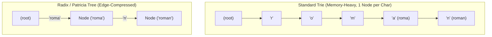
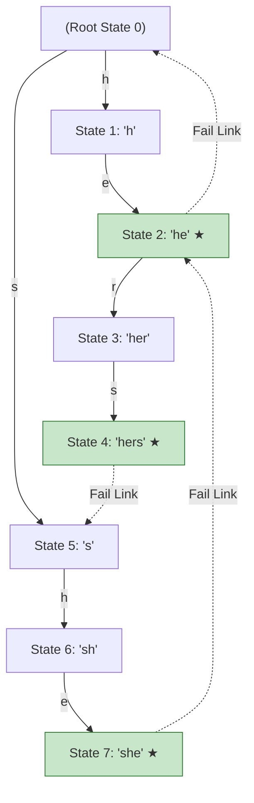
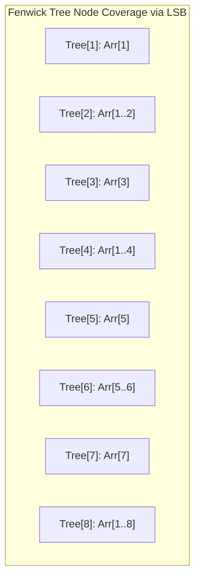
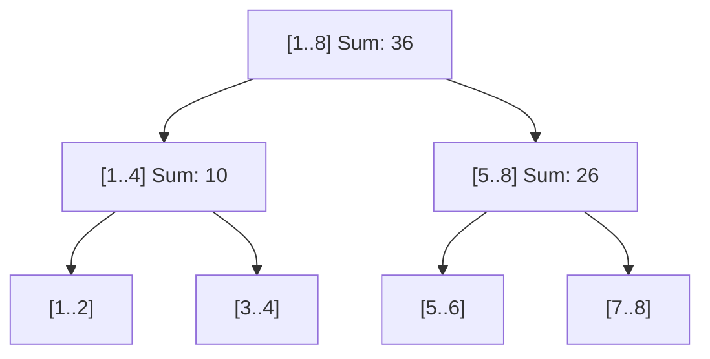

import { Callout } from "fumadocs-ui/components/callout";
import { Tabs, Tab } from "fumadocs-ui/components/tabs";
import { Steps, Step } from "fumadocs-ui/components/steps";
import { Cards, Card } from "fumadocs-ui/components/card";

High-frequency algorithmic systems frequently face two core challenges:

1. **High-Speed Text & Routing Operations:** Matching tens of thousands of malicious virus signatures in incoming gigabit network streams (**Snort IDS**), routing HTTP request paths in microseconds (**Gin / Chi**), or executing prefix auto-completion.
2. **Dynamic Range Queries:** Answering aggregation queries (sum, minimum, maximum) over mutating sequences of millions of elements in sub-millisecond time (Financial order books, real-time analytics).

To conquer these challenges, systems engineers deploy specialized trees and automata: **Radix Trees**, **KMP & Aho-Corasick**, **Fenwick Trees**, **Segment Trees**, and **Sparse Tables**.

---

## 1. Tries vs. Radix Trees (Compressed Patricia Tries)

A standard **Trie (Prefix Tree)** stores each character in an individual node.



### The Radix Tree Optimization

In a standard Trie, linear chains of single-child nodes (like `r -> o -> m -> a`) waste memory on pointer allocations.
A **Radix Tree** (or Patricia Trie) compresses any node with only one child into its parent edge, merging the string labels.

- **Space Efficiency:** Drastically fewer heap allocations and pointers.
- **CPU Cache Sympathy:** Sequential character substrings are stored contiguously in memory, reducing L1 cache misses.
- **Production Use:** The **Linux kernel page cache** organizes physical memory pages with a Radix Tree. Modern HTTP routers (Go's `chi` and `echo`) use Radix trees for route matching.

---

## 2. Linear String Search: KMP & Aho-Corasick

### Knuth-Morris-Pratt (KMP): Zero Backtracking in Text

The classical naive string search compares pattern $P$ of length $M$ against text $T$ of length $N$, falling back to $O(N \cdot M)$ on adversarial strings like `AAAA...AAAB`.

KMP preprocesses pattern $P$ into a **Longest Proper Prefix which is also Suffix (LPS / $\pi$) array** in $O(M)$ time.

```
Pattern: "A B A B A C"
Index:    0 1 2 3 4 5
LPS:     [0, 0, 1, 2, 3, 0]
```

When a mismatch occurs at index $j$, KMP does **not reset the text pointer**. Instead, it uses `LPS[j - 1]` to jump the pattern pointer directly to the longest matched prefix, guaranteeing strictly **$O(N + M)$ time**.

### Aho-Corasick Automaton: Multi-Pattern Stream Matching

What if you need to search for **10,000 distinct patterns simultaneously** across a continuous gigabit network stream? Running KMP 10,000 times yields $O(K \cdot N)$—far too slow for a real-time firewall.

The **Aho-Corasick Automaton** constructs a finite state machine:

1. Builds a **Trie** from all $K$ dictionary keywords.
2. Constructs **Failure Links** (using BFS, identical in concept to KMP's LPS array) that point to the longest proper suffix that is also a valid prefix in the Trie.
3. Constructs **Output / Dictionary Links** to emit matches without backtracking.



**Complexity:** Locates all occurrences of all $K$ patterns across text $T$ in strictly **$O(|T| + \text{Total Matches})$** time.

---

## 3. Dynamic Range Query Engines

When an array undergoes continuous mutations, how do you compute prefix sums or range minimums efficiently?

```
+-----------------------------------------------------------------------------------------+
| Structure           | Preprocessing | Point Update | Range Update  | Range Query        |
+-----------------------------------------------------------------------------------------+
| Naive Array         | O(1)          | O(1)         | O(R - L + 1)  | O(R - L + 1)       |
| Prefix Sum Array    | O(N)          | O(N)         | O(N)          | O(1)               |
| Sparse Table        | O(N log N)    | Immutable    | Immutable     | O(1) (Idempotent)  |
| Fenwick Tree (BIT)  | O(N)          | O(log N)     | O(log N)      | O(log N) (Prefix)  |
| Segment Tree + Lazy | O(N)          | O(log N)     | O(log N)      | O(log N) (General) |
+-----------------------------------------------------------------------------------------+
```

---

## 4. Fenwick Tree (Binary Indexed Tree / BIT)

A **Fenwick Tree** represents an implicit tree over a 1-indexed array using the powers-of-two decomposition of integers.

### The Bitwise Secret: `x & (-x)`

The expression `x & (-x)` isolates the **Least Significant Bit (LSB)** of $x$ in two's complement binary:

```
 x      = 12 = 0000 1100 (binary)
-x      = ~x + 1 = 1111 0100 (binary)
x & (-x)= 0000 0100 = 4
```



- **Prefix Query ($1 \dots i$):** Traverse down by subtracting LSB: `i -= (i & -i)`.
- **Point Update (add $\Delta$ to index $i$):** Traverse up by adding LSB: `i += (i & -i)`.
- **Memory Footprint:** Pure $O(N)$ contiguous array. **Zero pointer overhead**, perfectly cached by CPU L1.

---

## 5. Segment Tree with Lazy Propagation

While a Fenwick Tree handles prefix queries cleanly, a **Segment Tree** supports arbitrary associative operations ($\min, \max, \gcd, \text{sum}$) and enables **$O(\log N)$ range updates** via **Lazy Propagation**.



### The Lazy Propagation Invariant:

When updating a range $[L, R]$ by $+V$:

1. If the current tree node interval is completely inside $[L, R]$, apply the update to the node's aggregate and save $+V$ into its **`lazy` tag**.
2. **Stop immediately!** Do not traverse into child nodes.
3. When future queries visit this node, **push down** the deferred `lazy` tag to its children only as needed.

---

## 6. Sparse Table: Static $O(1)$ Range Minimum Queries (RMQ)

If an array never mutates, a **Sparse Table** computes Range Minimum Queries in strictly **$O(1)$ constant time** using $O(N \log N)$ preprocessing.

### The Idempotency Principle:

An operation $f$ is **idempotent** if $f(x, x) = x$. The minimum function is idempotent: $\min(a, b, b) = \min(a, b)$.
Given range $[L, R]$ of length $len = R - L + 1$:

1. Let $k = \lfloor \log_2(len) \rfloor$, so $2^k$ is the largest power of 2 fitting in the range.
2. We cover $[L, R]$ with two overlapping blocks of length $2^k$:
   - Left block: $[L, L + 2^k - 1]$
   - Right block: $[R - 2^k + 1, R]$
3. Result:
   $$\min(L \dots R) = \min(\text{Table}[k][L], \text{Table}[k][R - 2^k + 1])$$

Both block lookups are direct array accesses: **$O(1)$ query time!**

---

## Production Multi-Language Implementation

Below are complete, production-grade implementations of a **Fenwick Tree** and a **Segment Tree with Lazy Propagation**.

<Tabs items={['Python', 'TypeScript', 'C++']}>
  <Tab value="Python">
```python
from typing import List

class FenwickTree:
"""1-indexed Binary Indexed Tree for prefix sums and point updates."""
def **init**(self, size: int):
self.n = size
self.tree = [0] \* (self.n + 1)

    def update(self, index: int, delta: int) -> None:
        """Adds delta to element at index (1-based). Time: O(log N)."""
        if index <= 0: raise ValueError("Fenwick Tree uses 1-based indexing; index must be >= 1")
        while index <= self.n:
            self.tree[index] += delta
            index += index & (-index)

    def query(self, index: int) -> int:
        """Returns prefix sum arr[1...index]. Time: O(log N)."""
        total = 0
        while index > 0:
            total += self.tree[index]
            index -= index & (-index)
        return total

    def range_query(self, left: int, right: int) -> int:
        """Returns range sum arr[left...right] in O(log N)."""
        return self.query(right) - self.query(left - 1)

class LazySegmentTree:
"""Range Sum Segment Tree with Lazy Propagation."""
def **init**(self, data: List[int]):
self.n = len(data)
self.tree = [0] _ (4 _ self.n)
self.lazy = [0] _ (4 _ self.n)
if self.n > 0:
self.\_build(data, 1, 0, self.n - 1)

    def _build(self, data: List[int], node: int, start: int, end: int) -> None:
        if start == end:
            self.tree[node] = data[start]
            return
        mid = (start + end) // 2
        self._build(data, 2 * node, start, mid)
        self._build(data, 2 * node + 1, mid + 1, end)
        self.tree[node] = self.tree[2 * node] + self.tree[2 * node + 1]

    def _push(self, node: int, start: int, end: int) -> None:
        if self.lazy[node] != 0:
            mid = (start + end) // 2
            val = self.lazy[node]
            # Left child
            self.tree[2 * node] += val * (mid - start + 1)
            self.lazy[2 * node] += val
            # Right child
            self.tree[2 * node + 1] += val * (end - mid)
            self.lazy[2 * node + 1] += val
            self.lazy[node] = 0

    def update_range(self, l: int, r: int, delta: int, node: int = 1, start: int = 0, end: int = -1) -> None:
        if end == -1:
            end = self.n - 1
        if l > end or r < start:
            return
        if l <= start and end <= r:
            self.tree[node] += delta * (end - start + 1)
            self.lazy[node] += delta
            return

        self._push(node, start, end)
        mid = (start + end) // 2
        self.update_range(l, r, delta, 2 * node, start, mid)
        self.update_range(l, r, delta, 2 * node + 1, mid + 1, end)
        self.tree[node] = self.tree[2 * node] + self.tree[2 * node + 1]

    def query_range(self, l: int, r: int, node: int = 1, start: int = 0, end: int = -1) -> int:
        if end == -1:
            end = self.n - 1
        if l > end or r < start:
            return 0
        if l <= start and end <= r:
            return self.tree[node]

        self._push(node, start, end)
        mid = (start + end) // 2
        return (self.query_range(l, r, 2 * node, start, mid) +
                self.query_range(l, r, 2 * node + 1, mid + 1, end))

````
  </Tab>
  <Tab value="TypeScript">
```typescript
export class FenwickTree {
  private readonly n: number;
  private readonly tree: number[];

  constructor(size: number) {
    this.n = size;
    this.tree = new Array(this.n + 1).fill(0);
  }

  public update(index: number, delta: number): void {
    if (index <= 0) throw new Error("Fenwick Tree uses 1-based indexing; index must be >= 1");
    for (let i = index; i <= this.n; i += i & -i) {
      this.tree[i] += delta;
    }
  }

  public query(index: number): number {
    let sum = 0;
    for (let i = index; i > 0; i -= i & -i) {
      sum += this.tree[i];
    }
    return sum;
  }

  public rangeQuery(left: number, right: number): number {
    return this.query(right) - this.query(left - 1);
  }
}

export class LazySegmentTree {
  private readonly n: number;
  private readonly tree: number[];
  private readonly lazy: number[];

  constructor(data: number[]) {
    this.n = data.length;
    this.tree = new Array(4 * this.n).fill(0);
    this.lazy = new Array(4 * this.n).fill(0);
    if (this.n > 0) {
      this.build(data, 1, 0, this.n - 1);
    }
  }

  private build(data: number[], node: number, start: number, end: number): void {
    if (start === end) {
      this.tree[node] = data[start];
      return;
    }
    const mid = Math.floor((start + end) / 2);
    this.build(data, 2 * node, start, mid);
    this.build(data, 2 * node + 1, mid + 1, end);
    this.tree[node] = this.tree[2 * node] + this.tree[2 * node + 1];
  }

  private push(node: number, start: number, end: number): void {
    if (this.lazy[node] !== 0) {
      const mid = Math.floor((start + end) / 2);
      const val = this.lazy[node];

      this.tree[2 * node] += val * (mid - start + 1);
      this.lazy[2 * node] += val;

      this.tree[2 * node + 1] += val * (end - mid);
      this.lazy[2 * node + 1] += val;

      this.lazy[node] = 0;
    }
  }

  public updateRange(l: number, r: number, delta: number, node = 1, start = 0, end = this.n - 1): void {
    if (l > end || r < start) return;
    if (l <= start && end <= r) {
      this.tree[node] += delta * (end - start + 1);
      this.lazy[node] += delta;
      return;
    }

    this.push(node, start, end);
    const mid = Math.floor((start + end) / 2);
    this.updateRange(l, r, delta, 2 * node, start, mid);
    this.updateRange(l, r, delta, 2 * node + 1, mid + 1, end);
    this.tree[node] = this.tree[2 * node] + this.tree[2 * node + 1];
  }

  public queryRange(l: number, r: number, node = 1, start = 0, end = this.n - 1): number {
    if (l > end || r < start) return 0;
    if (l <= start && end <= r) return this.tree[node];

    this.push(node, start, end);
    const mid = Math.floor((start + end) / 2);
    return (
      this.queryRange(l, r, 2 * node, start, mid) +
      this.queryRange(l, r, 2 * node + 1, mid + 1, end)
    );
  }
}
````

  </Tab>
  <Tab value="C++">
```cpp
#include <iostream>
#include <vector>
#include <stdexcept>

class FenwickTree {
public:
explicit FenwickTree(size*t size) : n*(size), tree\_(size + 1, 0) {}

    void update(size_t index, long long delta) {
        if (index <= 0) throw std::out_of_range("Fenwick Tree uses 1-based indexing; index must be >= 1");
        for (size_t i = index; i <= n_; i += i & -i) {
            tree_[i] += delta;
        }
    }

    long long query(size_t index) const {
        long long sum = 0;
        for (size_t i = index; i > 0; i -= i & -i) {
            sum += tree_[i];
        }
        return sum;
    }

    long long range_query(size_t left, size_t right) const {
        return query(right) - query(left - 1);
    }

private:
size*t n*;
std::vector<long long> tree\_;
};

class LazySegmentTree {
public:
explicit LazySegmentTree(const std::vector<long long>& data)
: n*(data.size()), tree*(4 _ n*, 0), lazy*(4 _ n*, 0) {
if (n* > 0) build(data, 1, 0, n\_ - 1);
}

    void update_range(size_t l, size_t r, long long delta) {
        update_range(1, 0, n_ - 1, l, r, delta);
    }

    long long query_range(size_t l, size_t r) {
        return query_range(1, 0, n_ - 1, l, r);
    }

private:
size*t n*;
std::vector<long long> tree*;
std::vector<long long> lazy*;

    void build(const std::vector<long long>& data, size_t node, size_t start, size_t end) {
        if (start == end) {
            tree_[node] = data[start];
            return;
        }
        size_t mid = start + (end - start) / 2;
        build(data, 2 * node, start, mid);
        build(data, 2 * node + 1, mid + 1, end);
        tree_[node] = tree_[2 * node] + tree_[2 * node + 1];
    }

    void push(size_t node, size_t start, size_t end) {
        if (lazy_[node] != 0) {
            size_t mid = start + (end - start) / 2;
            long long val = lazy_[node];

            tree_[2 * node] += val * (mid - start + 1);
            lazy_[2 * node] += val;

            tree_[2 * node + 1] += val * (end - mid);
            lazy_[2 * node + 1] += val;

            lazy_[node] = 0;
        }
    }

    void update_range(size_t node, size_t start, size_t end, size_t l, size_t r, long long delta) {
        if (l > end || r < start) return;
        if (l <= start && end <= r) {
            tree_[node] += delta * (end - start + 1);
            lazy_[node] += delta;
            return;
        }
        push(node, start, end);
        size_t mid = start + (end - start) / 2;
        update_range(2 * node, start, mid, l, r, delta);
        update_range(2 * node + 1, mid + 1, end, l, r, delta);
        tree_[node] = tree_[2 * node] + tree_[2 * node + 1];
    }

    long long query_range(size_t node, size_t start, size_t end, size_t l, size_t r) {
        if (l > end || r < start) return 0;
        if (l <= start && end <= r) return tree_[node];

        push(node, start, end);
        size_t mid = start + (end - start) / 2;
        return query_range(2 * node, start, mid, l, r) +
               query_range(2 * node + 1, mid + 1, end, l, r);
    }

};

```
  </Tab>
</Tabs>

---

## Production Systems Case Studies

### 1. Snort & Suricata Network IDS: Aho-Corasick Multi-Pattern Inspection
Network Intrusion Detection Systems inspect high-speed packet payloads against thousands of known CVE signatures and malicious regex heuristics.
- Aho-Corasick allows Snort to match **100,000 rules in a single pass** over the raw byte stream.
- The failure links operate like a deterministic finite automaton (DFA), guaranteeing bounded worst-case latency per packet regardless of attack payload composition.

### 2. High-Frequency Trading (HFT): Order Book Aggregations via Fenwick Trees
In limit order book engines (LOB):
- Price levels range from $1$ to $1,000,000$ ticks.
- Orders are added and canceled continuously at microsecond speeds.
- Market participants constantly query: *"What is the cumulative shares depth available between price $P_1$ and $P_2$?"*
- A Fenwick Tree provides $O(\log N)$ point updates and $O(\log N)$ cumulative depth queries directly in CPU L1 cache with zero heap allocations.

---

## Technical Interview Patterns & Pitfalls

<Callout type="warn" title="Fenwick Tree 1-Based Indexing Trap">
Fenwick tree bitwise logic **relies strictly on 1-based indexing**. If you pass index `0` into `x & (-x)`, it returns `0`, causing an immediate infinite loop in updates and queries! Always offset 0-indexed arrays by $+1$.
</Callout>

### Pattern: Sparse Table for Static RMQ vs. Segment Tree
- Use **Sparse Table** when the underlying array is immutable and queries are heavy ($O(1)$ query after $O(N \log N)$ build).
- Use **Segment Tree** when updates are dynamic ($O(\log N)$ query and update).
- Use **Fenwick Tree** when operations are strictly cumulative prefix sums/counts and implementation simplicity or memory cache locality is paramount.

---

## Hands-On Verification Challenge

**Challenge:** Given an array $A = [3, 2, 4, 5, 1, 1, 5, 3]$:
1. What is the value of $LSB(6)$? Which array elements are covered by `Tree[6]` in a Fenwick Tree?
2. If we add $+5$ to $A[3]$, which Fenwick Tree indices will be updated?
3. Using a Sparse Table, how many sub-intervals are checked to answer $\min(A[1 \dots 6])$?

<Callout type="info" title="Solution">
1. Binary $6 = 110_2$. $LSB(6) = 6 \ \& \ (-6) = 2$. Therefore, `Tree[6]` covers $2$ elements: $A[5 \dots 6]$.
2. Adding to index 3 (1-based): Updates $3 \rightarrow 3 + 1 = 4 \rightarrow 4 + 4 = 8$. The updated tree indices are **3, 4, and 8**.
3. For range length $6 - 1 + 1 = 6$: $k = \lfloor \log_2 6 \rfloor = 2$ ($2^2 = 4$). We check **exactly two overlapping blocks** of length 4: $[1 \dots 4]$ and $[3 \dots 6]$ in **$O(1)$ time**.
</Callout>
```
