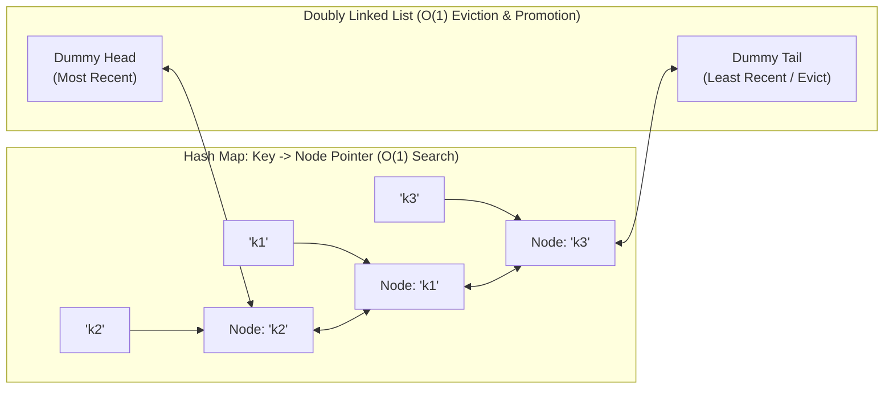
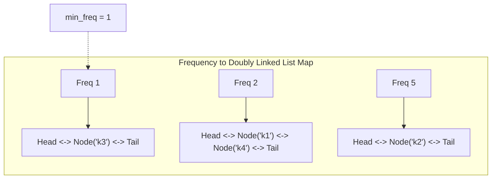
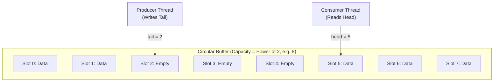
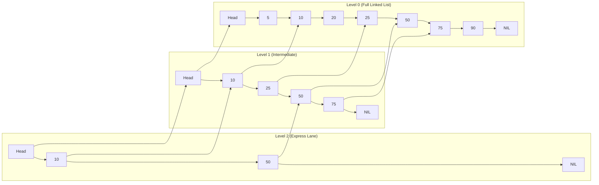
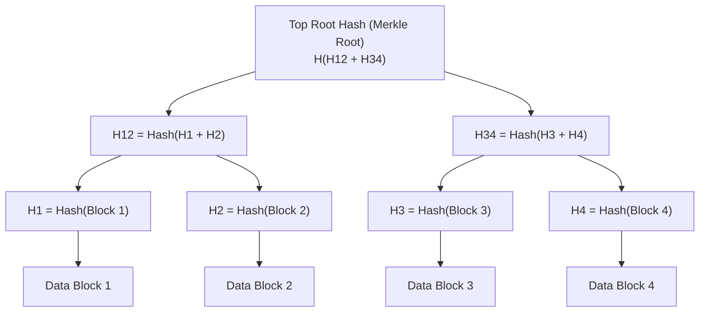

import { Callout } from "fumadocs-ui/components/callout";
import { Tabs, Tab } from "fumadocs-ui/components/tabs";
import { Steps, Step } from "fumadocs-ui/components/steps";
import { Cards, Card } from "fumadocs-ui/components/card";

When systems must handle millions of operations per second, the limiting bottleneck shifts from mathematical asymptotic complexity to **concurrency synchronization** and **memory layout**:

- How do we evict stale data in strictly $O(1)$ time without locking the entire cache?
- How do two threads communicate at millions of messages per second without mutex locks?
- How do distributed database nodes verify petabytes of replica consistency across continents without transferring the raw data?

This lesson explores the foundational structures powering operating systems, high-frequency exchanges, and distributed consensus: **LRU/LFU Caches**, **Lock-Free Ring Buffers**, **Skip Lists**, and **Merkle Trees**.

---

## 1. O(1) LRU Cache (Least Recently Used)

The **LRU Cache** evicts the item that has not been accessed for the longest duration when capacity is reached.



### The Architectural Blueprint:

- **Hash Map:** Provides $O(1)$ key-to-node pointer lookups.
- **Doubly Linked List:** Provides $O(1)$ node insertion, removal, and reordering.
- **Sentinel Nodes (Dummy Head & Tail):** Eliminates all null-pointer edge cases during list head/tail mutations.
- **Access Flow (`GET` / `PUT` update):** Move accessed node to immediately after `head` (marked most recently used).
- **Eviction Flow:** Discard node directly before `tail` (least recently used) and remove its key from the hash map.

---

## 2. O(1) LFU Cache (Least Frequently Used)

While LRU evicts based on recency, it suffers from **Cache Pollution**: a batch job scanning millions of cold keys once will flush out hot, frequently used keys.
The **LFU Cache** evicts the key with the lowest access count (frequency). If there is a tie, it falls back to LRU among those tied keys.



### Achieving True $O(1)$ LFU:

1. `key_map`: Maps `key` $\rightarrow$ `(value, freq)`.
2. `freq_map`: Maps `frequency` $\rightarrow$ `DoublyLinkedList` of keys with that frequency.
3. `min_freq`: An integer tracking the smallest frequency currently present in the cache.
4. When any key is accessed, its frequency increments from $f \rightarrow f + 1$. It is removed from `freq_map[f]` and prepended to `freq_map[f + 1]`. If `freq_map[min_freq]` becomes empty, increment `min_freq++`.
5. Eviction simply drops the tail of `freq_map[min_freq]`. **All operations are strictly $O(1)$**.

---

## 3. Lock-Free SPSC Ring Buffer (Circular Buffer)

When two threads communicate (e.g., an OS network packet receiver and a packet processing worker), using a mutex lock introduces catastrophic CPU core sleep/wake context-switch latency ($\approx 1 - 5 \ \mu\text{s}$).

A **Single-Producer Single-Consumer (SPSC) Ring Buffer** achieves **zero mutex contention** using lock-free circular indexing and atomic memory fences.



### The Systems Engineering Optimization: Power-of-Two Bitmask

Instead of using the expensive integer modulo operator (`%` takes $\approx 10 - 20$ CPU cycles):
$$\text{slot\_index} = \text{index} \ \& \ (\text{capacity} - 1)$$
If capacity is a power of 2 (e.g., $1024 = 2^{10}$), `capacity - 1` is a continuous mask of 1s (`1111111111_2`), reducing index wrapping to a single-cycle bitwise `AND`.

- **Producer updates only `tail`** with memory-order **Release**.
- **Consumer updates only `head`** with memory-order **Release**.
- Production implementations: **Linux Kernel `kfifo`**, **LMAX Disruptor** (processing 6+ million orders/sec at sub-microsecond latency).

---

## 4. Skip Lists: Probabilistic Balanced Search

Balanced binary trees (AVL, Red-Black) require complex rebalancing rotations (or color flips). Under multi-threaded concurrent workloads, balancing operations lock large portions of the tree.

In 1990, William Pugh invented the **Skip List**: a hierarchy of linked lists where higher levels act as "express lanes".



### Why Redis Uses Skip Lists for Sorted Sets (`zset`):

1. **Range Queries are Trivial:** Walking range intervals (`ZRANGEBYSCORE`) is a simple linear linked list traversal at Level 0.
2. **Lock Striping:** Updating a node only touches its immediate forward pointers, making concurrent lock striping drastically easier than rebalancing Red-Black trees.
3. **Probabilistic Height:** Node height is determined by a random geometric distribution (e.g., probability $p = 0.25$ or $0.5$). Expected search, insertion, and deletion complexity is strictly **$O(\log N)$**.

---

## 5. Merkle Trees: Cryptographic Integrity & Anti-Entropy

A **Merkle Tree** is a binary hash tree where every leaf node is the cryptographic hash of a data block, and every internal node is the hash of its children:

$$\text{Parent Hash} = \text{Hash}(\text{Left Child Hash} \parallel \text{Right Child Hash})$$



### Systems Engineering Use Cases:

1. **Git Commit Tree:** Git commits and directories are Merkle DAGs. Changing a single byte in any file alters every parent hash up to the commit hash.
2. **Cassandra & DynamoDB Anti-Entropy Repair:** When two database replicas across continents need to verify if their data matches:
   - They do **not** exchange gigabytes of records.
   - They exchange only their **Merkle Root Hashes**.
   - If the root hashes match, all data is guaranteed identical.
   - If they differ, nodes exchange hashes down the tree in $O(\log N)$ steps to isolate and sync only the exact mismatched ranges.

---

## Complexity Comparison Matrix

| Data Structure       | Primary Operation   | Time Complexity     | Space Complexity                | Real-World Platform                   |
| :------------------- | :------------------ | :------------------ | :------------------------------ | :------------------------------------ |
| **LRU Cache**        | `get` / `put`       | $O(1)$ / $O(1)$     | $O(\text{Capacity})$            | Memcached, Redis, OS Page Cache       |
| **LFU Cache**        | `get` / `put`       | $O(1)$ / $O(1)$     | $O(\text{Capacity})$            | Redis `maxmemory-policy: allkeys-lfu` |
| **SPSC Ring Buffer** | `push` / `pop`      | $O(1)$ (Lock-Free)  | $O(\text{Capacity})$ contiguous | Linux `kfifo`, LMAX Disruptor         |
| **Skip List**        | `search` / `insert` | $O(\log N)$ average | $O(N)$ expected                 | Redis `zset`, RocksDB MemTable        |
| **Merkle Tree**      | Range Diff / Proof  | $O(\log N)$         | $O(N)$                          | Git DAG, Apache Cassandra, Bitcoin    |

---

## Production Multi-Language Implementation: O(1) LRU Cache

<Tabs items={['Python', 'TypeScript', 'C++']}>
  <Tab value="Python">
```python
from typing import Dict, Optional

class DNode:
def **init**(self, key: int = 0, val: int = 0):
self.key = key
self.val = val
self.prev: Optional['DNode'] = None
self.next: Optional['DNode'] = None

class LRUCache:
"""Production-grade O(1) LRU Cache with sentinel nodes."""
def **init**(self, capacity: int):
self.capacity = capacity
self.cache: Dict[int, DNode] = {} # Sentinel boundary nodes
self.head = DNode()
self.tail = DNode()
self.head.next = self.tail
self.tail.prev = self.head

    def _remove(self, node: DNode) -> None:
        """Detaches node from its current position."""
        p = node.prev
        n = node.next
        if p and n:
            p.next = n
            n.prev = p

    def _add_to_front(self, node: DNode) -> None:
        """Inserts node immediately after head sentinel."""
        node.next = self.head.next
        node.prev = self.head
        if self.head.next:
            self.head.next.prev = node
        self.head.next = node

    def get(self, key: int) -> int:
        if key not in self.cache:
            return -1
        node = self.cache[key]
        self._remove(node)
        self._add_to_front(node)
        return node.val

    def put(self, key: int, value: int) -> None:
        if key in self.cache:
            node = self.cache[key]
            node.val = value
            self._remove(node)
            self._add_to_front(node)
            return

        if len(self.cache) >= self.capacity:
            # Evict least recently used node (before tail)
            lru_node = self.tail.prev
            if lru_node and lru_node != self.head:
                self._remove(lru_node)
                del self.cache[lru_node.key]

        new_node = DNode(key, value)
        self.cache[key] = new_node
        self._add_to_front(new_node)

````
  </Tab>
  <Tab value="TypeScript">
```typescript
class DNode<K, V> {
  key: K;
  val: V;
  prev: DNode<K, V> | null = null;
  next: DNode<K, V> | null = null;

  constructor(key: K, val: V) {
    this.key = key;
    this.val = val;
  }
}

export class LRUCache<K, V> {
  private readonly capacity: number;
  private readonly cache = new Map<K, DNode<K, V>>();
  private readonly head: DNode<K, V>;
  private readonly tail: DNode<K, V>;

  constructor(capacity: number) {
    this.capacity = capacity;
    this.head = new DNode<K, V>(null as any, null as any);
    this.tail = new DNode<K, V>(null as any, null as any);
    this.head.next = this.tail;
    this.tail.prev = this.head;
  }

  private remove(node: DNode<K, V>): void {
    const p = node.prev!;
    const n = node.next!;
    p.next = n;
    n.prev = p;
  }

  private addToFront(node: DNode<K, V>): void {
    node.next = this.head.next;
    node.prev = this.head;
    this.head.next!.prev = node;
    this.head.next = node;
  }

  public get(key: K): V | null {
    const node = this.cache.get(key);
    if (!node) return null;

    this.remove(node);
    this.addToFront(node);
    return node.val;
  }

  public put(key: K, value: V): void {
    if (this.cache.has(key)) {
      const node = this.cache.get(key)!;
      node.val = value;
      this.remove(node);
      this.addToFront(node);
      return;
    }

    if (this.cache.size >= this.capacity) {
      const lru = this.tail.prev!;
      this.remove(lru);
      this.cache.delete(lru.key);
    }

    const newNode = new DNode<K, V>(key, value);
    this.cache.set(key, newNode);
    this.addToFront(newNode);
  }
}
````

  </Tab>
  <Tab value="C++">
```cpp
#include <iostream>
#include <unordered_map>
#include <memory>

class LRUCache {
public:
explicit LRUCache(int capacity) : capacity*(capacity) {
head* = std::make*shared<Node>(0, 0);
tail* = std::make*shared<Node>(0, 0);
head*->next = tail*;
tail*->prev = head\_;
}

    int get(int key) {
        auto it = map_.find(key);
        if (it == map_.end()) return -1;

        auto node = it->second;
        remove(node);
        add_to_front(node);
        return node->val;
    }

    void put(int key, int value) {
        auto it = map_.find(key);
        if (it != map_.end()) {
            auto node = it->second;
            node->val = value;
            remove(node);
            add_to_front(node);
            return;
        }

        if (static_cast<int>(map_.size()) >= capacity_) {
            auto lru = tail_->prev.lock();
            if (lru && lru != head_) {
                remove(lru);
                map_.erase(lru->key);
            }
        }

        auto new_node = std::make_shared<Node>(key, value);
        map_[key] = new_node;
        add_to_front(new_node);
    }

private:
struct Node {
int key;
int val;
std::weak_ptr<Node> prev;
std::shared_ptr<Node> next;
Node(int k, int v) : key(k), val(v) {}
};

    int capacity_;
    std::unordered_map<int, std::shared_ptr<Node>> map_;
    std::shared_ptr<Node> head_;
    std::shared_ptr<Node> tail_;

    void remove(std::shared_ptr<Node> node) {
        auto p = node->prev.lock();
        auto n = node->next;
        if (p) p->next = n;
        if (n) n->prev = p;
    }

    void add_to_front(std::shared_ptr<Node> node) {
        node->next = head_->next;
        node->prev = head_;
        head_->next->prev = node;
        head_->next = node;
    }

};

```
  </Tab>
</Tabs>

---

## Production Systems Case Studies

### 1. Redis `zset`: Skip List + Hash Map Combination
In Redis, the `zset` (Sorted Set) data type backs leaderboards, priority scheduling, and sliding-window rate limiters.
- Redis embeds **both a Hash Map and a Skip List** inside `zset`.
- The hash map provides $O(1)$ score lookups for `ZSCORE username`.
- The skip list provides $O(\log N)$ sorted insertion and $O(\log N + K)$ range queries for `ZRANGEBYSCORE 100 500`.

### 2. Linux Kernel `kfifo`: Lock-Free Circular Buffer
The Linux kernel uses the `kfifo` structure for interrupt handlers and device driver character queues:
- The buffer length is strictly enforced to be a power of 2 at compile or allocation time.
- Read and write pointers are unbounded 32-bit integers that freely overflow:
  $$\text{in} - \text{out} = \text{number of occupied items}$$
  This mathematical property ensures thread-safety without lock acquisition as long as there is only one reader and one writer.

---

## Technical Interview Patterns & Pitfalls

<Callout type="warn" title="Double Pointer Mutation Bug in Cache Lists">
When splicing nodes out of a doubly linked list, updating pointers in the wrong order can disconnect the chain or introduce memory leaks. Always update the outer adjacent neighbors first (`node.prev.next = node.next` and `node.next.prev = node.prev`).
</Callout>

### Quick System Design Rules:
- **Use LRU:** When temporal recency governs access patterns (e.g., viewing user profiles or recent social media feeds).
- **Use LFU:** When popularity distribution follows a heavy-tailed Zipf distribution (e.g., CDN caching of static video assets).
- **Use SPSC Ring Buffer:** For intra-machine communication between distinct pinned CPU threads.

---

## Hands-On Verification Challenge

**Scenario:** In an SPSC Ring Buffer with power-of-two capacity $C = 16$:
1. If the write pointer `tail` is currently $37$ and the read pointer `head` is $34$:
   - How many items are currently in the queue?
   - What is the physical array index for the next read?
   - What is the physical array index for the next write?
2. How does the bitmask calculation `tail & (C - 1)` evaluate for `tail = 37`?

<Callout type="info" title="Solution">
1. Number of items = $\text{tail} - \text{head} = 37 - 34 = \mathbf{3 \text{ items}}$.
   - Next read slot: $34 \ \& \ (16 - 1) = 34 \ \& \ 15 = \mathbf{\text{Slot } 2}$.
   - Next write slot: $37 \ \& \ (16 - 1) = 37 \ \& \ 15 = \mathbf{\text{Slot } 5}$.
2. Binary evaluation:
   $37 = 00100101_2$
   $15 = 00001111_2$
   $37 \ \& \ 15 = 00000101_2 = \mathbf{5}$.
</Callout>
```
