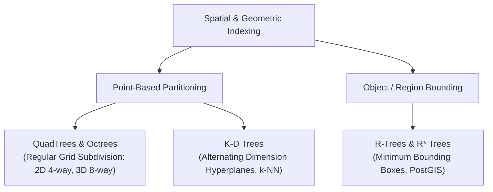
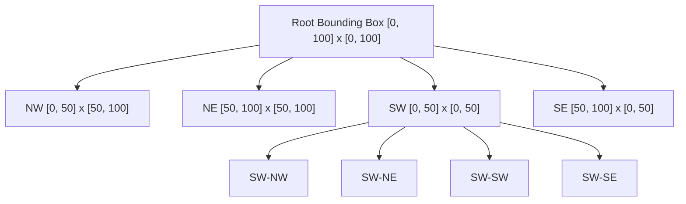
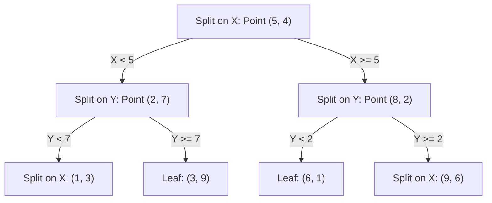
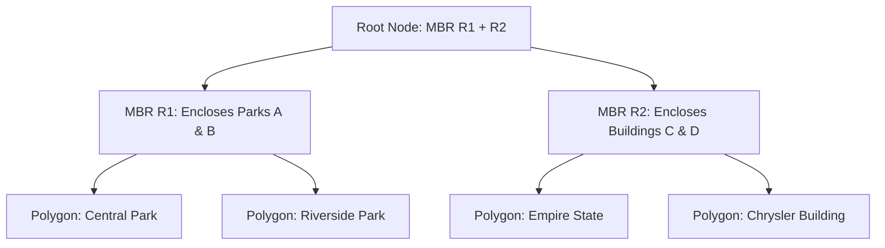

import { Callout } from "fumadocs-ui/components/callout";
import { Tabs, Tab } from "fumadocs-ui/components/tabs";
import { Steps, Step } from "fumadocs-ui/components/steps";
import { Cards, Card } from "fumadocs-ui/components/card";

In 1D memory, sorting keys allows binary search in $O(\log N)$ time. But what happens when an application needs to find the **nearest 10 Uber drivers** within a 2-mile radius, collision-check 3D physics meshes in a game engine, or filter billions of LiDAR points?

One-dimensional order collapses in multi-dimensional space. To query geometry without full table scans, systems rely on **Spatial Partitioning Trees**. Concurrently, at the micro-architectural tier, high-performance engines rely on single-cycle **bitwise twiddling** and **number-theoretic primitives** to maximize instructions per cycle (IPC).

---

## 1. Multi-Dimensional Spatial Indexing



---

## 2. QuadTrees & Octrees

A **QuadTree** recursively subdivides 2D space into four quadrants: **NW** (Northwest), **NE** (Northeast), **SW** (Southwest), and **SE** (Southeast). An **Octree** extends this to 3D by partitioning space into eight octants.



- **Capacity Invariant:** Each leaf holds up to $K$ points (e.g., $K = 4$). When the $(K+1)$-th point is inserted, the node splits into 4 child quadrants.
- **Pruning in Range Searches:** If a query bounding box does not intersect a quadrant, that entire subtree is skipped in $O(1)$.
- **Production Systems:** Used in Google Maps tile pyramids, spatial GIS rendering, and 3D collision detection engines.

---

## 3. K-D Trees (k-Dimensional Trees) & k-NN

A **K-D Tree** is a space-partitioning binary tree for organizing points in a $k$-dimensional space.



### Alternating Hyperplane Partitioning:

- **Depth 0:** Split on $X$-coordinate (median $X$).
- **Depth 1:** Split on $Y$-coordinate (median $Y$).
- **Depth $d$:** Split on dimension $d \pmod k$.

### k-Nearest Neighbors ($k$-NN) Pruning:

1. Traverse down to the leaf containing the query point.
2. Maintain a running best distance $R$.
3. When unwinding recursion, compute the perpendicular distance from the query point to the splitting hyperplane.
4. **Pruning Condition:** If the distance to the splitting plane is **$\ge R$**, the other side cannot contain a closer point—prune that entire branch!

<Callout type="warn" title="The Curse of Dimensionality">
In low dimensions ($k = 2$ or $3$), K-D Trees search nearest neighbors in $O(\log N)$. However, when $k > 20$ (e.g., in modern Machine Learning vector embeddings), the volume of the space grows exponentially, hyperplanes no longer prune effectively, and K-D Tree performance degrades to a brute-force $O(N)$ linear scan. For high-dimensional vector search, engines use **HNSW** (Hierarchical Navigable Small World graphs).
</Callout>

---

## 4. R-Trees & R\* Trees: Minimum Bounding Boxes (MBR)

While K-D Trees index zero-dimensional geometric points, real-world geospatial systems must index **polygons, roads, boundaries, and multi-point geometries**.

An **R-Tree** organizes spatial objects by grouping them into hierarchical **Minimum Bounding Boxes (MBR / BBox)**.



### PostGIS Mechanics:

- When running `SELECT * FROM parcels WHERE ST_Intersects(geom, :query_poly)`:
  1. PostGIS first queries the **R-Tree index** using the bounding box of `:query_poly` (cheap bounding box floating-point checks).
  2. It returns candidate row IDs.
  3. Only for candidates does PostGIS execute the computationally expensive geometric edge-crossing polygon check.

---

## 5. Low-Level Bit Manipulation Toolkit

Bitwise instructions run in **1 CPU clock cycle**, eliminate conditional branch mispredictions, and enable extreme SIMD parallelization.

```
+-----------------------------------------------------------------------------------------+
| Bitwise Expression       | Operational Meaning                  | System Use Case       |
+-----------------------------------------------------------------------------------------+
| x & (x - 1)              | Clears lowest set bit (rightmost 1)   | Kernighan's bit count |
| (x & (x - 1)) == 0       | Tests if positive integer is 2^k     | Buffer power-of-2 check|
| x & (-x)                 | Isolates lowest set bit (LSB)         | Fenwick tree index    |
| x ^ (x & (x - 1))        | Isolates lowest set bit               | Bitmask extraction    |
| s = (s - 1) & m          | Iterates all non-empty submasks of m  | Bitmask DP transitions|
+-----------------------------------------------------------------------------------------+
```

### The Submask Iteration Pattern

To iterate through all submasks $s$ of a bitmask $m$ in descending order:

```cpp
for (int s = m; s > 0; s = (s - 1) & m) {
    // Process submask s
}
```

Evaluating this for all $2^N$ masks evaluates strictly $\sum_{k=0}^N \binom{N}{k} 2^k = \mathbf{3^N}$ states, saving exponential time compared to naive $4^N$ iterations.

---

## 6. Systems Number Theory

### Fast Modular Exponentiation (Binary Exponentiation)

Computes $(a^b) \pmod m$ in $O(\log b)$ time by squaring the base:

- If $b$ is odd: $a^b = a \cdot a^{b-1}$.
- If $b$ is even: $a^b = (a^2)^{b / 2}$.
- Essential for RSA encryption, Diffie-Hellman key exchanges, and distributed hashing.

### Euler's Linear Sieve (Sieve in $O(N)$)

The classic Sieve of Eratosthenes runs in $O(N \log \log N)$ because composite numbers like $12$ are marked redundantly by both $2$ and $3$.
**Euler's Linear Sieve** visits every composite number **exactly once** by its smallest prime factor, achieving true **$O(N)$ linear time**.

---

## Production Multi-Language Implementation

Below are implementations of **K-D Tree (2D Construction & Nearest Neighbor)**, **Submask Iteration**, and **Euler's Linear Sieve**.

<Tabs items={['Python', 'TypeScript', 'C++']}>
  <Tab value="Python">
```python
import math
from typing import List, Optional, Tuple

class KDNode:
def **init**(self, point: Tuple[float, float], left=None, right=None):
self.point = point
self.left: Optional[KDNode] = left
self.right: Optional[KDNode] = right

class KDTree2D:
"""2D Space Partitioning Tree for fast Nearest-Neighbor lookups."""
def **init**(self, points: List[Tuple[float, float]]):
self.root = self.\_build(points, depth=0)

    def _build(self, points: List[Tuple[float, float]], depth: int) -> Optional[KDNode]:
        if not points:
            return None
        axis = depth % 2  # 0 for X, 1 for Y
        # NOTE: Using sort() at every recursive step yields O(N log²N) build time.
        # The C++ version uses std::nth_element for optimal O(N logN).
        # Python's statistics.median or a Quickselect-based approach could achieve the same optimization.
        points.sort(key=lambda p: p[axis])
        mid = len(points) // 2

        return KDNode(
            point=points[mid],
            left=self._build(points[:mid], depth + 1),
            right=self._build(points[mid + 1:], depth + 1)
        )

    def nearest_neighbor(self, target: Tuple[float, float]) -> Tuple[Tuple[float, float], float]:
        """Finds closest point using bounding hyperplane pruning."""
        best_point = self.root.point
        best_dist = float('inf')

        def _search(node: Optional[KDNode], depth: int):
            nonlocal best_point, best_dist
            if node is None:
                return

            d = math.hypot(node.point[0] - target[0], node.point[1] - target[1])
            if d < best_dist:
                best_dist = d
                best_point = node.point

            axis = depth % 2
            diff = target[axis] - node.point[axis]
            first = node.left if diff < 0 else node.right
            second = node.right if diff < 0 else node.left

            _search(first, depth + 1)
            # Pruning check: Can the opposite branch contain a closer point?
            if abs(diff) < best_dist:
                _search(second, depth + 1)

        _search(self.root, 0)
        return best_point, best_dist

# Systems Number Theory: Linear Euler Sieve

def linear*sieve(n: int) -> List[int]:
"""Computes all primes up to n in strict O(N) time."""
is_prime = [True] * (n + 1)
primes = []
for i in range(2, n + 1):
if is*prime[i]:
primes.append(i)
for p in primes:
if i * p > n:
break
is_prime[i * p] = False
if i % p == 0: # Key optimization: p is smallest prime factor of i \* p
break
return primes

````
  </Tab>
  <Tab value="TypeScript">
```typescript
export interface Point2D {
  x: number;
  y: number;
}

export class KDNode {
  point: Point2D;
  left: KDNode | null = null;
  right: KDNode | null = null;

  constructor(point: Point2D) {
    this.point = point;
  }
}

export class KDTree2D {
  private root: KDNode | null;

  constructor(points: Point2D[]) {
    this.root = this.build([...points], 0);
  }

  private build(points: Point2D[], depth: number): KDNode | null {
    if (points.length === 0) return null;

    const axis = depth % 2 === 0 ? "x" : "y";
    points.sort((a, b) => a[axis] - b[axis]);
    const mid = Math.floor(points.length / 2);

    const node = new KDNode(points[mid]);
    node.left = this.build(points.slice(0, mid), depth + 1);
    node.right = this.build(points.slice(mid + 1), depth + 1);
    return node;
  }

  public nearestNeighbor(target: Point2D): { point: Point2D; distance: number } {
    let bestPoint = this.root!.point;
    let bestDist = Infinity;

    const search = (node: KDNode | null, depth: number) => {
      if (!node) return;

      const d = Math.hypot(node.point.x - target.x, node.point.y - target.y);
      if (d < bestDist) {
        bestDist = d;
        bestPoint = node.point;
      }

      const axis = depth % 2 === 0 ? "x" : "y";
      const diff = target[axis] - node.point[axis];

      const first = diff < 0 ? node.left : node.right;
      const second = diff < 0 ? node.right : node.left;

      search(first, depth + 1);
      if (Math.abs(diff) < bestDist) {
        search(second, depth + 1);
      }
    };

    search(this.root, 0);
    return { point: bestPoint, distance: bestDist };
  }
}

// Fast Modular Exponentiation
export function modPow(base: bigint, exp: bigint, mod: bigint): bigint {
  let res = 1n;
  base = base % mod;
  while (exp > 0n) {
    if (exp & 1n) res = (res * base) % mod;
    base = (base * base) % mod;
    exp >>= 1n;
  }
  return res;
}
````

  </Tab>
  <Tab value="C++">
```cpp
#include <iostream>
#include <vector>
#include <cmath>
#include <algorithm>

struct Point {
double x, y;
};

struct KDNode {
Point pt;
KDNode* left = nullptr;
KDNode* right = nullptr;
explicit KDNode(Point p) : pt(p) {}
};

class KDTree2D {
public:
explicit KDTree2D(std::vector<Point> pts) {
root\_ = build(pts, 0);
}

    Point find_nearest(Point target) const {
        Point best = root_->pt;
        double best_dist = std::hypot(root_->pt.x - target.x, root_->pt.y - target.y);
        search(root_, target, 0, best, best_dist);
        return best;
    }

private:
KDNode\* root\_ = nullptr;

    KDNode* build(std::vector<Point>& pts, int depth) {
        if (pts.empty()) return nullptr;
        int axis = depth % 2;

        auto comp = [axis](const Point& a, const Point& b) {
            return axis == 0 ? a.x < b.x : a.y < b.y;
        };
        size_t mid = pts.size() / 2;
        std::nth_element(pts.begin(), pts.begin() + mid, pts.end(), comp);

        auto* node = new KDNode(pts[mid]);
        std::vector<Point> left_pts(pts.begin(), pts.begin() + mid);
        std::vector<Point> right_pts(pts.begin() + mid + 1, pts.end());

        node->left = build(left_pts, depth + 1);
        node->right = build(right_pts, depth + 1);
        return node;
    }

    void search(KDNode* node, const Point& target, int depth, Point& best, double& best_dist) const {
        if (!node) return;

        double d = std::hypot(node->pt.x - target.x, node->pt.y - target.y);
        if (d < best_dist) {
            best_dist = d;
            best = node->pt;
        }

        int axis = depth % 2;
        double diff = (axis == 0) ? (target.x - node->pt.x) : (target.y - node->pt.y);

        KDNode* first = diff < 0 ? node->left : node->right;
        KDNode* second = diff < 0 ? node->right : node->left;

        search(first, target, depth + 1, best, best_dist);
        if (std::abs(diff) < best_dist) {
            search(second, target, depth + 1, best, best_dist);
        }
    }

};

// Bit Twiddling: Submask Enumeration
inline void enumerate_submasks(int mask) {
for (int sub = mask; sub > 0; sub = (sub - 1) & mask) {
// sub is a valid strict subset of mask
}
}

```
  </Tab>
</Tabs>

---

## Production Systems Case Studies

### 1. PostGIS: Geospatial R-Trees
In PostgreSQL with PostGIS, spatial indexes use Generalized Search Trees (**GiST**) structured as R-Trees:
- Tables storing millions of geographic polygons store their bounding boxes in GiST.
- A query for `ST_DWithin(location, target, 1000)` quickly prunes 99.9% of distant polygons at the bounding box layer before triggering geodesic calculations.

### 2. Autonomous Vehicles: Octrees for LiDAR Filtering
LiDAR sensors generate over 1.5 million 3D point cloud measurements per second:
- Self-driving navigation stacks insert points into Octrees.
- Voxels (cubes) containing fewer than a threshold of points are pruned as atmospheric sensor noise.
- Ground-plane segmentation uses Octree bounding checks to detect curbs, obstacles, and pedestrians in real time.

---

## Technical Interview Patterns & Pitfalls

<Callout type="warn" title="Bitwise Precedence Trap in C/C++ & JavaScript">
Bitwise operators (`&`, `|`, `^`) have **lower precedence** than comparison operators (`==`, `!=`, `<`, `>`).
Writing `if (x & 1 == 0)` evaluates as `if (x & (1 == 0))` $\implies$ `if (x & 0)`, which is always false!
Always write: `if ((x & 1) == 0)`.
</Callout>

### Submask Pattern for Interviews:
Whenever an algorithmic problem has $N \le 18$ items and asks to group them into partitions (e.g., minimum partitions with weight $\le W$):
1. Compute valid states for each mask $m \in [0, 2^N - 1]$.
2. For each mask, iterate submasks `for (int s = m; s > 0; s = (s - 1) & m)` to find optimal combinations in $O(3^N)$ instead of $O(4^N)$.

---

## Hands-On Verification Challenge

1. What is the output of the bitwise expression `44 & (-44)`? Show the binary computation.
2. Given a 2D K-D Tree with root split at $X = 10$, suppose our current best nearest distance is $R = 3.0$ and our query point is $(15, 20)$. Will the search prune the left subtree ($X < 10$)?

<Callout type="info" title="Solution">
1. $44 = 00101100_2$.
   Two's complement $-44 = 11010100_2$.
   $44 \ \& \ (-44) = 00000100_2 = \mathbf{4}$ (The lowest set bit is isolated).
2. Perpendicular distance to splitting hyperplane $X = 10$ is $|15 - 10| = 5.0$.
   Since $5.0 \ge R \ (3.0)$, no point in the left branch can be within distance $3.0$. **The entire left branch is pruned!**
</Callout>
```
