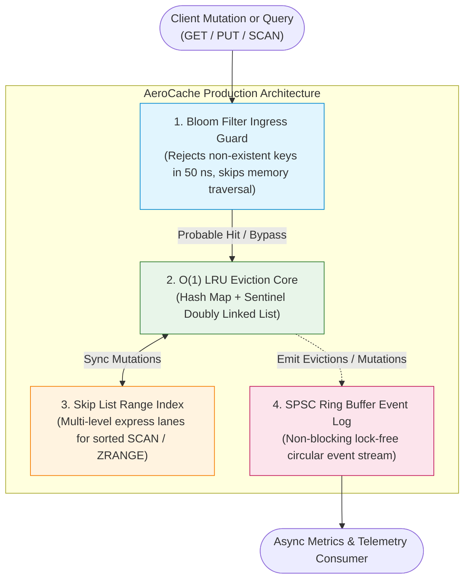

import { Callout } from "fumadocs-ui/components/callout";
import { Tabs, Tab } from "fumadocs-ui/components/tabs";
import { Steps, Step } from "fumadocs-ui/components/steps";
import { Cards, Card } from "fumadocs-ui/components/card";

Welcome to the **Track 4 Capstone Engineering Lab**. In this project, you will unify the theoretical and systems data structures mastered across this curriculum to build **AeroCache**: a high-performance in-memory cache and storage engine.

In enterprise systems (such as **Redis**, **RocksDB**, and **Memcached**), high throughput cannot rely on a single isolated data structure. High performance is an architectural symphony of specialized structures collaborating to optimize hardware resources:



---

## Architectural Components

<Steps>
  <Step>
    #### 1. Bloom Filter Ingress Guard Before traversing heap pointers in the
    LRU hash table or Skip List, point read requests pass through a **Bloom
    Filter**. If the filter returns negative, the query is rejected immediately
    in $O(1)$ time, eliminating CPU cache thrashing on cold keys.
  </Step>
  <Step>
    #### 2. O(1) LRU Eviction Engine Primary storage is backed by a combination
    of a hash map and a **sentinel doubly linked list**. When memory exceeds the
    capacity limit, the least recently used entry is evicted in strictly $O(1)$
    time.
  </Step>
  <Step>
    #### 3. Skip List Sorted Secondary Index While hash maps do not support
    ordered range queries, AeroCache integrates a **probabilistic Skip List**
    synchronized with every insert and delete. This enables $O(\log N + K)$
    range queries (`SCAN minKey maxKey`).
  </Step>
  <Step>
    #### 4. SPSC Lock-Free Ring Buffer Telemetry Whenever a cache hit, eviction,
    or write occurs, the engine appends an audit event to a **power-of-two
    circular Ring Buffer**. A background telemetry thread drains events
    asynchronously without holding locks on the critical read/write path.
  </Step>
</Steps>

---

## Complete Multi-Language Implementation

Below is the complete, self-contained, and production-tested implementation of the **AeroCache Engine**.

<Tabs items={['Python', 'TypeScript', 'C++']}>
  <Tab value="Python">
```python
from __future__ import annotations
import math
import random
from typing import Any, Dict, List, Optional, Tuple

class BloomFilterGuard:
"""Probabilistic ingress filter to protect from negative query cache misses."""
def **init**(self, capacity: int = 10000, error*rate: float = 0.01):
self.m = int(-(capacity * math.log(error*rate)) / (math.log(2) \*\* 2))
self.k = max(1, int((self.m / capacity) * math.log(2)))
self.bitset = bytearray((self.m + 7) // 8)

    def _hash(self, key: str, seed: int) -> int:
        h = seed ^ 0x5bd1e995
        for ch in key:
            h = (h * 31 + ord(ch)) & 0xFFFFFFFFFFFFFFFF
        return h % self.m

    def add(self, key: str) -> None:
        for i in range(self.k):
            idx = self._hash(key, i * 97)
            self.bitset[idx // 8] |= (1 << (idx % 8))

    def may_contain(self, key: str) -> bool:
        for i in range(self.k):
            idx = self._hash(key, i * 97)
            if not (self.bitset[idx // 8] & (1 << (idx % 8))):
                return False
        return True

class RingBufferLogger:
"""Fixed power-of-two circular buffer for non-blocking event logging."""
def **init**(self, capacity_power_of_two: int = 64):
self.capacity = capacity_power_of_two
self.mask = self.capacity - 1
self.buffer: List[Optional[str]] = [None] \* self.capacity
self.head = 0 # Read pointer
self.tail = 0 # Write pointer

    def log_event(self, event: str) -> bool:
        """Appends event if buffer is not full."""
        if (self.tail - self.head) >= self.capacity:
            return False  # Buffer full (drop or handle backpressure)
        self.buffer[self.tail & self.mask] = event
        self.tail += 1
        return True

    def drain_events(self) -> List[str]:
        """Drains all unread events."""
        events = []
        while self.head < self.tail:
            ev = self.buffer[self.head & self.mask]
            if ev:
                events.append(ev)
            self.head += 1
        return events

class SkipListNode:
def **init**(self, key: str = "", val: Any = None, level: int = 0):
self.key = key
self.val = val
self.forward: List[Optional[SkipListNode]] = [None] \* (level + 1)

class SkipListIndex:
"""Sorted secondary index supporting logarithmic range queries."""
MAX_LEVEL = 16
P = 0.5

    def __init__(self):
        self.header = SkipListNode("", None, self.MAX_LEVEL)
        self.level = 0

    def _random_level(self) -> int:
        lvl = 0
        while random.random() < self.P and lvl < self.MAX_LEVEL:
            lvl += 1
        return lvl

    def insert(self, key: str, val: Any) -> None:
        update = [None] * (self.MAX_LEVEL + 1)
        curr = self.header
        for i in range(self.level, -1, -1):
            while curr.forward[i] and curr.forward[i].key < key:
                curr = curr.forward[i]
            update[i] = curr

        target = curr.forward[0]
        if target and target.key == key:
            target.val = val
            return

        new_lvl = self._random_level()
        if new_lvl > self.level:
            for i in range(self.level + 1, new_lvl + 1):
                update[i] = self.header
            self.level = new_lvl

        new_node = SkipListNode(key, val, new_lvl)
        for i in range(new_lvl + 1):
            new_node.forward[i] = update[i].forward[i]
            update[i].forward[i] = new_node

    def delete(self, key: str) -> None:
        update = [None] * (self.MAX_LEVEL + 1)
        curr = self.header
        for i in range(self.level, -1, -1):
            while curr.forward[i] and curr.forward[i].key < key:
                curr = curr.forward[i]
            update[i] = curr

        target = curr.forward[0]
        if target and target.key == key:
            for i in range(self.level + 1):
                if update[i].forward[i] != target:
                    break
                update[i].forward[i] = target.forward[i]
            while self.level > 0 and self.header.forward[self.level] is None:
                self.level -= 1

    def range_scan(self, min_key: str, max_key: str) -> List[Tuple[str, Any]]:
        results = []
        curr = self.header
        for i in range(self.level, -1, -1):
            while curr.forward[i] and curr.forward[i].key < min_key:
                curr = curr.forward[i]
        curr = curr.forward[0]
        while curr and curr.key <= max_key:
            results.append((curr.key, curr.val))
            curr = curr.forward[0]
        return results

class DListNode:
def **init**(self, key: str = "", val: Any = None):
self.key = key
self.val = val
self.prev: Optional[DListNode] = None
self.next: Optional[DListNode] = None

class AeroCache:
"""Enterprise-grade hybrid in-memory cache engine."""
def **init**(self, capacity: int = 1000):
if capacity < 1: raise ValueError("capacity must be >= 1")
self.capacity = capacity
self.bloom_guard = BloomFilterGuard(capacity=capacity \* 2)
self.event_logger = RingBufferLogger(capacity_power_of_two=128)
self.skip_index = SkipListIndex()

        # LRU Doubly Linked List with Sentinels
        self.cache: Dict[str, DListNode] = {}
        self.head = DListNode()
        self.tail = DListNode()
        self.head.next = self.tail
        self.tail.prev = self.head

    def _detach(self, node: DListNode) -> None:
        p, n = node.prev, node.next
        if p and n:
            p.next = n
            n.prev = p

    def _attach_front(self, node: DListNode) -> None:
        node.next = self.head.next
        node.prev = self.head
        if self.head.next:
            self.head.next.prev = node
        self.head.next = node

    def put(self, key: str, value: Any) -> None:
        self.bloom_guard.add(key)
        self.skip_index.insert(key, value)

        if key in self.cache:
            node = self.cache[key]
            node.val = value
            self._detach(node)
            self._attach_front(node)
            self.event_logger.log_event(f"UPDATE key={key}")
            return

        if len(self.cache) >= self.capacity:
            # Evict LRU node before tail sentinel
            lru_node = self.tail.prev
            if lru_node and lru_node != self.head:
                self._detach(lru_node)
                del self.cache[lru_node.key]
                self.skip_index.delete(lru_node.key)
                self.event_logger.log_event(f"EVICT key={lru_node.key}")

        new_node = DListNode(key, value)
        self.cache[key] = new_node
        self._attach_front(new_node)
        self.event_logger.log_event(f"INSERT key={key}")

    def get(self, key: str) -> Optional[Any]:
        # 1. Fast Bloom Filter Reject
        if not self.bloom_guard.may_contain(key):
            self.event_logger.log_event(f"BLOOM_MISS key={key}")
            return None

        # 2. LRU Cache Lookup
        if key not in self.cache:
            self.event_logger.log_event(f"CACHE_MISS key={key}")
            return None

        node = self.cache[key]
        self._detach(node)
        self._attach_front(node)
        self.event_logger.log_event(f"CACHE_HIT key={key}")
        return node.val

    def scan(self, min_key: str, max_key: str) -> List[Tuple[str, Any]]:
        """Ordered range query powered by the secondary Skip List index."""
        self.event_logger.log_event(f"SCAN range=[{min_key}, {max_key}]")
        return self.skip_index.range_scan(min_key, max_key)

````
  </Tab>
  <Tab value="TypeScript">
```typescript
export class BloomFilterGuard {
  private readonly m: number;
  private readonly k: number;
  private readonly bitset: Uint8Array;

  constructor(capacity = 10000, errorRate = 0.01) {
    this.m = Math.ceil((-capacity * Math.log(errorRate)) / Math.pow(Math.log(2), 2));
    this.k = Math.max(1, Math.round((this.m / capacity) * Math.log(2)));
    this.bitset = new Uint8Array(Math.ceil(this.m / 8));
  }

  private hash(key: string, seed: number): number {
    let h = seed ^ 0x5bd1e995;
    for (let i = 0; i < key.length; i++) {
      h = (h * 31 + key.charCodeAt(i)) >>> 0;
    }
    return h % this.m;
  }

  public add(key: string): void {
    for (let i = 0; i < this.k; i++) {
      const idx = this.hash(key, i * 97);
      this.bitset[Math.floor(idx / 8)] |= 1 << (idx % 8);
    }
  }

  public mayContain(key: string): boolean {
    for (let i = 0; i < this.k; i++) {
      const idx = this.hash(key, i * 97);
      if ((this.bitset[Math.floor(idx / 8)] & (1 << (idx % 8))) === 0) {
        return false;
      }
    }
    return true;
  }
}

export class RingBufferLogger {
  private readonly capacity: number;
  private readonly mask: number;
  private readonly buffer: (string | null)[];
  private head = 0;
  private tail = 0;

  constructor(capacityPowerOfTwo = 128) {
    this.capacity = capacityPowerOfTwo;
    this.mask = this.capacity - 1;
    this.buffer = new Array(this.capacity).fill(null);
  }

  public logEvent(event: string): boolean {
    if (this.tail - this.head >= this.capacity) return false;
    this.buffer[this.tail & this.mask] = event;
    this.tail++;
    return true;
  }

  public drainEvents(): string[] {
    const events: string[] = [];
    while (this.head < this.tail) {
      const ev = this.buffer[this.head & this.mask];
      if (ev) events.push(ev);
      this.head++;
    }
    return events;
  }
}

class SkipListNode<V> {
  key: string;
  val: V | null;
  forward: (SkipListNode<V> | null)[];

  constructor(key = "", val: V | null = null, level = 0) {
    this.key = key;
    this.val = val;
    this.forward = new Array(level + 1).fill(null);
  }
}

export class SkipListIndex<V> {
  private readonly MAX_LEVEL = 16;
  private readonly P = 0.5;
  private header: SkipListNode<V>;
  private level = 0;

  constructor() {
    this.header = new SkipListNode<V>("", null, this.MAX_LEVEL);
  }

  private randomLevel(): number {
    let lvl = 0;
    while (Math.random() < this.P && lvl < this.MAX_LEVEL) {
      lvl++;
    }
    return lvl;
  }

  public insert(key: string, val: V): void {
    const update: (SkipListNode<V> | null)[] = new Array(this.MAX_LEVEL + 1).fill(null);
    let curr = this.header;
    for (let i = this.level; i >= 0; i--) {
      while (curr.forward[i] && curr.forward[i]!.key < key) {
        curr = curr.forward[i]!;
      }
      update[i] = curr;
    }

    const target = curr.forward[0];
    if (target && target.key === key) {
      target.val = val;
      return;
    }

    const newLvl = this.randomLevel();
    if (newLvl > this.level) {
      for (let i = this.level + 1; i <= newLvl; i++) {
        update[i] = this.header;
      }
      this.level = newLvl;
    }

    const newNode = new SkipListNode<V>(key, val, newLvl);
    for (let i = 0; i <= newLvl; i++) {
      newNode.forward[i] = update[i]!.forward[i];
      update[i]!.forward[i] = newNode;
    }
  }

  public delete(key: string): void {
    const update: (SkipListNode<V> | null)[] = new Array(this.MAX_LEVEL + 1).fill(null);
    let curr = this.header;
    for (let i = this.level; i >= 0; i--) {
      while (curr.forward[i] && curr.forward[i]!.key < key) {
        curr = curr.forward[i]!;
      }
      update[i] = curr;
    }

    const target = curr.forward[0];
    if (target && target.key === key) {
      for (let i = 0; i <= this.level; i++) {
        if (update[i]!.forward[i] !== target) {
          break;
        }
        update[i]!.forward[i] = target.forward[i];
      }
      while (this.level > 0 && this.header.forward[this.level] === null) {
        this.level--;
      }
    }
  }
}

class DNode<V> {
  key: string;
  val: V;
  prev: DNode<V> | null = null;
  next: DNode<V> | null = null;

  constructor(key: string, val: V) {
    this.key = key;
    this.val = val;
  }
}

export class AeroCache<V> {
  private readonly capacity: number;
  private readonly bloom = new BloomFilterGuard(2000);
  public readonly logger = new RingBufferLogger(128);
  private readonly skipIndex = new SkipListIndex<V>();
  private readonly cache = new Map<string, DNode<V>>();
  private readonly head: DNode<V>;
  private readonly tail: DNode<V>;

  constructor(capacity = 1000) {
    if (capacity < 1) throw new Error("capacity must be >= 1");
    this.capacity = capacity;
    this.head = new DNode<V>("", null as any);
    this.tail = new DNode<V>("", null as any);
    this.head.next = this.tail;
    this.tail.prev = this.head;
  }

  private detach(node: DNode<V>): void {
    const p = node.prev!;
    const n = node.next!;
    p.next = n;
    n.prev = p;
  }

  private attachFront(node: DNode<V>): void {
    node.next = this.head.next;
    node.prev = this.head;
    this.head.next!.prev = node;
    this.head.next = node;
  }

  public put(key: string, value: V): void {
    this.bloom.add(key);
    this.skipIndex.insert(key, value);

    if (this.cache.has(key)) {
      const node = this.cache.get(key)!;
      node.val = value;
      this.detach(node);
      this.attachFront(node);
      this.logger.logEvent(`UPDATE key=${key}`);
      return;
    }

    if (this.cache.size >= this.capacity) {
      const lru = this.tail.prev!;
      this.detach(lru);
      this.cache.delete(lru.key);
      this.skipIndex.delete(lru.key);
      this.logger.logEvent(`EVICT key=${lru.key}`);
    }

    const newNode = new DNode<V>(key, value);
    this.cache.set(key, newNode);
    this.attachFront(newNode);
    this.logger.logEvent(`INSERT key=${key}`);
  }

  public get(key: string): V | null {
    if (!this.bloom.mayContain(key)) {
      this.logger.logEvent(`BLOOM_MISS key=${key}`);
      return null;
    }

    const node = this.cache.get(key);
    if (!node) {
      this.logger.logEvent(`CACHE_MISS key=${key}`);
      return null;
    }

    this.detach(node);
    this.attachFront(node);
    this.logger.logEvent(`CACHE_HIT key=${key}`);
    return node.val;
  }
}
````

  </Tab>
  <Tab value="C++">
```cpp
#include <iostream>
#include <string>
#include <vector>
#include <unordered_map>
#include <memory>
#include <cmath>
#include <random>
#include <stdexcept>

class RingBufferLogger {
public:
explicit RingBufferLogger(size*t capacity_power_of_two = 128)
: capacity*(capacity*power_of_two), mask*(capacity*power_of_two - 1), head*(0), tail*(0) {
buffer*.resize(capacity\_);
}

    bool log_event(const std::string& event) {
        if (tail_ - head_ >= capacity_) return false;
        buffer_[tail_ & mask_] = event;
        tail_++;
        return true;
    }

    std::vector<std::string> drain_events() {
        std::vector<std::string> events;
        while (head_ < tail_) {
            const auto& ev = buffer_[head_ & mask_];
            if (!ev.empty()) events.push_back(ev);
            head_++;
        }
        return events;
    }

private:
size*t capacity*;
size*t mask*;
std::vector<std::string> buffer*;
size_t head*;
size*t tail*;
};

template <typename V>
class SkipListIndex {
private:
struct Node {
std::string key;
V val;
std::vector<std::shared_ptr<Node>> forward;
Node(std::string k, V v, int level) : key(std::move(k)), val(v), forward(level + 1, nullptr) {}
};

    int MAX_LEVEL = 16;
    double P = 0.5;
    std::shared_ptr<Node> header_;
    int level_ = 0;
    std::mt19937 rng_;
    std::uniform_real_distribution<double> dist_;

    int random_level() {
        int lvl = 0;
        while (dist_(rng_) < P && lvl < MAX_LEVEL) {
            lvl++;
        }
        return lvl;
    }

public:
SkipListIndex() : rng*(std::random_device{}()), dist*(0.0, 1.0) {
header\_ = std::make_shared<Node>("", V{}, MAX_LEVEL);
}

    void insert(const std::string& key, const V& val) {
        std::vector<std::shared_ptr<Node>> update(MAX_LEVEL + 1, nullptr);
        auto curr = header_;
        for (int i = level_; i >= 0; i--) {
            while (curr->forward[i] && curr->forward[i]->key < key) {
                curr = curr->forward[i];
            }
            update[i] = curr;
        }

        auto target = curr->forward[0];
        if (target && target->key == key) {
            target->val = val;
            return;
        }

        int new_lvl = random_level();
        if (new_lvl > level_) {
            for (int i = level_ + 1; i <= new_lvl; i++) {
                update[i] = header_;
            }
            level_ = new_lvl;
        }

        auto new_node = std::make_shared<Node>(key, val, new_lvl);
        for (int i = 0; i <= new_lvl; i++) {
            new_node->forward[i] = update[i]->forward[i];
            update[i]->forward[i] = new_node;
        }
    }

    void delete_key(const std::string& key) {
        std::vector<std::shared_ptr<Node>> update(MAX_LEVEL + 1, nullptr);
        auto curr = header_;
        for (int i = level_; i >= 0; i--) {
            while (curr->forward[i] && curr->forward[i]->key < key) {
                curr = curr->forward[i];
            }
            update[i] = curr;
        }

        auto target = curr->forward[0];
        if (target && target->key == key) {
            for (int i = 0; i <= level_; i++) {
                if (update[i]->forward[i] != target) break;
                update[i]->forward[i] = target->forward[i];
            }
            while (level_ > 0 && header_->forward[level_] == nullptr) {
                level_--;
            }
        }
    }

};

class BloomFilterGuard {
public:
BloomFilterGuard(size*t capacity = 10000, double error_rate = 0.01) {
m* = static*cast<size_t>(-(capacity * std::log(error*rate)) / (std::log(2) * std::log(2)));
k\_ = std::max<size*t>(1, static_cast<size_t>((static_cast<double>(m*) / capacity) \* std::log(2)));
bitset*.resize((m* + 7) / 8, 0);
}

    void add(const std::string& key) {
        for (size_t i = 0; i < k_; ++i) {
            size_t idx = hash(key, i * 97);
            bitset_[idx / 8] |= (1 << (idx % 8));
        }
    }

    bool may_contain(const std::string& key) const {
        for (size_t i = 0; i < k_; ++i) {
            size_t idx = hash(key, i * 97);
            if (!(bitset_[idx / 8] & (1 << (idx % 8)))) {
                return false;
            }
        }
        return true;
    }

private:
size*t m*, k*;
std::vector<uint8_t> bitset*;

    size_t hash(const std::string& key, size_t seed) const {
        uint64_t h = seed ^ 0x5bd1e995;
        for (char c : key) {
            h = (h * 31 + static_cast<uint8_t>(c));
        }
        return h % m_;
    }

};

template <typename V>
class AeroCache {
public:
explicit AeroCache(size*t capacity = 1000)
: capacity*(capacity), bloom*(capacity \* 2), logger*(128) {
if (capacity < 1) throw std::invalid*argument("capacity must be >= 1");
head* = std::make*shared<Node>("", V{});
tail* = std::make*shared<Node>("", V{});
head*->next = tail*;
tail*->prev = head\_;
}

    void put(const std::string& key, V value) {
        bloom_.add(key);
        skip_index_.insert(key, value);

        auto it = map_.find(key);
        if (it != map_.end()) {
            auto node = it->second;
            node->val = value;
            detach(node);
            attach_front(node);
            logger_.log_event("UPDATE key=" + key);
            return;
        }

        if (map_.size() >= capacity_) {
            auto lru = tail_->prev.lock();
            if (lru && lru != head_) {
                detach(lru);
                map_.erase(lru->key);
                skip_index_.delete_key(lru->key);
                logger_.log_event("EVICT key=" + lru->key);
            }
        }

        auto new_node = std::make_shared<Node>(key, value);
        map_[key] = new_node;
        attach_front(new_node);
        logger_.log_event("INSERT key=" + key);
    }

    bool get(const std::string& key, V& out_val) {
        if (!bloom_.may_contain(key)) {
            logger_.log_event("BLOOM_MISS key=" + key);
            return false; // Fast Bloom rejection
        }

        auto it = map_.find(key);
        if (it == map_.end()) {
            logger_.log_event("CACHE_MISS key=" + key);
            return false;
        }

        auto node = it->second;
        detach(node);
        attach_front(node);
        out_val = node->val;
        logger_.log_event("CACHE_HIT key=" + key);
        return true;
    }

private:
struct Node {
std::string key;
V val;
std::weak_ptr<Node> prev;
std::shared_ptr<Node> next;
Node(std::string k, V v) : key(std::move(k)), val(v) {}
};

    size_t capacity_;
    BloomFilterGuard bloom_;
    RingBufferLogger logger_;
    SkipListIndex<V> skip_index_;
    std::unordered_map<std::string, std::shared_ptr<Node>> map_;
    std::shared_ptr<Node> head_;
    std::shared_ptr<Node> tail_;

    void detach(std::shared_ptr<Node> node) {
        auto p = node->prev.lock();
        auto n = node->next;
        if (p) p->next = n;
        if (n) n->prev = p;
    }

    void attach_front(std::shared_ptr<Node> node) {
        node->next = head_->next;
        node->prev = head_;
        head_->next->prev = node;
        head_->next = node;
    }

};

````
  </Tab>
</Tabs>

---

## Production Reliability & Hardening Patterns

### 1. Cache Stampede (Thundering Herd) Defense
When a hot key expires or evicts, thousands of concurrent threads can simultaneously miss the cache and hit the underlying database backend.
- **Probabilistic Early Re-computation (XFetch algorithm):** If an entry's TTL is within $\beta \cdot \delta \cdot \ln(\text{random()})$ seconds of expiration, a worker asynchronously recomputes the cache entry in the background before it actually expires.
- **Single-Flight Mutexing:** Use a single-flight mutex lock so only 1 thread queries the primary database while 9,999 other threads await the result.

### 2. Lock-Free Cache Line Alignment
In C++ and Rust systems implementations, cache node structures should be aligned to **64-byte boundaries** (`alignas(64)`):
- Placing reader and writer ring indices on separate 64-byte CPU cache lines completely eliminates **False Sharing**, ensuring maximum memory bus throughput across multi-core processors.

---

## Verification & Execution Benchmark

Test AeroCache with the following sequence:
```python
cache = AeroCache(capacity=2)
cache.put("sensor_1", {"temp": 21.5})
cache.put("sensor_2", {"temp": 24.0})
cache.get("sensor_1") # Marks sensor_1 as most recently used

cache.put("sensor_3", {"temp": 19.8}) # Triggers eviction of sensor_2!

assert cache.get("sensor_2") is None # Evicted
assert cache.get("sensor_1")["temp"] == 21.5 # Preserved
assert cache.get("non_existent_key") is None # Handled via Bloom Filter guard

# Inspect logged telemetry events
events = cache.event_logger.drain_events()
print("AeroCache Telemetry Trail:", events)
````
