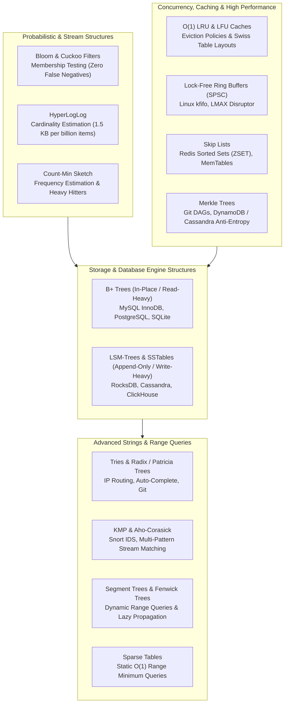

import { Callout } from "fumadocs-ui/components/callout";
import { Tabs, Tab } from "fumadocs-ui/components/tabs";
import { Steps, Step } from "fumadocs-ui/components/steps";
import { Cards, Card } from "fumadocs-ui/components/card";

Welcome to **Track 4: Systems Data Structures & Production Mastery**.

In academic curricula and standard interview preparation, algorithms are typically analyzed under the idealized **Random Access Machine (RAM)** model, where every memory access takes uniform $O(1)$ time regardless of scale. However, production systems engineering lives under physical hardware realities:

- **CPU Cache Hierarchies (L1/L2/L3)** make pointer-chasing in binary trees up to $100\times$ slower than scanning contiguous arrays.
- **Physical Block Storage (NVMe SSDs, spinning disks)** transfers data in chunks of 4 KB to 64 KB, making binary node traversals cost catastrophic random disk I/O seek penalties.
- **Write Amplification & Flash Endurance** penalize in-place updates, driving modern systems toward append-only log-structured models.
- **Massive Cardinality & Memory Footprints** force real-time streaming engines to accept bounded probabilistic error (Bloom filters, HyperLogLog) to compress petabytes of telemetry into kilobytes of RAM.

This track bridges the gap between theoretical algorithmic mastery and industrial systems architecture—from the low-level disk page layouts of **PostgreSQL** and **MySQL InnoDB** to the log-structured merge engines of **RocksDB**, the memory-efficient probabilistic sketches of **Redis**, and the lock-free rings of the **Linux kernel**.

---

## Systems Architecture Landscape

---

## Track Modules

<Cards>
  <Card
    title="01: Disk & Database Trees (B-Trees & B+ Trees)"
    href="/docs/dsa/04-systems-data-structures-and-interview-mastery/01-disk-and-database-trees-b-trees-and-b-plus-trees"
    description="Disk block paging (4KB/16KB), the failure of binary trees on disk, B-Tree splitting/merging, B+ Tree leaf linked lists, and MySQL InnoDB clustering."
  />
  <Card
    title="02: Write-Optimized Storage (LSM-Trees & SSTables)"
    href="/docs/dsa/04-systems-data-structures-and-interview-mastery/02-write-optimized-storage-lsm-trees-and-ss-tables"
    description="Sequential write throughput vs random updates, MemTables, Write-Ahead Logs (WAL), immutable SSTables, and Leveled Compaction in RocksDB."
  />
  <Card
    title="03: Probabilistic Data Structures"
    href="/docs/dsa/04-systems-data-structures-and-interview-mastery/03-probabilistic-data-structures"
    description="Trading certainty for exponential space savings: Bloom Filters, Cuckoo Filters, HyperLogLog cardinality in Redis, and Count-Min Sketch."
  />
  <Card
    title="04: Advanced String & Range Query Structures"
    href="/docs/dsa/04-systems-data-structures-and-interview-mastery/04-advanced-string-and-range-query-structures"
    description="Tries, Radix trees, KMP LPS arrays, Aho-Corasick multi-pattern search, Segment Trees with lazy propagation, Fenwick trees, and Sparse Tables."
  />
  <Card
    title="05: Concurrency, Caching & Systems Structures"
    href="/docs/dsa/04-systems-data-structures-and-interview-mastery/05-concurrency-caching-and-systems-structures"
    description="O(1) LRU & LFU cache engines, lock-free Ring Buffers (LMAX Disruptor, Linux kfifo), Redis Skip Lists, and cryptographic Merkle Trees."
  />
  <Card
    title="06: Spatial & Bitwise Algorithms"
    href="/docs/dsa/04-systems-data-structures-and-interview-mastery/06-spatial-and-bitwise-algorithms"
    description="QuadTrees, Octrees, K-D Trees (KNN), PostGIS R-Trees, low-level bit twiddling tricks (x & -x, submasks), and Euler's linear prime sieve."
  />
  <Card
    title="Capstone: Production Distributed Key-Value Cache"
    href="/docs/dsa/04-systems-data-structures-and-interview-mastery/capstone-production-distributed-key-value-cache"
    description="End-to-end production implementation combining an O(1) LRU eviction engine, Bloom filter pre-checks, Skip List index, and ring buffer event logging."
  />
  <Card
    title="Systems Data Structures Quick Reference"
    href="/docs/dsa/04-systems-data-structures-and-interview-mastery/quick-reference"
    description="Comparative storage matrix (B+ Tree vs LSM), probabilistic structures cheatsheet, bitwise recipes, and LeetCode-to-production mapping."
  />
</Cards>

---

## Pedagogical Philosophy & What You Will Build

<Steps>
  <Step>
    #### Step 1: Physical Reality & Mechanical Sympathy Software does not run in
    a vacuum. You will understand how CPU cache lines (64 bytes), virtual memory
    pages (4 KB), and flash SSD block erase units (2 MB - 8 MB) govern why
    certain algorithms win or fail in production.
  </Step>
  <Step>
    #### Step 2: Industrial Systems Implementations Every algorithm is
    implemented with complete, idiomatic, and strongly typed implementations
    across **Python**, **TypeScript**, and **C++**. We do not skip tricky edge
    cases like node splitting, lazy propagation, lock-free memory fences, or
    tombstone deletions.
  </Step>
  <Step>
    #### Step 3: Production Codebase Reverse-Engineering We dissect real code
    patterns extracted directly from production titans: - **Linux Kernel**: CFS
    red-black tree, `kfifo` ring buffer, circular doubly linked lists. -
    **Redis**: `ziplist`, `zset` (Skip List + Hash Map), `PFADD` (HyperLogLog).
    - **RocksDB & LevelDB**: Write-Ahead Log (WAL), block-based SSTables,
    Leveled Compaction. - **MySQL & PostgreSQL**: InnoDB index clustering, page
    fill factor, and buffer pool caching.
  </Step>
  <Step>
    #### Step 4: Capstone Engineering Lab You will assemble these components
    into a working in-memory storage engine equipped with probabilistic
    filtering, logarithmic range indexing, constant-time LRU cache eviction, and
    lock-free event streaming.
  </Step>
</Steps>

<Callout type="info" title="Prerequisites">
  Before diving into Track 4, ensure you are comfortable with basic dynamic
  arrays, hash tables, and binary trees from Tracks 1 and 2. High comfort with
  bitwise operations, memory pointers, and asymptotic notation will help you
  extract maximum value from this track.
</Callout>
