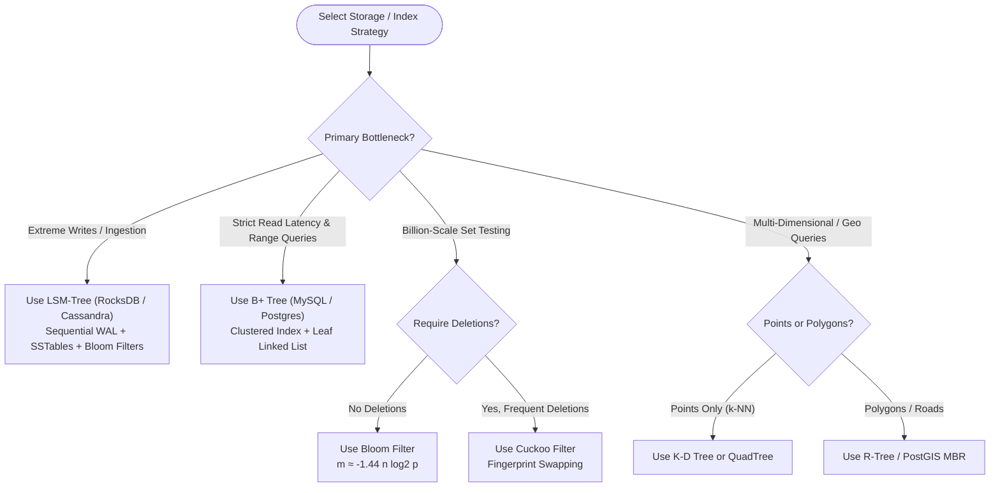

import { Callout } from "fumadocs-ui/components/callout";
import { Tabs, Tab } from "fumadocs-ui/components/tabs";
import { Steps, Step } from "fumadocs-ui/components/steps";
import { Cards, Card } from "fumadocs-ui/components/card";

This quick-reference guide serves as your authoritative cheat sheet for storage engine selection, probabilistic data structure sizing, low-level bit manipulation recipes, and translating coding interview problems into production systems architecture.

---

## Storage Engine Architecture: B+ Tree vs. LSM-Tree

```
+--------------------------------------------------------------------------------------------------------+
| Metric / Dimension         | B+ Tree (InnoDB, PostgreSQL)         | LSM-Tree (RocksDB, Cassandra)       |
+--------------------------------------------------------------------------------------------------------+
| Primary Write Strategy     | In-Place Random Disk Page Overwrites | Sequential Append-Only Log & Flush  |
| Write Throughput           | Moderate (Bound by disk random I/O)  | Ultra-High (Peak hardware sequential)|
| Point Lookup ('GET')       | Fast & Deterministic (1 - 3 reads)   | Variable (Optimized by Bloom filter)|
| Range Queries ('SCAN')     | Exceptional (Leaf Doubly Linked List)| Good (K-Way merge sort over levels) |
| Write Amplification (WA)   | Catastrophic (50x - 500x on NVMe)    | Low to Moderate (10x - 30x)         |
| Space Amplification (SA)   | Moderate (Fragmented empty page headroom)| Very Low (Compressed immutable SSTs)|
| Flash Memory (SSD) Wear    | High (Frequent block re-erases)      | Low (Sequential stream writes)      |
| Concurrency Model          | Page latches / Lock coupling         | Lock-free MemTable append           |
| Deletions                  | In-place page tombstone/merge        | Append-only Tombstone marker        |
| Recovery Mechanism         | Redo Log / WAL replay                | WAL replay + MemTable reconstruction|
| Best Workload              | Read-Heavy OLTP, Low Update Churn    | Write-Heavy Ingestion, Time-Series  |
+--------------------------------------------------------------------------------------------------------+
```

---

## Architectural Decision Flowchart



---

## Probabilistic Data Structures Cheatsheet

| Structure            | Target Metric            | Mathematical Sizing Formula                                                       | Key Invariant                                                              |
| :------------------- | :----------------------- | :-------------------------------------------------------------------------------- | :------------------------------------------------------------------------- |
| **Bloom Filter**     | Set Membership           | $m = -\frac{n \ln p}{(\ln 2)^2}$, $k = \frac{m}{n} \ln 2$                         | **Zero False Negatives**; No deletes; $1\%$ error $\approx 9.6$ bits/item. |
| **Cuckoo Filter**    | Set Membership + Deletes | Fingerprint size $f \approx \log_2(1/p) + 2$ bits                                 | Supports dynamic deletions; $O(1)$ amortized insert.                       |
| **HyperLogLog**      | Unique Cardinality       | Relative Error $\approx \frac{1.04}{\sqrt{m}}$ ($m=16384 \implies \pm 0.81\%$)    | 12 KB RAM counts billions of unique items in Redis `PFADD`.                |
| **Count-Min Sketch** | Item Frequency           | Width $w = \lceil e / \epsilon \rceil$, Depth $d = \lceil \ln(1 / \delta) \rceil$ | **Never underestimates**; tracks top-K DDoS heavy hitters.                 |

---

## Advanced Range Query Structures Matrix

| Structure                 | Preprocessing  | Point Update | Range Update | Range Query                  | Primary Use Case                         |
| :------------------------ | :------------- | :----------- | :----------- | :--------------------------- | :--------------------------------------- |
| **Fenwick Tree (BIT)**    | $O(N)$         | $O(\log N)$  | $O(\log N)$  | $O(\log N)$ (Prefix)         | Limit Order Book depth, Prefix sums      |
| **Segment Tree (Lazy)**   | $O(N)$         | $O(\log N)$  | $O(\log N)$  | $O(\log N)$ (General)        | Dynamic range $\min/\max/\text{sum}$     |
| **Sparse Table**          | $O(N \log N)$  | Immutable    | Immutable    | $\mathbf{O(1)}$ (Idempotent) | Static Range Minimum Queries (RMQ)       |
| **Radix / Patricia Tree** | $O(L \cdot N)$ | $O(L)$       | —            | $O(L + K)$                   | Linux page cache, IP routing, URL routes |
| **K-D Tree**              | $O(N \log N)$  | $O(\log N)$  | —            | $O(\log N)$ avg ($k$-NN)     | Autonomous vehicle LiDAR, 2D/3D physics  |

---

## Bit Manipulation & Systems Math Recipes

```cpp
// 1. Clear rightmost set bit
x = x & (x - 1);

// 2. Test if positive integer is a power of 2
bool is_pow2 = (x > 0) && ((x & (x - 1)) == 0);

// 3. Isolate the lowest set bit (LSB)
int lsb = x & (-x);

// 4. Power-of-two modulo wrap for circular ring buffers
int index = sequence & (capacity - 1); // capacity MUST be 2^k

// 5. Enumerate all non-empty submasks of mask m in descending order
for (int s = m; s > 0; s = (s - 1) & m) {
    // Process submask s
}

// 6. Fast Modular Exponentiation: (base^exp) % mod in O(log exp)
long long mod_pow(long long base, long long exp, long long mod) {
    long long res = 1;
    base %= mod;
    while (exp > 0) {
        if (exp & 1) res = (__int128(res) * base) % mod;
        base = (__int128(base) * base) % mod;
        exp >>= 1;
    }
    return res;
}
```

---

## The Definitive LeetCode to Production Systems Architecture Mapping

When technical interviewers ask algorithmic questions, they are evaluating whether you understand the fundamental primitives that underpin distributed infrastructure:

| LeetCode Pattern / Problem                     | Core Algorithmic Concept                     | Production Systems Architecture Real-World Application                                                                 |
| :--------------------------------------------- | :------------------------------------------- | :--------------------------------------------------------------------------------------------------------------------- |
| **LRU Cache** (LC 146)                         | Hash Map + Doubly Linked List with Sentinels | **Operating System Virtual Memory Page Replacement**, Redis `volatile-lru`, Memcached, CPU L2/L3 hardware caches.      |
| **LFU Cache** (LC 460)                         | Frequency Buckets + Doubly Linked Lists      | **Content Delivery Networks (Cloudflare/Fastly)**, edge web proxies caching viral media files.                         |
| **Range Sum Query** (LC 307 / 308)             | Binary Indexed Tree (Fenwick) / Segment Tree | **Stock Exchange Limit Order Books (Nasdaq)**: microsecond cumulative order book depth calculations.                   |
| **Sliding Window Maximum** (LC 239)            | Monotonic Deque / Ring Buffer                | **TCP Congestion Window Control**, Apache Flink stream processing moving averages, real-time rate limiters.            |
| **Design In-Memory File System** (LC 588)      | Prefix Tree (Trie) with Directory Inodes     | **Linux Virtual File System (VFS)**, ZFS directory dentry cache, Docker container overlay filesystems.                 |
| **Prefix Tree / Trie** (LC 208)                | Compressed Radix / Patricia Trie             | **Linux Kernel Page Cache (`radix_tree_root`)**, BGP / CIDR IP longest prefix matching, Go HTTP mux routers.           |
| **Find Median from Data Stream** (LC 295)      | Two Heaps (Max-Heap + Min-Heap)              | **Distributed Telemetry Monitoring (Prometheus, Datadog)**: computing p50/p95/p99 latency quantiles in real time.      |
| **Course Schedule / Topo Sort** (LC 207 / 210) | Kahn's Algorithm / DFS Cycle Detection       | **Build Systems (Webpack, Bazel, Vite)**, Terraform infrastructure resource dependency resolution graphs.              |
| **Network Delay Time / Dijkstra** (LC 743)     | Priority Queue Shortest Path                 | **Internet Routing Protocols (OSPF, IS-IS)**, AWS VPC transit gateway path selection, Google Maps directions.          |
| **Redundant Connection / DSU** (LC 684)        | Disjoint Set Union (Path Compression + Rank) | **Kruskal's Spanning Trees in Distributed Overlay Networks**, Network mesh partition detection.                        |
| **Word Search II / Stream Matching** (LC 212)  | Trie + DFS / Aho-Corasick Automaton          | **Network Intrusion Detection Systems (Snort, Suricata)**: scanning packet byte streams for 50,000 malware signatures. |
| **Merge k Sorted Lists** (LC 23)               | Min-Heap Multi-Way Merge Sort                | **LSM-Tree Compaction Workers (RocksDB, Cassandra)**, ClickHouse MergeTree background data part merges.                |

---

## Technical Interview Systems Checklist

Before submitting code in systems programming or senior engineering rounds, verify:

1. **Memory Locality:** Are you allocating millions of small heap nodes (pointer chasing), or can you lay out data in contiguous arrays (CPU cache line friendly)?
2. **Lock Granularity:** Can this shared queue be converted into a lock-free Single-Producer Single-Consumer (SPSC) ring buffer?
3. **Write Path Cost:** If an interviewer asks to scale writes from 10k/sec to 500k/sec, did you transition from an in-place B+ Tree model to an append-only LSM-Tree + MemTable model?
4. **Failure Modes:** Did you consider memory bounds, tombstone buildup, hash collisions, and buffer wrap-around?
