import { Callout } from "fumadocs-ui/components/callout";
import { Tabs, Tab } from "fumadocs-ui/components/tabs";
import { Steps, Step } from "fumadocs-ui/components/steps";
import { Cards, Card } from "fumadocs-ui/components/card";

Welcome to **Stage 5: Systems & Storage** — the systems engineering appendix of the Data Structures & Algorithms curriculum.

In theoretical computer science, algorithms are evaluated under an abstract Random Access Machine (RAM) model where all memory accesses take uniform $O(1)$ time. In production database engineering and distributed storage infrastructure, that model breaks down:

1. **Mechanical Silicon Reality**: Accessing an L1 CPU cache line takes $\approx 1 \text{ ns}$, DRAM takes $\approx 60 \text{ ns}$, and NVMe/SSD or rotational disk takes $10{,}000$ to $10{,}000{,}000 \text{ ns}$.
2. **Page-Granular I/O**: Disk and operating system file systems operate in $4\text{ KB}$ or $16\text{ KB}$ pages, making pointer-heavy in-memory nodes (like binary search trees) unusable for persistence.
3. **Write Amplification & In-Memory Compaction**: High-throughput distributed stores require append-only storage architectures like LSM-Trees, SSTables, and Bloom filters to turn random disk writes into high-speed sequential writes.

This stage bridges the gap between pure algorithms and industrial storage engines like PostgreSQL, MySQL InnoDB, SQLite, RocksDB, Redis, and Apache Cassandra.

---

## Expert Architecture Landscape

The diagram below maps the synthesis between expert algorithmic paradigms and industrial storage systems:

```mermaid
flowchart TD
    subgraph ExpertTheory["Stage 4: Expert Algorithmic Domains"]
        direction TB
        subgraph RangeTree["4.1. Range Structures & 4.2. Tree Decompositions"]
            PST["Persistent & Sparse SegTrees<br/>Merge Sort Trees, Treaps"]
            HLD["Heavy-Light Decomposition (HLD)<br/>Centroid & Virtual Trees"]
        end

        subgraph FlowsDP["4.3. Flows/Matching & 4.4. DP Optimizations"]
            FLOW["Max-Flow Min-Cut & Dinic<br/>Hopcroft-Karp Bipartite Matching"]
            DPOPT["Convex Hull Trick (CHT) & Li Chao<br/>Knuth, Aliens Trick & SOS DP"]
        end

        subgraph StringsAlgebra["4.5. String Suffix & 4.6. Algebraic Algorithms"]
            SAM["Suffix Automata (SAM) & Suffix Arrays<br/>Aho-Corasick & Palindromic Trees"]
            FFT["Fast Fourier Transform (FFT / NTT)<br/>Linear XOR Basis & Sprague-Grundy"]
        end
    end

    subgraph SystemsAppendix["Appendix: Systems & Storage Data Structures"]
        direction TB
        subgraph StorageLayer["Storage Engine Architectures"]
            BT["B-Trees & B+ Trees<br/>Block Paging (InnoDB, Postgres)"]
            LSM["LSM-Trees & SSTables<br/>Append-Only Compaction (RocksDB)"]
        end

        subgraph StreamLayer["Probabilistic & High-Performance Primitives"]
            SKETCH["Bloom, Cuckoo & HyperLogLog<br/>O(1) Memory Cardinality & Sketches"]
            CONCUR["Lock-Free SPSC Ring Buffers<br/>O(1) LRU/LFU Caches & Skip Lists"]
        end
    end

    RangeTree --> StorageLayer
    FlowsDP --> StreamLayer
    StringsAlgebra --> StorageLayer

    style ExpertTheory fill:#020617,stroke:#38bdf8,stroke-width:2px
    style SystemsAppendix fill:#0f172a,stroke:#a855f7,stroke-width:2px
```

---

## Detailed Expert Syllabus: 6 Core Domains + Systems Appendix

### 4.1. Specialized and Persistent Range Structures

Traditional Segment Trees and Fenwick Trees operate on fixed static arrays with standard point and range updates. Expert-level systems require persistence, arbitrary coordinate domains, and structural mutations:

- **4.1.1. Dynamic and Sparse Segment Trees:** On-demand node allocation supporting dynamic ranges over coordinates up to $[0, 10^9]$ without complete offline coordinate compression.
- **4.1.2. Persistent Segment Trees:** Path-copying technique preserving all historical versions with $O(\log N)$ memory overhead per update; foundational for range $k$-th smallest queries (Chair Tree) and temporal analytics.
- **4.1.3. Merge Sort Trees & 2D Range Queries:** Tree hierarchy where each internal node maintains an ordered vector of its subtree elements, answering range frequency and rank queries via binary search.
- **4.1.4. Segment Tree Beats (Ji Driver SegTree):** Maintaining range minimum/maximum clipping ($A[i] = \min(A[i], X)$) and modulo updates in amortized $O(N \log N)$ time by tracking primary and secondary extrema.
- **4.1.5. Wavelet Trees:** Space-efficient recursive alphabet-partitioning trees supporting $O(\log \Sigma)$ rank, select, and quantile queries over arbitrary sequences without full sorting.
- **4.1.6. Square Root Decomposition:** Block decomposition partitioning arrays into $\sqrt{N}$ chunks, processing arbitrary point updates and range reductions in $O(\sqrt{N})$ worst-case time.
- **4.1.7. Mo's Algorithm:** Offline query reordering via Hilbert space-filling curves or block sorting, reducing $Q$ range query evaluation complexity to $O((N + Q)\sqrt{N})$.
- **4.1.8. Randomized Treaps and Implicit Treaps:** Binary search tree augmented with randomized heap priority tags; implicit treap indexing unlocks $O(\log N)$ array range reversals, cuts, and rope splicing.
- **4.1.9. Splay Trees and Link-Cut Trees:** Self-adjusting trees providing amortized $O(\log N)$ access via splaying; Link-Cut Trees (LCT) decomposing dynamic forests into preferred splay paths for $O(\log N)$ dynamic link, cut, and path connectivity operations.

---

### 4.2. Tree Decompositions

While simple trees permit direct DFS/BFS traversals, complex path aggregation and subtree queries under dynamic edge weights require tree decomposition techniques:

- **4.2.1. Heavy-Light Decomposition (HLD):** Partitions tree vertices into heavy and light paths based on subtree weight. Maps tree paths to contiguous segments on a Segment Tree, enabling arbitrary path updates and queries in $O(\log^2 N)$ time and subtree queries in $O(\log N)$ time.
- **4.2.2. Centroid Decomposition:** Divide-and-conquer on trees by recursively finding the centroid vertex (whose removal splits the tree into components of size $\le N/2$). Yields a decomposition tree of depth $O(\log N)$, answering all-pairs path length and distance constraint queries in $O(N \log N)$ total time.
- **4.2.3. Virtual Trees (Auxiliary Trees):** Given a subset of $K$ critical tree nodes, constructs a minimal compressed auxiliary tree containing only those $K$ nodes and their pairwise Lowest Common Ancestors (LCA) in $O(K \log K)$ time, bypassing full tree traversals.
- **4.2.4. Kruskal Reconstruction Tree:** A binary tree built alongside Kruskal's MST algorithm where leaves represent original vertices and internal nodes represent added edges. Converts bottleneck edge weight queries between any pair of vertices into static LCA queries.

---

### 4.3. Connectivity, Flows, and Matchings

Going beyond simple BFS/DFS and minimum spanning trees, these algorithms solve optimal routing, capacity bottlenecks, and combinatorial constraint satisfaction:

- **4.3.1. Kosaraju's and Tarjan's Strongly Connected Components (SCC):** Linear $O(V + E)$ identification of maximal strongly connected subgraphs in directed graphs via two-pass DFS (Kosaraju) or single-pass low-link DFS stacks (Tarjan).
- **4.3.2. Two-Satisfiability (2-SAT):** Evaluates whether boolean formulas in 2-CNF $(x_i \lor x_j)$ are satisfiable in $O(V + E)$ linear time by constructing an implication digraph and checking whether any variable shares an SCC with its negation.
- **4.3.3. Bridges, Articulation Points, and Biconnected Components:** Pinpoints single points of failure in undirected networks using DFS discovery timestamps (`tin`) and low-link values (`low`).
- **4.3.4. Block-Cut Trees:** Bipartite tree representation abstracting an undirected graph into biconnected components (blocks) and articulation vertices (cuts), turning survivability analysis into tree queries.
- **4.3.5. Maximum Flow and Minimum Cut:** Max-Flow Min-Cut Theorem, Ford-Fulkerson method, and Edmonds-Karp algorithm with shortest augmenting paths in $O(V E^2)$.
- **4.3.6. Dinic's Algorithm:** Level graphs constructed via BFS and blocking flows pushed via DFS, delivering maximum network flow in $O(V^2 E)$ generally and $O(E \sqrt{V})$ on unit capacity networks.
- **4.3.7. Maximum Bipartite Matching:** Finding maximal independent edge sets in bipartite graphs via the Hopcroft-Karp algorithm in $O(E \sqrt{V})$ time.
- **4.3.8. Minimum Cost Maximum Flow (MCMF):** Augmenting flow along minimum-cost paths using Bellman-Ford/SPFA or Johnson's reweighting potentials with Dijkstra.
- **4.3.9. Offline Dynamic Connectivity:** Maintaining connectivity across an offline sequence of edge insertions and deletions using Disjoint Set Union (DSU) with rollback and divide-and-conquer over time segments in $O((V + Q) \log^2 V)$.

---

### 4.4. Dynamic Programming Optimizations

Standard dynamic programming recurrences often exhibit polynomial bottlenecks ($O(N^2)$, $O(N^3)$, or $O(K N^2)$). Expert DP optimizations exploit convexity, monotonicity, and algebraic properties to shave dimensions off running times:

- **4.4.1. Convex Hull Trick (CHT):** Optimizes linear transitions of the form $dp[i] = \min_{j < i} \{ dp[j] + m_j x_i + c_j \}$ from $O(N^2)$ down to $O(N)$ (monotonic slopes) or $O(N \log N)$ (arbitrary slopes) by maintaining upper or lower convex hulls of linear equations.
- **4.4.2. Li Chao Trees:** Specialized segment tree maintaining line envelopes $(y = mx + c)$, enabling dynamic line insertion and point evaluation in $O(\log N)$ time without sorting slope values.
- **4.4.3. Divide & Conquer DP Optimization:** Applicable when optimal transition split points exhibit quadrangle monotonicity ($opt[i][j-1] \le opt[i][j] \le opt[i+1][j]$), collapsing $O(K N^2)$ recurrences into $O(K N \log N)$.
- **4.4.4. Knuth's Optimization:** For interval DP recurrences satisfying the quadrangle inequality where $opt[i][j-1] \le opt[i][j] \le opt[i+1][j]$, narrowing the search window to reduce complexity from $O(N^3)$ to $O(N^2)$.
- **4.4.5. Lagrangian Relaxation and Aliens Trick:** Binary searching over a penalty parameter $\lambda$ associated with a cardinality constraint $K$, transforming constrained DP into unconstrained DP.
- **4.4.6. Slope Trick:** Optimizing continuous or discrete convex cost functions by representing functions purely as collections of slope change coordinates maintained in priority queues.
- **4.4.7. Sum Over Subsets (SOS) DP:** Evaluates multi-dimensional submask sums $F[mask] = \sum_{sub \subseteq mask} A[sub]$ across $N$ bits in $O(N \cdot 2^N)$ time instead of naive $O(3^N)$ submask iteration.
- **4.4.8. Broken Profile Dynamic Programming:** Dynamic programming across 2D grids with irregular or jagged state boundaries, tracking frontier cell occupancy using bitmasks.

---

### 4.5. Advanced String Suffix Structures

Sublinear string search, multiple pattern matching, and complex substring combinatorics:

- **4.5.1. Aho-Corasick Automaton:** Combines a Trie with Knuth-Morris-Pratt failure links and dictionary output links, enabling simultaneous search for thousands of patterns in $O(\sum |P_i| + |Text|)$ streaming time.
- **4.5.2. Suffix Arrays & Longest Common Prefix (LCP) Array:** Lexicographically sorted array of all suffixes constructed in $O(N \log N)$ or $O(N)$, paired with Kasai's algorithm to compute the LCP array in $O(N)$ linear time.
- **4.5.3. Suffix Automata (SAM):** Minimal Directed Acyclic Word Graph (DAWG) encoding every substring of a string $S$ in $O(N)$ states and transitions; supports substring counting, occurrences, and distinct substring queries in linear time.
- **4.5.4. Palindromic Trees (Eertree):** Directed tree containing two auxiliary roots (lengths $-1$ and $0$) encoding all distinct palindromic substrings of a string with $O(N)$ vertices and linear amortized transition times.

---

### 4.6. Algebraic and Game-Theoretic Algorithms

Mathematical, polynomial, and vector space paradigms:

- **4.6.1. Fast Fourier Transform (FFT) and Number Theoretic Transform (NTT):** Accelerates polynomial convolution and multiplication from $O(N^2)$ to $O(N \log N)$ utilizing complex roots of unity or finite field modular primitive roots.
- **4.6.2. Linear XOR Basis & Gaussian Elimination:** Vector space over Galois field $\mathbb{F}_2$, computing maximum XOR subset sums, span membership, and solving systems of linear equations over modular domains.
- **4.6.3. Combinatorial Game Theory & Sprague-Grundy Theorem:** Analysis of impartial games under normal play convention; computes Grundy values via the Minimum Excluded value ($mex$) function, decomposing compound independent games via XOR Nim-sums.

---

### Appendix: Systems & Storage Data Structures

The architectural foundations powering relational databases, distributed key-value engines, operating system kernels, and high-throughput caches:

- **B-Trees & B+ Trees:** High-fanout balanced search trees structured around 4 KB to 64 KB storage pages to minimize mechanical disk head movement and NVMe random read penalties; linked leaf nodes enable sequential scan acceleration in MySQL InnoDB and PostgreSQL.
- **Log-Structured Merge-Trees (LSM-Trees) & SSTables:** Append-only write engines transforming random disk writes into high-speed sequential log writes; utilizes in-memory MemTables, Write-Ahead Logs (WAL), sorted immutable SSTable disk files, and background Leveled or Size-Tiered compaction (RocksDB, ClickHouse).
- **Probabilistic Filters & Sketches:**
  - **Bloom Filters & Cuckoo Filters:** Space-efficient set membership testing with zero false negatives; Cuckoo filters support dynamic deletions and high load factors.
  - **HyperLogLog (HLL):** Cardinality estimation across billions of unique keys with $\approx 1\%$ standard error using only 1.5 KB of memory.
  - **Count-Min Sketch:** Streaming frequency estimation and heavy-hitter identification in high-frequency trading and telemetry pipelines.
- **Compressed Radix Trees (Patricia Tries):** Compact prefix trees utilized in the Linux kernel page cache and microsecond HTTP routing engines.
- **Concurrency & In-Memory Caching Structures:**
  - **$O(1)$ LRU & LFU Cache Engines:** Doubly linked lists combined with hash tables and frequency buckets for eviction guarantees.
  - **Lock-Free SPSC Ring Buffers:** Thread-safe circular buffers utilizing atomic read/write head pointers and CPU memory barriers (Linux `kfifo`, LMAX Disruptor).
  - **Skip Lists:** Probabilistic balanced hierarchies facilitating lock-free concurrent access in Redis Sorted Sets (`ZSET`) and storage MemTables.
  - **Merkle Trees:** Cryptographic hash trees for anti-entropy and partition synchronization in distributed consensus stores (DynamoDB, Cassandra).
- **Multi-Dimensional Spatial Partitioning Trees:**
  - **QuadTrees & Octrees:** Recursive 2D/3D spatial division for graphics engines and collision engines.
  - **K-D Trees:** Alternating hyperplane space partitioning for $k$-nearest neighbor ($k$-NN) search.
  - **R-Trees & $R^*$ Trees:** Bounding box hierarchies for geographic GIS indexing (PostGIS).

---

## Stage 5 Modules & Storage Primitives

Explore the production systems storage engines, sketching structures, and hardware-conscious courseware included in this stage:

<Cards>
  <Card
    title="01: Disk & Database Trees (B-Trees & B+ Trees)"
    href="/docs/dsa/05-systems-and-storage/01-disk-and-database-trees-b-trees-and-b-plus-trees"
    description="Disk block paging (4KB/16KB), the failure of binary trees on disk, B-Tree splitting/merging, B+ Tree leaf linked lists, and MySQL InnoDB clustering."
  />
  <Card
    title="02: Write-Optimized Storage (LSM-Trees & SSTables)"
    href="/docs/dsa/05-systems-and-storage/02-write-optimized-storage-lsm-trees-and-ss-tables"
    description="Sequential write throughput vs random updates, MemTables, Write-Ahead Logs (WAL), immutable SSTables, and Leveled Compaction in RocksDB."
  />
  <Card
    title="03: Probabilistic Data Structures"
    href="/docs/dsa/05-systems-and-storage/03-probabilistic-data-structures"
    description="Trading certainty for exponential space savings: Bloom Filters, Cuckoo Filters, HyperLogLog cardinality in Redis, and Count-Min Sketch."
  />
  <Card
    title="04: Advanced String & Range Query Structures"
    href="/docs/dsa/05-systems-and-storage/04-advanced-string-and-range-query-structures"
    description="Tries, Radix trees, KMP LPS arrays, Aho-Corasick multi-pattern search, Segment Trees with lazy propagation, Fenwick trees, and Sparse Tables."
  />
  <Card
    title="05: Concurrency, Caching & Systems Structures"
    href="/docs/dsa/05-systems-and-storage/05-concurrency-caching-and-systems-structures"
    description="O(1) LRU & LFU cache engines, lock-free Ring Buffers (LMAX Disruptor, Linux kfifo), Redis Skip Lists, and cryptographic Merkle Trees."
  />
  <Card
    title="06: Spatial & Bitwise Algorithms"
    href="/docs/dsa/05-systems-and-storage/06-spatial-and-bitwise-algorithms"
    description="QuadTrees, Octrees, K-D Trees (KNN), PostGIS R-Trees, low-level bit twiddling tricks (x & -x, submasks), and Euler's linear prime sieve."
  />
  <Card
    title="Capstone: Production Distributed Key-Value Cache"
    href="/docs/dsa/05-systems-and-storage/capstone-production-distributed-key-value-cache"
    description="End-to-end production implementation combining an O(1) LRU eviction engine, Bloom filter pre-checks, Skip List index, and ring buffer event logging."
  />
  <Card
    title="Systems Data Structures Quick Reference"
    href="/docs/dsa/05-systems-and-storage/quick-reference"
    description="Comparative storage matrix (B+ Tree vs LSM), probabilistic structures cheatsheet, bitwise recipes, and LeetCode-to-production mapping."
  />
</Cards>

---

## Pedagogical Philosophy & Engineering Journey

<Steps>
  <Step>
    #### Step 1: Physical Reality & Mechanical Sympathy Software does not run in
    a vacuum. You will understand how CPU cache lines (64 bytes), virtual memory
    pages (4 KB), and flash SSD block erase units (2 MB - 8 MB) govern why
    certain algorithms win or fail in production environments.
  </Step>
  <Step>
    #### Step 2: Algorithmic Rigor & Olympiad Decomposition Conquer complex
    decomposition techniques (Heavy-Light Decomposition, Centroid Decomposition)
    and advanced DP state reductions (Convex Hull Trick, Li Chao, Knuth). You
    will develop the intuition to recognize hidden convex hulls and DAG
    structures in intricate problem spaces.
  </Step>
  <Step>
    #### Step 3: Industrial Production Codebase Reverse-Engineering We dissect
    real code patterns extracted directly from production titans: - **Linux
    Kernel**: CFS red-black tree, `kfifo` ring buffer, and circular intrusive
    lists. - **Redis**: `ziplist`, `zset` (Skip List + Hash Map), and `PFADD`
    (HyperLogLog). - **RocksDB & LevelDB**: Write-Ahead Log (WAL), block-based
    SSTables, and Leveled Compaction. - **MySQL & PostgreSQL**: InnoDB index
    clustering, page fill factor, and buffer pool caching.
  </Step>
  <Step>
    #### Step 4: Capstone Engineering Lab You will assemble these components
    into a working in-memory storage engine equipped with probabilistic
    filtering, logarithmic range indexing, constant-time LRU cache eviction, and
    lock-free event streaming.
  </Step>
</Steps>

<Callout type="info" title="Prerequisites">
  Before diving into Stage 4, ensure you have mastered the foundational linear
  primitives from **Stage 1: Beginner**, hierarchical trees and heaps from
  **Stage 2: Intermediate**, and shortest-path graph algorithms and standard
  dynamic programming from **Stage 3: Advanced**. Comfort with pointers, bitwise
  manipulation, and asymptotic notation is assumed.
</Callout>
