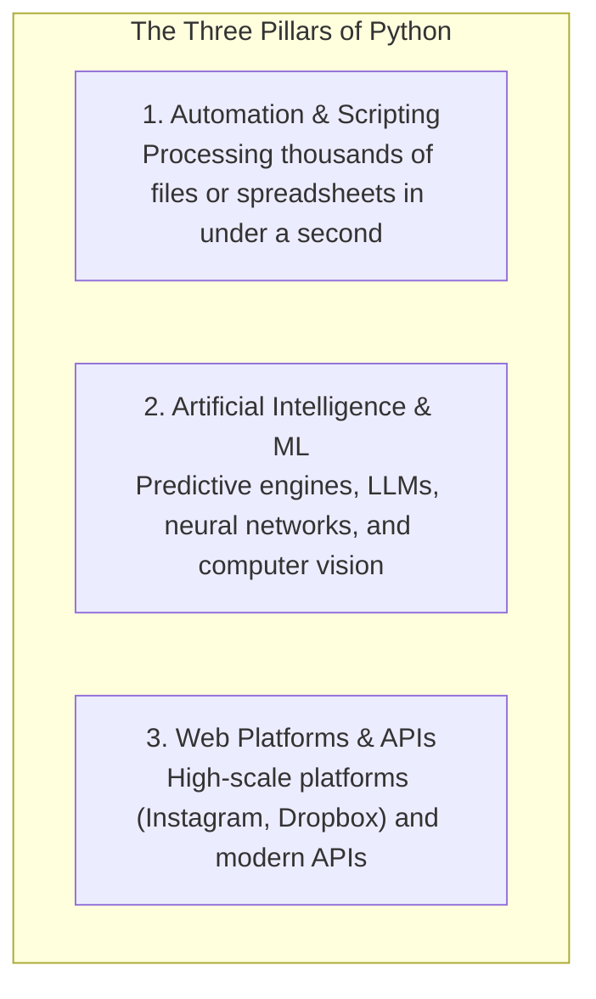

import { Callout } from "fumadocs-ui/components/callout";
import { Tabs, Tab } from "fumadocs-ui/components/tabs";
import { Steps, Step } from "fumadocs-ui/components/steps";
import { Accordion, Accordions } from "fumadocs-ui/components/accordion";

Python is one of the most popular programming languages on the planet. Every single day, engineers and researchers use it to accomplish extraordinary things across three distinct pillars:



> _"You're not too old or too young, and Python is super easy to learn. You can write your first Python program in literally seconds."_  
> — Mosh Hamedani

---

## What You Will Build

Learning syntax without context is dry and forgettable. To keep our sights set on real software engineering, this curriculum guides you toward building substantive software across three practical domains:

1. **The Storefront Application**: A clean web application with a catalog and administrative management (built with modern Python web tooling).
2. **The Recommender Engine**: A machine-learning script that analyzes user profiles and predicts media preferences (like Spotify or YouTube).
3. **The Automator**: A high-speed CLI tool that parses, extracts, and summarizes thousands of files in constant memory.

---

## Two Installations: The Interpreter and the IDE

Two tools stand between you and your first running program:

1. **The Language Interpreter**: The engine that knows how to read and execute Python instructions.
2. **An IDE or Code Editor**: Where you comfortably write, inspect, and debug your code.

<Callout type="info" title="What is the Python Interpreter?">
  Computers do not speak English, and silicon CPUs do not understand Python
  directly. The **interpreter** is a specialized native executable (`python` or
  `python.exe`) that translates your human-readable Python code into machine
  instructions that the computer's CPU can execute.
</Callout>

### Step 1: Install Modern Python & The `uv` Toolchain

Historically, Python developers wrestled with complex installations and PATH errors. Today, the modern standard is **`uv`** (by Astral) — an ultra-fast Rust-native tool that automatically manages Python versions, virtual environments, and packages in milliseconds.

<Tabs items={['macOS / Linux', 'Windows (PowerShell)', 'Traditional python.org']}>
<Tab value="macOS / Linux">
```bash
# Install uv
curl -LsSf https://astral.sh/uv/install.sh | sh

# Install Python 3.12+ automatically

uv python install 3.12

# Verify installation

uv run python --version

````
</Tab>
<Tab value="Windows (PowerShell)">
```powershell
# Install uv via standalone installer
powershell -ExecutionPolicy ByPass -c "irm https://astral.sh/uv/install.ps1 | iex"

# Install Python 3.12+ automatically
uv python install 3.12

# Verify installation
uv run python --version
````

</Tab>
<Tab value="Traditional python.org">
1. Head to **[python.org/downloads](https://python.org/downloads)** and download Python 3.12+.
2. **Crucial on Windows**: During installation, tick the checkbox labelled **"Add python.exe to PATH"**. If you miss this checkbox, your terminal will not be able to find the Python interpreter when you type `python`.
</Tab>
</Tabs>

### Step 2: Choose Your Editor (IDE)

A code editor is to an engineer what Microsoft Word is to a writer. An **Integrated Development Environment (IDE)** is a code editor on steroids: it includes syntax highlighting, code completion, a built-in terminal, and interactive debuggers.

- **VS Code** (Free, lightweight, industry standard): Install the official _Python_ and _Ruff_ extensions.
- **PyCharm Community** (Free, dedicated Python IDE from JetBrains): Excellent out-of-the-box refactoring and interpreter management.
- **Cursor / Zed**: Modern AI-first editors.

---

## Creating Your First Project Directory

Open your terminal and create a folder for your practice code:

```bash
mkdir hello_python
cd hello_python
```

Create a new file named `app.py`:

```bash
# On Linux/macOS
touch app.py

# On Windows PowerShell
New-Item app.py
```

<Callout type="note" title="Why .py?">
  By convention, every Python source file carries the <code>.py</code>{" "}
  extension. This tells your operating system and code editor that the file
  contains Python source code.
</Callout>

---

## Practice Questions & Challenges

Test your understanding of the Python interpreter, PATH environment variables, interactive vs script mode, and runtime verification.

### Question 1: Command & Output Prediction

Without opening a terminal, what will be output or what action occurs when executing each of the following CLI commands?

```bash
# Command A:
python -c "print('Python runtime ready!')"

# Command B:
python --version

# Command C:
python
```

<Accordions>
<Accordion title="Reveal Solution & Explanation">

- **Command A**: Executes the Python string inline without needing a `.py` file, outputting `Python runtime ready!` to `stdout` and exiting immediately back to the shell with status code `0`.
- **Command B**: Prints the currently active Python interpreter's version string (e.g., `Python 3.12.3`) to standard output and immediately exits.
- **Command C**: Launches the **Interactive REPL** (Read-Eval-Print Loop), displaying the interactive primary prompt (`>>>`), waiting for you to type Python statements line by line. (Exit with `exit()` or <kbd>Ctrl+Z</kbd>/<kbd>Ctrl+D</kbd>).

</Accordion>
</Accordions>

---

### Question 2: Spot and Fix the Bug (The Dreaded PATH Error)

A developer on Windows installs Python from `python.org`. When opening PowerShell and typing `python --version`, they encounter this error:

```text
python : The term 'python' is not recognized as the name of a cmdlet, function,
script file, or operable program. Check the spelling of the name, or if a path
was included, verify that the path is correct and try again.
```

1. What causes this error?
2. How do you diagnose which directory is missing?
3. What is the permanent fix?

<Accordions>
<Accordion title="Reveal Solution & Explanation">

**1. Root Cause:**
The Windows installer ran without enabling the **"Add python.exe to PATH"** checkbox. The operating system looks for commands only in directories listed in the `%PATH%` environment variable; because the Python installation folder (e.g., `C:\Users\<User>\AppData\Local\Programs\Python\Python312\`) is not listed in `PATH`, the terminal cannot locate `python.exe`.

**2. Diagnosis:**

- In Windows PowerShell, check if the Python launcher exists: `py --version` (Windows installs `py.exe` in `C:\Windows`, which is always on PATH).
- Inspect current PATH entries: `$env:PATH -split ';'`

**3. The Permanent Fix:**

- Re-run the Python installer, select **Modify**, and check **"Add Python to environment variables"**.
- Alternatively, use the modern Astral toolchain: running `uv python install 3.12` or running scripts with `uv run script.py` eliminates system PATH dependency conflicts completely.

</Accordion>
</Accordions>

---

### Question 3: Conceptual Question (Interpreted vs Compiled)

People often say _"Python is an interpreted language, unlike C or Rust which are compiled."_

Is it true that Python never compiles code? What role do `.pyc` files and `__pycache__` play during program execution?

<Accordions>
<Accordion title="Reveal Solution & Explanation">

**The Nuance:**
Python is **both compiled and interpreted**:

1. **Compilation Phase**: When you run `python app.py`, CPython first checks for existing valid bytecode. If absent or outdated, CPython's compiler parses your `.py` source text into an Abstract Syntax Tree (AST) and compiles it into low-level **bytecode** (`.pyc` files stored inside `__pycache__/`).
2. **Evaluation Phase**: The CPython Virtual Machine (the evaluation loop inside `ceval.c`) interprets that pre-compiled bytecode instruction-by-instruction.

**Key Difference from C/Rust:**
C and Rust compile source code ahead-of-time (AOT) directly into native CPU machine instructions (x86-64 or ARM machine code). Python compiles to portable virtual bytecode evaluated by a runtime VM.

</Accordion>
</Accordions>

---

### Question 4: Script Mode vs Interactive REPL

When should an engineer use the interactive REPL (`>>>`), and when should they write scripts in `.py` files? Give two distinct real-world use cases for each mode.

<Accordions>
<Accordion title="Reveal Solution & Explanation">

- **Use the REPL when:**
  1. _Quick API or library exploration_: Testing what methods a newly installed package exposes (e.g., testing `import httpx; client = httpx.Client()`).
  2. _Evaluating quick expressions or one-off calculations_: Verifying regex matches, date calculations, or testing a tricky slice without creating a temporary file.

- **Use Script Mode (`.py` files) when:**
  1. _Production applications and automation_: Code that must be saved, version-controlled with Git, reviewed, and run repeatedly.
  2. _Testing and multi-module architectures_: Programs that define functions, classes, imports, and error handling intended for automated execution.

</Accordion>
</Accordions>

---

### Question 5: Code Challenge (Environment Sanity Verifier)

Write a Python script `verify_env.py` that verifies the runtime environment.

The script must:

1. Check the Python version using `sys.version_info`.
2. If the major version is less than 3, or the minor version is less than 12, print a warning stating: `Error: Modern Python 3.12+ required. Found <version>` and exit with status code `1` using `sys.exit(1)`.
3. If valid, print the active interpreter path (`sys.executable`) and the operating system platform (`sys.platform`), followed by: `Environment Verified: Ready for Modern Python Engineering!`

<Accordions>
<Accordion title="Reveal Solution & Code">

```python
# verify_env.py
import sys

def verify_environment() -> None:
    major, minor, micro = sys.version_info[:3]
    version_str = f"{major}.{minor}.{micro}"

    # Python 3.12+ check
    if sys.version_info < (3, 12):
        print(f"Error: Modern Python 3.12+ required. Found {version_str}", file=sys.stderr)
        sys.exit(1)

    print(f"Python Version    : {version_str}")
    print(f"Active Interpreter: {sys.executable}")
    print(f"Platform Target   : {sys.platform}")
    print("Environment Verified: Ready for Modern Python Engineering!")

if __name__ == "__main__":
    verify_environment()
```

**Testing the output:**

```text
Python Version    : 3.12.3
Active Interpreter: /usr/local/bin/python3
Platform Target   : linux
Environment Verified: Ready for Modern Python Engineering!
```

</Accordion>
</Accordions>

---

## Core Definitions to Remember

| Term            | Meaning                                                                                                                              |
| :-------------- | :----------------------------------------------------------------------------------------------------------------------------------- |
| **Interpreter** | The program that translates Python instructions into binary machine instructions the CPU can execute.                                |
| **IDE**         | Integrated Development Environment — an editor with integrated tooling (terminal, debugger, linters) to make writing code ergonomic. |
| **`.py`**       | The standard file extension for Python source files.                                                                                 |
| **`PATH`**      | An operating system environment variable listing the directories where executable programs live.                                     |

With your environment ready, proceed to **[02. Your First Program & Execution Model](/docs/learn-python/01-fundamentals/02-first-program-and-execution)**!
