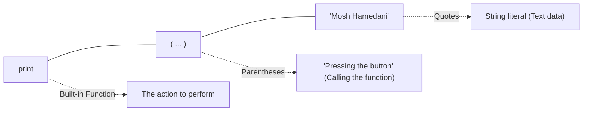

import { Callout } from "fumadocs-ui/components/callout";
import { Accordion, Accordions } from "fumadocs-ui/components/accordion";

Open `app.py` in your editor and type your very first line of Python code:

```python
print("Mosh Hamedani")
```

Now run the program from your terminal:

```bash
python app.py
# or using uv:
uv run app.py
```

Look at the terminal output:

```text
Mosh Hamedani
```

---

## Anatomy of the Line

This single line teaches three fundamental concepts:



1. **`print`**: A function built directly into Python. Python is strictly case-sensitive; built-in functions are always lowercase (`print`, not `Print` or `PRINT`).
2. **`()` Parentheses**: The parentheses **call** (execute) the function. Think of a TV remote control: the button labelled "Volume Up" exists on the remote, but nothing happens until you press it. The parentheses are the act of pressing the button.
3. **`" "` Quotes**: Anything wrapped in quotes is a **string** — a sequence of text characters. Single quotes (`'...'`) or double quotes (`"..."`) both work identically in Python.

<Callout type="info" title="The Terminal as a Window">
  The terminal is a little window into your running program. Later in this
  curriculum, you will build applications with web user interfaces (browsers) or
  GUIs, but the terminal remains the fundamental developer interface where logs,
  diagnostic outputs, and program results live.
</Callout>

---

## The Cardinal Rule: Line-by-Line Execution

Add two more print statements to `app.py` to draw an imaginary dog:

```python
print("Mosh Hamedani")
print("o----")
print(" ||||")
```

Run the program again:

```text
Mosh Hamedani
o----
 ||||
```

An `o` for the head, four hyphens for the body, and four vertical bars for the legs. While playful, this snippet teaches the single most important rule about Python execution:

> **Python code is executed line by line, from the top down.**

When you start the interpreter, it reads line 1, evaluates it, and prints the name. Then it advances to line 2 and prints the body. Then it advances to line 3 and prints the legs. In Python, the **order of your statements is absolute**.

---

## String Arithmetic & Expressions

Now try something cool. Change `app.py` to:

```python
print("*" * 10)
```

Run the program:

```text
**********
```

Notice what happened: we took a string containing a single asterisk `"*"` and multiplied it by the number `10` using the standard multiplication operator (`*`). Python responded by repeating the string ten times!

### What is an Expression?

The piece of code `"*" * 10` has a precise computer science name: an **expression**.

<Callout type="note" title="Definition: Expression">
  An **expression** is any piece of code that <em>produces a value</em>.
</Callout>

When the interpreter encounters the line `print("*" * 10)`:

1. It first evaluates the expression inside the parentheses: `"*" * 10` evaluates to `"**********"`.
2. It then passes that evaluated value into the `print()` function.
3. The function displays the ten asterisks on your screen.

---

## Practice Questions & Challenges

Test your understanding of the Python execution model, `print()` mechanics, argument separators, and expressions.

### Question 1: Output Prediction (Print Arguments & Separators)

Without executing the code, predict the exact terminal output for each snippet:

```python
# Snippet A: Multiple arguments with default separators
print("Build", "Ship", "Run")

# Snippet B: Custom sep and end arguments
print("2026", "10", "18", sep="-", end=" | ")
print("Status", "OK", sep=": ")

# Snippet C: Expression evaluation precedence in print
print("=" * 4 + " " + "Python" + " " + "=" * 4)
```

<Accordions>
<Accordion title="Reveal Solution & Explanation">

**Snippet A Output:**

```text
Build Ship Run
```

_Explanation:_ By default, passing comma-separated arguments to `print()` outputs them joined by a single space (`sep=" "`) and terminates with a newline (`end="\n"`).

**Snippet B Output:**

```text
2026-10-18 | Status: OK
```

_Explanation:_ The first `print()` replaces the default newline with `end=" | "`, so the second `print()` continues immediately on the exact same line.

**Snippet C Output:**

```text
==== Python ====
```

_Explanation:_ The expressions `"*" * 4` evaluate first to `"===="`, which are concatenated with `" Python "` before being displayed.

</Accordion>
</Accordions>

---

### Question 2: Spot and Fix the Bug (Case Sensitivity & Syntax Traps)

Examine the following code in `test_app.py`:

```python
Print("Starting system...")
print("Step 1: Check database"
print("Step 2: Connecting", "localhost", sep = = ":")
```

Identify the three separate bugs in this code, their respective exception types, and write the corrected version.

<Accordions>
<Accordion title="Reveal Solution & Explanation">

**The Three Bugs:**

1. **Line 1: `Print` instead of `print`**: Python is strictly case-sensitive. `Print` is not built-in, triggering `NameError: name 'Print' is not defined`.
2. **Line 2: Missing closing parenthesis `)`**: Line 2 never closes its `print(` call, causing the interpreter to raise a `SyntaxError: closing parenthesis ')' does not match opening parenthesis` or syntax error on the subsequent line.
3. **Line 3: Double equals `= =` in keyword argument**: Keyword arguments in Python use single `=` without spaces (`sep=":"`). `sep = = ":"` is invalid grammar and triggers a `SyntaxError: invalid syntax`.

**Corrected Code:**

```python
print("Starting system...")
print("Step 1: Check database")
print("Step 2: Connecting", "localhost", sep=":")
```

</Accordion>
</Accordions>

---

### Question 3: Architecture Question (Expressions vs Statements)

In Python programming:

1. What is the fundamental difference between an **expression** and a **statement**?
2. Why does Python permit `print(4 + 5)` but crashes if you write `print(x = 5)`?

<Accordions>
<Accordion title="Reveal Solution & Explanation">

**1. Expression vs Statement:**

- An **expression** represents a computation that evaluates to a concrete object/value in memory (e.g., `"hello" * 2`, `42`, `10 / 2`, `len("test")`).
- A **statement** represents an action or instruction that performs a side-effect but does _not_ evaluate to a value (e.g., variable assignment `x = 5`, `import sys`, `for`, `if`).

**2. Why `print(x = 5)` fails:**
Standard variable assignment (`x = 5`) is a statement, not an expression. Because function call arguments must evaluate to expressions, passing an assignment statement into a function causes a `SyntaxError: invalid syntax. Maybe you meant '==' or ':='?`.  
_(Note: Python 3.8+ introduced the walrus operator `:=`, which is an assignment **expression**, making `print(x := 5)` valid!)_

</Accordion>
</Accordions>

---

### Question 4: Hands-On ASCII Art Challenge

Using only `print()` statements and line-by-line execution, draw an animal or shape on your terminal (for instance, a cat or a diamond) using string repetition and escaped characters where appropriate.

<Accordions>
<Accordion title="Reveal Solution & Output">

```python
# app.py
print(" /\\_/\\ ")
print("( o.o )")
print(" > ^ < ")
```

When executed, the terminal displays:

```text
 /\_/\
( o.o )
 > ^ <
```

_(Note: We use `\\` to escape backslashes in Python strings so they don't get confused with special formatting codes like `\n`.)_

</Accordion>
</Accordions>

---

### Question 5: Code Challenge (Terminal Receipt Formatter)

Write a Python program in `app.py` that formats and prints an order receipt cleanly aligned within a 30-character boundary using **only** `print()`, `sep`, `end`, and string repetition (`*`):

Expected Output:

```text
==============================
       COFFEE SHOP RECEIPT
==============================
Item:               Latte
Price:              $4.50
Tax:                $0.40
------------------------------
Total:              $4.90
==============================
Thank you for your visit!
```

Ensure the header border uses 30 `=` characters and the divider uses 30 `-` characters generated via expression repetition, not hard-coded manual dashes.

<Accordions>
<Accordion title="Reveal Solution & Code">

```python
# app.py
width = 30

print("=" * width)
print("       COFFEE SHOP RECEIPT    ")
print("=" * width)
print("Item:", "Latte", sep="               ")
print("Price:", "$4.50", sep="              ")
print("Tax:", "$0.40", sep="                ")
print("-" * width)
print("Total:", "$4.90", sep="              ")
print("=" * width)
print("Thank you for your visit!")
```

</Accordion>
</Accordions>

---

## Summary Reference

- **`print(...)`**: Outputs text or expressions to the console.
- **Parentheses `()`**: Execute ("call") a function.
- **Line-by-line flow**: Execution moves strictly top-to-bottom.
- **Expression**: Any snippet of code that evaluates to a value.

Next, let's explore how Python remembers information in **[03. Variables & The Core Data Types](/docs/learn-python/01-fundamentals/03-variables-and-data-types)**.
