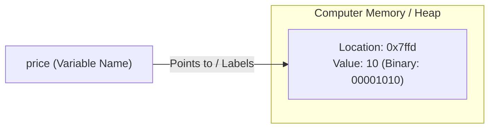

import { Callout } from "fumadocs-ui/components/callout";
import { Accordion, Accordions } from "fumadocs-ui/components/accordion";

Variables are one of the most fundamental concepts in computer programming. They are not unique to Python; they exist in virtually every programming language in the world.

A variable **temporarily stores data in the computer's memory (RAM)** while your program runs.

Type the following lines into `app.py`:

```python
price = 10
print(price)
```

Run the program:

```text
10
```

---

## Mental Model: A Box with a Label

When the Python interpreter executes the line `price = 10`, three specific things happen:



1. **Memory Allocation**: Python reserves a small chunk of space in the computer's RAM.
2. **Value Storing**: It places the value `10` inside that memory location.
3. **Label Attachment**: It binds the name `price` as a label pointing to that location.

### Why Are There No Quotes Around `price` in `print()`?

Notice that we wrote `print(price)` without quotes:

- If you write `print("price")` with quotes, Python prints the literal string characters `price`.
- If you write `print(price)` without quotes, Python looks up the variable label in memory, retrieves the stored value (`10`), and prints the value.

---

## Under the Hood: Decimal to Binary

Before the number `10` lands in RAM, it undergoes a transformation. Humans count in decimal (base 10, using digits 0 through 9). However, physical computer memory consists of microscopic transistors that can only be ON (1) or OFF (0).

When Python stores `10`, it converts the decimal number into binary bits:

> **Decimal `10` → Binary `1010` (base 2)**

It then writes those electrical bits into RAM. When you print `price`, Python reads the bits from memory, converts them back to human-readable decimal `10`, and displays it.

---

## Reassignment: Last Assignment Wins

Watch what happens when you reassign a variable:

```python
price = 10
price = 20
print(price)
```

Run the program:

```text
20
```

Remember our cardinal rule: **code executes line by line, from the top**.

1. Line 1: `price` is bound to `10`.
2. Line 2: `price` is rebound to `20`.
3. Line 3: `print(price)` prints `20`. The last assignment always wins.

---

## The Four Core Data Types

In Python, every value has a specific **type**. In these early stages, four core data types form the backbone of nearly all programs:

| Type        | What It Holds                                           | Example               | Notes                                                        |
| :---------- | :------------------------------------------------------ | :-------------------- | :----------------------------------------------------------- |
| **`int`**   | Whole integers (positive or negative, no decimal point) | `price = 10`          | Short for "integer". Can be arbitrarily large in Python.     |
| **`float`** | Real numbers with a fractional decimal point            | `rating = 4.9`        | Short for "floating-point number".                           |
| **`str`**   | Text (a sequence of characters)                         | `name = "Mosh"`       | Short for "string". Defined using single or double quotes.   |
| **`bool`**  | Binary truth values (yes / no)                          | `is_published = True` | Short for "boolean". Must be capitalized: `True` or `False`. |

### Case Sensitivity & Naming Conventions

Python is strictly **case-sensitive**:

- `True` and `False` are valid booleans. Lowercase `true` or `false` will produce a `NameError` because Python treats them as undefined variable names.
- Variable names should always be **lowercase**, with multiple words separated by an underscore (`snake_case`):

```python
# ✅ Pythonic snake_case
user_age = 25
is_logged_in = False

# ❌ Non-pythonic (avoid in Python)
userAge = 25
IsLoggedIn = False
```

---

## Practice Questions & Challenges

Test your understanding of variables, dynamic rebinding, the four core types, and Python's memory model.

### Question 1: Output Prediction (Variable Rebinding)

Without running the script, predict what this code prints:

```python
x = 10
y = x
x = 25
z = y + 5

print("x:", x)
print("y:", y)
print("z:", z)
```

<Accordions>
<Accordion title="Reveal Solution & Explanation">

```text
x: 25
y: 10
z: 15
```

**Why `y` does not change when `x` changes:**

1. `x = 10` creates an integer object `10` in memory and binds label `x` to it.
2. `y = x` binds label `y` to that exact same object (`10`).
3. `x = 25` rebinds label `x` to a new object `25`. It does _not_ modify the integer `10`, nor does it affect `y`.
4. Therefore, `y` continues pointing to `10`, and `z = y + 5` evaluates to `15`.

</Accordion>
</Accordions>

---

### Question 2: Spot and Fix the Bug (Identifier & Type Traps)

A beginner writes this configuration script in `settings.py`:

```python
2fa_enabled = true
user-score = 98.5
total count = 100
MAX_LIMIT = 500
```

1. Identify the syntax errors on lines 1, 2, and 3.
2. What makes `MAX_LIMIT` valid even though it uses all uppercase letters?
3. Rewrite the code using strict PEP 8 Pythonic conventions.

<Accordions>
<Accordion title="Reveal Solution & Explanation">

**The Bugs:**

1. **Line 1 (`2fa_enabled = true`)**:
   - Variable names cannot start with a digit (triggers `SyntaxError: invalid decimal literal`).
   - `true` must be capitalized (`True`), otherwise Python raises `NameError: name 'true' is not defined`.
2. **Line 2 (`user-score = 98.5`)**:
   - Hyphens `-` are subtraction operators in Python, not valid characters in variable names (triggers `SyntaxError: cannot assign to expression`).
3. **Line 3 (`total count = 100`)**:
   - Variable names cannot contain spaces (triggers `SyntaxError: invalid syntax`).

**Why `MAX_LIMIT` is valid:**
Uppercase variable names are syntactically valid in Python. In PEP 8, `ALL_CAPS` is the recognized convention for **constants** (values that should not be altered during runtime).

**Corrected Code:**

```python
two_factor_enabled = True
user_score = 98.5
total_count = 100
MAX_LIMIT = 500
```

</Accordion>
</Accordions>

---

### Question 3: Architecture Question (Dynamic Typing & Object Identity)

In Python:

1. When you write `age = 20`, does the variable `age` own the type `int`, or does the object `20` own the type?
2. What does Python's built-in `id(obj)` function return?
3. Run or analyze this snippet:
   ```python
   a = 256
   b = 256
   print(a is b)
   ```
   Why does `a is b` evaluate to `True` for `256`, but might evaluate to `False` for `10000`?

<Accordions>
<Accordion title="Reveal Solution & Explanation">

**1. Where the Type Lives:**
In Python, **variables do not have types; objects do**. The name `age` is merely a pointer/reference in the local namespace. The integer object `20` residing on the heap contains the type pointer (`ob_type -> &PyLong_Type`).

**2. What `id()` Returns:**
`id()` returns the unique integer representing the object's identity—in CPython, this is the exact virtual memory address of the `PyObject` struct in RAM.

**3. Small Integer Caching (-5 to 256):**
CPython pre-allocates an internal array of singleton integer objects for all integers between $-5$ and $256$ during interpreter startup. When you request `256`, Python reuses the pre-existing cached object, so `id(a) == id(b)` and `a is b` is `True`. For large numbers like `10000`, CPython allocates separate objects in memory unless optimized by the compiler's constant folding.

</Accordion>
</Accordions>

---

### Question 4: Hands-On Challenge (Hospital Patient Record)

Imagine a hospital check-in system that records a new patient with the following details:

- **Name**: John Smith
- **Age**: 20 years old
- **Weight**: 72.5 kilograms
- **Status**: He is a **new** patient (has never visited before).

In `app.py`, define four variables with appropriate names and data types to represent this patient, then print them with descriptive labels.

<Accordions>
<Accordion title="Reveal Solution & Explanation">

```python
# app.py
full_name = "John Smith"
age = 20
weight_kg = 72.5
is_new = True

print("Patient:", full_name)
print("Age:", age)
print("Weight (kg):", weight_kg)
print("New Patient?", is_new)
```

Output:

```text
Patient: John Smith
Age: 20
Weight (kg): 72.5
New Patient? True
```

**Why this solution is idiomatic:**

- `full_name`: A descriptive string (`str`).
- `age`: An integer (`int`) since age in whole years does not need decimal points.
- `weight_kg`: A floating-point number (`float`) to accommodate decimal precision.
- `is_new`: A boolean (`bool`) with value `True`, which is the ideal data type for two-state flags.

</Accordion>
</Accordions>

---

### Question 5: Code Challenge (Runtime Memory & Type Inspector)

Write a Python script `type_inspector.py` that defines four variables representing different types: an integer, a float, a string, and a boolean.

The script must print a formatted table showing:

1. The variable name.
2. The current value.
3. The underlying data type using `type(x).__name__`.
4. The memory ID using `hex(id(x))`.

<Accordions>
<Accordion title="Reveal Solution & Code">

```python
# type_inspector.py
title = "Python Mastery"
version = 3
speed = 99.4
is_released = True

variables = [
    ("title", title),
    ("version", version),
    ("speed", speed),
    ("is_released", is_released),
]

print("-" * 65)
print(f"{'Variable':<15} | {'Value':<15} | {'Type':<10} | {'Memory Address'}")
print("-" * 65)

for name, val in variables:
    t_name = type(val).__name__
    mem_addr = hex(id(val))
    print(f"{name:<15} | {str(val):<15} | {t_name:<10} | {mem_addr}")

print("-" * 65)
```

**Sample Output:**

```text
-----------------------------------------------------------------
Variable        | Value           | Type       | Memory Address
-----------------------------------------------------------------
title           | Python Mastery  | str        | 0x7f9a10204b30
version         | 3               | int        | 0x7f9a101f8070
speed           | 99.4            | float      | 0x7f9a101d2930
is_released     | True            | bool       | 0x7f9a0fe0e9c0
-----------------------------------------------------------------
```

</Accordion>
</Accordions>

---

## Summary Reference

- **Variable**: A named label bound to a value in computer memory.
- **`int`**: Whole numbers (`42`).
- **`float`**: Numbers with decimals (`3.14`).
- **`str`**: Text wrapped in quotes (`"hello"`).
- **`bool`**: Capitalized `True` or `False`.
- **`snake_case`**: The official naming standard for Python variables.

Next, learn how to interact with the user and diagnose errors in **[04. Receiving Input & Type Conversion](/docs/learn-python/01-fundamentals/04-receiving-input-and-type-conversion)**!
