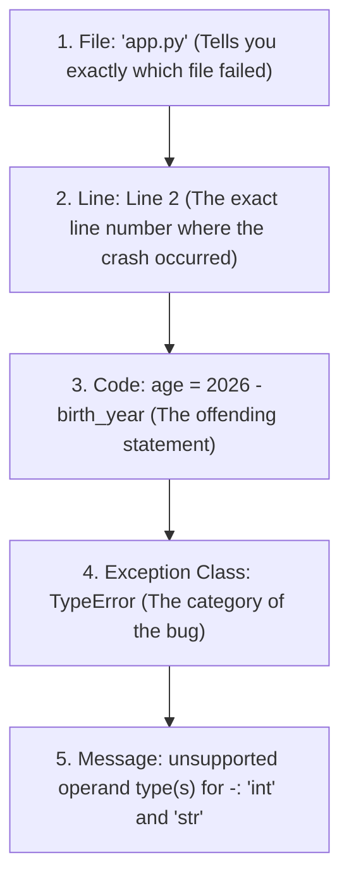

import { Callout } from "fumadocs-ui/components/callout";
import { Accordion, Accordions } from "fumadocs-ui/components/accordion";

You can print messages to the screen; now let's teach your program to **listen**.

To interact with a human user, Python provides the built-in `input()` function. Type the following into `app.py`:

```python
name = input("What is your name? ")
print("Hi " + name)
```

Run the program:

```text
What is your name? Mosh
Hi Mosh
```

_(Note: In the terminal above, `Mosh` is the text typed by the user before pressing Enter)._

---

## Functions Are Buttons on a Remote

Think back to the television remote control analogy:

- A remote has buttons for power, volume, and input sources.
- Python ships with built-in buttons for common tasks: `print()` to display output, `input()` to receive input.
- Whenever you attach parentheses `()` after a function name, you are **calling** the function — you are pressing the button.

### What Happens Behind the Scenes:

1. `input("What is your name? ")` prints the prompt text on the terminal screen and **pauses execution**.
2. The interpreter waits for the user to type on the keyboard and press <kbd>Enter</kbd>.
3. Once Enter is pressed, `input()` **returns** whatever text the user typed.
4. The returned value is stored in our variable `name`.
5. `"Hi " + name` combines (**concatenates**) the two strings together into a single greeting.

<Callout type="tip" title="Polish Detail: The Trailing Space">
  Notice the deliberate space after the question mark:{" "}
  <code>input("What is your name? ")</code>. Without that space, the user's
  cursor would immediately touch the question mark (
  <code>What is your name?Mosh</code>). Small polish details like this make
  software feel professional.
</Callout>

---

## Hands-On Exercise 03

Extend `app.py` so that it asks **two** questions:

1. The user's name.
2. The user's favorite color.

Then print a sentence like: `Mosh likes blue`.

<Accordions>
<Accordion title="Reveal Solution & Explanation">

```python
# app.py
name = input("What is your name? ")
favorite_color = input("What is your favorite color? ")

print(name + " likes " + favorite_color)
```

Terminal execution:

```text
What is your name? Mosh
What is your favorite color? blue
Mosh likes blue
```

Notice how we added spaces around `" likes "` so the words do not collide.

</Accordion>
</Accordions>

---

## Type Conversion & Reading Error Maps

Now let's write a program that asks for the user's birth year and calculates their approximate age:

```python
birth_year = input("Birth year: ")
age = 2026 - birth_year
print(age)
```

Run the program, type `1995`, and press <kbd>Enter</kbd>:

```text
Traceback (most recent call last):
  File "app.py", line 2, in <module>
    age = 2026 - birth_year
TypeError: unsupported operand type(s) for -: 'int' and 'str'
```

### The 5-Point Anatomy of a Traceback

Many beginners panic when they see red error text in their terminal. In software engineering, **an error traceback is not a failure — it is a diagnostic map.**



Reading the map:

1. **File**: `app.py` (In large software projects with hundreds of files, this pinpoints the file).
2. **Line**: Line 2.
3. **Code**: The interpreter reprints the exact line that caused the crash.
4. **Exception Type**: `TypeError` — we tried to perform an operation on incompatible types.
5. **Message**: `unsupported operand type(s) for -: 'int' and 'str'`. You cannot subtract a string (`str`) from an integer (`int`).

---

## Why Did It Break?

Whenever a user types into a terminal, `input()` **ALWAYS returns a string (`str`)**, even if the user typed numbers!

So in line 1, `birth_year` did not receive the integer `1995`. It received the four-character text string `"1995"`.

At runtime, line 2 evaluated to:

> `age = 2026 - "1995"`

In Python, you cannot perform mathematical subtraction between a number and a piece of text.

---

## The Solution: Conversion Functions

Python provides built-in conversion functions to cast values between data types:

| Function   | Converts To    | Example          | Output          |
| :--------- | :------------- | :--------------- | :-------------- |
| `int(x)`   | Integer        | `int("1995")`    | `1995` (number) |
| `float(x)` | Floating-point | `float("19.99")` | `19.99`         |
| `str(x)`   | String         | `str(100)`       | `"100"`         |
| `bool(x)`  | Boolean        | `bool(1)`        | `True`          |

Let's fix our program by wrapping `birth_year` in `int()`:

```python
birth_year = input("Birth year: ")
age = 2026 - int(birth_year)
print(age)
```

Run it again:

```text
Birth year: 1995
31
```

It works cleanly!

### Inspecting Types with `type()`

To inspect what data type a variable holds at any moment, pass it to Python's built-in `type()` function:

```python
birth_year = input("Birth year: ")
print(type(birth_year))  # Before conversion

converted_year = int(birth_year)
print(type(converted_year))  # After conversion
```

Output:

```text
Birth year: 1995
<class 'str'>
<class 'int'>
```

---

## Practice Questions & Challenges

Test your understanding of `input()`, type coercion rules, string-to-number casting, and defensive input processing.

### Question 1: Output Prediction (The `bool("False")` Trap)

Without running Python, determine the exact output of these four lines:

```python
# Line 1:
print(type("42") == int)

# Line 2:
print("20" + "26")

# Line 3:
print("7" * 3)

# Line 4:
print(bool("False"), bool(""))
```

<Accordions>
<Accordion title="Reveal Solution & Explanation">

```text
False
2026
777
True False
```

**Explanations:**

- **Line 1 (`False`)**: `"42"` is wrapped in quotes, so its type is `<class 'str'>`, not `int`.
- **Line 2 (`2026`)**: The `+` operator between two strings performs **concatenation**, joining them together.
- **Line 3 (`777`)**: The `*` operator between a string and an integer repeats the string three times.
- **Line 4 (`True False`)**: In Python, `bool(s)` tests whether the string is non-empty. Because `"False"` contains 5 characters, it evaluates to `True`! Only an empty string `""` evaluates to `False`.

</Accordion>
</Accordions>

---

### Question 2: Spot and Fix the Bug (`ValueError: invalid literal for int()`)

A student writes this tipping calculator:

```python
bill = input("Enter bill amount ($): ")
tip_percent = input("Enter tip percent: ")

total_tip = int(bill) * (int(tip_percent) / 100)
print("Tip amount: $" + total_tip)
```

When a user enters `48.50` for the bill and `15` for the tip, the program crashes with two separate errors.

1. Why does `int("48.50")` fail?
2. What error occurs on the `print()` line even if the conversion succeeds?
3. Provide the corrected, robust code.

<Accordions>
<Accordion title="Reveal Solution & Explanation">

**The Bugs:**

1. **`ValueError: invalid literal for int() with base 10: '48.50'`**: `int()` only converts strings containing whole base-10 digits. Strings containing a decimal point (`.`) cannot be parsed directly by `int()`. You must convert with `float()` first.
2. **`TypeError: can only concatenate str (not "float") to str`**: You cannot use `+` to join a string (`"Tip amount: $"`) with a float (`total_tip`).

**Corrected Code:**

```python
bill = input("Enter bill amount ($): ")
tip_percent = input("Enter tip percent: ")

total_tip = float(bill) * (float(tip_percent) / 100)
print("Tip amount: $", total_tip)
# or using str():
# print("Tip amount: $" + str(round(total_tip, 2)))
```

</Accordion>
</Accordions>

---

### Question 3: Architecture Question (Why `input()` Strictly Returns `str`)

In Python 2, `input()` automatically evaluated user input as executable Python expressions (e.g., typing `__import__('os').system('rm -rf /')` would execute directly!).

Why does modern Python 3 strictly make `input()` return raw strings (`str`), forcing developers to explicitly call `int()` or `float()`?

<Accordions>
<Accordion title="Reveal Solution & Explanation">

**The Security & Determinism Rationale:**

1. **Remote Code Execution (RCE) Prevention**: In Python 2, evaluating input with `eval()` meant any malicious user could execute arbitrary system commands. Returning raw strings guarantees user input remains harmless data until explicitly sanitized.
2. **Predictable Types**: Automatic type inference is fragile. If a user types `"0123"`, should the language assume an integer `123`, an octal number, or a ZIP code / phone number that _must_ preserve the leading zero? By returning `str`, Python leaves business logic decisions in the hands of the programmer.

</Accordion>
</Accordions>

---

### Question 4: Hands-On Challenge (Interactive Weight Converter)

Write a weight converter program:

1. Ask the user for their weight.
2. Ask whether the given weight is in `(L)bs` or `(K)g`.
3. If in pounds (`L` or `l`), convert to kilograms (`weight * 0.453592`) and print the result.
4. If in kilograms (`K` or `k`), convert to pounds (`weight / 0.453592`) and print the result.

<Accordions>
<Accordion title="Reveal Solution & Code">

```python
# app.py
raw_weight = input("Enter weight: ")
unit = input("Is this in (L)bs or (K)g? ")

weight = float(raw_weight)

if unit == "l" or unit == "L":
    converted = weight * 0.453592
    print("Weight in kilograms:", round(converted, 2), "kg")
elif unit == "k" or unit == "K":
    converted = weight / 0.453592
    print("Weight in pounds:", round(converted, 2), "lbs")
else:
    print("Unknown unit! Please enter 'L' or 'K'.")
```

Sample Terminal Execution:

```text
Enter weight: 160
Is this in (L)bs or (K)g? L
Weight in kilograms: 72.57 kg
```

</Accordion>
</Accordions>

---

### Question 5: Code Challenge (Defensive Interactive Age & Retirement Calculator)

Write a Python program in `app.py` that asks a user for their **Name**, their **Birth Year**, and their **Target Retirement Age**.

Requirements:

1. Convert the inputs safely to compute their current age (assuming current year is 2026).
2. Calculate how many years they have left until retirement.
3. If they are already older than the retirement age, output: `<Name>, you have already reached your retirement goal!`
4. Otherwise, output: `<Name>, you are currently <Age> years old and have <Years Left> years remaining until retirement.`

<Accordions>
<Accordion title="Reveal Solution & Code">

```python
# app.py
CURRENT_YEAR = 2026

name = input("Enter your name: ")
birth_year_str = input("Enter your birth year (e.g. 1995): ")
target_retire_str = input("Enter target retirement age (e.g. 65): ")

birth_year = int(birth_year_str)
target_retire_age = int(target_retire_str)

current_age = CURRENT_YEAR - birth_year
years_left = target_retire_age - current_age

if years_left <= 0:
    print(name + ", you have already reached your retirement goal!")
else:
    print(name + ", you are currently", current_age, "years old and have", years_left, "years remaining until retirement.")
```

Sample Run:

```text
Enter your name: Sarah
Enter your birth year (e.g. 1995): 1996
Enter target retirement age (e.g. 65): 60
Sarah, you are currently 30 years old and have 30 years remaining until retirement.
```

</Accordion>
</Accordions>

---

## Summary Reference

- **`input("...")`**: Halts execution, presents prompt, returns input as a `str`.
- **Traceback**: Diagnostic guide listing file, line number, exception type, and message.
- **Conversion Functions**: `int()`, `float()`, `str()`, `bool()`.
- **`type(x)`**: Returns the class/type of object `x`.

Next, dive deep into strings, indexing, and slicing in **[05. Strings: Quotes, Indexing & Slicing](/docs/learn-python/01-fundamentals/05-strings-quotes-indexes-slices)**!
