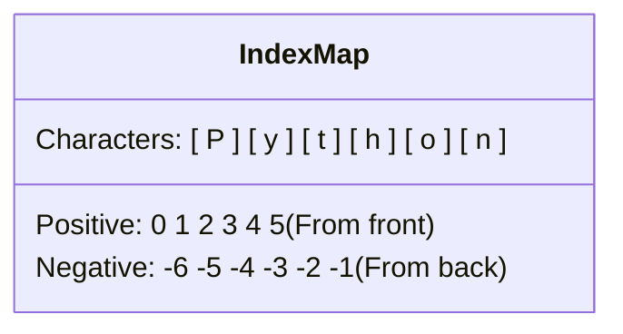

import { Callout } from "fumadocs-ui/components/callout";
import { Accordion, Accordions } from "fumadocs-ui/components/accordion";

Text data is ubiquitous in programming. Whether processing user emails, scraping website HTML, or parsing server log files, understanding how Python treats strings is essential.

In this lesson, we cover quote selection rules, multi-line strings, and the square-bracket syntax (`[]`) used for indexing and slicing.

---

## Choosing Quotes Deliberately

Python allows strings to be enclosed in either single quotes (`'...'`) or double quotes (`"..."`). While both are identical to the interpreter, you must choose deliberately when your string text contains quotation marks or apostrophes:

```python
# 1. Standard single or double quotes
course = 'Python for Beginners'

# 2. Apostrophe inside -> Use double quotes outside
course = "Python's Course for Beginners"

# 3. Inner double quotes -> Use single quotes outside
course = 'Python for "Beginners"'
```

<Callout type="warn" title="Syntax Error Trap">
  If you write <code>course = 'Python's Course'</code>, Python interprets the
  second apostrophe as the end of the string. The remaining text (
  <code>s Course'</code>) becomes invalid syntax, causing a{" "}
  <code>SyntaxError: invalid syntax</code> crash!
</Callout>

---

## Triple Quotes for Multi-Line Strings

When you need a string that spans multiple lines — such as an email body, documentation block, or HTML template — use **triple quotes** (`'''...'''` or `"""..."""`):

```python
message = '''
Hi John,

This is our first notification email to you.

Best regards,
The Engineering Team
'''

print(message)
```

Output:

```text
Hi John,

This is our first notification email to you.

Best regards,
The Engineering Team
```

Triple quotes preserve all line breaks, indentation, and spaces exactly as you typed them.

---

## The Bidirectional Index Map

Strings in Python are ordered sequences of individual characters. You can retrieve any character at a specific position using **square brackets `[]`**.

Crucially, **Python indexing is zero-based** (the first character is at index `0`), and Python uniquely supports **negative indexing** (counting backwards from the end of the string).

### Character Index Map: `"Python"`



| Character | Positive Index (From Front) | Negative Index (From Back) |
| :-------: | :-------------------------: | :------------------------: |
|  **`P`**  |             `0`             |            `-6`            |
|  **`y`**  |             `1`             |            `-5`            |
|  **`t`**  |             `2`             |            `-4`            |
|  **`h`**  |             `3`             |            `-3`            |
|  **`o`**  |             `4`             |            `-2`            |
|  **`n`**  |             `5`             |            `-1`            |

Let's test this in Python:

```python
course = "Python for Beginners"

print(course[0])   # 'P' - The first character
print(course[-1])  # 's' - The last character
print(course[-2])  # 'r' - The second-to-last character
```

Output:

```text
P
s
r
```

---

## Slicing: Extracting Substrings

While single brackets retrieve one character, **slicing** extracts a range of characters:

```text
string[start:end]
```

<Callout type="tip" title="The Golden Rule of Slicing">
  In a slice <code>string[start:end]</code>, the{" "}
  <strong>start index is INCLUDED</strong>, but the{" "}
  <strong>end index is EXCLUDED</strong>.
</Callout>

```python
course = "Python for Beginners"

# 1. From index 0 up to (but not including) index 3
print(course[0:3])

# 2. From index 1 all the way to the end (omitting end defaults to end of string)
print(course[1:])

# 3. From the beginning up to index 5 (omitting start defaults to 0)
print(course[:5])

# 4. Omitting both start and end creates a full clone
print(course[:])
```

Output:

```text
Pyt
ython for Beginners
Pytho
Python for Beginners
```

### Slice Step Syntax: `[start:end:step]`

Python also supports an optional third parameter: the `step`:

```python
numbers = "0123456789"

# Every second character
print(numbers[::2])  # '02468'

# Reverse a string effortlessly with step -1!
print(numbers[::-1])  # '9876543210'
```

---

## Practice Questions & Challenges

Test your understanding of indexing, negative strides, slicing bounds, and immutability.

### Question 1: Output Prediction (Slice Strides & Negative Steps)

Without running the code, predict the exact terminal output for each `print()` call:

```python
text = "PythonDeveloper"

print("A:", text[6:1:-1])
print("B:", text[2:10:3])
print("C:", text[5:2])
```

<Accordions>
<Accordion title="Reveal Solution & Step-by-Step Breakdown">

**Output:**

```text
A: Dnoht
B: toD
C:
```

**Detailed Breakdown:**

1. **`text[6:1:-1]`**:
   - Start index `6` is `'D'`.
   - Step is `-1`, meaning we move backwards towards index `1` (`'y'`).
   - Slicing stops _before_ the stop index (`1`), so `'y'` is excluded.
   - Collected characters: index 6 (`'D'`), 5 (`'n'`), 4 (`'o'`), 3 (`'h'`), 2 (`'t'`) $\rightarrow$ `"Dnoht"`.
2. **`text[2:10:3]`**:
   - Start index `2` is `'t'`.
   - Step is `+3`. Stop index is `10` (exclusive).
   - Indices sampled: 2 (`'t'`), 5 (`'o'`), 8 (`'D'`). Index 11 is $\ge 10$, so it stops.
   - Result: `"toD"`.
3. **`text[5:2]`**:
   - The default step is `+1` (moving left-to-right).
   - Since start (`5`) is already to the right of stop (`2`), Python cannot step forward to reach `2`.
   - Rather than throwing an error, Python returns an **empty string** `""`.

</Accordion>
</Accordions>

---

### Question 2: Spot and Fix the Bug (String Immutability Trap)

A junior engineer wants to change the file extension of a dataset:

```python
filename = "data_v1.txt"
filename[-3:] = "csv"
print(filename)
```

1. What exact exception does Python raise when this code runs?
2. Why does Python forbid this operation?
3. How should this be fixed idiomatically?

<Accordions>
<Accordion title="Reveal Solution & Explanation">

**1. The Exception:**

```text
TypeError: 'str' object does not support item assignment
```

**2. Why Python forbids it:**
In Python, strings are **strictly immutable**. Once created in memory, characters inside a string cannot be modified, replaced, or deleted in place.

**3. The Correct Fix:**
Create a _new_ string by combining a slice of the original with the new extension:

```python
filename = "data_v1.txt"

# Keep everything before the last 3 characters, then append "csv"
new_filename = filename[:-3] + "csv"
print(new_filename)  # "data_v1.csv"
```

_(Tip: In lesson 06, you'll also learn `filename.replace(".txt", ".csv")` for substring substitution!)_

</Accordion>
</Accordions>

---

### Question 3: Indexing vs Slicing Boundary Behavior

Analyze what happens when running these two lines:

```python
lang = "Python"

# Case A:
print(lang[100])

# Case B:
print(lang[2:100])
```

Why does Case A crash, while Case B succeeds and outputs `"thon"`? What is the design rationale behind Python's slicing boundaries?

<Accordions>
<Accordion title="Reveal Solution & Explanation">

**Output:**

- **Case A**: Crashes with `IndexError: string index out of range`.
- **Case B**: Executes cleanly and outputs `"thon"`.

**Design Rationale:**

- **Direct Indexing (`s[i]`)**: You are asking Python for a _single specific memory location_. If that exact element does not exist, silently returning something else or `None` would mask logical bugs, so Python raises an explicit `IndexError`.
- **Slicing (`s[start:end]`)**: Slicing defines a _range window_. Python gracefully clamps out-of-range bounds to `len(s)` or `0`. If `end` exceeds the string length, Python simply stops at the end of the sequence. This makes slicing resilient when processing chunks of arbitrary-length text without needing defensive length checks first.

</Accordion>
</Accordions>

---

### Question 4: Practical String Extraction

Given the following raw URL:

```python
url = "https://api.internal.service.org/v1/auth"
```

Using only string slicing and index queries (or negative indexing):

1. Extract the scheme/protocol (`"https"`).
2. Extract the sub-path (`"/v1/auth"`).
3. Reverse only the top-level domain (`"org"` $\rightarrow$ `"gro"`).

<Accordions>
<Accordion title="Reveal Solution & Code">

```python
url = "https://api.internal.service.org/v1/auth"

# 1. Protocol: From start up to the colon
protocol = url[:5]  # or url[:url.find(":")]
print("Protocol:", protocol)  # "https"

# 2. Path: From index 32 to the end
path = url[32:]     # or url[-8:]
print("Path:", path)          # "/v1/auth"

# 3. Top-level domain: Characters between index 29 and 32
tld = url[29:32]              # "org"
reversed_tld = tld[::-1]
print("Reversed TLD:", reversed_tld)  # "gro"
```

</Accordion>
</Accordions>

---

### Question 5: Code Challenge (Palindrome Verification)

Write a Python expression that checks whether a given string is a **palindrome** (reads the same backwards and forwards, ignoring case differences).

Test cases:

- `"Radar"` $\rightarrow$ `True`
- `"Python"` $\rightarrow$ `False`
- `"step on no pets"` $\rightarrow$ `True`

<Accordions>
<Accordion title="Reveal Solution & Code">

```python
def is_palindrome(word: str) -> bool:
    # Normalize to lowercase so 'R' matches 'r'
    normalized = word.lower()
    # Compare original normalized string to its reversed slice
    return normalized == normalized[::-1]

print(is_palindrome("Radar"))            # True
print(is_palindrome("Python"))           # False
print(is_palindrome("step on no pets"))  # True
```

**Key Takeaway:** The slice stride `[::-1]` produces a reversed shallow copy of any sequence in $O(N)$ time, making palindrome verification a simple one-line check.

</Accordion>
</Accordions>

---

## Summary Reference

- **Quotes**: Single `'...'` and double `"..."` can nest each other.
- **Triple Quotes**: `'''...'''` spans multiple lines and preserves whitespace.
- **`s[0]`**: First character.
- **`s[-1]`**: Last character.
- **`s[start:end]`**: Substring from `start` (inclusive) to `end` (exclusive).
- **`s[:]`**: Full copy of string `s`.
- **`s[::-1]`**: Reverses string `s`.

Next, discover the power of modern formatted strings and string methods in **[06. Formatted Strings & Methods](/docs/learn-python/01-fundamentals/06-formatted-strings-and-string-methods)**!
