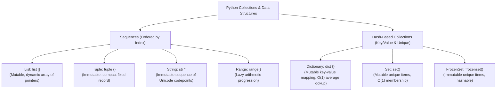
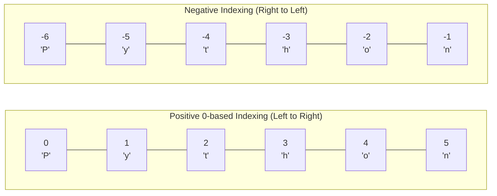
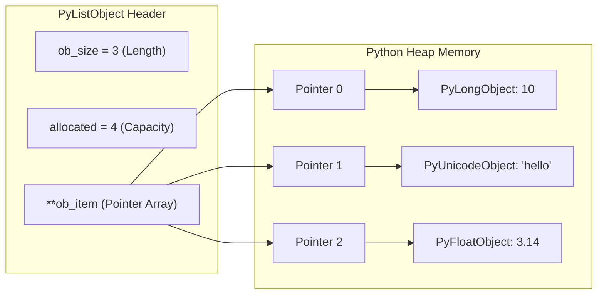
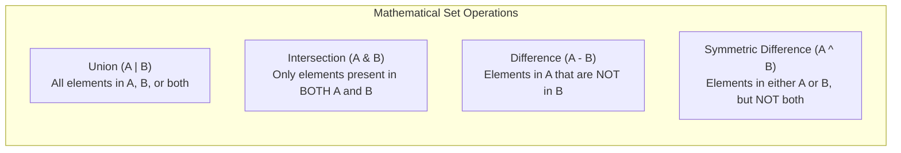
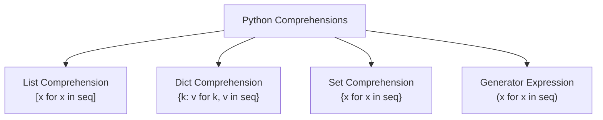
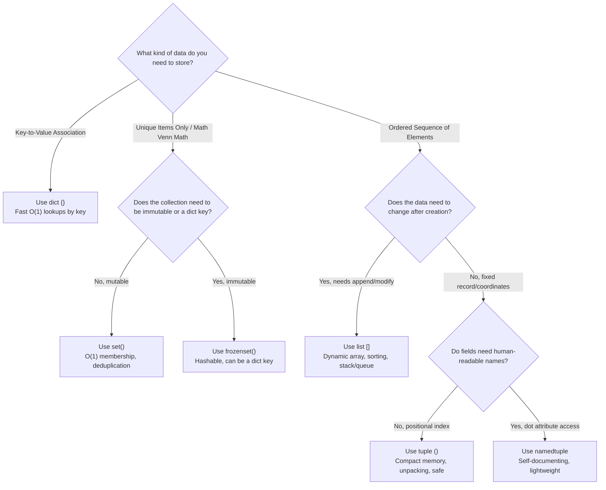

import { Callout } from "fumadocs-ui/components/callout";
import { Tabs, Tab } from "fumadocs-ui/components/tabs";
import { Accordion, Accordions } from "fumadocs-ui/components/accordion";

In software development, managing individual primitive values (`10`, `"Alice"`, `True`) is only the starting point. Real-world applications model collections of entities: shopping carts, user sessions, active IP addresses, database records, and configuration maps.

Python provides a rich, expressive suite of built-in collection types. Understanding how each collection organizes data in memory, its performance characteristics ($O(1)$ vs $O(n)$), and its mutability semantics is critical for writing robust and efficient Python software.



---

## The Sequence Protocol: Universal Operations

Before diving into individual types, notice that `list`, `tuple`, `str`, and `range` all implement Python's **Sequence Protocol**. Any operation that works on sequence order works across all of them:



### 1. Indexing & Boundary Safety

Every element in a sequence occupies a position from `0` to `len(seq) - 1`, or negatively from `-1` (the last element) back to `-len(seq)` (the first element):

```python
languages = ["Python", "Go", "Rust", "TypeScript"]

print(languages[0])   # 'Python' (first element)
print(languages[-1])  # 'TypeScript' (last element)
print(languages[-2])  # 'Rust' (second to last)
```

Direct indexing beyond boundaries raises `IndexError`:

```python
# languages[10]  # ❌ IndexError: list index out of range
```

### 2. Slicing Mechanics: `[start:stop:step]`

Slicing extracts a sub-sequence without altering the original container. The general syntax is:

$$\text{sequence}[\text{start} : \text{stop} : \text{step}]$$

- **`start`**: Index where the slice begins (inclusive). Defaults to `0` (or `len - 1` if step is negative).
- **`stop`**: Index where the slice ends (**exclusive**). Defaults to `len(seq)` (or the beginning if step is negative).
- **`step`**: Stride or interval. Defaults to `1`.

```python
nums = [0, 1, 2, 3, 4, 5, 6, 7, 8, 9]

print(nums[2:6])     # [2, 3, 4, 5] (indices 2, 3, 4, 5)
print(nums[:4])      # [0, 1, 2, 3] (from beginning up to index 4)
print(nums[6:])      # [6, 7, 8, 9] (from index 6 to the end)
print(nums[::2])     # [0, 2, 4, 6, 8] (every second element)
print(nums[::-1])    # [9, 8, 7, 6, 5, 4, 3, 2, 1, 0] (reverses the sequence!)
```

<Callout type="info" title="Slices Never Raise IndexError">
  Unlike direct subscript access (`nums[100]` $\rightarrow$ `IndexError`),
  slicing is boundary-tolerant: ```python nums = [10, 20, 30] print(nums[1:100])
  # [20, 30] (stops cleanly at the end) print(nums[50:60]) # [] (empty list, no
  exception thrown) ```
</Callout>

### 3. Common Sequence Functions & Operators

| Operation         | Syntax                 | Description                           | Example (`s = [1, 2, 3]`)           |
| :---------------- | :--------------------- | :------------------------------------ | :---------------------------------- |
| **Length**        | `len(s)`               | Returns number of elements            | `len(s)` $\rightarrow$ `3`          |
| **Membership**    | `x in s`, `x not in s` | Checks if element exists ($O(n)$)     | `2 in s` $\rightarrow$ `True`       |
| **Concatenation** | `s1 + s2`              | Combines two sequences into a new one | `[1] + [2]` $\rightarrow$ `[1, 2]`  |
| **Repetition**    | `s * n`                | Replicates sequence $n$ times         | `[0] * 3` $\rightarrow$ `[0, 0, 0]` |
| **Minimum**       | `min(s)`               | Smallest element                      | `min([4, 1, 9])` $\rightarrow$ `1`  |
| **Maximum**       | `max(s)`               | Largest element                       | `max([4, 1, 9])` $\rightarrow$ `9`  |
| **Sum**           | `sum(s, [start])`      | Sum of numeric items                  | `sum([1, 2, 3])` $\rightarrow$ `6`  |

---

## 1. Lists: Dynamic, Mutable Arrays

A **list** is an ordered, mutable sequence of arbitrary objects. In Python, lists are implemented under the hood not as linked lists, but as **dynamic arrays of pointers** (`PyObject*`).



Because a Python list holds **pointers** to objects rather than the raw data itself:

1. A single list can hold heterogeneous types simultaneously: `[10, "hello", 3.14, True]`.
2. Python uses an **over-allocation growth pattern** (geometric resizing: 0, 4, 8, 16, 25, 35, 46, 58, 72...). When you call `.append()`, capacity is pre-allocated so appending takes **amortized $O(1)$ constant time**.

### Creating Lists

```python
# 1. Literal syntax:
empty = []
primes = [2, 3, 5, 7, 11]

# 2. list() constructor over any iterable:
chars = list("Python")            # ['P', 'y', 't', 'h', 'o', 'n']
range_nums = list(range(1, 6))    # [1, 2, 3, 4, 5]

# 3. List comprehension (expressive creation):
squares = [x ** 2 for x in range(5)]  # [0, 1, 4, 9, 16]
```

<Callout type="warn" title="The Nested List Multiplication Trap">
  Multiplying a list containing mutable objects replicates the **pointer**, not the object:

```python
# ❌ DANGEROUS: Creates 3 references pointing to the exact SAME inner list!
grid = [[0] * 3] * 3
grid[0][0] = 99
print(grid)  # [[99, 0, 0], [99, 0, 0], [99, 0, 0]] — All rows mutated!

# ✅ CORRECT: Generates independent list instances:
grid = [[0] * 3 for _ in range(3)]
grid[0][0] = 99
print(grid)  # [[99, 0, 0], [0, 0, 0], [0, 0, 0]] — Only row 0 mutated!
```

</Callout>

### Modifying Lists: Insertion, Deletion & Mutation

Lists can be mutated in place without allocating a new list container.

```python
tasks = ["plan", "code"]

# --- Adding Elements ---
tasks.append("test")              # Append to end: O(1) -> ['plan', 'code', 'test']
tasks.insert(0, "design")         # Insert at index 0: O(n) -> ['design', 'plan', 'code', 'test']
tasks.extend(["review", "deploy"]) # Unpack iterable into list -> ['design', 'plan', 'code', 'test', 'review', 'deploy']

# --- Removing Elements ---
last_task = tasks.pop()           # Remove & return last item: O(1) -> 'deploy'
first_task = tasks.pop(0)         # Remove & return item at index: O(n) -> 'design'
tasks.remove("code")              # Remove FIRST matching value (raises ValueError if absent)
del tasks[0]                      # Delete item at index 0 via statement
print(tasks)                      # ['test', 'review']

tasks.clear()                     # Empties the list completely -> []
```

#### Slicing Mutations

You can replace, expand, contract, or delete entire ranges of elements directly using slice assignment:

```python
letters = ["a", "b", "c", "d", "e"]

# Replace slice:
letters[1:4] = ["B", "C", "D"]
print(letters)  # ['a', 'B', 'C', 'D', 'e']

# Expand slice (inserting more elements than were replaced):
letters[1:2] = ["X", "Y", "Z"]
print(letters)  # ['a', 'X', 'Y', 'Z', 'C', 'D', 'e']

# Delete slice:
del letters[1:4]
print(letters)  # ['a', 'C', 'D', 'e']

# Clear in-place while keeping original list object identity:
letters[:] = []
print(letters)  # []
```

### Searching & Counting

```python
scores = [85, 92, 78, 92, 100, 92]

# 1. Count occurrences:
print(scores.count(92))  # 3

# 2. Find position:
print(scores.index(100))  # 4

# 3. Always check membership before calling .index() to prevent crashes:
target = 99
if target in scores:
    print("Found at:", scores.index(target))
else:
    print(f"{target} is not in the list")  # Prevents ValueError!
```

### Sorting: `.sort()` vs. `sorted()`

One of the most frequent points of confusion in Python is the difference between the **`.sort()` method** and the **`sorted()` built-in function**:

<Tabs items={["list.sort() (In-Place)", "sorted() (Returns New List)"]}>
  <Tab value="list.sort() (In-Place)">
    Mutates the existing list in place and returns `None`. Extremely memory-efficient because no duplicate array is created:

    ```python
    cities = ["Tokyo", "Berlin", "New York", "Cairo"]

    cities.sort()  # In-place alphabetical sort
    print(cities)  # ['Berlin', 'Cairo', 'New York', 'Tokyo']

    # Custom key (e.g. sort by length):
    cities.sort(key=len, reverse=True)
    print(cities)  # ['New York', 'Berlin', 'Tokyo', 'Cairo']
    ```

  </Tab>
  <Tab value="sorted() (Returns New List)">
    Leaves the original list untouched and constructs a brand new, sorted list. Works on **any iterable** (tuples, strings, sets, dicts):

    ```python
    scores = (88, 72, 95, 61)
    sorted_scores = sorted(scores)

    print("Original tuple:", scores)         # (88, 72, 95, 61) - untouched!
    print("New sorted list:", sorted_scores) # [61, 72, 88, 95]

    # Sorting dictionaries by value:
    inventory = {"apples": 50, "bananas": 12, "cherries": 34}
    sorted_by_qty = sorted(inventory.items(), key=lambda item: item[1])
    print(sorted_by_qty)  # [('bananas', 12), ('cherries', 34), ('apples', 50)]
    ```

  </Tab>
</Tabs>

<Callout type="info" title="The Timsort Algorithm">
  Python's sorting algorithm is **Timsort** (created by Tim Peters). Timsort is
  an adaptive, stable hybrid of Merge Sort and Insertion Sort: - **Worst-case
  time**: $O(n \log n)$ - **Best-case time (already sorted or nearly sorted
  data)**: $O(n)$ - **Stability**: Elements with equal keys preserve their
  original relative order.
</Callout>

### Copying Mechanics: References vs. Shallow vs. Deep Copies

Understanding object references is vital when passing lists into functions or assigning them to new variables:

```python
import copy

original = [1, [2, 3]]

# 1. Aliasing (NOT a copy! Just another name pointing to the SAME object):
alias = original
alias.append(99)
print("Original modified by alias:", original)  # [1, [2, 3], 99]

# 2. Shallow Copy (.copy() or slice [:]):
shallow = original.copy()
shallow[0] = "MUTATED"
print("Original unaffected by shallow[0]:", original[0])  # 1

# BUT nested mutable objects are still shared references!
shallow[1].append("UH_OH")
print("Original nested list WAS modified:", original[1])  # [2, 3, 'UH_OH']

# 3. Deep Copy (Recursively clones every nested object):
safe_deep = copy.deepcopy(original)
safe_deep[1].append("ISOLATED")
print("Original untouched:", original[1])  # [2, 3, 'UH_OH']
```

---

## 2. Tuples: Immutable Records

A **tuple** is an ordered sequence of elements wrapped in parentheses `()`. Unlike lists, **tuples are completely immutable**: once constructed, their size and their element references cannot be added, removed, or reassigned.

```python
point = (10, 20)

print(point[0])  # 10
print(point[1])  # 20

# ❌ Mutating a tuple raises TypeError:
# point[0] = 15  # TypeError: 'tuple' object does not support item assignment
```

### Why Use Tuples Instead of Lists?

If lists can do everything tuples do plus mutate, why do tuples exist?

1. **Data Integrity & Intent**: Using a tuple signals to teammates and compilers that this data is a fixed record (such as an RGB color `(255, 128, 0)` or a geographic coordinate) that must not change during runtime.
2. **Performance & Memory Efficiency**: Because tuples have fixed size, Python allocates the exact required memory without over-allocation buffers. Small tuples are cached in internal free lists, making tuple allocation significantly faster than list allocation.
3. **Hashability**: Because tuples are immutable (provided all elements inside are also immutable), they are **hashable**. This means a tuple can be used as a **dictionary key** or stored inside a **set**, whereas a list cannot!

```python
import sys

list_demo = [1, 2, 3]
tuple_demo = (1, 2, 3)

print("List byte size:", sys.getsizeof(list_demo))    # Typically 88 bytes
print("Tuple byte size:", sys.getsizeof(tuple_demo))  # Typically 64 bytes
```

### The "Singleton Tuple" Syntax Gotcha

In Python, parentheses are used both for grouping mathematical expressions `(3 + 2)` and for tuples. Because of this ambiguity, a comma is **mandatory** when defining a single-element tuple:

```python
# ❌ THIS IS NOT A TUPLE! It is an integer wrapped in grouping parentheses:
not_a_tuple = (42)
print(type(not_a_tuple))  # <class 'int'>

# ✅ THIS IS A TUPLE:
single_tuple = (42,)
print(type(single_tuple))  # <class 'tuple'>
print(len(single_tuple))   # 1

# Empty tuple:
empty_tuple = ()
```

<Callout type="tip" title="Parentheses Are Optional (Tuple Packing)">
  In Python, it is the comma `,` that creates a tuple, not the parentheses:
  
  ```python
  coordinates = 37.7749, -122.4194  # Creates a 2-element tuple!
  print(type(coordinates))           # <class 'tuple'>
  ```
</Callout>

### Pattern Unpacking & Variable Swapping

Tuples enable one of Python's most elegant syntax features: **unpacking**.

#### 1. Basic & Nested Unpacking

```python
# Unpacking pairs:
user = ("Sarah", "Admin", 104)
name, role, emp_id = user
print(f"{name} ({emp_id}) is an {role}")

# Nested unpacking:
server = ("prod-01", ("192.168.1.10", 8080), "US-East")
hostname, (ip, port), region = server
print(f"Server {hostname} listening at {ip}:{port}")
```

#### 2. Atomic Variable Swapping

In languages like C, Java, or C++, swapping two variables requires a temporary placeholder. In Python, tuple packing and unpacking swaps values atomically in one clean line:

```python
a = 100
b = 200

# Tuple packing on the right -> unpacked into variables on the left:
a, b = b, a

print(f"a = {a}, b = {b}")  # a = 200, b = 100
```

#### 3. Extended Unpacking with the Star (`*`) Operator

When unpacking sequences of arbitrary or variable length, prefix a variable with `*` to capture all remaining elements as a list:

```python
scores = [98, 95, 87, 82, 79, 64]

# Capture highest, lowest, and everything in between:
highest, *middle, lowest = scores
print("Highest:", highest)  # 98
print("Middle:", middle)    # [95, 87, 82, 79] (always a list!)
print("Lowest:", lowest)    # 64

# Head and tail pattern:
first, *rest = scores       # first = 98, rest = [95, 87, 82, 79, 64]
*leading, last = scores     # leading = [98, 95, 87, 82, 79], last = 64

# Ignoring unwanted fields using throwaway variables:
record = ("2026-10-21", "SUCCESS", "GET", "/api/v1/users", 200, 14.2)
date, status, *_, duration = record
print(f"{date} [{status}] took {duration}ms")
```

### The "Mutable Elements in an Immutable Tuple" Paradox

While the tuple itself cannot have its slots reassigned, if an element inside a tuple is a mutable object (like a list), that referenced object can still be modified:

```python
# A tuple containing an integer and a list:
data = ("Release v1.0", [101, 102])

# Mutating the list inside the tuple works:
data[1].append(103)
print(data)  # ('Release v1.0', [101, 102, 103])
```

<Callout type="warn" title="The Augmented Assignment (+=) Trap on Tuples">
  Examine what happens if you try `+=` on a list inside a tuple:

```python
t = (1, 2, [30, 40])
try:
    t[2] += [50]
except TypeError as err:
    print("Caught error:", err)

print("Resulting tuple:", t)
```

Output:

```text
Caught error: 'tuple' object does not support item assignment
Resulting tuple: (1, 2, [30, 40, 50])
```

**Why did this happen?**

1. `+=` on a list calls `list.__iadd__()`, which extends the list in-place (mutating `[30, 40]` to `[30, 40, 50]`).
2. Python's bytecode then attempts to assign the result back to `t[2]` using `STORE_SUBSCR`.
3. Because `t` is a tuple, `STORE_SUBSCR` fails and throws `TypeError`!
4. The exception is raised, **but the in-place mutation of the list already occurred**!

**Rule**: Never store mutable objects inside tuples if you expect full immutability.

</Callout>

### Named Tuples: Self-Documenting Lightweight Objects

When working with tuple records, accessing fields by index (`user[0]`, `user[2]`) becomes error-prone as schemas evolve. Python provides `collections.namedtuple` to create lightweight, tuple-based records with attribute access:

```python
from collections import namedtuple

# Define a Point blueprint with named fields:
Point = namedtuple("Point", ["x", "y", "z"])

p1 = Point(x=10, y=20, z=30)

# Access by field name OR by index:
print(p1.x, p1.y, p1.z)  # 10 20 30
print(p1[0])             # 10

# Still a tuple under the hood (immutable & unpackable!):
x, y, z = p1
print(f"Unpacked: {x}, {y}, {z}")
# p1.x = 99  # ❌ AttributeError: can't set attribute
```

---

## 3. Sets: Mathematical Rigor & Lightning Uniqueness

A **set** is an unordered collection of **unique, hashable** elements. Sets mirror the mathematical concept of sets: elements have no index, cannot be duplicated, and support set-theoretic operations (union, intersection, difference, symmetric difference).



### Creating Sets & The Empty Set Trap

```python
# 1. Set literal with braces:
fruits = {"apple", "banana", "cherry", "apple"}
print(fruits)  # {'apple', 'banana', 'cherry'} — duplicate 'apple' eliminated!

# 2. De-duplicating an existing list via set() constructor:
raw_ids = [101, 102, 101, 105, 102, 108]
unique_ids = set(raw_ids)
print(unique_ids)  # {101, 102, 105, 108}
```

<Callout type="warn" title="The Empty Set Gotcha">
  Because curly braces `{}` were originally used for dictionaries in Python, `{}` creates an **empty dictionary**, NOT an empty set!
  
  ```python
  empty_check = {}
  print(type(empty_check))  # <class 'dict'>

# ✅ To create an empty set, you MUST call set():

empty_set = set()
print(type(empty_set)) # <class 'set'>

````
</Callout>

### Modifying Sets

```python
tags = {"python", "coding"}

# Adding elements:
tags.add("ai")                   # Add single item: O(1)
tags.update(["web", "cloud"])    # Add multiple items from iterable
print(tags)                      # {'python', 'coding', 'ai', 'web', 'cloud'}

# Removing elements:
tags.remove("ai")                # Removes 'ai'. Raises KeyError if item is missing!

tags.discard("blockchain")       # Safe remove: removes if present, NO-OP if absent! (Never raises KeyError)

item = tags.pop()                # Removes and returns an ARBITRARY element
print("Popped item:", item)

tags.clear()                     # Clears all items -> set()
````

### Mathematical Set Operations: Operators vs. Methods

Python provides two ways to perform set operations: **symbolic operators** and **named methods**.

```python
frontend = {"HTML", "CSS", "JavaScript", "React"}
backend = {"Python", "JavaScript", "PostgreSQL", "React"}

# 1. UNION: All unique skills across both tracks
# Operator: |   Method: .union()
all_skills = frontend | backend
print("Union:", all_skills)
# {'HTML', 'CSS', 'JavaScript', 'React', 'Python', 'PostgreSQL'}

# 2. INTERSECTION: Skills shared by both frontend and backend
# Operator: &   Method: .intersection()
fullstack_core = frontend & backend
print("Intersection:", fullstack_core)
# {'JavaScript', 'React'}

# 3. DIFFERENCE: Skills in frontend that backend developers don't have
# Operator: -   Method: .difference()
pure_frontend = frontend - backend
print("Difference:", pure_frontend)
# {'HTML', 'CSS'}

# 4. SYMMETRIC DIFFERENCE: Skills specialized in ONE track, but not in both
# Operator: ^   Method: .symmetric_difference()
specialized = frontend ^ backend
print("Symmetric Difference:", specialized)
# {'HTML', 'CSS', 'Python', 'PostgreSQL'}
```

<Callout type="info" title="Operators vs. Methods: The Crucial Difference">
  - **Operators (`|`, `&`, `-`, `^`)** require **both** operands to be `set` objects:
    ```python
    # {"a", "b"} | ["b", "c"]  # ❌ TypeError: unsupported operand type
    ```
  - **Methods (`.union()`, `.intersection()`, etc.)** accept **any iterable** (lists, tuples, dict keys, generators):
    ```python
    # ✅ Seamless conversion:
    combined = {"a", "b"}.union(["b", "c"], ("d", "e"))
    print(combined)  # {'a', 'b', 'c', 'd', 'e'}
    ```
</Callout>

### Set Relationships: Subsets & Supersets

```python
admin_roles = {"read", "write", "delete", "audit"}
editor_roles = {"read", "write"}
viewer_roles = {"read"}

# Subsets (<= and <):
print(editor_roles.issubset(admin_roles))  # True (editor_roles <= admin_roles)
print(editor_roles < admin_roles)           # True (Proper subset: strictly smaller)

# Supersets (>= and >):
print(admin_roles.issuperset(viewer_roles)) # True (admin_roles >= viewer_roles)

# Disjoint (Check if sets share NO common elements):
guest_roles = {"anonymous"}
print(guest_roles.isdisjoint(editor_roles)) # True (Zero common items)
```

### Frozen Sets (`frozenset`): Immutable Sets

Because regular sets are mutable, they cannot be stored inside another set, nor can they be used as dictionary keys:

```python
# ❌ Attempting to make a set of sets:
# nested = { {"a", "b"}, {"c", "d"} }  # TypeError: unhashable type: 'set'
```

Python solves this with **`frozenset`**: an immutable, hashable variant of `set`.

```python
# Valid set of frozensets:
valid_nested = {frozenset(["read", "write"]), frozenset(["admin"])}

# Using frozenset as a cache key in a dictionary:
access_cache = {}
permissions = frozenset(["read", "execute"])
access_cache[permissions] = "Role_Operator"

print(access_cache[permissions])  # 'Role_Operator'
```

---

## 4. Dictionaries: High-Speed Key-Value Maps

A **dictionary** (`dict`) is an associative container mapping unique, hashable **keys** to arbitrary **values**.

```python
user = {
    "id": 1089,
    "username": "coder_pro",
    "email": "coder@example.com",
    "is_active": True
}

# Accessing values:
print(user["username"])  # 'coder_pro'
```

### Safe Lookups with `.get()` & `.setdefault()`

Accessing a missing key using bracket notation raises `KeyError`. To build defensive software:

```python
# 1. Safe access with default fallback:
phone = user.get("phone", "Not Provided")
print("Phone:", phone)  # 'Not Provided' (No crash!)

# 2. setdefault: Returns value if key exists; if not, inserts key with default and returns it:
user.setdefault("theme", "dark")
print("Theme:", user["theme"])  # 'dark'
```

### Dictionary View Objects

Dictionaries provide three live dynamic view objects:

```python
book = {"title": "Clean Code", "author": "Robert Martin", "pages": 464}

# 1. .keys():
print(list(book.keys()))    # ['title', 'author', 'pages']

# 2. .values():
print(list(book.values()))  # ['Clean Code', 'Robert Martin', 464]

# 3. .items() (Yields (key, value) tuples for clean unpacking):
for key, value in book.items():
    print(f"  {key.upper()}: {value}")
```

<Callout type="tip" title="Deep Dive: Advanced Dictionary Architectures">
  For advanced dictionary workflows—including nested dictionary manipulation,
  `defaultdict`, dictionary merges (`|` and `|=`), and JSON data modeling—see
  **[08. Dictionaries & Structuring
  Data](/docs/learn-python/01-fundamentals/08-dictionaries-and-structuring-data)**.
</Callout>

---

## 5. Comprehensions Masterclass: Lists, Dictionaries, Sets & Generator Expressions

Writing a standard `for` loop to build, filter, or transform a collection often takes 3–5 lines of boilerplate:

```python
# The verbose, traditional way (4 lines):
squares = []
for n in range(1, 6):
    squares.append(n ** 2)
```

A **comprehension** compresses this entire pattern into **one clean, readable, idiomatic line**:

```python
# The modern Pythonic comprehension (1 line):
squares = [n ** 2 for n in range(1, 6)]
```

Python provides four distinct flavors of comprehensions:



---

### 1. List Comprehensions: `[expression for item in iterable if condition]`

List comprehensions create a **brand-new list** by applying an expression to each element of an iterable.

#### Simple Example: Transforming Items

```python
# Doubling numbers:
numbers = [1, 2, 3, 4, 5]
doubled = [n * 2 for n in numbers]
print("Doubled:", doubled)

# Formatting string titles:
names = ["alice", "bob", "charlie"]
capitalized = [name.capitalize() for name in names]
print("Capitalized:", capitalized)
```

```text
Doubled: [2, 4, 6, 8, 10]
Capitalized: ['Alice', 'Bob', 'Charlie']
```

#### Simple Example: Filtering with `if`

You can place an `if` clause at the end to keep only the items that satisfy a condition:

```python
scores = [45, 88, 92, 59, 74, 98]

# Keep only passing grades (>= 70):
passing = [score for score in scores if score >= 70]
print("Passing scores:", passing)

# Filter words longer than 4 characters:
words = ["sun", "planet", "galaxy", "star", "moon"]
long_words = [w for w in words if len(w) > 4]
print("Long words:", long_words)
```

```text
Passing scores: [88, 92, 74, 98]
Long words: ['planet', 'galaxy']
```

#### Transforming with `if-else` (Ternary Expression)

If you want to replace items instead of filtering them out, put the `if-else` **before** the `for`:

```python
# Label pass or fail for each score:
results = ["Pass" if score >= 70 else "Fail" for score in scores]
print("Results:", results)
```

```text
Results: ['Fail', 'Pass', 'Pass', 'Fail', 'Pass', 'Pass']
```

---

### 2. Dictionary Comprehensions: `{key: value for item in iterable if condition}`

Dictionary comprehensions construct a **new dictionary** dynamically. Notice the colon `:` separating the key and value expressions!

#### Simple Example: Transforming Elements into Key-Value Pairs

```python
# Mapping numbers to their squares:
squares_map = {n: n ** 2 for n in range(1, 6)}
print("Squares dict:", squares_map)

# Mapping names to their character lengths:
cities = ["Paris", "Tokyo", "San Francisco"]
city_lengths = {city: len(city) for city in cities}
print("City lengths:", city_lengths)
```

```text
Squares dict: {1: 1, 2: 4, 3: 9, 4: 16, 5: 25}
City lengths: {'Paris': 5, 'Tokyo': 5, 'San Francisco': 13}
```

#### Simple Example: Inverting (Swapping) Keys and Values

```python
country_to_code = {"France": "FR", "Japan": "JP", "Canada": "CA"}

# Swap keys and values:
code_to_country = {code: country for country, code in country_to_code.items()}
print("Inverted:", code_to_country)
```

```text
Inverted: {'FR': 'France', 'JP': 'Japan', 'CA': 'Canada'}
```

#### Simple Example: Filtering an Existing Dictionary

```python
prices_usd = {"laptop": 1200, "mouse": 25, "monitor": 300, "cable": 12}

# Keep only expensive items (> $100):
expensive = {item: price for item, price in prices_usd.items() if price > 100}
print("Expensive items:", expensive)
```

```text
Expensive items: {'laptop': 1200, 'monitor': 300}
```

---

### 3. Set Comprehensions: `{expression for item in iterable if condition}`

Set comprehensions use curly braces `{...}` without a colon. They automatically **deduplicate** elements:

#### Simple Example: Unique Word Lengths

```python
words = ["python", "java", "ruby", "c", "rust", "go", "java", "ruby"]

# Automatically removes duplicates:
unique_lengths = {len(w) for w in words}
print("Unique word lengths:", unique_lengths)
```

```text
Unique word lengths: {1, 2, 4, 6}
```

#### Simple Example: Normalizing Case and Stripping Whitespace

```python
tags = ["  Python", "PYTHON ", "python", " JavaScript", "javascript "]

# Clean and deduplicate tags:
clean_tags = {tag.strip().lower() for tag in tags}
print("Clean tags:", clean_tags)
```

```text
Clean tags: {'javascript', 'python'}
```

---

### 4. Generator Expressions: `(expression for item in iterable)`

If you change square brackets `[...]` to parentheses `(...)`, you create a **Generator Expression**.

Unlike list comprehensions that build the entire list in RAM immediately, a generator expression produces items **lazily, one at a time on demand**:

```python
# List comprehension: Eager (allocates memory for 10 million ints immediately)
# nums_list = [x for x in range(10_000_000)]  # Consumes ~400 MB RAM!

# Generator expression: Lazy (consumes practically 0 MB RAM!)
nums_gen = (x for x in range(10_000_000))
print("Generator object:", nums_gen)
print("First item:", next(nums_gen))
print("Second item:", next(nums_gen))
```

```text
Generator object: <generator object <genexpr> at 0x7f8...>
First item: 0
Second item: 1
```

#### Passing Generator Expressions Directly to Aggregators

When passing directly into functions like `sum()`, `min()`, `max()`, or `join()`, you don't even need double parentheses:

```python
# Sum of squares up to 100:
total = sum(x ** 2 for x in range(1, 101))
print("Sum of squares:", total)

# Finding maximum length word:
words = ["apple", "strawberry", "kiwi", "banana"]
max_len = max(len(w) for w in words)
print("Longest word length:", max_len)
```

```text
Sum of squares: 338350
Longest word length: 10
```

---

### Side-by-Side Comparison Matrix

| Comprehension Type       | Syntax                   | Output Container    | Memory Behavior            | Simple Use Case                                               |
| :----------------------- | :----------------------- | :------------------ | :------------------------- | :------------------------------------------------------------ |
| **List Comprehension**   | `[x for x in seq]`       | `list` `[...]`      | Eager (stores all in RAM)  | Filtered array to iterate or slice multiple times             |
| **Dict Comprehension**   | `{k: v for k, v in seq}` | `dict` `{k: v}`     | Eager (stores all in RAM)  | Quick lookup map, inverting mappings, JSON schema mapping     |
| **Set Comprehension**    | `{x for x in seq}`       | `set` `{...}`       | Eager (stores all in RAM)  | Deduplicating values, tracking unique IDs or tags             |
| **Generator Expression** | `(x for x in seq)`       | `generator` `(...)` | Lazy ($O(1)$ constant RAM) | Streaming huge files, feeding directly into `sum()` / `max()` |

---

## 6. Choosing the Right Collection

When designing a system, use this decision framework to select the optimal collection type:



### Big-O Time & Space Complexity Matrix

| Collection          | Index Access `[i]` | Key Access `[k]` | Membership (`x in c`) |   Append / Add   | Insert Arbitrary |   Pop from End   | Pop from Index 0 |      Space Complexity      |
| :------------------ | :----------------: | :--------------: | :-------------------: | :--------------: | :--------------: | :--------------: | :--------------: | :------------------------: |
| **List (`list`)**   |       $O(1)$       |       N/A        |        $O(n)$         | $O(1)$ amortized |      $O(n)$      |      $O(1)$      |      $O(n)$      |  $O(n)$ (over-allocated)   |
| **Tuple (`tuple`)** |       $O(1)$       |       N/A        |        $O(n)$         |       N/A        |       N/A        |       N/A        |       N/A        | $O(n)$ (exact allocation)  |
| **Set (`set`)**     |        N/A         |       N/A        |    $O(1)$ average     |  $O(1)$ average  |       N/A        | $O(1)$ arbitrary |       N/A        |    $O(n)$ (hash table)     |
| **Dict (`dict`)**   |        N/A         |  $O(1)$ average  |     $O(1)$ (keys)     |  $O(1)$ average  |       N/A        |  $O(1)$ (LIFO)   |       N/A        | $O(n)$ (sparse hash table) |

---

## 7. Common Gotchas & Anti-Patterns

### Anti-Pattern 1: Mutating a Collection While Iterating Over It

Mutating a list or set while looping over it shifts indices and corrupts iterator state:

```python
# ❌ BUGGY: Deleting items while looping over a list skips elements!
numbers = [1, 2, 3, 4, 5, 6]
for num in numbers:
    if num % 2 == 0:
        numbers.remove(num)
print("Unexpected result:", numbers)  # [1, 3, 5] (Wait, why did this work? Try with consecutive evens!)

consecutive_evens = [2, 4, 6, 8]
for num in consecutive_evens:
    consecutive_evens.remove(num)
print("Skipped evens:", consecutive_evens)  # [4, 8] — Skipped elements because index shifted!

# ✅ CORRECT: Iterate over a shallow copy or use a list comprehension:
numbers = [2, 4, 6, 8]
odd_only = [x for x in numbers if x % 2 != 0]

# Or mutate existing list via slice replacement over a copy:
for num in numbers.copy():
    if num % 2 == 0:
        numbers.remove(num)
print("Cleanly emptied:", numbers)  # []
```

### Anti-Pattern 2: Unhashable Types in Sets or Dictionary Keys

Only immutable, hashable objects can be stored in sets or used as dictionary keys:

```python
# ❌ Crashes with TypeError: unhashable type: 'list'
# cache = { [1, 2]: "coords" }

# ✅ Use immutable tuples:
cache = { (1, 2): "coords" }
print(cache[(1, 2)])  # 'coords'
```

### Anti-Pattern 3: Value Equality (`==`) vs. Object Identity (`is`)

- **`==`**: Checks whether two objects have equivalent **values**.
- **`is`**: Checks whether two variables point to the exact same **memory address** (`id(a) == id(b)`).

```python
list_a = [1, 2, 3]
list_b = [1, 2, 3]

print(list_a == list_b)  # True (Identical content)
print(list_a is list_b)  # False (Two separate lists in memory!)

list_c = list_a
print(list_a is list_c)  # True (Both point to the same memory address)
```

---

## Practice Questions & Challenges

Deepen your understanding of memory models, set mathematics, reference semantics, and sequence idioms.

### Question 1: Output Prediction (The Aliasing & Mutation Trap)

Trace the execution of this code snippet:

```python
def process_data(records, default_tag="pending"):
    records = list(records)
    records.append(default_tag)
    return records

raw_batch = ["tx_101", "tx_102"]
result = process_data(raw_batch)

print("raw_batch:", raw_batch)
print("result:", result)
print("Same object?", raw_batch is result)
```

1. What will be printed for `raw_batch` and `result`?
2. Did `process_data` mutate `raw_batch`? Why or why not?

<Accordions>
<Accordion title="Reveal Solution & Explanation">

**Output:**

```text
raw_batch: ['tx_101', 'tx_102']
result: ['tx_101', 'tx_102', 'pending']
Same object? False
```

**Why:**
Inside `process_data()`, the line `records = list(records)` calls the `list()` constructor, which constructs a **new, shallow copy** of `records` and binds the local variable `records` to that new list.
When `records.append(default_tag)` executes, it modifies that new local copy. `raw_batch` in the outer scope remains untouched!

</Accordion>
</Accordions>

---

### Question 2: Spot and Fix the Bug (2D Grid Initialization)

A developer needs to initialize a $4 \times 4$ chessboard with zeroes:

```python
board = [[0] * 4] * 4

# Place a piece at row 1, col 2:
board[1][2] = "KNIGHT"

for row in board:
    print(row)
```

1. What is the actual output of this code?
2. Why did placing a piece in row 1 modify every single row?
3. Rewrite the initialization using idiomatic Python so each row is independent.

<Accordions>
<Accordion title="Reveal Solution & Explanation">

**1. The Actual Output:**

```text
[0, 0, 'KNIGHT', 0]
[0, 0, 'KNIGHT', 0]
[0, 0, 'KNIGHT', 0]
[0, 0, 'KNIGHT', 0]
```

**2. The Bug:**
The expression `[0] * 4` creates a single list `[0, 0, 0, 0]`.
The outer multiplication `[...] * 4` replicates the **pointer to that single inner list** 4 times! All four rows point to the exact same list in memory. Mutating `board[1][2]` mutates the single shared list.

**3. The Idiomatic Fix (List Comprehension):**

```python
# A list comprehension executes [0] * 4 on each iteration, creating 4 distinct lists:
board = [[0] * 4 for _ in range(4)]

board[1][2] = "KNIGHT"

for row in board:
    print(row)
```

Output:

```text
[0, 0, 0, 0]
[0, 0, 'KNIGHT', 0]
[0, 0, 0, 0]
[0, 0, 0, 0]
```

</Accordion>
</Accordions>

---

### Question 3: The Tuple Augmented Assignment Paradox

Predict what happens when running this snippet:

```python
t = (1, 2, ["alpha", "beta"])

try:
    t[2] += ["gamma"]
except Exception as e:
    print("Caught:", type(e).__name__)

print("t is now:", t)
```

1. Is an exception raised? If so, which one?
2. Does the list inside `t` contain `"gamma"` after the crash? Explain the internal bytecode mechanics.

<Accordions>
<Accordion title="Reveal Solution & Explanation">

**Output:**

```text
Caught: TypeError
t is now: (1, 2, ['alpha', 'beta', 'gamma'])
```

**Explanation:**

1. Python executes `t[2] += ["gamma"]` in two steps:
   - **Step 1 (`INPLACE_ADD`)**: Python retrieves the list at `t[2]` and invokes its in-place addition method `list.__iadd__(["gamma"])`. This mutates the list in place, adding `"gamma"`.
   - **Step 2 (`STORE_SUBSCR`)**: Python attempts to store the resulting list reference back into index `2` of `t`.
2. Because `t` is an immutable tuple, the assignment `STORE_SUBSCR` fails and raises `TypeError: 'tuple' object does not support item assignment`.
3. However, because Step 1 already succeeded before Step 2 failed, the inner list **was already mutated in memory**!

</Accordion>
</Accordions>

---

### Question 4: Access Control Audit with Sets

You are auditing user permissions for a secure API endpoint:

```python
endpoint_required_permissions = {"auth:read", "users:write", "billing:charge"}
current_user_roles = {
    "role_analyst": {"auth:read", "reports:export"},
    "role_billing_admin": {"auth:read", "billing:charge", "invoices:view"}
}
```

1. Compute the union of all permissions granted across all roles the user possesses.
2. Determine which required permissions for `endpoint_required_permissions` the user is still **missing**.
3. Check if the user is authorized to execute the action (i.e. possesses all required permissions) in a single boolean expression.

<Accordions>
<Accordion title="Reveal Solution & Code">

```python
endpoint_required_permissions = {"auth:read", "users:write", "billing:charge"}
current_user_roles = {
    "role_analyst": {"auth:read", "reports:export"},
    "role_billing_admin": {"auth:read", "billing:charge", "invoices:view"}
}

# 1. Union of all user permissions across all active roles:
user_permissions = set().union(*current_user_roles.values())
print("Total user permissions:", user_permissions)
# Output: {'auth:read', 'reports:export', 'billing:charge', 'invoices:view'}

# 2. Missing permissions (Required MINUS User):
missing = endpoint_required_permissions - user_permissions
print("Missing permissions:", missing)
# Output: {'users:write'}

# 3. Check authorization:
is_authorized = endpoint_required_permissions.issubset(user_permissions)
print("Authorized to access endpoint?", is_authorized)
# Output: False
```

</Accordion>
</Accordions>

---

### Question 5: Deduplicating While Preserving Order

Given a sequence with duplicate values:

```python
log_stream = ["login", "view", "login", "purchase", "view", "logout"]
```

1. If you run `list(set(log_stream))`, what is the drawback?
2. How can you remove duplicates in $O(n)$ time while **guaranteeing the original first-appearance order is preserved**?

<Accordions>
<Accordion title="Reveal Solution & Explanation">

**1. The Drawback of `set()`:**
Sets are **unordered** hash tables. Converting a list to a set and back to a list (`list(set(log_stream))`) scrambles the chronological sequence of events.

**2. The Order-Preserving Solution (`dict.fromkeys()`):**
Since Python 3.7+, standard dictionaries are **guaranteed to maintain insertion order**. Because dictionary keys are unique, `dict.fromkeys()` strips duplicates while maintaining order in $O(n)$ time:

```python
log_stream = ["login", "view", "login", "purchase", "view", "logout"]

# Idiomatic high-performance de-duplication:
unique_ordered = list(dict.fromkeys(log_stream))

print(unique_ordered)
# Output: ['login', 'view', 'purchase', 'logout'] (Order preserved!)
```

</Accordion>
</Accordions>

---

### Question 6: Log Parsing with Extended Star Unpacking

You receive raw server log entries in the following format:

```python
log_line = "2026-10-21 14:32:01 ERROR Connection to primary database timed out (node_id=db-04)"
```

Using `str.split()` and **extended sequence unpacking (`*`)**:

- Extract the `date` (`"2026-10-21"`)
- Extract the `time` (`"14:32:01"`)
- Extract the `log_level` (`"ERROR"`)
- Extract the `node_id` (`"(node_id=db-04)"`)
- Recombine all intermediate tokens into a single clean `message` string (`"Connection to primary database timed out"`).

<Accordions>
<Accordion title="Reveal Solution & Code">

```python
log_line = "2026-10-21 14:32:01 ERROR Connection to primary database timed out (node_id=db-04)"

# Split line into tokens and unpack:
date, time, log_level, *message_parts, node_id = log_line.split()

# Rejoin variable-length message:
message = " ".join(message_parts)

print(f"Timestamp: {date} {time}")
print(f"Level:     {log_level}")
print(f"Message:   {message}")
print(f"Node:      {node_id}")
```

Output:

```text
Timestamp: 2026-10-21 14:32:01
Level:     ERROR
Message:   Connection to primary database timed out
Node:      (node_id=db-04)
```

</Accordion>
</Accordions>

---

## Summary Reference

- **Sequences**: Ordered by integer index. Slicing `[start:stop:step]` never throws `IndexError`. Negative stride `[::-1]` reverses sequences.
- **Lists (`[]`)**: Mutable dynamic arrays of pointers. Appending is amortized $O(1)$; inserting/popping at index 0 is $O(n)$.
- **List Sorting**: `.sort()` mutates in-place ($O(1)$ memory); `sorted()` creates a new list and leaves the source untouched.
- **Tuples (`()`)**: Immutable fixed records. Memory compact and hashable. Requires trailing comma for singletons `(item,)`.
- **Tuple Unpacking**: Enables atomic variable swap `a, b = b, a` and extended unpacking `first, *mid, last = seq`.
- **Sets (`set()`)**: Unordered collections of unique, hashable elements. $O(1)$ average membership testing (`in`). `{}` is an empty dictionary; use `set()` for empty sets.
- **Mathematical Sets**: Use `|` (union), `&` (intersection), `-` (difference), and `^` (symmetric difference).
- **Frozen Sets (`frozenset()`)**: Immutable hashable sets that can be used as dictionary keys or stored in other sets.
- **Order-Preserving Deduplication**: Use `list(dict.fromkeys(iterable))` for $O(n)$ ordered deduplication.

Next, master deep dictionary data structures, nested data modeling, and `defaultdict` in **[08. Dictionaries & Structuring Data](/docs/learn-python/01-fundamentals/08-dictionaries-and-structuring-data)**!
