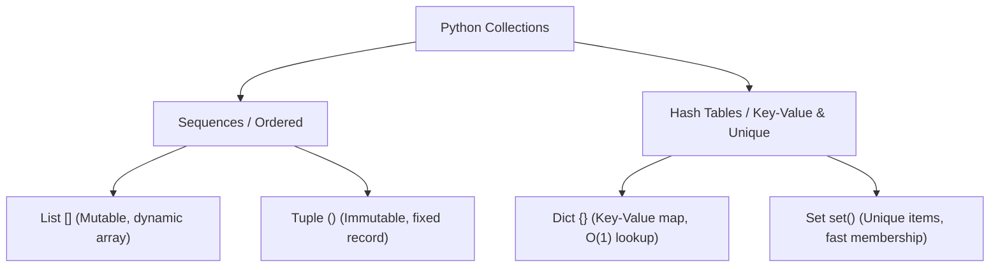

import { Callout } from "fumadocs-ui/components/callout";
import { Tabs, Tab } from "fumadocs-ui/components/tabs";
import { Accordion, Accordions } from "fumadocs-ui/components/accordion";

So far, our variables have held individual values (`10`, `"Mosh"`, `True`). But real software needs to manage groups of items: lists of shopping cart products, sets of active IP addresses, or database user records.

Python provides four built-in collection types:



---

## 1. Lists: Dynamic, Mutable Sequences

A **list** is an ordered, changeable sequence of items wrapped in square brackets `[]`:

```python
names = ["Alice", "Bob", "Charlie"]

print(names[0])   # 'Alice'
print(names[-1])  # 'Charlie'

# Lists are MUTABLE: you can modify them in place!
names[0] = "Alicia"
print(names)
```

Output:

```text
Alice
Charlie
['Alicia', 'Bob', 'Charlie']
```

### Common List Methods

```python
numbers = [1, 2, 3, 4]

numbers.append(5)        # Add to the end -> [1, 2, 3, 4, 5]
numbers.insert(0, 0)     # Insert at index 0 -> [0, 1, 2, 3, 4, 5]
last = numbers.pop()     # Remove and return the last item (5)
numbers.remove(2)        # Remove the first occurrence of value 2
print(numbers)
```

Output:

```text
[0, 1, 3, 4]
```

---

## 2. Tuples: Immutable Records

A **tuple** looks like a list, but is defined with parentheses `()`. The critical difference: **tuples are immutable** (they cannot be changed after creation).

```python
point = (10, 20)

print(point[0])

# ❌ ATTEMPTING TO MUTATE A TUPLE:
point[0] = 15
```

Terminal output:

```text
10
Traceback (most recent call last):
  File "app.py", line 6, in <module>
    point[0] = 15
TypeError: 'tuple' object does not support item assignment
```

### Elegant Tuple Unpacking

Tuples allow you to unpack multiple values into variables in a single, clean line:

```python
coordinates = (4, 9, 12)
x, y, z = coordinates

print(f"X: {x}, Y: {y}, Z: {z}")
```

Output:

```text
X: 4, Y: 9, Z: 12
```

---

## 3. Dictionaries: High-Speed Key-Value Maps

A **dictionary** (`dict`) stores relationships between **keys** and **values** using curly braces `{}`:

```python
customer = {
    "name": "John Smith",
    "age": 30,
    "is_verified": True
}

print(customer["name"])
```

Output:

```text
John Smith
```

### Safe Lookups with `.get()`

If you query a key that doesn't exist using square brackets, Python throws a `KeyError`. To avoid crashes, use `.get()` with an optional default fallback:

```python
# customer["birthdate"]  <- Crashes with KeyError!

# ✅ Safe access:
birthdate = customer.get("birthdate", "Jan 1, 1990")
print(birthdate)
```

Output:

```text
Jan 1, 1990
```

<Callout type="info" title="Under the Hood: O(1) Hash Map Speed">
  Behind the scenes, Python dictionaries are implemented using **hash tables**.
  Looking up a key in a dictionary containing 10,000,000 entries takes almost
  the exact same fraction of a microsecond as looking up a key in a dictionary
  of 5 entries ($O(1)$ constant time complexity)!
</Callout>

---

## 4. Sets: Unique Collections & Set Theory

A **set** is an unordered collection of **unique** elements. Duplicate entries are automatically eliminated:

```python
numbers = [1, 2, 2, 3, 4, 4, 4, 5]
unique_numbers = set(numbers)

print(unique_numbers)
```

Output:

```text
{1, 2, 3, 4, 5}
```

### Mathematical Set Operations

```python
frontend_devs = {"Alice", "Bob", "Charlie"}
backend_devs = {"Bob", "David", "Eve"}

# 1. Intersection (&): Developers who know BOTH frontend and backend
fullstack = frontend_devs & backend_devs
print("Fullstack:", fullstack)

# 2. Union (|): All developers combined
all_devs = frontend_devs | backend_devs
print("All devs:", all_devs)

# 3. Difference (-): Frontend developers who do NOT do backend
pure_frontend = frontend_devs - backend_devs
print("Pure frontend:", pure_frontend)
```

Output:

```text
Fullstack: {'Bob'}
All devs: {'Alice', 'Bob', 'Charlie', 'David', 'Eve'}
Pure frontend: {'Alice', 'Charlie'}
```

---

## Practice Questions & Challenges

Deepen your mastery of mutation, reference semantics, dictionary safe-traversal, and set theory.

### Question 1: Output Prediction (List Aliasing & The Reference Mutation Trap)

Carefully trace the execution of the following snippet:

```python
team_a = ["Alice", "Bob"]
team_b = team_a
team_b.append("Charlie")

print("team_a:", team_a)
print("team_b:", team_b)
print("Same object in memory?", team_a is team_b)
```

1. What will be printed for `team_a` and `team_b`?
2. Why was `team_a` modified when the code explicitly called `team_b.append()`?
3. How can you make `team_b` a truly independent copy so modifying it leaves `team_a` untouched?

<Accordions>
<Accordion title="Reveal Solution & Explanation">

**Output:**

```text
team_a: ['Alice', 'Bob', 'Charlie']
team_b: ['Alice', 'Bob', 'Charlie']
Same object in memory? True
```

**Why this happened (Reference Semantics):**
In Python, variables do not "contain" lists; variables are **pointers (references)** to objects stored in the computer's heap memory.

1. `team_a = [...]` creates a list object in memory and binds `team_a` to its address.
2. `team_b = team_a` does **not** copy the list! It simply binds `team_b` to point to the exact same list address.
3. When `team_b.append("Charlie")` runs, it mutates that single list in memory. Because both variables point to that same list, both reflect the change.

**How to create an independent copy:**
Use the `.copy()` method or full slice syntax `[:]`:

```python
team_a = ["Alice", "Bob"]

# Independent shallow copy:
team_b = team_a.copy()  # or team_a[:]
team_b.append("Charlie")

print("team_a:", team_a)  # ['Alice', 'Bob']
print("team_b:", team_b)  # ['Alice', 'Bob', 'Charlie']
print("Same object?", team_a is team_b)  # False
```

</Accordion>
</Accordions>

---

### Question 2: Spot and Fix the Bug (Dictionary Key Access & Safe Fallback)

A developer is writing code to inspect a user's preferences:

```python
user_profile = {
    "user_id": 9042,
    "email": "sarah@company.io",
    "settings": {
        "theme": "dark"
    }
}

# The user might or might not have configured push notifications:
notifications_enabled = user_profile["settings"]["push_notifications"]
print("Notifications:", notifications_enabled)
```

1. What exact exception crashes this script?
2. How do you rewrite the retrieval using `.get()` so the script never crashes and defaults to `True` if the setting is absent?

<Accordions>
<Accordion title="Reveal Solution & Explanation">

**1. The Exception:**

```text
KeyError: 'push_notifications'
```

Direct square-bracket subscripting (`dict[key]`) raises a `KeyError` if the key does not exist.

**2. The Safe Fix using `.get()`:**
The `.get(key, default)` method returns `default` (or `None`) if the key is missing instead of crashing:

```python
settings = user_profile.get("settings", {})
notifications_enabled = settings.get("push_notifications", True)

print("Notifications:", notifications_enabled)
# Output: Notifications: True
```

</Accordion>
</Accordions>

---

### Question 3: Real-World Set Operations (Permission Auditing)

In a cloud API gateway, you need to audit an incoming client token:

```python
required_scopes = {"users:read", "users:write", "billing:charge"}
user_scopes = {"users:read", "reports:view", "users:write"}
```

Using set operations (or methods):

1. Compute which required permissions the user is **missing**.
2. Compute the extra permissions the user possesses that are not part of `required_scopes`.
3. Write a single boolean expression evaluating whether the user possesses **all** required scopes.

<Accordions>
<Accordion title="Reveal Solution & Explanation">

```python
required_scopes = {"users:read", "users:write", "billing:charge"}
user_scopes = {"users:read", "reports:view", "users:write"}

# 1. Missing scopes: Set difference (Required MINUS User)
missing = required_scopes - user_scopes
print("Missing scopes:", missing)
# Output: {'billing:charge'}

# 2. Extra scopes: Set difference (User MINUS Required)
extra = user_scopes - required_scopes
print("Extra scopes:", extra)
# Output: {'reports:view'}

# 3. Check if user has all required scopes:
# Either check if required is a subset of user_scopes, or missing is empty:
has_all_permissions = required_scopes.issubset(user_scopes)
# or: has_all_permissions = len(missing) == 0

print("Access Granted?", has_all_permissions)
# Output: False
```

</Accordion>
</Accordions>

---

### Question 4: Conceptual Question (Why Can't a List be a Dictionary Key?)

Evaluate what happens when running this snippet:

```python
geo_cache = {}
location_coords = [37.7749, -122.4194]

geo_cache[location_coords] = "San Francisco"
```

1. What exception is raised?
2. Explain the concept of **hashability** and why Python forbids mutable containers as dictionary keys.
3. Which collection type should be used instead?

<Accordions>
<Accordion title="Reveal Solution & Explanation">

**1. The Exception:**

```text
TypeError: unhashable type: 'list'
```

**2. Why Python forbids it (Hashability & Immutability):**
Python dictionaries achieve ultra-fast $O(1)$ lookups by computing a mathematical hash value (`hash(key)`) for each key to determine where in internal memory to store and locate it.
If a key were mutable (like a list), you could change its contents after inserting it into the dictionary (`location_coords.append(999)`). This would alter its hash value, making it impossible for the dictionary to ever find the item again—the internal hash table structure would become corrupted!
Therefore, Python strictly requires that all dictionary keys be **hashable and immutable**.

**3. The Solution:**
Use an **immutable tuple** `(...)` instead of a list:

```python
geo_cache = {}
location_coords = (37.7749, -122.4194)  # Tuple!

geo_cache[location_coords] = "San Francisco"
print(geo_cache[location_coords])  # "San Francisco"
```

</Accordion>
</Accordions>

---

### Question 5: Code Challenge (Frequency Counter & Deduplication)

Given a list of tags logged from a web analytics stream:

```python
tags = ["python", "ai", "web", "python", "ai", "cloud", "python"]
```

Without importing any external libraries:

1. Extract all unique tags in a single statement.
2. Build a dictionary counting the occurrences of each tag using a `for` loop and the `.get()` method.

<Accordions>
<Accordion title="Reveal Solution & Code">

```python
tags = ["python", "ai", "web", "python", "ai", "cloud", "python"]

# 1. Unique tags using set conversion:
unique_tags = list(set(tags))
print("Unique tags:", unique_tags)

# 2. Frequency dictionary using dict.get(tag, 0):
counts = {}
for tag in tags:
    counts[tag] = counts.get(tag, 0) + 1

print("Frequency count:", counts)
# Output: {'python': 3, 'ai': 2, 'web': 1, 'cloud': 1}
```

**Key Takeaway:** The pattern `counts[item] = counts.get(item, 0) + 1` is one of the most widely used idioms in Python for counting items without raising `KeyError` on unseen keys.

</Accordion>
</Accordions>

---

## Comparison Matrix

| Collection | Syntax       |  Ordered?  | Mutable? | Allows Duplicates?  | Primary Use Case                             |
| :--------- | :----------- | :--------: | :------: | :-----------------: | :------------------------------------------- |
| **List**   | `[1, 2, 3]`  |    Yes     | **Yes**  |         Yes         | Ordered sequences, shopping carts, stacks.   |
| **Tuple**  | `(1, 2, 3)`  |    Yes     |  **No**  |         Yes         | Immutable coordinates, database row records. |
| **Dict**   | `{"k": "v"}` | Yes (3.7+) | **Yes**  | Keys: No, Vals: Yes | Fast lookups, JSON data, configurations.     |
| **Set**    | `{1, 2, 3}`  |     No     | **Yes**  |       **No**        | De-duplication, membership tests, Venn math. |

Next, let's learn how to direct program logic in **[08. Control Flow & Pattern Matching](/docs/learn-python/01-fundamentals/08-control-flow-and-pattern-matching)**!
