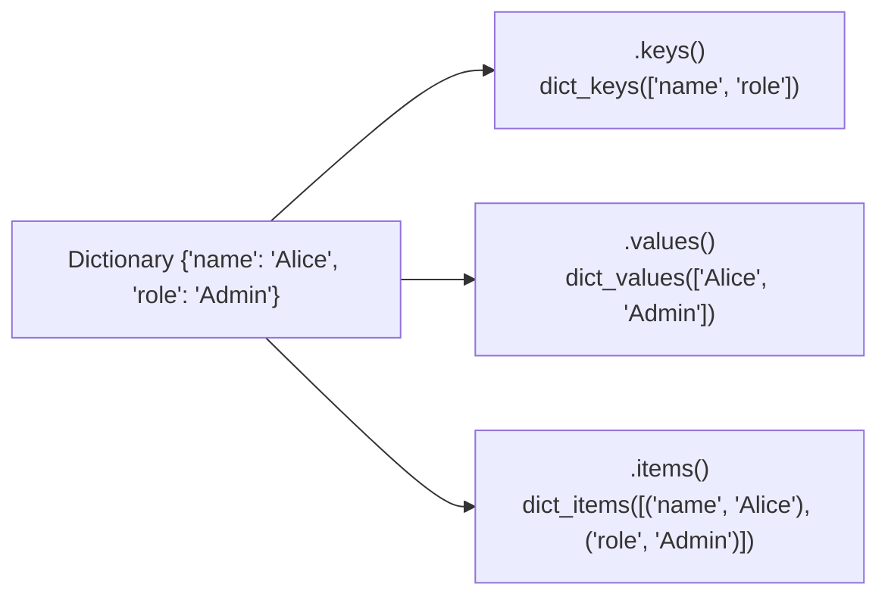
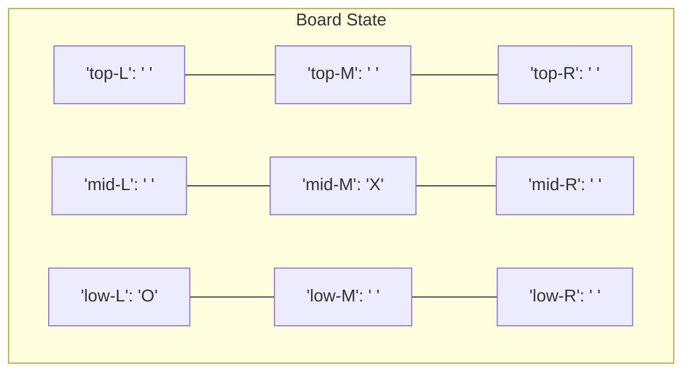

import { Callout } from "fumadocs-ui/components/callout";
import { Tabs, Tab } from "fumadocs-ui/components/tabs";
import { Accordion, Accordions } from "fumadocs-ui/components/accordion";

As programs grow in size, managing data with isolated variables (`user_name`, `user_age`, `user_cart_item_1`, `user_cart_item_2`) becomes unmanageable.

In previous lessons, you learned the syntax of lists and dictionaries. In this lesson, you will learn how to transition from simply storing values to **structuring complex real-world systems**: modeling game boards, managing nested user sessions, aggregating inventories, and defending against insidious reference mutation traps.

---

## 1. Dictionary Operations Deep Dive

Python dictionaries (`dict`) map unique, hashable **keys** to **values**. Because they are implemented as hash tables, key lookups, insertions, and deletions take constant $O(1)$ time regardless of whether your dictionary holds 10 or 10,000,000 entries.



### The Three View Objects: `.keys()`, `.values()`, `.items()`

Dictionaries provide dynamic "view" objects that reflect changes made to the underlying dictionary in real time:

```python
user = {"name": "Alice", "role": "Architect", "active": True}

# 1. Iterating keys:
for key in user.keys():
    print("Key:", key)

# 2. Iterating values:
for val in user.values():
    print("Value:", val)

# 3. Iterating keys and values together (Idiomatic Tuple Unpacking):
for key, val in user.items():
    print(f"  {key} => {val}")
```

Output:

```text
Key: name
Key: role
Key: active
Value: Alice
Value: Architect
Value: True
  name => Alice
  role => Architect
  active => True
```

### Membership Testing: `in` and `not in`

Checking whether a **key** exists in a dictionary is instantaneous ($O(1)$):

```python
inventory = {"apples": 15, "bananas": 8, "oranges": 0}

# Checks KEYS by default:
print("apples" in inventory)      # True
print("strawberries" in inventory) # False

# To check VALUES (Requires O(N) scan across all items):
print(15 in inventory.values())   # True
```

---

## 2. `.setdefault()` vs. `.get()`

A common programming task is initializing a key with a default value only if that key does not already exist.

Consider counting character frequencies. Using basic `if/else`, code requires redundant lookups:

<Tabs items={[".setdefault() (Idiomatic)", "Manual if/else (Verbose)", "collections.defaultdict"]}>
<Tab value=".setdefault() (Idiomatic)">

```python
# .setdefault(key, default) checks if key exists.
# If not, it sets d[key] = default AND returns the value:
message = "it was a bright cold day in april"
count = {}

for char in message:
    count.setdefault(char, 0)
    count[char] += 1

print(count)
```

</Tab>
<Tab value="Manual if/else (Verbose)">

```python
message = "it was a bright cold day in april"
count = {}

for char in message:
    if char not in count:
        count[char] = 0
    count[char] += 1

print(count)
```

</Tab>
<Tab value="collections.defaultdict">

```python
from collections import defaultdict

# Automatically creates 0 for any missing key:
count = defaultdict(int)

for char in "it was a bright cold day in april":
    count[char] += 1

print(dict(count))
```

</Tab>
</Tabs>

### The Crucial Difference: `.get()` vs `.setdefault()`

- `dict.get(key, fallback)`: **Reads** from the dictionary. If the key is missing, it returns the fallback without altering the dictionary.
- `dict.setdefault(key, default)`: **Mutates** the dictionary. If the key is missing, it inserts `key: default` into the dictionary.

---

## 3. Merging Dictionaries: The Union Operator (`|`)

In modern Python (3.9+), you can merge dictionaries cleanly using the **union operator (`|`)** and **in-place update operator (`|=`)**:

```python
default_config = {
    "theme": "dark",
    "font_size": 14,
    "show_line_numbers": True
}

user_preferences = {
    "font_size": 18,        # Overrides default
    "vim_mode": True        # Adds new setting
}

# 1. Merge into a new dictionary (right side wins conflicts):
active_config = default_config | user_preferences
print("Merged:", active_config)

# 2. In-place merge:
default_config |= user_preferences
print("Updated default_config in-place:", default_config)
```

Output:

```text
Merged: {'theme': 'dark', 'font_size': 18, 'show_line_numbers': True, 'vim_mode': True}
Updated default_config in-place: {'theme': 'dark', 'font_size': 18, 'show_line_numbers': True, 'vim_mode': True}
```

---

## 4. Pretty Printing Complex Structures with `pprint`

When printing nested data structures containing lists, sets, and sub-dictionaries, `print()` outputs a single unformatted, unreadable wall of text.

Python's standard library **`pprint` module** formats complex structures with clean indentation and line breaks:

```python
import pprint

company_roster = {
    "engineering": [
        {"name": "Alice Smith", "level": "Principal", "skills": ["Python", "Rust", "Distributed Systems"]},
        {"name": "Bob Jones", "level": "Senior", "skills": ["TypeScript", "React", "GraphQL"]}
    ],
    "design": [
        {"name": "Carol Danvers", "level": "Lead", "skills": ["Figma", "Design Systems", "Prototyping"]}
    ]
}

# 1. Direct pretty print:
pprint.pprint(company_roster, indent=2, width=60)

# 2. Or convert to a formatted string with pformat():
formatted_string = pprint.pformat(company_roster, indent=2)
```

Output:

```text
{ 'design': [ { 'level': 'Lead',
                'name': 'Carol Danvers',
                'skills': [ 'Figma',
                            'Design Systems',
                            'Prototyping']}],
  'engineering': [ { 'level': 'Principal',
                     'name': 'Alice Smith',
                     'skills': [ 'Python',
                                 'Rust',
                                 'Distributed Systems']},
                   { 'level': 'Senior',
                     'name': 'Bob Jones',
                     'skills': [ 'TypeScript',
                                 'React',
                                 'GraphQL']}]}
```

---

## 5. Modeling Real-World Systems with Nested Data

The true power of dictionaries emerges when you combine them with lists and other dictionaries to represent state machines, games, and enterprise entities.

### Pattern 1: Modeling a Tic-Tac-Toe Game Board

A 3×3 game board can be modeled as a dictionary where keys represent coordinate positions:



```python
# The game board state:
board = {
    'top-L': ' ', 'top-M': ' ', 'top-R': ' ',
    'mid-L': ' ', 'mid-M': ' ', 'mid-R': ' ',
    'low-L': ' ', 'low-M': ' ', 'low-R': ' '
}

def print_board(b: dict[str, str]) -> None:
    """Renders the board state cleanly in terminal ASCII."""
    print(f" {b['top-L']} | {b['top-M']} | {b['top-R']} ")
    print("---+---+---")
    print(f" {b['mid-L']} | {b['mid-M']} | {b['mid-R']} ")
    print("---+---+---")
    print(f" {b['low-L']} | {b['low-M']} | {b['low-R']} ")

# Make moves by updating dictionary keys:
board['mid-M'] = 'X'
board['top-L'] = 'O'
board['low-R'] = 'X'

print_board(board)
```

Output:

```text
 O |   |
---+---+---
   | X |
---+---+---
   |   | X
```

### Pattern 2: Modeling an RPG Character & Inventory

Real software structures domain models hierarchically:

```python
player = {
    "name": "Eldrin",
    "class": "Mage",
    "stats": {
        "level": 12,
        "max_hp": 150,
        "current_hp": 132,
        "mana": 280
    },
    "inventory": {
        "gold": 250,
        "potions": {"healing": 4, "mana": 2},
        "spells": ["Fireball", "Frost Nova", "Teleport"]
    }
}

# 1. Reading deeply nested attributes:
current_mana = player["stats"]["mana"]
healing_potions = player["inventory"]["potions"]["healing"]
first_spell = player["inventory"]["spells"][0]

print(f"{player['name']} has {healing_potions} healing potions and knows {first_spell}.")

# 2. Updating nested values:
player["stats"]["current_hp"] += 20
player["inventory"]["potions"]["healing"] -= 1

print(f"Drank potion! HP restored to {player['stats']['current_hp']}/{player['stats']['max_hp']}.")
```

Output:

```text
Eldrin has 4 healing potions and knows Fireball.
Drank potion! HP restored to 152/150.
```

---

## 6. The Nested Mutation Trap: Shallow vs. Deep Copy

One of the most dangerous bugs in Python involves copying nested data structures.

When you use `.copy()` on a dictionary, Python creates a **shallow copy**. The outer dictionary is duplicated, but all inner nested lists and dictionaries are still shared **references**:

```python
import copy

original_character = {
    "name": "Warrior",
    "equipment": ["Iron Sword", "Wooden Shield"]
}

# ❌ SHALLOW COPY:
shallow_clone = original_character.copy()
shallow_clone["name"] = "Barbarian"              # Safe (replaces string reference)
shallow_clone["equipment"].append("Plate Armor") # DANGER! Mutates original!

print("Original equipment:", original_character["equipment"])
# Output: ['Iron Sword', 'Wooden Shield', 'Plate Armor']  <- Corrupted!

# ✅ DEEP COPY:
deep_clone = copy.deepcopy(original_character)
deep_clone["equipment"].append("Magic Ring")

print("Original equipment after deepcopy:", original_character["equipment"])
print("Deep clone equipment:             ", deep_clone["equipment"])
```

Output:

```text
Original equipment: ['Iron Sword', 'Wooden Shield', 'Plate Armor']
Original equipment after deepcopy: ['Iron Sword', 'Wooden Shield', 'Plate Armor']
Deep clone equipment:              ['Iron Sword', 'Wooden Shield', 'Plate Armor', 'Magic Ring']
```

<Callout type="error" title="Rule of Thumb">
  Whenever your dictionary contains nested dictionaries, lists, or custom
  objects, **never use `dict.copy()`**. Always use `copy.deepcopy()` to prevent
  accidental mutations across cloned records.
</Callout>

---

## 7. Advanced Collections: `Counter` & `defaultdict`

Python's `collections` standard library module contains specialized dictionary extensions:

### `collections.Counter`: Instant Frequency Analysis

```python
from collections import Counter

votes = ["apple", "banana", "apple", "orange", "apple", "banana", "grape"]

# Count occurrences in one step:
tally = Counter(votes)

print("Tally:", tally)
print("Most popular:", tally.most_common(1))  # Top 1 result
```

Output:

```text
Tally: Counter({'apple': 3, 'banana': 2, 'orange': 1, 'grape': 1})
Most popular: [('apple', 3)]
```

### `collections.defaultdict`: Grouping Lists Without Boilerplate

```python
from collections import defaultdict

# Grouping employees by department:
department_staff = defaultdict(list)

records = [
    ("engineering", "Alice"),
    ("marketing", "Bob"),
    ("engineering", "Charlie"),
    ("design", "Diana"),
    ("engineering", "Elena")
]

for dept, person in records:
    # No need to check if dept exists; an empty list is created automatically!
    department_staff[dept].append(person)

for dept, people in department_staff.items():
    print(f"{dept.capitalize()} Team ({len(people)}): {', '.join(people)}")
```

Output:

```text
Engineering Team (3): Alice, Charlie, Elena
Marketing Team (1): Bob
Design Team (1): Diana
```

---

## 8. Real-World Project: Fantasy Inventory Manager

Let's build a modular inventory management and loot aggregator system:

```python
"""inventory_manager.py: RPG Inventory Audit & Loot System."""

from __future__ import annotations
import pprint

# Player inventory with category grouping:
inventory: dict[str, int] = {
    "rope": 1,
    "torch": 6,
    "gold coin": 42,
    "dagger": 1,
    "arrow": 12
}

# Loot dropped by defeated monsters:
dragon_loot = ["gold coin", "dagger", "gold coin", "gold coin", "ruby", "dragon scale"]

def display_inventory(inv: dict[str, int]) -> int:
    """Displays formatted inventory and computes the grand item total."""
    print("=== INVENTORY AUDIT ===")
    total_items = 0
    for item_name, count in sorted(inv.items()):
        print(f"  {count:>4} x {item_name}")
        total_items += count
    print("-----------------------")
    print(f"Total item count: {total_items}\n")
    return total_items

def add_to_inventory(inv: dict[str, int], added_items: list[str]) -> dict[str, int]:
    """Adds a list of dropped items to the player's inventory dictionary."""
    for item in added_items:
        inv.setdefault(item, 0)
        inv[item] += 1
    return inv

# 1. Audit current inventory:
display_inventory(inventory)

# 2. Defeat dragon and collect loot:
print(f"⚔️ Defeated Dragon! Looting {len(dragon_loot)} items...")
add_to_inventory(inventory, dragon_loot)

# 3. Audit updated inventory:
display_inventory(inventory)
```

Output:

```text
=== INVENTORY AUDIT ===
    12 x arrow
     1 x dagger
    42 x gold coin
     1 x rope
     6 x torch
-----------------------
Total item count: 62

⚔️ Defeated Dragon! Looting 6 items...
=== INVENTORY AUDIT ===
    12 x arrow
     2 x dagger
     1 x dragon scale
    45 x gold coin
     1 x rope
     1 x ruby
     6 x torch
-----------------------
Total item count: 68
```

---

## 9. Practice Exercises & Solutions

<Accordions>
<Accordion title="Exercise 1: Guest Picnic Basket Aggregator">

You have a dictionary containing items each guest brought to a picnic:

```python
all_guests = {
    'Alice': {'apples': 5, 'pretzels': 12},
    'Bob': {'ham sandwiches': 3, 'apples': 2},
    'Carol': {'cups': 3, 'apple pies': 1}
}
```

Write a function `total_brought(guests: dict, item: str) -> int` that calculates how many of a specific item were brought across all guests combined:

```python
def total_brought(guests: dict[str, dict[str, int]], item: str) -> int:
    num_brought = 0
    for guest_name, basket in guests.items():
        num_brought += basket.get(item, 0)
    return num_brought

print("Total apples:  ", total_brought(all_guests, "apples"))   # 7
print("Total cups:    ", total_brought(all_guests, "cups"))     # 3
print("Total cookies: ", total_brought(all_guests, "cookies"))  # 0
```

</Accordion>

<Accordion title="Exercise 2: Safe Nested Dictionary Path Traversal">

Write a utility function `deep_get(data: dict, *keys: str, default=None)` that safely traverses arbitrarily deep dictionary paths without throwing `KeyError` or `TypeError` if an intermediate key is missing:

```python
from typing import Any

def deep_get(data: dict, *keys: str, default: Any = None) -> Any:
    """Safely traverses nested dictionaries using a variable sequence of keys."""
    current = data
    for key in keys:
        if isinstance(current, dict) and key in current:
            current = current[key]
        else:
            return default
    return current

# Test data:
config = {
    "database": {
        "connections": {
            "primary": {"host": "10.0.0.1", "port": 5432}
        }
    }
}

# Successful nested lookup:
print(deep_get(config, "database", "connections", "primary", "port"))  # 5432

# Missing key returns default instead of crashing:
print(deep_get(config, "database", "replicas", "backup_1", default="N/A"))  # N/A
```

</Accordion>
</Accordions>

---

## Summary Reference

- Use `.items()` with tuple unpacking `for k, v in d.items():` for clean iterations.
- `.get(k, default)` reads safely without mutation; `.setdefault(k, default)` initializes missing keys in-place.
- Merge dictionaries with the union operator: `d1 | d2` (right-hand dictionary wins conflicting keys).
- Never use `dict.copy()` on nested structures; use `copy.deepcopy()` to avoid aliasing bugs.
- Use `collections.defaultdict` to eliminate key initialization boilerplate and `collections.Counter` for frequency tallies.
- Format complex nested structures using `pprint.pprint(d, indent=2)`.

---

## Next Steps

Now that you can model complex entities and nested structures, learn how to steer execution paths, evaluate conditions, and loop over data collections with **[09. Control Flow & Modern Pattern Matching](/docs/learn-python/01-fundamentals/09-control-flow-and-pattern-matching)**!
