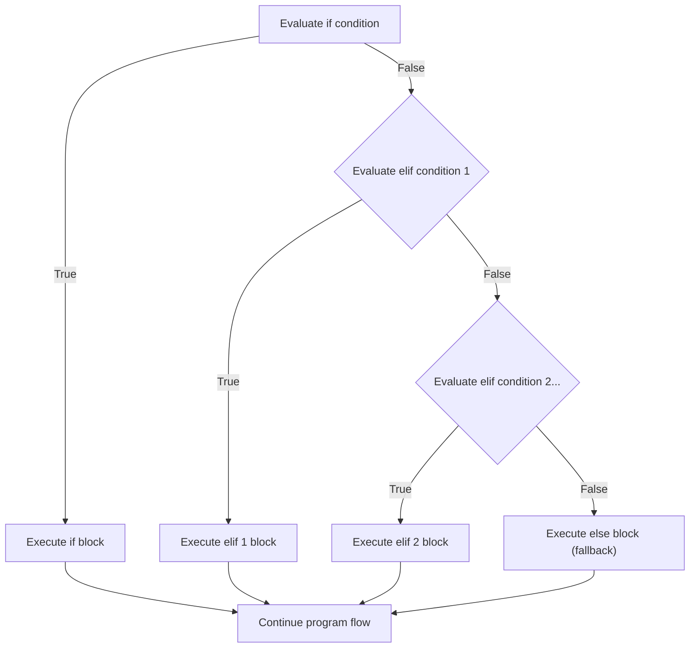
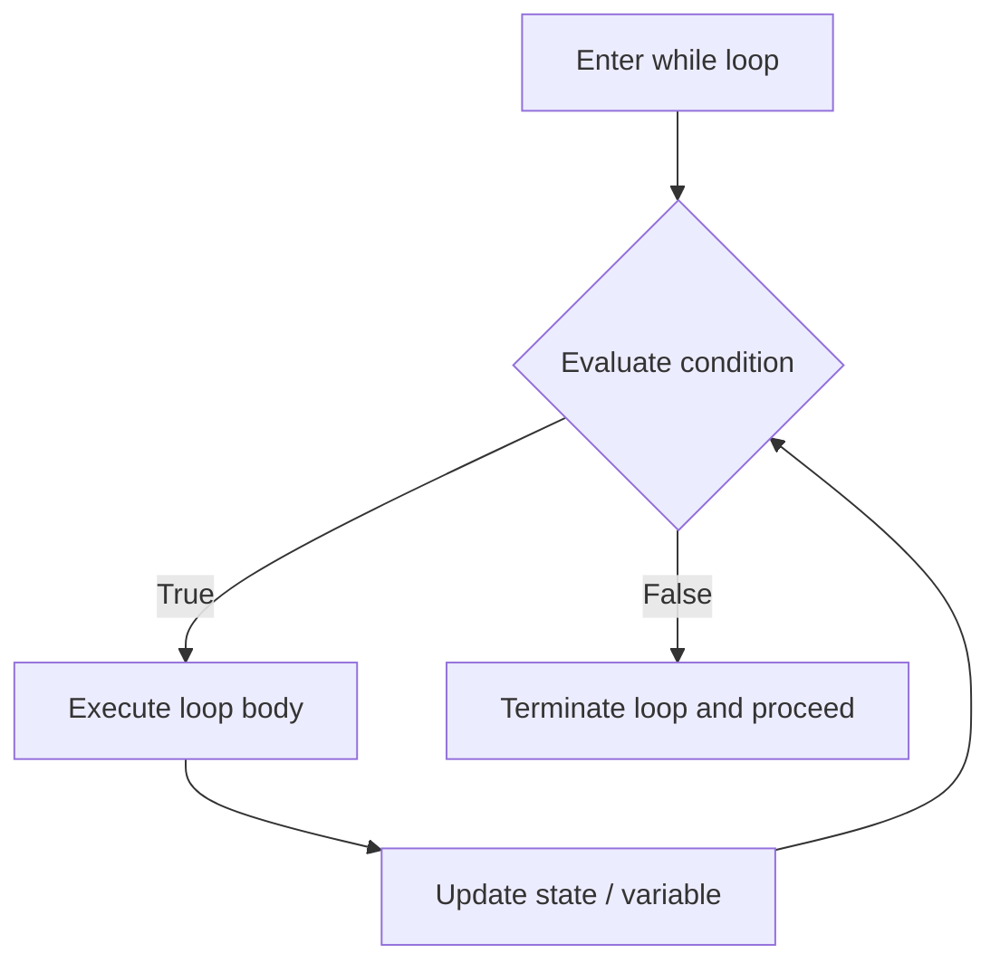
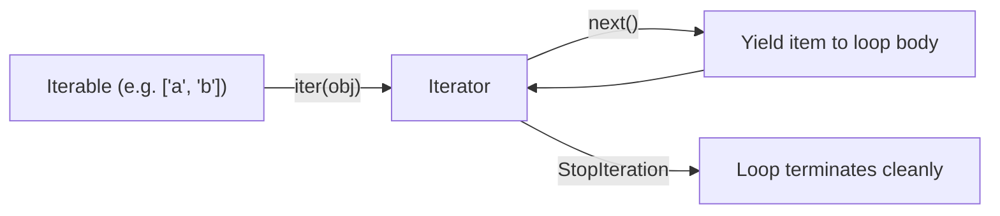

import { Callout } from "fumadocs-ui/components/callout";
import { Tabs, Tab } from "fumadocs-ui/components/tabs";
import { Accordion, Accordions } from "fumadocs-ui/components/accordion";

Software creates real value when it can make intelligent decisions and iterate over dynamic data. In Python, control flow is intentionally clean, relying on semantic keywords and strict indentation rather than curly braces or verbose boilerplate.

In this comprehensive guide, we cover:

1. **Conditional Branching (`if`, `elif`, `else`)**, truth value testing, short-circuit evaluation, and ternary operators.
2. **Looping Constructs (`while`, `for`)**, loop control (`break`, `continue`, `pass`), the loop-`else` clause, and iteration helpers (`enumerate`, `zip`).
3. **The Walrus Operator (`:=`)**: Assignment expressions, syntax rules, and practical patterns.
4. **Structural Pattern Matching (`match / case`)**: Modern Python 3.10+ pattern matching, deconstruction, guard clauses, and class patterns.

<Callout
  type="info"
  title="Structural Pattern Matching vs. Regular Expressions"
>
  This lesson covers **Structural Pattern Matching** (Python 3.10+ `match /
  case` syntax) for branching on data structures and object shapes. If you are
  looking for text search and string pattern matching with regular expressions,
  see **[12. Pattern Matching with Regular
  Expressions](/docs/learn-python/02-intermediate/12-pattern-matching-with-regular-expressions)**.
</Callout>

---

## 1. Conditional Branching: `if`, `elif`, `else`

In Python, code blocks are defined by **indentation** (the standard PEP 8 convention is **4 spaces**, never tabs).

```python
user_role = "admin"
is_authenticated = True

if not is_authenticated:
    print("Access Denied: Please log in.")
elif user_role == "admin":
    print("Welcome to the Administration Console.")
elif user_role == "moderator":
    print("Welcome to the Moderation Dashboard.")
else:
    print("Welcome to the User Portal.")
```



### Truthiness & Truth Value Testing

In Python, every single object has an inherent boolean value. When placed in an `if` condition, an object evaluates to either `True` (**truthy**) or `False` (**falsy**).

#### Built-in Falsy Objects

The following values always evaluate to `False` in a boolean context:

- `None`
- `False`
- Numeric zeros: `0`, `0.0`, `0j`, `Decimal(0)`, `Fraction(0, 1)`
- Empty sequences: `""` (empty string), `()` (empty tuple), `[]` (empty list), `range(0)`
- Empty collections/mappings: `{}` (empty dict), `set()` (empty set), `frozenset()`

Everything else evaluates to `True` (**truthy**).

```python
# ❌ Un-pythonic / Clunky
items = ["apple", "banana"]
if len(items) > 0:
    print("We have inventory")

# ✅ Idiomatic Python (relies directly on truthiness)
if items:
    print("We have inventory")

name = ""
if not name:
    print("Name was left blank!")
```

<Callout type="warn" title="Equality vs. Truthiness">
  Never check boolean equality with <code>== True</code> or{" "}
  <code>== False</code>.
  <br />
  Writing <code>if is_active == True:</code> is redundant and dangerous. If{" "}
  <code>is_active = 1</code>, <code>1 == True</code> is True in Python, but{" "}
  <code>is_active = "yes"</code> will fail <code>== True</code> even though it
  is truthy! Always write <code>if is_active:</code> or{" "}
  <code>if not is_active:</code>.
</Callout>

### Short-Circuit Evaluation (`and`, `or`, `not`)

Python evaluates boolean operators from left to right using **short-circuit evaluation**:

- **`and`**: Returns the first falsy operand, or the last operand if all are truthy. If the first operand is falsy, Python stops evaluating immediately.
- **`or`**: Returns the first truthy operand, or the last operand if all are falsy. If the first operand is truthy, Python stops evaluating immediately.
- **`not`**: Inverts the boolean truth value, always returning a strict `bool` (`True` or `False`).

```python
# Short-circuiting returns the operand itself, not necessarily True or False!
print("Python" and "Rocks")  # Output: 'Rocks' (both truthy, returns last)
print([] and "Python")       # Output: [] (first is falsy, immediately stops)
print("" or "Default Name")  # Output: 'Default Name' (first falsy, proceeds to second)
print("Alice" or "Bob")      # Output: 'Alice' (first truthy, immediately stops)
```

#### Guarding Against Crashes with Short-Circuiting

Short-circuit evaluation is essential for defensive programming. It allows you to check whether an object exists before accessing its attributes or methods:

```python
user = {"name": "Charlie", "profile": None}

# Safe: if user["profile"] is None, Python never calls .get("bio")!
if user.get("profile") is not None and user["profile"].get("bio"):
    print("User has a biography")
else:
    print("No biography available")
```

### Ternary Conditional Expressions (`x if cond else y`)

Python offers a concise inline conditional expression (often called the ternary operator) for assigning values based on a condition:

```python
status_code = 200
message = "Success" if status_code == 200 else "Error Encountered"
print(message)  # 'Success'
```

Syntax rule:

```python
value_if_true if condition else value_if_false
```

### Chained Comparison Operators

Python allows mathematical chained comparisons:

```python
score = 85

# In C++/Java/JavaScript: (score >= 80 && score <= 90)
# In Python:
if 80 <= score <= 90:
    print("Grade: B")
```

---

## 2. Looping Constructs: `while` & `for`

Loops allow your program to repeat operations until a condition is met or across elements of a collection.

### The `while` Loop: Condition-Driven Iteration

A `while` loop repeatedly executes a block of code as long as its target condition evaluates to `True` (truthy). It is a **pre-test loop**: Python evaluates the condition _before_ entering each iteration. If the condition evaluates to `False` from the outset, the loop body will not execute even once.



#### Anatomy of a Robust `while` Loop

Every safe, predictable `while` loop depends on three core parts:

1. **State Initialization**: Setting up one or more tracking variables before the loop begins.
2. **Evaluation Condition**: A boolean expression tested before every single pass.
3. **State Mutation / Progress**: Updating the state inside the loop body so that the condition eventually evaluates to `False`.

```python
# 1. State Initialization
countdown = 5

# 2. Evaluation Condition
while countdown > 0:
    print(f"T-minus {countdown}...")
    # 3. State Mutation (Progress towards termination)
    countdown -= 1

print("Blastoff! 🚀")
```

#### Common `while` Loop Patterns

##### 1. The Sentinel / Event Loop Pattern (`while True`)

When the exact number of iterations is unknown in advance—such as processing user commands, polling event streams, or accepting socket connections—use an indefinite loop guarded by an explicit sentinel condition and `break`:

```python
def command_line_interface() -> None:
    while True:
        raw_cmd = input("app> ").strip().lower()

        if raw_cmd == "exit" or raw_cmd == "quit":
            print("Shutting down session...")
            break  # Exit loop immediately
        elif raw_cmd == "status":
            print("System status: Healthy [OK]")
        elif not raw_cmd:
            continue  # Skip blank entries
        else:
            print(f"Unknown command: '{raw_cmd}'. Type 'exit' to leave.")
```

##### 2. State-Driven Retries with Backoff

In networked systems, operations like API calls or database connections can transiently fail. A `while` loop cleanly handles bounded retries:

```python
import time

def connect_with_retry(max_retries: int = 4) -> bool:
    attempt = 0
    connected = False
    delay = 1.0  # seconds

    while attempt < max_retries and not connected:
        attempt += 1
        print(f"Connection attempt {attempt} of {max_retries}...")

        # Simulated connection check (e.g. succeeds on 3rd attempt)
        if attempt == 3:
            connected = True
            print("Successfully connected to database!")
        else:
            print(f"Connection failed. Backing off for {delay:.1f}s...")
            time.sleep(delay)
            delay *= 2  # Exponential backoff

    return connected
```

##### 3. Dynamic Queue / Work-Drain Pattern

`while` loops are the natural construct for consuming and mutating dynamic data structures until they are empty:

```python
task_queue = ["send_welcome_email", "sync_stripe_billing", "warm_cache"]

# While task_queue is truthy (not empty):
while task_queue:
    current_task = task_queue.pop(0)  # Dequeue first task
    print(f"Processing task: {current_task} (Remaining: {len(task_queue)})")

print("All queued tasks completed.")
```

#### Critical `while` Loop Hazards

<Callout type="error" title="Hazard 1: The Infinite Loop Trap">
  If you forget to mutate the state variable inside the loop body (e.g.,
  omitting <code>countdown -= 1</code>), the condition never evaluates to{" "}
  <code>False</code>. The loop will run forever, pegging 100% of a CPU core
  until killed.
  <br />
  If your program hangs or floods the console, press <kbd>Ctrl</kbd> +{" "}
  <kbd>C</kbd> in your terminal to raise a <code>KeyboardInterrupt</code> and
  kill the process.
</Callout>

<Callout type="warn" title="Hazard 2: Floating-Point Counter Inequality">
  Never use exact floating-point equality as a loop termination condition due to binary floating-point representation limits (IEEE 754):
  <br />
  ```python
  # ❌ HAZARDOUS: May run forever because 0.1 + 0.1 + ... never hits exactly 1.0!
  x = 0.0
  while x != 1.0:
      x += 0.1

# ✅ SAFE: Use inequality boundaries:

x = 0.0
while x < 1.0 - 1e-9:
x += 0.1

````
</Callout>

---

### The `for` Loop: The Iterator Protocol

Unlike C, C++, or Java where `for` loops traditionally rely on index manipulation (`for (int i = 0; i < n; i++)`), Python's `for` loop is fundamentally a **for-each loop**. It consumes any object that conforms to Python's **Iterable protocol** (such as lists, tuples, strings, dictionaries, sets, files, and generators).

```python
tech_stack = ["FastAPI", "PostgreSQL", "Redis", "Docker"]

for tech in tech_stack:
  print(f"Deploying {tech}...")
````

#### Under the Hood: How `for` Really Works

When Python encounters `for item in iterable:`, it does **not** count indices. Instead, it executes the **Iterator Protocol** in three steps:

1. **Obtain an Iterator**: Python calls `iter(iterable)` (which calls the object's `__iter__()` dunder method).
2. **Fetch Successive Items**: Python repeatedly invokes `next(iterator)` (which calls the object's `__next__()` dunder method).
3. **Catch Termination**: When the iterator runs out of elements, it raises a built-in `StopIteration` exception. Python automatically catches `StopIteration` and terminates the loop cleanly.



We can prove this by manually emulating what Python's `for` loop does behind the scenes:

<Tabs items={["Idiomatic for Loop", "Manual Iterator Protocol Emulation"]}>
<Tab value="Idiomatic for Loop">

```python
nodes = ["worker-1", "worker-2", "worker-3"]

for node in nodes:
    print(f"Active node: {node}")
```

</Tab>
<Tab value="Manual Iterator Protocol Emulation">

```python
nodes = ["worker-1", "worker-2", "worker-3"]

# Exactly what Python executes under the hood:
node_iterator = iter(nodes)

while True:
    try:
        node = next(node_iterator)
        print(f"Active node: {node}")
    except StopIteration:
        # End of sequence reached cleanly without crashing!
        break
```

</Tab>
</Tabs>

#### Generating Numeric Sequences: `range()`

When you need to repeat a block a specific number of times, or generate an arithmetic sequence of numbers, use the built-in `range()` function. `range()` supports three signatures:

| Signature                  | Behavior                                           | Example           | Values Generated |
| :------------------------- | :------------------------------------------------- | :---------------- | :--------------- |
| `range(stop)`              | Generates integers from `0` up to `stop - 1`.      | `range(4)`        | `0, 1, 2, 3`     |
| `range(start, stop)`       | Generates integers from `start` up to `stop - 1`.  | `range(2, 6)`     | `2, 3, 4, 5`     |
| `range(start, stop, step)` | Steps by `step` increments (positive or negative). | `range(0, 10, 2)` | `0, 2, 4, 6, 8`  |

```python
# 1. Basic fixed count iteration (0 to 2)
for i in range(3):
    print(f"Heartbeat ping #{i}")

# 2. Stepping by increments (10, 20, 30, 40)
for step in range(10, 50, 10):
    print(f"Progress checkpoint: {step}%")

# 3. Negative steps: countdowns (3, 2, 1)
for countdown in range(3, 0, -1):
    print(f"{countdown}...")
```

<Callout type="info" title="Memory Efficiency of range()">
  In Python 3, `range` does not generate a gigantic list in memory! It returns
  an immutable sequence object that generates numbers on-the-fly ($O(1)$ memory
  consumption).
  <br />
  <code>sys.getsizeof(range(5))</code> and{" "}
  <code>sys.getsizeof(range(10_000_000))</code> consume the exact same tiny
  memory footprint (typically 48 bytes)!
</Callout>

#### Iterating Over Diverse Data Structures

Python's `for` loop adapts cleanly to any data structure:

```python
# 1. Strings: Iterates character-by-character
for char in "DevOps":
    print(char, end=".")  # Output: D.e.v.O.p.s.
print()

# 2. Sets: Iterates unique members (arbitrary hash-based ordering)
unique_roles = {"Admin", "Editor", "Viewer"}
for role in unique_roles:
    print(f"Role: {role}")

# 3. Dictionaries: Three iteration perspectives
user_caps = {"alice": "admin", "bob": "editor", "clara": "viewer"}

# 3a. Keys (default behavior)
for user in user_caps:
    print(f"Username: {user}")

# 3b. Values
for cap in user_caps.values():
    print(f"Capability: {cap}")

# 3c. Key-Value pairs with Tuple Unpacking
for user, cap in user_caps.items():
    print(f"User '{user}' has access '{cap}'")
```

#### Advanced Pattern: Inline Tuple & Sequence Unpacking

When elements inside an iterable are themselves sequences (tuples or lists), you can unpack their individual components directly in the `for` statement header:

```python
# List of (latitude, longitude, city_name) tuples
geocodes = [
    (37.7749, -122.4194, "San Francisco"),
    (40.7128, -74.0060, "New York"),
    (51.5074, -0.1278, "London"),
]

# Unpack lat, lon, city directly in the loop statement:
for lat, lon, city in geocodes:
    print(f"{city:15} -> Coordinates: ({lat:.2f}, {lon:.2f})")
```

#### Reversing and Sorting During Iteration

Rather than modifying collections in-place or creating duplicate sliced copies (`items[::-1]`), use Python's built-in non-destructive iteration utilities:

```python
metrics = [88.5, 92.0, 79.4, 95.1]

# 1. reversed(seq): Iterates from right to left without making a copied list
for metric in reversed(metrics):
    print(f"Recent: {metric}")

# 2. sorted(iterable, reverse=True): Yields items in sorted order cleanly
for metric in sorted(metrics, reverse=True):
    print(f"Ranked: {metric}")
```

<Callout
  type="warn"
  title="Critical Anti-Pattern: Modifying a Collection While Iterating Over It"
>
  Never add (<code>append</code>, <code>insert</code>) or remove (
  <code>remove</code>, <code>pop</code>) items from a list while looping over
  it! Python updates its internal index pointer, causing subsequent elements to
  shift positions and be skipped silently.
  <br />
  If you must filter or mutate, iterate over a shallow copy (
  <code>for item in items[:]:</code>) or construct a new list with a list
  comprehension (<code>items = [x for x in items if keep(x)]</code>). See{" "}
  <strong>
    [Practice Question
    2](#question-2-spot-and-fix-the-bug-mutating-a-list-during-iteration)
  </strong>{" "}
  below for a detailed trace of this bug.
</Callout>

---

### Choosing Between `for` and `while` Loops

| Decision Criteria            | Use a `for` Loop                                              | Use a `while` Loop                                                    |
| :--------------------------- | :------------------------------------------------------------ | :-------------------------------------------------------------------- |
| **Number of Iterations**     | Known in advance or bounded by a collection / generator.      | Unknown or indefinite; bounded by dynamic state changes or events.    |
| **Primary Driver**           | Data-driven (each item in a list, dict, file, range).         | Condition-driven (boolean flag, threshold, socket status).            |
| **Index / Counter Handling** | Automatic via `range()` or `enumerate()`.                     | Explicitly initialized, checked, and incremented.                     |
| **Infinite Loop Risk**       | Almost zero (finite iterables always terminate).              | Moderate to High (requires careful termination logic).                |
| **Typical Scenarios**        | Processing data records, batch transformations, fixed counts. | CLI event loops, socket listener daemons, retry-with-backoff, queues. |
| **Pythonic Rule of Thumb**   | **Default choice for 90%+ of iterative code.**                | Use when iteration relies on conditions external to a container.      |

---

### Loop Control: `break`, `continue`, and `pass`

| Keyword        | Action                                                                                            |
| :------------- | :------------------------------------------------------------------------------------------------ |
| **`break`**    | Exits the loop immediately, skipping all remaining iterations.                                    |
| **`continue`** | Skips the remainder of the current iteration and jumps to the next iteration.                     |
| **`pass`**     | A null statement. Acts as a syntactic placeholder where code is required but no action is needed. |

```python
numbers = [1, 2, 3, 4, 5, 6, 7, 8, 9, 10]

for n in numbers:
    if n % 2 != 0:
        continue  # Skip odd numbers
    if n > 6:
        break     # Stop loop entirely once number exceeds 6
    print(f"Even number: {n}")
```

Output:

```text
Even number: 2
Even number: 4
Even number: 6
```

### The Loop `else` Clause: Python's Hidden Gem

Python allows you to attach an `else:` block directly to a `for` or `while` loop!

<Callout type="info" title="When does loop else run?">
  The loop <code>else</code> block executes{" "}
  <strong>
    only if the loop completes normally without encountering a{" "}
    <code>break</code> statement
  </strong>
  .
</Callout>

This cleanly solves the common "search and find" problem without needing messy boolean flag variables:

<Tabs items={["Pythonic Loop else", "Legacy Flag Variable"]}>
<Tab value="Pythonic Loop else">

```python
def find_service(services: list[str], target: str) -> None:
    for service in services:
        if service == target:
            print(f"Found required service: {target}!")
            break
    else:
        # Runs ONLY if the loop exhausted all items without breaking!
        print(f"Critical alert: {target} was NOT found in cluster.")

find_service(["auth", "billing", "gateway"], "database")
# Output: Critical alert: database was NOT found in cluster.
```

</Tab>
<Tab value="Legacy Flag Variable">

```python
def find_service(services: list[str], target: str) -> None:
    found = False
    for service in services:
        if service == target:
            print(f"Found required service: {target}!")
            found = True
            break
    if not found:
        print(f"Critical alert: {target} was NOT found in cluster.")
```

</Tab>
</Tabs>

### Essential Iteration Helpers

Never manually maintain index counters with `i = 0; i += 1`. Use Python's built-in iteration utilities:

#### 1. `enumerate(iterable, start=0)`

Provides both the zero-based index and the item simultaneously:

```python
servers = ["web-01", "web-02", "db-primary"]

for index, server in enumerate(servers, start=1):
    print(f"Node #{index}: {server}")
```

#### 2. `zip(*iterables, strict=True)`

Pairs elements from multiple iterables in lock-step:

```python
users = ["Alice", "Bob", "Charlie"]
roles = ["Admin", "Developer", "Analyst"]

for user, role in zip(users, roles, strict=True):
    print(f"{user} -> {role}")
```

_(Note: `strict=True`, introduced in Python 3.10, raises a `ValueError` if the iterables are of unequal length, preventing silent truncation bugs!)_

#### 3. Unequal Iterables with `itertools.zip_longest`

When iterables have different lengths and you want to iterate until the _longest_ collection is exhausted without throwing an exception, use `itertools.zip_longest` with a designated `fillvalue`:

```python
from itertools import zip_longest

headers = ["Name", "Role", "Department", "Office"]
employee_data = ["Alice", "Platform Engineer"]

for header, val in zip_longest(headers, employee_data, fillvalue="N/A"):
    print(f"{header:12}: {val}")
```

Output:

```text
Name        : Alice
Role        : Platform Engineer
Department  : N/A
Office      : N/A
```

---

## 3. The Walrus Operator (`:=`): Assignment Expressions

Introduced in Python 3.8 (PEP 572), the **walrus operator** (`:=`) allows you to **assign a value to a variable inside an expression**.

### The Motivation: Eliminating Redundant Computations

Without the walrus operator, you often have to compute an expression once to check it, or repeat the computation:

<Tabs items={["With Walrus (:=)", "Without Walrus"]}>
<Tab value="With Walrus (:=)">

```python
data = [10, 20, 30, 40, 50, 60]

# Computes len(data), stores in 'count', and tests condition in one step:
if (count := len(data)) > 3:
    print(f"Dataset has {count} entries (exceeds limit of 3)")
```

</Tab>
<Tab value="Without Walrus">

```python
data = [10, 20, 30, 40, 50, 60]

count = len(data)
if count > 3:
    print(f"Dataset has {count} entries (exceeds limit of 3)")
```

</Tab>
</Tabs>

### Real-World Walrus Pattern: Stream and Buffer Ingestion

The walrus operator is unbeatable when reading file streams or network sockets in chunks:

```python
# Iterates until read() returns an empty bytes object b""
with open("data.bin", "rb") as stream:
    while (chunk := stream.read(4096)):
        process_binary_chunk(chunk)
```

### Walrus in List Comprehensions

You can use the walrus operator to filter and transform without running expensive functions twice:

```python
import math

raw_values = [1, 4, 9, 16, 25, -1, 36]

# Compute sqrt once; use in condition AND include in resulting list:
roots = [root for x in raw_values if x >= 0 and (root := math.isqrt(x)) > 2]
print(roots)  # [3, 4, 5, 6]
```

<Callout type="warn" title="Syntax Rule for Walrus">
  The walrus operator has low precedence. You must almost always enclose it in parentheses when used in comparisons:
  <br />
  <code>if (n := len(items)) > 10:</code> ✅ Correct
  <br />
  <code>if n := len(items) > 10:</code> ❌ SyntaxError or assigns boolean result to n!
</Callout>

---

## 4. Modern Structural Pattern Matching (`match / case`)

Introduced in Python 3.10 (PEP 634), **Structural Pattern Matching** is not just an alternative to C-style `switch/case` statements. It is a full destructuring engine that inspects the **structure**, **type**, and **contents** of complex data structures.

### Basic Syntax & Wildcard

```python
def http_status_handler(status: int) -> str:
    match status:
        case 200:
            return "OK"
        case 301 | 302:  # OR pattern
            return "Redirect"
        case 400:
            return "Bad Request"
        case 404:
            return "Not Found"
        case 500 | 502 | 503:
            return "Server Error"
        case _:          # Wildcard (matches anything else)
            return f"Unhandled Status Code: {status}"
```

### Pattern Varieties in Depth

Structural pattern matching supports multiple sophisticated pattern styles:

#### 1. Sequence Patterns (Lists & Tuples)

Matches sequences and extracts elements by position:

```python
def evaluate_command(tokens: list[str]) -> None:
    match tokens:
        case ["quit"]:
            print("Shutting down application...")
        case ["load", filename]:
            print(f"Loading file from: {filename}")
        case ["set", key, value]:
            print(f"Setting config '{key}' = '{value}'")
        case ["batch", *items]:  # Star unpacking
            print(f"Batch processing {len(items)} items: {items}")
        case _:
            print(f"Unrecognized command format: {tokens}")

evaluate_command(["load", "dataset.csv"])
evaluate_command(["batch", "task1", "task2", "task3"])
```

#### 2. Mapping Patterns (Dictionaries)

Matches specific keys in dictionaries regardless of extra keys (partial matching):

```python
def route_event(event: dict) -> None:
    match event:
        case {"type": "click", "x": int(x), "y": int(y)}:
            print(f"Mouse click registered at coordinate ({x}, {y})")

        case {"type": "keydown", "key": str(k)}:
            print(f"Key press registered: {k}")

        case {"type": "error", **details}:
            # Star-star unpacks remaining dictionary keys
            print(f"Error event occurred: {details}")

        case _:
            print("Ignored background event.")

route_event({"type": "click", "x": 100, "y": 250, "button": "left"})
# Output: Mouse click registered at coordinate (100, 250)
```

#### 3. Class Patterns & Object Deconstruction

Matches against custom class instances and extracts attributes:

```python
from dataclasses import dataclass

@dataclass
class Point:
    x: float
    y: float

def inspect_point(p: Point) -> None:
    match p:
        case Point(x=0, y=0):
            print("At the origin.")
        case Point(x=0, y=y):
            print(f"On the Y-axis at y={y}")
        case Point(x=x, y=0):
            print(f"On the X-axis at x={x}")
        case Point(x=x, y=y) if x == y:  # Guard clause
            print(f"On the diagonal line x=y at ({x}, {y})")
        case Point(x=x, y=y):
            print(f"General point at ({x}, {y})")

inspect_point(Point(0, 0))    # At the origin.
inspect_point(Point(5, 5))    # On the diagonal line x=y at (5, 5)
inspect_point(Point(3, 8))    # General point at (3, 8)
```

#### 4. Guard Clauses (`if ...`)

You can append an `if` expression to any `case` pattern. The pattern will only match if the structure matches **and** the guard condition evaluates to `True`:

```python
def classify_number(val: int) -> str:
    match val:
        case n if n < 0:
            return f"{n} is negative"
        case 0:
            return "Zero"
        case n if n % 2 == 0:
            return f"{n} is positive even"
        case n:
            return f"{n} is positive odd"
```

<Callout type="error" title="Critical Trap: Variable Capture vs. Equality">
  In a <code>case</code> statement, a plain identifier is interpreted as a <strong>variable capture pattern</strong>, NOT an equality comparison against an existing variable!
  <br />
  ```python
  EXPECTED_CODE = 404
  status = 200

match status:
case EXPECTED_CODE: # ⚠️ This REBINDS EXPECTED_CODE to status (200) and matches!
print("Matched!")

````
To match against a constant or enum value, use a <strong>dotted name</strong>:
```python
import http

match status:
    case http.HTTPStatus.NOT_FOUND:  # ✅ Correctly checks equality!
        print("404 Not Found")
````

</Callout>

---

## Practice Questions & Challenges

Test your understanding of short-circuit evaluation, iteration hazards, the loop-else clause, the walrus operator, and modern pattern matching.

### Question 1: Output Prediction (Short-Circuit Logic & Truthiness)

Examine this script where helper functions print diagnostic logs when called:

```python
def query_database():
    print("-> [DB] Running heavy query...")
    return True

is_cached = True
has_auth = False

print("Test 1:")
access = is_cached or query_database()

print("Test 2:")
granted = has_auth and query_database()
```

1. What gets printed on the console?
2. Why was `query_database()` never called in either Test 1 or Test 2?
3. How can relying on short-circuit evaluation safeguard your code against errors (e.g., checking if an object is not `None` before reading an attribute)?

<Accordions>
<Accordion title="Reveal Solution & Explanation">

**Output:**

```text
Test 1:
Test 2:
```

**Why `query_database()` was never invoked:**
Python evaluates boolean operators from left to right using **short-circuit evaluation**:

- In `Test 1` (`is_cached or query_database()`): The left side is `True`. In an `or` statement, if the first operand is truthy, the entire expression is already guaranteed to be `True`. Python **skips** evaluating the right operand entirely.
- In `Test 2` (`has_auth and query_database()`): The left side is `False`. In an `and` statement, if the first operand is falsy, the expression is already guaranteed to be `False`. Python immediately short-circuits and ignores the right operand.

**Defensive Programming Benefit:**
Short-circuiting lets you guard against crashes without nested `if` statements:

```python
# If user is None, user.is_active is never evaluated, preventing AttributeError:
if user is not None and user.is_active:
    process_login()
```

</Accordion>
</Accordions>

---

### Question 2: Spot and Fix the Bug (Mutating a List During Iteration)

A developer wants to remove all even numbers from a list in-place:

```python
numbers = [2, 4, 6, 8]

for n in numbers:
    if n % 2 == 0:
        numbers.remove(n)

print("Remaining:", numbers)
```

1. Instead of the intended empty list `[]`, what does `numbers` actually contain after running?
2. Why does Python skip items when removing elements while iterating over the same list?
3. What are the two idiomatic ways to fix this?

<Accordions>
<Accordion title="Reveal Solution & Explanation">

**1. Unexpected Output:**

```text
Remaining: [4, 8]
```

**2. Why it happens (The Internal Index Shift Trap):**
Under the hood, Python's `for` loop tracks an internal index counter (`0, 1, 2, ...`):

1. **Iteration 0**: Index `0` holds `2`. It is even, so `numbers.remove(2)` deletes it.
2. The remaining list shrinks: `[4, 6, 8]`. The value `4` now shifts into index `0`, and `6` shifts into index `1`!
3. **Iteration 1**: The loop increments its internal counter to index `1`. Index 1 now contains `6`!
4. Notice that **`4` was never inspected** because it shifted into index 0 which the loop had already passed!
5. `6` is removed. The list becomes `[4, 8]`.
6. **Iteration 2**: The counter moves to index 2, but the list only has length 2, so the loop terminates. The number `8` is also never inspected!

**3. The Two Correct Fixes:**

_Method A: List Comprehension (Recommended)_
Create a new list with only the desired elements:

```python
numbers = [2, 4, 6, 8]
numbers = [n for n in numbers if n % 2 != 0]
print(numbers)  # []
```

_Method B: Iterate Over a Shallow Copy `[:]`_
Iterate over a frozen copy while mutating the original:

```python
numbers = [2, 4, 6, 8]
for n in numbers[:]:  # Slicing creates an independent copy
    if n % 2 == 0:
        numbers.remove(n)
print(numbers)  # []
```

</Accordion>
</Accordions>

---

### Question 3: Understanding the Loop `else` Clause

Trace what this code displays for both calls:

```python
def check_membership(target: int, numbers: list[int]) -> None:
    for num in numbers:
        if num == target:
            print(f"Match found: {target}")
            break
    else:
        print(f"No match for {target} after full scan.")

check_membership(3, [1, 2, 3, 4])
print("---")
check_membership(99, [1, 2, 3, 4])
```

1. When does the `else` block attached to a loop run?
2. When does it get bypassed?
3. What common "flag" variable pattern does this clean up?

<Accordions>
<Accordion title="Reveal Solution & Explanation">

**Output:**

```text
Match found: 3
---
No match for 99 after full scan.
```

**Execution Rules for Loop `else`:**

- The `else` block runs **only if the loop finishes naturally** (i.e. it exhausts all items in the sequence without encountering a `break`).
- If a `break` statement is hit, execution terminates the loop immediately and **jumps over the `else` block**.

**Why it matters:**
In many other languages, searching a list requires introducing a temporary flag:

```python
# Clunky flag approach:
found = False
for num in numbers:
    if num == target:
        found = True
        break
if not found:
    print("Not found")
```

Python's loop `else` eliminates `found = False` entirely.

</Accordion>
</Accordions>

---

### Question 4: Walrus Operator (`:=`) Refactoring

Consider this repetitive pattern where data is fetched and validated in a loop:

```python
command = input("Enter command: ")
while command != "quit":
    print(f"Executing: {command.upper()}")
    command = input("Enter command: ")
```

Refactor this loop using Python's assignment expression (the walrus operator `:=`). Explain why this pattern is safer and more maintainable.

<Accordions>
<Accordion title="Reveal Solution & Code">

```python
while (command := input("Enter command: ")) != "quit":
    print(f"Executing: {command.upper()}")
```

**Why this is superior:**

- **Zero Duplication**: The prompt `input("Enter command: ")` is written only once, preventing bugs where one prompt string is updated and the other is forgotten.
- **Scope & Readability**: The variable `command` is assigned and evaluated in the exact line where the loop decision is made.

</Accordion>
</Accordions>

---

### Question 5: Code Challenge (Structural Pattern Matching: Event Processor)

Write a function `process_event(event: dict) -> str` using Python 3.10+ `match / case` to categorize and handle event objects:

- If the event has `{"type": "message", "body": text}` $\rightarrow$ return `f"Message: {text}"`
- If the event has `{"type": "payment", "amount": amt, "status": "approved"}` $\rightarrow$ return `f"Payment of ${amt:.2f} processed"`
- If the event has `{"type": "payment", "amount": amt, "status": "declined"}` $\rightarrow$ return `f"Alert: ${amt:.2f} payment was declined"`
- Any event with `"urgent": True` regardless of type $\rightarrow$ return `"Priority dispatch triggered"`
- Any other unmatched structure $\rightarrow$ return `"Ignored event"`

<Accordions>
<Accordion title="Reveal Solution & Code">

```python
def process_event(event: dict) -> str:
    match event:
        # Check guard clause for urgent events first:
        case _ if event.get("urgent") is True:
            return "Priority dispatch triggered"

        case {"type": "message", "body": str(text)}:
            return f"Message: {text}"

        case {"type": "payment", "amount": (int() | float()) as amt, "status": "approved"}:
            return f"Payment of ${amt:.2f} processed"

        case {"type": "payment", "amount": (int() | float()) as amt, "status": "declined"}:
            return f"Alert: ${amt:.2f} payment was declined"

        case _:
            return "Ignored event"

# Tests:
print(process_event({"type": "message", "body": "Server rebooting"}))
# Output: Message: Server rebooting

print(process_event({"type": "payment", "amount": 49.99, "status": "approved"}))
# Output: Payment of $49.99 processed

print(process_event({"type": "sensor", "urgent": True}))
# Output: Priority dispatch triggered
```

</Accordion>
</Accordions>

---

## Summary Reference

- **`if / elif / else`**: Evaluates conditions top-to-bottom based on 4-space indentation.
- **Truthiness**: `None`, `0`, `False`, `""`, `[]`, `{}`, `set()` are falsy; all other objects are truthy.
- **Short-circuiting**: `and` returns first falsy; `or` returns first truthy.
- **`while` Loops**: Pre-test condition-driven loops; require explicit state mutation to avoid infinite loops. Ideal for event loops (`while True`) and dynamic queues.
- **`for` Loops & Iterator Protocol**: Python's `for` loop executes `iter()` and `next()` until `StopIteration`. Default to `for` for almost all iterations.
- **`range()`**: Generates arithmetic sequences on-the-fly with $O(1)$ memory consumption (`range(stop)`, `range(start, stop[, step])`).
- **Loop `else`**: Executes only if the loop terminates normally without hitting a `break`.
- **Iteration tools**: Use `enumerate()` for indices, `zip(..., strict=True)` for lock-step pairing, and `itertools.zip_longest()` for unequal lengths.
- **Walrus `:=`**: Assigns variable value within an expression (`while (chunk := f.read()):`).
- **`match / case`**: Python 3.10+ structural pattern matching with sequence unpacking, dictionary matching, class deconstruction, and guard clauses.

Next, package logic into reusable modular blocks in **[10. Functions & Scopes](/docs/learn-python/01-fundamentals/10-functions-and-scopes)**!
