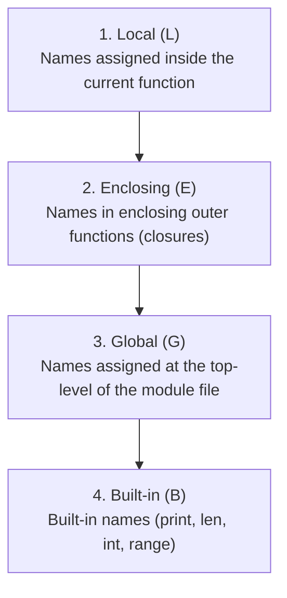

import { Callout } from "fumadocs-ui/components/callout";
import { Tabs, Tab } from "fumadocs-ui/components/tabs";
import { Accordion, Accordions } from "fumadocs-ui/components/accordion";

As your programs expand beyond a few lines, repeating code becomes a major source of bugs. Functions allow you to break your program into small, named, reusable blocks of logic.

---

## 1. Defining & Calling Functions

Use the `def` keyword to define a function, followed by its name, parentheses for parameters, and a colon:

```python
def greet_user(first_name, last_name):
    print(f"Hello, {first_name} {last_name}!")
    print("Welcome aboard.")

greet_user("John", "Smith")
```

Output:

```text
Hello, John Smith!
Welcome aboard.
```

### Parameters vs Arguments

- **Parameter**: The variable placeholder declared in the function definition (`first_name`, `last_name`).
- **Argument**: The actual value passed into the function during a call (`"John"`, `"Smith"`).

---

## 2. Return Values & `None`

Functions can compute and pass data back to the caller using the `return` statement:

```python
def square(number):
    return number * number

result = square(4)
print("Square:", result)
```

Output:

```text
Square: 16
```

<Callout type="note" title="Default Return: None">
  If a Python function finishes execution without hitting an explicit{" "}
  <code>return</code> statement, it automatically returns <code>None</code>. In
  Python, <code>None</code> is a special object representing the absence of a
  value.
</Callout>

---

## 3. Positional vs. Keyword Arguments

When invoking a function, you can supply arguments positionally or explicitly by name:

```python
def calculate_price(price, tax=0.05, discount=0.0):
    return (price * (1 + tax)) - discount

# 1. Positional arguments (matched strictly by order)
print(calculate_price(100, 0.08, 10))

# 2. Keyword arguments (explicit, order doesn't matter)
print(calculate_price(price=100, discount=10, tax=0.08))
```

Output:

```text
98.0
98.0
```

---

## 4. The Infamous Mutable Default Argument Trap

Consider this seemingly innocent function:

```python
# ❌ DANGEROUS BUG: Default list evaluated once at definition!
def add_item(item, basket=[]):
    basket.append(item)
    return basket

print(add_item("Apple"))
print(add_item("Banana"))
```

Run this code:

```text
['Apple']
['Apple', 'Banana']
```

Notice what happened: the second call preserved `"Apple"` from the first call!

<Callout type="error" title="Why Did This Happen?">
  In Python, default function arguments are{" "}
  <strong>evaluated only once when the function is defined</strong>, not every
  time it is called. That means the list <code>[]</code> is shared across all
  function calls that omit the second argument!
</Callout>

### The Idiomatic Fix: Use `None` as the Sentinel

```python
# ✅ IDIOMATIC PATTERN: Sentinel None
def add_item(item, basket=None):
    if basket is None:
        basket = []  # A fresh new list is created on every call
    basket.append(item)
    return basket

print(add_item("Apple"))
print(add_item("Banana"))
```

Output:

```text
['Apple']
['Banana']
```

---

## 5. Variable Scoping: The LEGB Rule

When Python encounters a variable name inside a function, it searches for it in four hierarchical scopes:



If the name is not found in any of these four tiers, Python raises a `NameError`.

---

## 6. Modern Python 3.12+ Type Annotations

Modern Python allows you to specify type annotations directly in your function signatures. This provides rich IDE autocompletion and enables static type checking with tools like `mypy` or `pyright`:

```python
def compute_inventory(
    items: list[str],
    prices: dict[str, float],
    tax_rate: float = 0.08
) -> float:
    total: float = sum(prices.get(item, 0.0) for item in items)
    return total * (1.0 + tax_rate)

receipt = compute_inventory(["pen", "notebook"], {"pen": 1.5, "notebook": 4.0})
print(f"Total: ${receipt:.2f}")
```

Output:

```text
Total: $5.94
```

---

## Practice Questions & Challenges

Deepen your understanding of default arguments, variable scopes, argument syntax rules, variadic unpacking, and writing pure functions.

### Question 1: Output Prediction (The Mutable Default Argument Trap)

Carefully examine this function and predict the output of each print statement:

```python
def enroll_student(name: str, roster: list = []) -> list:
    roster.append(name)
    return roster

batch_1 = enroll_student("Alice")
batch_2 = enroll_student("Bob")
batch_3 = enroll_student("Charlie", ["David"])
batch_4 = enroll_student("Eve")

print("batch_1:", batch_1)
print("batch_2:", batch_2)
print("batch_3:", batch_3)
print("batch_4:", batch_4)
```

1. What is printed for each batch?
2. Why does `batch_2` contain both `"Alice"` and `"Bob"` instead of just `"Bob"`?
3. When does Python evaluate default argument expressions?
4. How do you rewrite the function using the `None` sentinel pattern?

<Accordions>
<Accordion title="Reveal Solution & Explanation">

**Output:**

```text
batch_1: ['Alice', 'Bob', 'Eve']
batch_2: ['Alice', 'Bob', 'Eve']
batch_3: ['David', 'Charlie']
batch_4: ['Alice', 'Bob', 'Eve']
```

**Why this happened:**

1. In Python, default argument expressions are evaluated **once, when the function definition is first executed at module load time**, NOT every time the function is called!
2. The empty list `[]` was created once in memory and permanently attached to the function object.
3. Every call to `enroll_student` that does not supply a second argument appends to that **exact same list in memory**.
4. In `batch_3`, an explicit list `["David"]` was provided, so the default list was bypassed.
5. In `batch_4`, the default list was used again, appending `"Eve"` to `['Alice', 'Bob']`.

**The Universal Fix (`None` Sentinel Pattern):**
Always use immutable `None` as the default value for mutable parameters:

```python
def enroll_student(name: str, roster: list | None = None) -> list:
    if roster is None:
        roster = []
    roster.append(name)
    return roster

print(enroll_student("Alice"))  # ['Alice']
print(enroll_student("Bob"))    # ['Bob']
```

</Accordion>
</Accordions>

---

### Question 2: Spot and Fix the Bug (`UnboundLocalError` & Scope Binding)

A developer wants to track how many times a user fails authentication:

```python
login_attempts = 0

def record_failed_attempt():
    login_attempts += 1
    print(f"Failed attempts: {login_attempts}")

record_failed_attempt()
```

1. What exact exception crashes this script?
2. Why does Python consider `login_attempts` local even though a global variable with that exact name exists?
3. How can you refactor this without using the bad practice `global` keyword?

<Accordions>
<Accordion title="Reveal Solution & Explanation">

**1. The Exception:**

```text
UnboundLocalError: cannot access local variable 'login_attempts' where it is not associated with a value
```

**2. Why it happens (Lexical Scope Binding):**
When Python parses a function, if any statement inside the function assigns to a variable name (`login_attempts += 1` expands to `login_attempts = login_attempts + 1`), Python classifies that variable as **local to the function for the entire body**.
When the interpreter tries to read `login_attempts + 1`, the local variable has not been assigned a value yet, triggering `UnboundLocalError`.

**3. The Clean Refactoring:**
While you could write `global login_attempts`, modifying global state inside functions produces tightly coupled code that is difficult to test and debug.
The clean, modern approach is to pass state in and return the updated state (pure function) or encapsulate it in a class:

```python
# Pure functional approach:
def record_failed_attempt(current_count: int) -> int:
    new_count = current_count + 1
    print(f"Failed attempts: {new_count}")
    return new_count

login_attempts = 0
login_attempts = record_failed_attempt(login_attempts)  # 1
login_attempts = record_failed_attempt(login_attempts)  # 2
```

</Accordion>
</Accordions>

---

### Question 3: Parameter Syntax Validation (Positional vs Keyword Ordering)

Examine the following code snippets. Which ones are illegal in Python, and why?

```python
# Snippet A (Function Definition):
def send_email(subject, template="default.html", recipient):
    pass

# Snippet B (Function Call):
def connect(host, port=5432, timeout=30):
    pass

connect(host="db.internal.net", 5432)

# Snippet C (Function Call):
connect("db.internal.net", timeout=10)
```

<Accordions>
<Accordion title="Reveal Solution & Explanation">

**Results:**

- **Snippet A is INVALID**: Raises `SyntaxError: non-default argument 'recipient' follows default argument`.
- **Snippet B is INVALID**: Raises `SyntaxError: positional argument follows keyword argument`.
- **Snippet C is VALID**: Cleanly passes `"db.internal.net"` as `host`, uses the default `port=5432`, and overrides `timeout=10`.

**The Iron Rule of Python Argument Grammar:**
In both function definitions and function calls:

> **Positional arguments MUST ALWAYS appear before keyword/default arguments.**

Once you use a keyword argument or default parameter, every subsequent parameter must also be explicit or have a default.

</Accordion>
</Accordions>

---

### Question 4: Variadic Arguments (`*args` and `**kwargs`) Mechanics

Trace this function and explain the types and values received inside:

```python
def configure_server(env: str, *features: str, **settings: int | bool) -> None:
    print("env:", env)
    print("features:", features, "| type:", type(features))
    print("settings:", settings, "| type:", type(settings))

configure_server("prod", "cache", "ssl", "metrics", port=8000, workers=4, debug=False)
```

<Accordions>
<Accordion title="Reveal Solution & Explanation">

**Output:**

```text
env: prod
features: ('cache', 'ssl', 'metrics') | type: <class 'tuple'>
settings: {'port': 8000, 'workers': 4, 'debug': False} | type: <class 'dict'>
```

**Key Takeaways:**

- **`*features`**: Collects all remaining positional arguments into an **immutable tuple**.
- **`**settings`**: Collects all remaining keyword arguments into a **standard dictionary\*\*.
- This enables functions to accept arbitrary configurations without changing their formal signature.

</Accordion>
</Accordions>

---

### Question 5: Code Challenge (Pure Function & Type Hints)

Write a pure, fully type-annotated function:

```python
def filter_and_format_users(
    users: list[dict],
    min_age: int = 18
) -> list[str]:
    ...
```

Requirements:

1. Input is a list of user dictionaries: `[{"name": "alice smith", "age": 21}, {"name": "bob", "age": 15}]`.
2. Filter out any users whose `"age"` is strictly less than `min_age`.
3. Return a new list of strings with each name formatted in Title Case followed by their age in brackets: `["Alice Smith [Age: 21]"]`.
4. Ensure the function is **pure**: it must NOT mutate the original `users` list or dictionaries.

<Accordions>
<Accordion title="Reveal Solution & Code">

```python
def filter_and_format_users(
    users: list[dict],
    min_age: int = 18
) -> list[str]:
    """Filters users by age and formats their profile strings without mutating input."""
    formatted_profiles = []

    for user in users:
        if user.get("age", 0) >= min_age:
            clean_name = user.get("name", "").title()
            age = user.get("age")
            formatted_profiles.append(f"{clean_name} [Age: {age}]")

    return formatted_profiles

# Verification:
input_data = [
    {"name": "ada lovelace", "age": 28},
    {"name": "timmy turner", "age": 10},
    {"name": "alan turing", "age": 41}
]

result = filter_and_format_users(input_data)
print("Result:", result)
# Output: ['Ada Lovelace [Age: 28]', 'Alan Turing [Age: 41]']

# Verify input purity:
print("Input untouched?", input_data[0]["name"] == "ada lovelace")  # True
```

</Accordion>
</Accordions>

---

## Summary Reference

- **`def func(arg):`**: Defines a function.
- **`return`**: Returns a value; returns `None` if omitted.
- **Keyword arguments**: Increase call-site readability (`func(rate=0.05)`).
- **Default arguments**: Never use mutable containers (`[]`, `{}`); always use `None` as a sentinel.
- **LEGB Scope**: Local → Enclosing → Global → Built-in.

Next, learn how to document code cleanly in **[10. Comments: Documenting Your Code for Humans](/docs/learn-python/01-fundamentals/10-comments-and-code-documentation)**!
