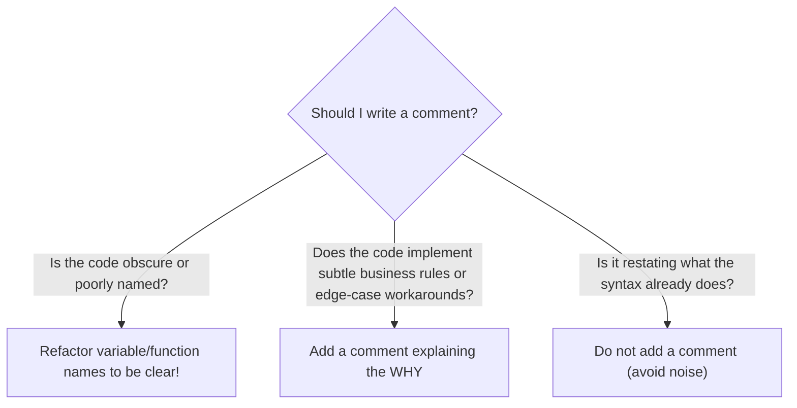

import { Callout } from "fumadocs-ui/components/callout";
import { Accordion, Accordions } from "fumadocs-ui/components/accordion";

Computers don't care how readable your source code is. The Python interpreter converts code directly into bytecode and executes it regardless of formatting.

**Humans, however, care deeply.**

In software engineering, you will read code far more often than you write it. Whether reviewing your own code six months later or collaborating with team members across the globe, writing clean comments and code documentation is an essential engineering skill.

---

## 1. Single-Line Comments with `#`

Python uses the hash symbol (`#`) for comments. Any text following a `#` on that line is completely ignored by the Python interpreter:

```python
# Calculate total price with 8% sales tax
subtotal = 120.0
tax_rate = 0.08
total = subtotal * (1 + tax_rate)

print(f"Total: ${total:.2f}")
```

Output:

```text
Total: $129.60
```

When Python parses this file:

1. It encounters `# Calculate total price...` and skips straight to the next line.
2. It assigns `subtotal = 120.0`.
3. It computes `total` and prints the output.

---

## 2. Inline Comments

An **inline comment** sits on the exact same line as an executable code statement:

```python
timeout_seconds = 30  # Default socket timeout recommended by RFC 2616
retry_count = 3       # Max retry attempts before failing over
```

### PEP 8 Formatting Guidelines for Inline Comments

Python's official style guide ([PEP 8](https://peps.python.org/pep-0008/)) defines two key rules for inline comments:

- **Two spaces**: Separate the comment from your code statement by at least **two spaces**.
- **One space after `#`**: Always put a single space between `#` and the first word of your comment.

```python
# ❌ Bad formatting: crowded and messy
x = 5#set x to 5

# ✅ Pythonic formatting: clear and spaced
x = 5  # Set x to 5
```

---

## 3. The Golden Rule: Explain "Why", Not "What"

The most common trap beginner programmers fall into is **stating the obvious**:

```python
# ❌ BAD: Explaining "What" (the code already says this!)
# Create a variable called age and set it to 20
age = 20

# Add 1 to age
age = age + 1

# Print the age
print(age)
```

Good code is **self-documenting** — variable and function names should explain _what_ is happening. Comments should explain the non-obvious business logic, technical decisions, or workarounds:

```python
# ✅ GOOD: Explaining "Why" (intent, domain knowledge, or constraints)

# Users under 13 require parental consent per COPPA regulations
COPPA_MIN_AGE = 13
is_coppa_exempt = user_age >= COPPA_MIN_AGE

# Subtract 1 millisecond so the timestamp falls within the current billing cycle
cycle_end_timestamp = next_month_start - 0.001
```



---

## 4. Multi-Line Comments & Docstrings (`"""`)

Unlike C-family languages that have `/* ... */`, Python does not have a distinct multi-line comment token. Instead, you have two options:

### Option A: Multiple `#` Lines (Recommended for Block Comments)

Use sequential `#` characters to explain multi-step processes or architecture:

```python
# -------------------------------------------------------------
# Authentication Pipeline:
# 1. Decode incoming bearer JWT token
# 2. Verify signature against public JWKS key
# 3. Check token expiration timestamp (exp)
# -------------------------------------------------------------
def verify_token(token: str) -> bool:
    ...
```

### Option B: Docstrings (Documentation Strings)

When a string literal wrapped in triple quotes (`"""..."""` or `'''...'''`) appears as the **first statement** inside a function, class, or module, Python treats it as a **docstring**:

```python
def calculate_compound_interest(principal: float, rate: float, years: int) -> float:
    """
    Calculate annual compound interest for a financial account.

    Parameters:
        principal: Starting balance in dollars.
        rate: Annual interest rate as a decimal (e.g. 0.05 for 5%).
        years: Number of years the investment compounds.

    Returns:
        The total compounded balance.
    """
    return principal * ((1 + rate) ** years)
```

### Docstrings vs Regular Comments

The fundamental difference:

- Regular `#` comments are discarded by Python during tokenization.
- Docstrings are **retained at runtime** and attached to the object's `__doc__` attribute. Developer tools, IDE hover cards, and the built-in `help()` function use them to show documentation interactively:

```python
print(calculate_compound_interest.__doc__)
```

---

## 5. Temporarily Disabling Code (Commenting Out)

During testing and debugging, engineers frequently "comment out" code to isolate bugs without deleting lines permanently:

```python
user_id = 42

# send_verification_email(user_id)  <-- Disabled during local offline testing
print(f"Bypassed email verification for user {user_id}")
```

<Callout type="tip" title="Keyboard Shortcut">
  In VS Code, Cursor, and PyCharm: - Windows/Linux: Press <kbd>Ctrl</kbd> +{" "}
  <kbd>/</kbd> to toggle comments on any highlighted lines. - macOS: Press{" "}
  <kbd>Cmd</kbd> + <kbd>/</kbd>.
</Callout>

---

## Practice Questions & Challenges

Test your understanding of comments, PEP 8 inline rules, docstring compilation mechanics, and documentation architecture.

### Question 1: Output Prediction (Docstrings vs Comments at Runtime)

Without running Python, determine the exact terminal output of this script:

```python
# Script: inspect_docs.py

# This function computes the cube of a number
def calculate_cube(n: int) -> int:
    # Inline note: multiply n three times
    """Compute and return n raised to the third power."""
    return n ** 3

print("Docstring output:")
print(calculate_cube.__doc__)

print("Comment presence:")
print(hasattr(calculate_cube, "# This function"))
```

<Accordions>
<Accordion title="Reveal Solution & Explanation">

```text
Docstring output:
Compute and return n raised to the third power.
Comment presence:
False
```

**Why this happens:**

- Comments beginning with `#` are discarded by the Python tokenizer during lexical analysis. They do **not** exist in the compiled bytecode or in memory at runtime.
- In contrast, triple-quoted strings placed as the first statement in a function body are treated as **docstrings**. The compiler binds them directly to the function object's `__doc__` attribute and places them in the code object's constants table (`__code__.co_consts`).

</Accordion>
</Accordions>

---

### Question 2: Spot and Fix the Bug (Misplaced Docstrings & Dangerous Comments)

A junior engineer writes this module in `tax.py`:

```python
def compute_sales_tax(subtotal: float, state_code: str) -> float:
    rate = 0.08  # Default tax rate
    """Calculate the state sales tax based on the subtotal."""

    # Check if exempt
    if state_code == "OR" or state_code == "NH":
        return 0.0

    # Apply 10% standard rate
    return subtotal * rate
```

1. Why will `compute_sales_tax.__doc__` return `None`?
2. What dangerous inconsistency exists between the comment and the code on line 10?
3. Rewrite the function following PEP 257 and clean documentation practices.

<Accordions>
<Accordion title="Reveal Solution & Explanation">

**The Bugs:**

1. **Misplaced Docstring**: A docstring **must be the very first statement** inside the function body. Because `rate = 0.08` precedes the triple-quoted string, Python treats the string as a useless orphaned expression rather than a docstring, leaving `__doc__` as `None`.
2. **Outdated/Lying Comment**: The comment says `# Apply 10% standard rate`, but the code multiplies by `rate` (which was set to `0.08`, i.e., 8%). Outdated comments that contradict code are worse than no comments at all because they mislead engineers during debugging!

**Corrected Code:**

```python
def compute_sales_tax(subtotal: float, state_code: str) -> float:
    """
    Calculate the state sales tax based on the subtotal and jurisdiction.

    Exempt states (e.g. Oregon 'OR', New Hampshire 'NH') return a $0.00 tax obligation.
    """
    EXEMPT_STATES = {"OR", "NH"}
    if state_code.upper() in EXEMPT_STATES:
        return 0.0

    STANDARD_RATE = 0.08
    return subtotal * STANDARD_RATE
```

</Accordion>
</Accordions>

---

### Question 3: Architecture Question (Why Does Bytecode Discard Comments?)

When CPython creates a `.pyc` file inside `__pycache__/`:

1. Why does the compiler strip all single-line `#` comments from the bytecode?
2. Does stripping comments make Python programs run faster or consume less RAM?

<Accordions>
<Accordion title="Reveal Solution & Explanation">

**1. Compilation Mechanics:**
During the lexical analysis phase, CPython converts raw source text into a stream of tokens. The tokenizer matches `#` and everything following it up to the newline character and skips it entirely—comments never make it into the Abstract Syntax Tree (AST) or the compiled bytecode instructions.

**2. Performance Impact:**

- **At runtime**: Stripping comments has **zero impact on execution speed** because the runtime virtual machine only evaluates opcodes. However, it saves RAM and disk space because comments don't inflate the `.pyc` file or occupy memory heap allocations.
- **At parse time**: Python can parse clean files slightly faster, but the real benefit is keeping compiled distributions lean and secure (comments often contain internal developer notes not meant for end-user bundles).

</Accordion>
</Accordions>

---

### Question 4: Hands-On Refactoring (The Cryptic Pricing Function)

Look at this poorly documented code snippet and refactor it with clean, professional comments and docstrings:

```python
# take p and d
def f(p, d):
    # if d > 0.5
    if d > 0.5:
        # return p - p * 0.5
        return p * 0.5
    # return p - p * d
    return p * (1 - d)
```

<Accordions>
<Accordion title="Reveal Solution & Explanation">

```python
def apply_promotional_discount(original_price: float, discount_rate: float) -> float:
    """
    Calculate the discounted price for an item.

    Discounts are capped at a maximum of 50% (0.50) to protect store profit margins.
    """
    # Safeguard: cap promotional discounts to prevent selling below cost
    MAX_DISCOUNT_CAP = 0.50
    effective_discount = min(discount_rate, MAX_DISCOUNT_CAP)

    return original_price * (1 - effective_discount)
```

**Key Improvements:**

1. Renamed cryptic variables `f`, `p`, `d` to self-documenting names `apply_promotional_discount`, `original_price`, `discount_rate`.
2. Removed redundant comments that simply repeated the arithmetic.
3. Added a clear docstring describing the business purpose and boundary condition.
4. Added an explanatory comment on _why_ the 50% cap exists.

</Accordion>
</Accordions>

---

### Question 5: Code Challenge (Production Self-Documenting Financial Function)

Write a production-quality function `calculate_loan_amortization` that calculates the monthly payment for a fixed-rate loan.

Formula:
$$M = P \frac{r(1 + r)^n}{(1 + r)^n - 1}$$
Where:

- $P$ is principal loan amount.
- $r$ is monthly interest rate (annual interest rate / 12).
- $n$ is total number of monthly payments (years \* 12).

Requirements:

1. Provide a standard Google-style docstring documenting `Args:`, `Returns:`, and `Raises:`.
2. Include type annotations for all parameters and the return value.
3. Check if principal or years are $\le 0$, and raise a `ValueError` with an explanatory message.
4. If the annual rate is $0\%$, calculate payment directly as $P / n$ to avoid division by zero.

<Accordions>
<Accordion title="Reveal Solution & Code">

```python
def calculate_monthly_payment(
    principal: float,
    annual_rate: float,
    years: int
) -> float:
    """
    Compute the fixed monthly payment for a fully amortized loan.

    Args:
        principal: The total amount borrowed in dollars (must be > 0).
        annual_rate: Annual interest rate expressed as a decimal (e.g. 0.05 for 5%).
        years: The duration of the loan in whole years (must be > 0).

    Returns:
        The monthly payment rounded to 2 decimal places.

    Raises:
        ValueError: If principal or years are less than or equal to zero.
    """
    if principal <= 0 or years <= 0:
        raise ValueError("Principal and loan duration must both be positive values.")

    total_months = years * 12

    # Handle zero-interest special promotional loans to prevent division by zero
    if annual_rate == 0:
        return round(principal / total_months, 2)

    monthly_rate = annual_rate / 12
    # Compound multiplier: (1 + r)^n
    compound_factor = (1 + monthly_rate) ** total_months
    monthly_payment = principal * (monthly_rate * compound_factor) / (compound_factor - 1)

    return round(monthly_payment, 2)

# Verification
if __name__ == "__main__":
    payment = calculate_monthly_payment(principal=250_000, annual_rate=0.065, years=30)
    print(f"Monthly Mortgage Payment: ${payment:,.2f}")
    # Output: Monthly Mortgage Payment: $1,580.17
```

</Accordion>
</Accordions>

---

## Summary Reference

- **`#`**: Single-line comment; ignored by the interpreter.
- **Inline comments**: Separate from code by 2 spaces, followed by `#` and 1 space.
- **`"""..."""` Docstrings**: Placed as the first statement in functions/classes/modules; available at runtime via `help()` and `.__doc__`.
- **Golden rule**: Code tells _how_, variable names tell _what_, comments explain _why_.

Next, let's explore what happens when programs crash in **[11. Python Errors: Understanding When Code Doesn't Run](/docs/learn-python/01-fundamentals/11-understanding-errors-and-debugging)**!
