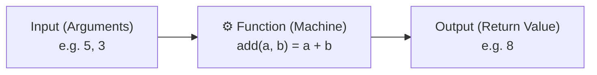
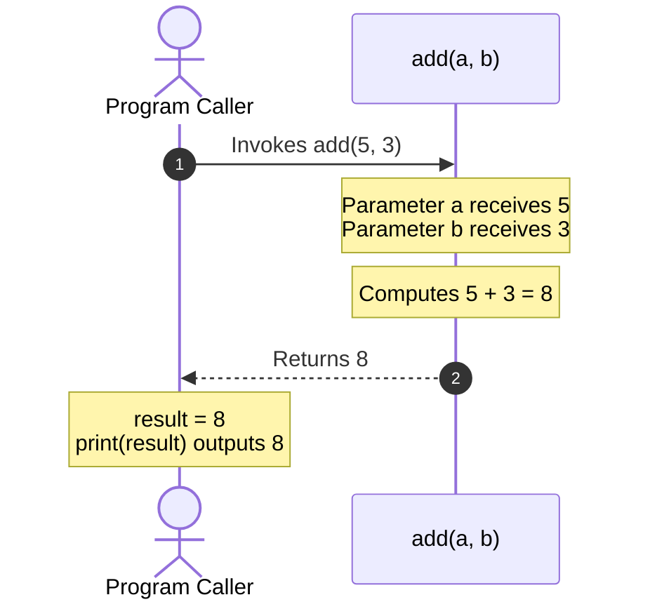
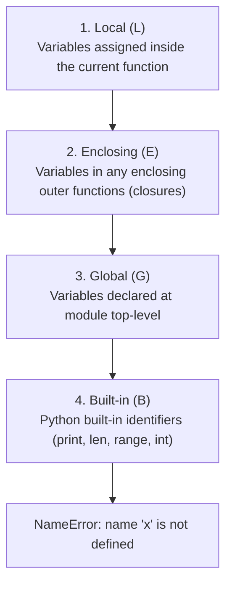

import { Callout } from "fumadocs-ui/components/callout";
import { Tabs, Tab } from "fumadocs-ui/components/tabs";
import { Accordion, Accordions } from "fumadocs-ui/components/accordion";

As programs grow beyond basic scripts, repeating code becomes a major source of bugs, maintenance overhead, and technical debt. **Functions** are the foundational building blocks of clean software: they allow you to bundle logic into named, modular, reusable, and testable units.

In this comprehensive guide, we cover the complete spectrum of Python functions—from your very first function to production-grade architecture:

1. **Python Functions — Explained from Zero**: The machine mental model, your first function, parameters vs. arguments, `return` vs. `print`, and beginner exercises.
2. **Five Essential Concepts**: Variable scoping (Local vs. Global), multiple return values, variadic positional arguments (`*args`), variadic keyword arguments (`**kwargs`), and lambda functions.
3. **Advanced Function Anatomy & Clean Code Patterns**: Docstrings (PEP 257), early returns, and guard clauses (The Bouncer Pattern).
4. **The Complete Python Parameter & Argument Model**: Positional vs. keyword rules, call-site unpacking (`*`, `**`), keyword-only parameters (`*`), positional-only parameters (`/`), and the full signature hierarchy.
5. **The Infamous Mutable Default Argument Trap**: Root cause, evaluation at module load time, and the universal `None` sentinel pattern.
6. **Variable Scoping & The LEGB Rule**: Local, Enclosing, Global, and Built-in scopes, `global` vs. `nonlocal`, closures, and the compile-time `UnboundLocalError` trap.
7. **First-Class Functions & Higher-Order Design**: Functions as objects, dispatch tables, and callbacks.
8. **Modern Python 3.10+ Type Annotations**: Type hints, built-in generic collections (`list[T]`, `dict[K, V]`), union syntax (`X | Y`), and `Callable`.
9. **Interactive Exercises & Production Challenges**: Knowledge-check quizzes and real-world debugging challenges.

---

## 1. Python Functions — Explained from Zero

A function in Python is a reusable block of code that performs a specific task.

Think of it like a **machine**: you give it some input, it performs an operation, and it may give you an output.



For example, instead of writing the same addition code 10 times, you create a function once and call it whenever you need it.

### Your First Python Function

Here is the simplest possible function in Python:

```python
def greet():
    print("Hello, Abhishek!")

# Calling the function
greet()
```

Output:

```text
Hello, Abhishek!
```

Let's break down what every part does:

1. **`def`**: Short for "define". It tells Python that you are creating a new function.
2. **`greet()`**: The function's name is `greet`. The parentheses `()` are where you can specify inputs (parameters). Even if a function takes no inputs, the parentheses are mandatory.
3. **`:` (colon)**: Signals the start of the function body.
4. **`print("Hello, Abhishek!")`**: The indented block (standard PEP 8 uses **4 spaces**) is the body of code that executes whenever the function is invoked.
5. **`greet()`**: Calls (executes) the function.

<Callout type="info" title="Defining vs. Executing">
  Defining a function does **not** execute its body. Python stores the
  instructions in memory. The body runs only when you explicitly **call**
  (invoke) the function using its name followed by parentheses `greet()`.
</Callout>

---

### Why Do We Need Functions?

Imagine you need to print a greeting three times in different places in your script.

**Without a function (copy-pasting code):**

```python
print("Hello!")
print("Hello!")
print("Hello!")
```

**With a function (modular and reusable):**

```python
def greet():
    print("Hello!")

greet()
greet()
greet()
```

Both produce the exact same output:

```text
Hello!
Hello!
Hello!
```

**Why the function approach is vastly superior:**

- **DRY (Don't Repeat Yourself)**: If you want to change `"Hello!"` to `"Welcome!"`, you only edit one place instead of hunting through hundreds of lines.
- **Maintainability & Testing**: You can test, isolate, and debug each piece of logic independently.
- **Readability**: Well-named functions make code self-documenting.

---

### Functions with Parameters

What if you want to greet different people? You can pass information into a function using **parameters**.

```python
def greet(name):
    print(f"Hello, {name}!")

greet("Abhishek")
greet("Rahul")
greet("Aman")
```

Output:

```text
Hello, Abhishek!
Hello, Rahul!
Hello, Aman!
```

#### The Crucial Distinction: Parameters vs. Arguments

People often use these terms interchangeably, but they have precise meanings:

- **Parameter**: The variable declared inside the function parentheses in the definition (`name`). It acts as a placeholder that receives input.
- **Argument**: The concrete value passed into the function when you invoke it (`"Abhishek"`, `"Rahul"`, `"Aman"`).
- **Function Call**: The syntax that triggers execution: `greet("Abhishek")`.

When Python executes `greet("Abhishek")`, the parameter `name` receives the argument `"Abhishek"`.

---

### Functions That Return Values

This is one of the most important concepts in programming.

Functions can compute a result and send it back to whoever called them using the **`return`** keyword:

```python
def add(a, b):
    return a + b

result = add(5, 3)
print(result)
```

Output:

```text
8
```

#### Step-by-Step Execution Walkthrough



1. **Function call**: The program hits `add(5, 3)`.
2. **Parameters receive values**: `a = 5`, `b = 3`.
3. **Calculation**: `5 + 3 = 8`.
4. **Return value**: `8` is sent back to the call site and assigned to `result`.

#### `print()` vs. `return`

A very common beginner confusion is mixing up `print()` and `return`. They serve completely different purposes:

| Feature                  | `print()`                                                   | `return`                                                                                     |
| :----------------------- | :---------------------------------------------------------- | :------------------------------------------------------------------------------------------- |
| **Primary Purpose**      | Displays text on the terminal screen for humans.            | Passes a value back to the program for further calculation.                                  |
| **Usability**            | The output disappears into the console; code cannot use it. | The returned value can be stored in a variable, passed to another function, or used in math. |
| **Terminates Function?** | No. Execution continues to the next line.                   | **Yes.** Exits the function immediately.                                                     |

Examine this demonstration carefully:

```python
def add_print(a, b):
    print(a + b)

def add_return(a, b):
    return a + b

x = add_print(2, 3)   # Prints 5 immediately to console
y = add_return(2, 3)  # Does not print anything, but returns 5

print("x is:", x)
print("y is:", y)
```

Output:

```text
5
x is: None
y is: 5
```

<Callout type="warn" title="Why is x equal to None?">
  Because <code>add_print()</code> displayed <code>5</code> on the screen but
  did not use the <code>return</code> keyword. In Python, whenever a function
  finishes executing without hitting an explicit <code>return</code>, it
  automatically returns <code>None</code>!
  <br />
  <br />
  <strong>Golden Rule:</strong> Use <code>return</code> when you want to
  calculate a result and use it elsewhere in your program. Use{" "}
  <code>print()</code> only when you want to show something to the user.
</Callout>

---

### Default Parameters

You can provide a default fallback value for a parameter. If the caller does not supply an argument, Python uses the default:

```python
def greet(name="Guest"):
    print(f"Hello, {name}!")

greet()            # No argument provided -> uses default "Guest"
greet("Abhishek")  # Argument provided -> overrides default
```

Output:

```text
Hello, Guest!
Hello, Abhishek!
```

When you call `greet()` without an argument, Python assigns `"Guest"` to `name`. When you supply `"Abhishek"`, that value is used instead.

---

### Functions with Multiple Parameters

A function can accept multiple inputs, perform complex calculations, and return the result:

```python
def calculate_total(price, quantity):
    total = price * quantity
    return total

bill = calculate_total(100, 3)
print(bill)
```

Output:

```text
300
```

Here, `price = 100` and `quantity = 3`, so the function returns `100 * 3 = 300`. This is how functions organize real applications, from computing shopping cart balances to validating authentication tokens.

---

### A Function Can Return Any Data Type

In Python, functions can return strings, integers, floats, lists, dictionaries, Booleans, or even other functions:

```python
def get_user():
    return {
        "name": "Abhishek",
        "age": 21,
        "developer": True
    }

user = get_user()
print("Name:", user["name"])
print("Age:", user["age"])
print("Is Developer?", user["developer"])
```

Output:

```text
Name: Abhishek
Age: 21
Is Developer? True
```

---

### Your Turn: Practice Functions (Beginner Exercises)

Try solving these three exercises on your own before checking the answers.

<Accordions>
<Accordion title="Exercise 1 — Basic Function">

**Task:** Write a function named `say_hello` that prints `"Hello, World!"` and call it.

```python
def say_hello():
    print("Hello, World!")

# Calling the function:
say_hello()
```

**Output:**

```text
Hello, World!
```

</Accordion>

<Accordion title="Exercise 2 — Parameters and Return">

**Task:** Write a function named `square` that accepts a number and returns its square. Call it with `4` and print the result.

```python
def square(number):
    return number * number

result = square(4)
print(result)
```

**Output:**

```text
16
```

</Accordion>

<Accordion title="Exercise 3 — Conditions Inside Functions">

**Task:** Write a function `is_even` that accepts an integer and returns `True` if it is even, otherwise `False`. Test it with `4` and `7`.

```python
def is_even(number):
    if number % 2 == 0:
        return True
    else:
        return False

# Idiomatic shortcut:
# def is_even(number):
#     return number % 2 == 0

print(is_even(4))  # True
print(is_even(7))  # False
```

**Output:**

```text
True
False
```

</Accordion>
</Accordions>

#### What You Should Remember So Far

- `def` tells Python you are defining a function.
- **Parameters** act as placeholders in the definition; **arguments** are the actual values passed during the call.
- Calling a function executes its body.
- `return` sends a result back to the caller; without an explicit `return`, Python returns `None`.
- Functions eliminate repeated code and make logic modular and testable.

---

## 2. Five Essential Concepts: Scope, Multiple Returns, \*args, \*\*kwargs & Lambdas

These five concepts build directly on the foundations of `def`, parameters, and `return`.

### 1. Scope: Local vs. Global Variables

**Scope** determines where a variable is visible and accessible in your code.

#### A. Local Variables

A variable created inside a function is **local** to that function. It exists only while the function is executing and disappears once the function finishes:

```python
def greet():
    message = "Hello!"
    print(message)

greet()

# Attempting to access message outside:
print(message)  # ❌ NameError!
```

Output:

```text
Hello!
NameError: name 'message' is not defined
```

**Why?**

- Inside `greet()`: `message` exists and is accessible.
- Outside `greet()`: `message` is invisible to the outer code because it is local to `greet()`.

#### B. Global Variables

A variable defined outside all functions is **global** to the module:

```python
name = "Abhishek"

def greet():
    print(name)  # Can read global variable

greet()
print(name)
```

Output:

```text
Abhishek
Abhishek
```

Functions can read global variables because the global scope encloses the function.

#### C. Modifying a Global Variable (and the `global` Keyword)

Examine what happens when you try to change a global variable:

```python
count = 0

def increase():
    count = 5  # Does this change the global count?

increase()
print(count)
```

Output:

```text
0
```

**Why didn't `count` become 5?**
Because Python sees the assignment `count = 5` inside `increase()` and creates a **brand-new local variable** named `count`. It leaves the global `count` completely untouched!

To explicitly tell Python you want to modify the global variable, use the `global` keyword:

```python
count = 0

def increase():
    global count
    count = 5

increase()
print(count)
```

Output:

```text
5
```

<Callout type="warn" title="Best Practice: Avoid global in Production Code">
  Avoid using the <code>global</code> keyword for ordinary application logic. Modifying global variables creates hidden side effects that make programs unpredictable, hard to test, and difficult to debug.
  <br /><br />
  <strong>The Clean Alternative:</strong> Pass state into the function as an argument and return the updated value:
  <br />
  ```python
  def increase(count):
      return count + 1

count = 0
count = increase(count)
print(count) # 1

````
This makes the dependencies explicit and keeps functions pure!
</Callout>

---

### 2. Multiple Return Values

In Python, a function can return more than one value in a single `return` statement:

```python
def calculate(a, b):
  addition = a + b
  subtraction = a - b
  return addition, subtraction

result = calculate(10, 4)
print(result)
print(type(result))
````

Output:

```text
(14, 6)
<class 'tuple'>
```

#### How Does It Work?

When Python encounters comma-separated values in `return addition, subtraction`, it automatically **packs** them into an immutable `tuple`.

You can unpack those values into separate variables at the call site:

```python
def calculate(a, b):
    return a + b, a - b

sum_result, difference = calculate(10, 4)
print("Sum:", sum_result)          # 14
print("Difference:", difference)  # 6
```

You can return three, four, or more values:

```python
def get_user():
    return "Abhishek", 21, "Developer"

name, age, role = get_user()
print(name)  # Abhishek
print(age)   # 21
print(role)  # Developer
```

**When is this useful?**
When one logical operation naturally computes multiple related outputs, such as coordinates `(x, y)`, min and max stats `(min_val, max_val)`, or database status `(is_success, record_id)`.

---

### 3. `*args` — Accept Any Number of Positional Arguments

Suppose you want to write a function that sums numbers, but you don't know whether the user will pass 2, 5, or 20 numbers.

If you write `def add(a, b): return a + b`, callers are locked into exactly two arguments.

Instead, use **`*args`**:

```python
def add(*args):
    print("Received tuple:", args)
    return sum(args)

print(add(10, 20))
print(add(10, 20, 30))
print(add(1, 2, 3, 4, 5))
```

Output:

```text
Received tuple: (10, 20)
30
Received tuple: (10, 20, 30)
60
Received tuple: (1, 2, 3, 4, 5)
15
```

#### What's Happening?

- When you prefix a parameter with an asterisk `*`, Python collects all surplus positional arguments into a **tuple**.
- The name `args` is a universal convention, not a reserved keyword. The asterisk `*` does the work. You could name it `*numbers`:

```python
def add(*numbers):
    return sum(numbers)

print(add(5, 10, 15))  # 30
```

---

### 4. `**kwargs` — Accept Any Number of Keyword Arguments

Now imagine you want to accept user profile attributes, but different users have different optional fields (e.g. `age`, `city`, `twitter`, `role`).

Use **`**kwargs`\*\* (keyword arguments):

```python
def show_user(**kwargs):
    print(kwargs)
    print(type(kwargs))

show_user(name="Abhishek", age=21, role="Developer")
```

Output:

```text
{'name': 'Abhishek', 'age': 21, 'role': 'Developer'}
<class 'dict'>
```

Python collects all named keyword arguments into a standard **dictionary**:

- The argument names (`name`, `age`, `role`) become dictionary keys.
- The values (`"Abhishek"`, `21`, `"Developer"`) become dictionary values.

You can inspect or look up values inside the dictionary:

```python
def show_user(**kwargs):
    print("User Name:", kwargs.get("name"))
    print("User Age:", kwargs.get("age"))

show_user(name="Abhishek", age=21)
```

#### Comparison: `*args` vs. `**kwargs`

| Feature            | `*args`                                  | `**kwargs`                                       |
| :----------------- | :--------------------------------------- | :----------------------------------------------- |
| **Accepts**        | Arbitrary positional arguments           | Arbitrary keyword arguments (`key=value`)        |
| **Data Structure** | Packed into a **Tuple** `(item1, item2)` | Packed into a **Dictionary** `{"key": value}`    |
| **Example Call**   | `func(10, 20, 30)`                       | `func(name="Abhishek", role="Dev")`              |
| **Access Pattern** | By index: `args[0]`                      | By key: `kwargs["name"]` or `kwargs.get("name")` |

#### Combining `*args` and `**kwargs`

You can combine standard parameters, `*args`, and `**kwargs` in the same function:

```python
def display(*args, **kwargs):
    print("Positional:", args)
    print("Keyword:", kwargs)

display(10, 20, name="Abhishek", role="Developer")
```

Output:

```text
Positional: (10, 20)
Keyword: {'name': 'Abhishek', 'role': 'Developer'}
```

When combining with standard parameters:

```python
def example(required, *args, **kwargs):
    print("Required:", required)
    print("Args:", args)
    print("Kwargs:", kwargs)

example("Hello", 10, 20, name="Abhishek", active=True)
```

Output:

```text
Required: Hello
Args: (10, 20)
Kwargs: {'name': 'Abhishek', 'active': True}
```

<Callout type="warn" title="Parameter Order Matters!">
  Parameters must be defined in strict order:
  <br />
  <code>def func(standard_params, *args, **kwargs):</code>
  <br />
  Standard parameters come first, then <code>*args</code>, and finally{" "}
  <code>**kwargs</code>.
</Callout>

---

### 5. Lambda Functions — Small Anonymous Functions

A **lambda function** is a concise, one-line function written without the traditional `def` syntax.

**With a regular function:**

```python
def square(number):
    return number * number

print(square(5))  # 25
```

**With a lambda function:**

```python
square = lambda number: number * number

print(square(5))  # 25
```

Both yield identical results.

#### Syntax Breakdown

```text
lambda  parameter  :  expression
  │         │              │
keyword   input       evaluated and
                     returned automatically
```

- **`lambda` keyword**: Declares the anonymous function.
- **`parameter`**: The input variable(s).
- **`expression`**: A single expression that is evaluated and implicitly returned. Lambdas cannot contain multi-line statements, loops, or assignments.

#### Lambda with Multiple Parameters

```python
multiply = lambda a, b: a * b

print(multiply(4, 5))  # 20
```

#### Practical Use Case: Custom Sorting Keys

In idiomatic Python, you almost never assign lambdas to variable names (PEP 8 recommends `def` for named functions). Instead, lambdas shine as **inline throwaway functions** passed into `sort()`, `sorted()`, `min()`, or `max()`:

```python
users = [
    {"name": "Rahul", "age": 25},
    {"name": "Aman", "age": 19},
    {"name": "Abhishek", "age": 21}
]

# Sort users by age ascending:
users.sort(key=lambda user: user["age"])
print(users)
```

Output:

```text
[{'name': 'Aman', 'age': 19}, {'name': 'Abhishek', 'age': 21}, {'name': 'Rahul', 'age': 25}]
```

Here, `key=lambda user: user["age"]` tells Python to extract the `age` field from each dictionary and use it for comparison.

**Rule of Thumb:**

- Use **`lambda`** for short, throwaway, single-expression callbacks (e.g. sorting keys).
- Use **`def`** when the logic spans multiple lines, needs documentation/docstrings, or is reused throughout your project.

---

### Core Concepts Quick Revision

| Concept              | What It Does                                                  | Syntax Example                     |
| :------------------- | :------------------------------------------------------------ | :--------------------------------- |
| **Scope**            | Controls where a variable can be accessed (Local vs. Global). | Local inside `def`; Global outside |
| **Multiple Returns** | Returns multiple values packed into a tuple.                  | `return a, b`                      |
| **`*args`**          | Collects surplus positional arguments into a tuple.           | `def func(*args):`                 |
| **`**kwargs`\*\*     | Collects surplus keyword arguments into a dictionary.         | `def func(**kwargs):`              |
| **Lambda**           | Creates a small anonymous function with a single expression.  | `lambda x: x * 2`                  |

---

### Test Your Understanding (Knowledge Check)

Test yourself on these 4 questions:

<Accordions>
<Accordion title="Question 1: What will *args collect?">

```python
def test(*args):
    print(args)

test(1, 2, 3)
```

- **A)** `[1, 2, 3]` — a list
- **B)** `(1, 2, 3)` — a tuple
- **C)** `{"1": 2}` — a dictionary

**Answer:** **B: `(1, 2, 3)` — a tuple**
`*args` collects any extra positional arguments into an immutable tuple.

</Accordion>

<Accordion title="Question 2: What will this print?">

```python
x = 10

def change():
    x = 20

change()
print(x)
```

- **A)** `20`
- **B)** `10`
- **C)** An error (`NameError`)

**Answer:** **B: `10`**
The assignment `x = 20` inside `change()` creates a local variable `x` that shadows the global variable. It does not modify the outer global `x`, so `print(x)` displays `10`.

</Accordion>

<Accordion title="Question 3: What does **kwargs collect?">

- **A)** Extra positional arguments into a tuple
- **B)** Keyword arguments into a dictionary
- **C)** Only integer arguments

**Answer:** **B: Keyword arguments into a dictionary**
`**kwargs` captures all named arguments that do not match formal parameters and stores them as key-value pairs in a dictionary.

</Accordion>

<Accordion title="Question 4: What is the output of this lambda?">

```python
double = lambda x: x * 2
print(double(6))
```

- **A)** `6`
- **B)** `12`
- **C)** `x * 2`

**Answer:** **B: `12`**
The argument `6` is assigned to parameter `x`. The expression `x * 2` evaluates to `6 * 2 = 12`, which is implicitly returned.

</Accordion>
</Accordions>

---

## 3. Advanced Function Anatomy & Clean Code Patterns

Now that you understand function mechanics, let's explore professional coding patterns: docstrings, guard clauses, and early returns.

### Function Docstrings (PEP 257) & Introspection

Document your functions using a docstring immediately following the `def` line. These docstrings are attached to the function object's `__doc__` attribute and populate built-in help systems and IDE tooltips:

```python
def calculate_net_salary(gross_salary: float, tax_rate: float) -> float:
    """
    Compute net salary after deducting taxes.

    :param gross_salary: Total earnings before deductions.
    :param tax_rate: Fractional tax rate (e.g. 0.20 for 20%).
    :return: Take-home net salary.
    """
    tax_amount = gross_salary * tax_rate
    return gross_salary - tax_amount

# Invoking the function:
take_home = calculate_net_salary(100000.0, 0.25)
print(f"Take-home pay: ${take_home:,.2f}")  # Take-home pay: $75,000.00
print("Docstring:", calculate_net_salary.__doc__.strip())
```

### Early Returns & Guard Clauses (The Bouncer Pattern)

Deeply nested `if` statements create hard-to-read "arrow code". Use **guard clauses** with early `return` to validate inputs upfront and exit early:

<Tabs items={["Clean Guard Clauses (Recommended)", "Deeply Nested Anti-Pattern"]}>
<Tab value="Clean Guard Clauses (Recommended)">

```python
def process_order(user: dict | None, cart: list[str]) -> bool:
    if user is None:
        print("Error: User must be logged in.")
        return False

    if not user.get("is_verified"):
        print("Error: Account email not verified.")
        return False

    if not cart:
        print("Error: Cart is empty.")
        return False

    # Happy path executes flat with zero nesting!
    print(f"Order processed for {user['name']} with {len(cart)} items.")
    return True
```

</Tab>
<Tab value="Deeply Nested Anti-Pattern">

```python
def process_order(user: dict | None, cart: list[str]) -> bool:
    if user is not None:
        if user.get("is_verified"):
            if cart:
                print(f"Order processed for {user['name']} with {len(cart)} items.")
                return True
            else:
                print("Error: Cart is empty.")
                return False
        else:
            print("Error: Account email not verified.")
            return False
    else:
        print("Error: User must be logged in.")
        return False
```

</Tab>
</Tabs>

---

## 4. The Complete Python Argument Model (Advanced Hierarchy)

Python has one of the most expressive parameter systems of any programming language. Mastering it is essential for writing robust libraries and APIs.

### 1. Positional vs. Keyword Arguments at Call Site

```python
def send_notification(user_id: int, message: str, priority: str = "normal") -> None:
    print(f"[{priority.upper()}] Sending to User {user_id}: {message}")

# Positional arguments: matched strictly by order of appearance
send_notification(42, "Disk space low")

# Keyword arguments: explicit by parameter name (order does not matter!)
send_notification(message="Billing overdue", user_id=99, priority="high")
```

<Callout type="warn" title="Syntax Rule">
  Positional arguments <strong>must always come before</strong> keyword
  arguments at the call site:
  <br />
  <code>send_notification(42, message="Hello")</code> ✅ Valid
  <br />
  <code>send_notification(user_id=42, "Hello")</code> ❌{" "}
  <code>SyntaxError: positional argument follows keyword argument</code>
</Callout>

### 2. Argument Unpacking with `*` and `**`

You can use `*` and `**` at the **call site** to unpack existing collections into individual arguments:

```python
def connect_database(host: str, port: int, database: str) -> None:
    print(f"Connecting to postgres://{host}:{port}/{database}")

# Unpacking a list/tuple with *
server_coords = ("db-primary.cloud", 5432, "production_db")
connect_database(*server_coords)

# Unpacking a dictionary with **
db_config = {"host": "127.0.0.1", "port": 5432, "database": "local_dev"}
connect_database(**db_config)
```

### 3. Keyword-Only Arguments (`*`)

By placing a bare asterisk `*` in your parameter list, all parameters following it **cannot** be passed positionally—they must be passed by name:

```python
def create_button(label: str, *, is_rounded: bool = False, disabled: bool = False) -> None:
    print(f"Button '{label}' [rounded={is_rounded}, disabled={disabled}]")

# ✅ Explicit, self-documenting code:
create_button("Submit", is_rounded=True, disabled=False)

# ❌ Trying to pass by position raises TypeError:
# create_button("Submit", True, False)
# TypeError: create_button() takes 1 positional argument but 3 were given
```

<Callout type="tip" title="Why use Keyword-Only Arguments?">
  Keyword-only arguments prevent "boolean trap" bugs. In{" "}
  <code>create_button("Submit", True, False)</code>, someone reading the code
  has no idea what <code>True</code> and <code>False</code> mean without looking
  up the source definition. Forcing keyword arguments makes the call site
  readable and prevents accidental argument swaps.
</Callout>

### 4. Positional-Only Arguments (`/`)

Introduced in Python 3.8 (PEP 570), placing a forward slash `/` in your parameter list specifies that all parameters before it **must** be passed positionally and cannot be passed as keywords:

```python
def calculate_area(length: float, width: float, /) -> float:
    return length * width

# ✅ Valid:
print(calculate_area(10.0, 5.0))

# ❌ Calling with keyword raises TypeError:
# calculate_area(length=10.0, width=5.0)
# TypeError: calculate_area() got some positional-only arguments passed as keyword arguments: 'length, width'
```

Positional-only parameters are used extensively in the Python standard library (e.g. `len(obj)`, `math.sin(x)`) because:

1. It frees library authors to rename parameters in the future without breaking callers who relied on keyword names.
2. It optimizes internal CPython call performance.

### 5. The Full Signature Hierarchy

Here is the master syntax combining all parameter varieties in their required legal order:

```python
def full_signature_example(
    pos_only1, pos_only2, /,      # 1. Positional-only (before /)
    standard1, standard2="def",   # 2. Standard positional or keyword
    *args,                        # 3. Variadic positional arguments
    kw_only1, kw_only2="opt",     # 4. Keyword-only (after * or *args)
    **kwargs                      # 5. Variadic keyword arguments
):
    pass
```

---

## 5. The Infamous Mutable Default Argument Trap

Consider this seemingly harmless function:

```python
# ❌ DANGEROUS BUG: Default list evaluated once at definition!
def add_task(task_name: str, queue: list = []) -> list:
    queue.append(task_name)
    return queue

print(add_task("Deploy database"))
print(add_task("Renew SSL certificate"))
```

Run this code:

```text
['Deploy database']
['Deploy database', 'Renew SSL certificate']
```

Notice what happened: the second function call remembered the task from the first call!

<Callout type="error" title="Why Did This Happen?">
  In Python, default parameter expressions are{" "}
  <strong>
    evaluated only once when the function definition is first executed at module
    load time
  </strong>
  , NOT on each function call!
  <br />
  The empty list <code>[]</code> is instantiated once in memory and permanently
  attached to the function object's <code>__defaults__</code> tuple. Every
  subsequent call that omits the second argument modifies that{" "}
  <em>exact same list in memory</em>!
</Callout>

### The Universal Fix: Use `None` as the Sentinel

Always use the immutable object `None` as the default value for mutable containers (lists, dicts, sets, objects):

```python
# ✅ IDIOMATIC PATTERN: Sentinel None
def add_task(task_name: str, queue: list[str] | None = None) -> list[str]:
    if queue is None:
        queue = []  # Creates a fresh, isolated new list on every invocation!
    queue.append(task_name)
    return queue

print(add_task("Deploy database"))        # ['Deploy database']
print(add_task("Renew SSL certificate"))  # ['Renew SSL certificate']
```

---

## 6. Variable Scoping & The LEGB Rule

When Python encounters a variable name, it searches for it in four strictly ordered hierarchical scopes known as the **LEGB Rule**:



```python
# Global scope
api_host = "api.internal.network"

def outer_service():
    # Enclosing scope
    service_id = "svc_auth_01"

    def inner_worker():
        # Local scope
        worker_id = "worker_99"

        # Reads: worker_id (Local), service_id (Enclosing), api_host (Global), print (Built-in)
        print(f"[{worker_id} of {service_id}] Connecting to {api_host}")

    inner_worker()

outer_service()
```

### Modifying Scopes: `global` vs. `nonlocal`

By default, assigning to a variable inside a function marks it as **local**. If you want to modify a variable outside the local function, you must declare it explicitly:

#### The `global` Keyword

Declares that a variable belongs to the top-level module scope:

```python
app_counter = 0

def increment_bad():
    # app_counter += 1  # ❌ UnboundLocalError!
    pass

def increment_global():
    global app_counter
    app_counter += 1  # Modifies module-level app_counter
```

#### The `nonlocal` Keyword

Introduced in PEP 3104, `nonlocal` allows an inner function to rebind a variable in an **enclosing** (outer non-global) scope. This is essential for stateful **closures**:

```python
def make_counter(start: int = 0):
    count = start

    def counter():
        nonlocal count  # Rebinds 'count' in make_counter's scope
        count += 1
        return count

    return counter

c1 = make_counter(10)
print(c1())  # 11
print(c1())  # 12
```

### The `UnboundLocalError` Trap

Examine this common pitfall:

```python
threshold = 100

def check_value(x: int):
    if x > threshold:
        threshold = x  # ⚠️ Assignment here makes 'threshold' local to entire function!
        print("New threshold:", threshold)

# check_value(150)
# UnboundLocalError: cannot access local variable 'threshold' where it is not associated with a value
```

<Callout type="warn" title="Why UnboundLocalError Occurs">
  Python analyzes function scopes at <strong>compile/parse time</strong>, NOT line-by-line at runtime. If a variable is assigned anywhere within a function body (even inside an <code>if</code> block later in the function), Python permanently designates that variable as <strong>local</strong> for the entire function.
  <br />
  When Python evaluates <code>x > threshold</code>, it searches the local scope, finds that the local <code>threshold</code> has not yet been assigned, and crashes!
</Callout>

---

## 7. First-Class Functions & Higher-Order Design

In Python, functions are **first-class objects**. This means functions can be:

- Assigned to variables
- Passed as arguments to other functions
- Returned from other functions
- Stored in data structures (lists, dictionaries)

```python
def square(x: float) -> float:
    return x * x

def cube(x: float) -> float:
    return x * x * x

# Mapping function objects in a dispatch dictionary:
math_operations = {
    "sq": square,
    "cb": cube
}

op = math_operations["sq"]
print(op(5.0))  # 25.0
```

<Callout type="warn" title="PEP 8 Guideline: Avoid Naming Lambdas">
  Never assign a lambda to an identifier like <code>f = lambda x: x * 2</code>.
  <br />
  Always use <code>def f(x): return x * 2</code> instead. Named functions
  produce proper traceback names during debugging, whereas lambdas appear
  anonymously as <code>&lt;lambda&gt;</code> in crash logs.
</Callout>

---

## 8. Modern Python 3.10+ Type Annotations

Type annotations (PEP 484, PEP 585, PEP 604) document the intended types of variables, parameters, and return values.

Python remains dynamically typed at runtime, but annotations provide **unrivaled IDE autocomplete**, instant refactoring safety, and static verification with type checkers like **`mypy`**, **`pyright`**, and **`Ruff`**.

### Standard Types & Built-in Generic Collections

In modern Python (3.9+), standard built-in collections can be used directly as type generics without importing from `typing`:

```python
def process_inventory(
    catalog: dict[str, float],         # Dict mapping string keys to float values
    items_to_order: list[str],         # List of strings
    allowed_categories: set[str],      # Set of strings
    geo_point: tuple[float, float],    # Fixed 2-element tuple of floats
    records: tuple[int, ...]           # Variable-length tuple of ints
) -> float:
    total_cost: float = 0.0
    for item in items_to_order:
        total_cost += catalog.get(item, 0.0)
    return total_cost
```

### Union Types & Optional Syntax (`|`)

In Python 3.10+, use the pipe operator `|` for union types instead of importing `Union` and `Optional`:

```python
# Accepts either an int or float:
def format_currency(amount: int | float) -> str:
    return f"${amount:,.2f}"

# Value can be a string or None (replaces Optional[str]):
def find_user_email(user_id: int) -> str | None:
    users = {1: "alice@example.com"}
    return users.get(user_id)
```

### Higher-Order Types: `Callable` and `Any`

When functions take other functions as arguments, annotate them using `Callable[[ParamTypes], ReturnType]`:

```python
from collections.abc import Callable
from typing import Any

def apply_transformation(
    values: list[int],
    transform_fn: Callable[[int], int]
) -> list[int]:
    return [transform_fn(val) for val in values]

squared = apply_transformation([1, 2, 3, 4], lambda x: x * x)
print("Squared:", squared)  # [1, 4, 9, 16]
```

---

## 9. Production Practice Questions & Challenges

Deepen your understanding of default arguments, variable scopes, argument syntax rules, variadic unpacking, and writing pure functions.

### Question 1: Output Prediction (The Mutable Default Argument Trap)

Carefully examine this function and predict the output of each print statement:

```python
def enroll_student(name: str, roster: list = []) -> list:
    roster.append(name)
    return roster

batch_1 = enroll_student("Alice")
batch_2 = enroll_student("Bob")
batch_3 = enroll_student("Charlie", ["David"])
batch_4 = enroll_student("Eve")

print("batch_1:", batch_1)
print("batch_2:", batch_2)
print("batch_3:", batch_3)
print("batch_4:", batch_4)
```

1. What is printed for each batch?
2. Why does `batch_2` contain both `"Alice"` and `"Bob"` instead of just `"Bob"`?
3. When does Python evaluate default argument expressions?
4. How do you rewrite the function using the `None` sentinel pattern?

<Accordions>
<Accordion title="Reveal Solution & Explanation">

**Output:**

```text
batch_1: ['Alice', 'Bob', 'Eve']
batch_2: ['Alice', 'Bob', 'Eve']
batch_3: ['David', 'Charlie']
batch_4: ['Alice', 'Bob', 'Eve']
```

**Why this happened:**

1. In Python, default argument expressions are evaluated **once, when the function definition is first executed at module load time**, NOT every time the function is called!
2. The empty list `[]` was created once in memory and permanently attached to the function object.
3. Every call to `enroll_student` that does not supply a second argument appends to that **exact same list in memory**.
4. In `batch_3`, an explicit list `["David"]` was provided, so the default list was bypassed.
5. In `batch_4`, the default list was used again, appending `"Eve"` to `['Alice', 'Bob']`.

**The Universal Fix (`None` Sentinel Pattern):**
Always use immutable `None` as the default value for mutable parameters:

```python
def enroll_student(name: str, roster: list | None = None) -> list:
    if roster is None:
        roster = []
    roster.append(name)
    return roster

print(enroll_student("Alice"))  # ['Alice']
print(enroll_student("Bob"))    # ['Bob']
```

</Accordion>
</Accordions>

---

### Question 2: Spot and Fix the Bug (`UnboundLocalError` & Scope Binding)

A developer wants to track how many times a user fails authentication:

```python
login_attempts = 0

def record_failed_attempt():
    login_attempts += 1
    print(f"Failed attempts: {login_attempts}")

record_failed_attempt()
```

1. What exact exception crashes this script?
2. Why does Python consider `login_attempts` local even though a global variable with that exact name exists?
3. How can you refactor this without using the bad practice `global` keyword?

<Accordions>
<Accordion title="Reveal Solution & Explanation">

**1. The Exception:**

```text
UnboundLocalError: cannot access local variable 'login_attempts' where it is not associated with a value
```

**2. Why it happens (Lexical Scope Binding):**
When Python parses a function, if any statement inside the function assigns to a variable name (`login_attempts += 1` expands to `login_attempts = login_attempts + 1`), Python classifies that variable as **local to the function for the entire body**.
When the interpreter tries to read `login_attempts + 1`, the local variable has not been assigned a value yet, triggering `UnboundLocalError`.

**3. The Clean Refactoring:**
While you could write `global login_attempts`, modifying global state inside functions produces tightly coupled code that is difficult to test and debug.
The clean, modern approach is to pass state in and return the updated state (pure function) or encapsulate it in a class:

```python
# Pure functional approach:
def record_failed_attempt(current_count: int) -> int:
    new_count = current_count + 1
    print(f"Failed attempts: {new_count}")
    return new_count

login_attempts = 0
login_attempts = record_failed_attempt(login_attempts)  # 1
login_attempts = record_failed_attempt(login_attempts)  # 2
```

</Accordion>
</Accordions>

---

### Question 3: Parameter Syntax Validation (Positional vs Keyword Ordering)

Examine the following code snippets. Which ones are illegal in Python, and why?

```python
# Snippet A (Function Definition):
def send_email(subject, template="default.html", recipient):
    pass

# Snippet B (Function Call):
def connect(host, port=5432, timeout=30):
    pass

connect(host="db.internal.net", 5432)

# Snippet C (Function Call):
connect("db.internal.net", timeout=10)
```

<Accordions>
<Accordion title="Reveal Solution & Explanation">

**Results:**

- **Snippet A is INVALID**: Raises `SyntaxError: non-default argument 'recipient' follows default argument`.
- **Snippet B is INVALID**: Raises `SyntaxError: positional argument follows keyword argument`.
- **Snippet C is VALID**: Cleanly passes `"db.internal.net"` as `host`, uses the default `port=5432`, and overrides `timeout=10`.

**The Iron Rule of Python Argument Grammar:**
In both function definitions and function calls:

> **Positional arguments MUST ALWAYS appear before keyword/default arguments.**

Once you use a keyword argument or default parameter, every subsequent parameter must also be explicit or have a default.

</Accordion>
</Accordions>

---

### Question 4: Variadic Arguments (`*args` and `**kwargs`) Mechanics

Trace this function and explain the types and values received inside:

```python
def configure_server(env: str, *features: str, **settings: int | bool) -> None:
    print("env:", env)
    print("features:", features, "| type:", type(features))
    print("settings:", settings, "| type:", type(settings))

configure_server("prod", "cache", "ssl", "metrics", port=8000, workers=4, debug=False)
```

<Accordions>
<Accordion title="Reveal Solution & Explanation">

**Output:**

```text
env: prod
features: ('cache', 'ssl', 'metrics') | type: <class 'tuple'>
settings: {'port': 8000, 'workers': 4, 'debug': False} | type: <class 'dict'>
```

**Key Takeaways:**

- **`*features`**: Collects all remaining positional arguments into an **immutable tuple**.
- **`**settings`**: Collects all remaining keyword arguments into a **standard dictionary\*\*.
- This enables functions to accept arbitrary configurations without changing their formal signature.

</Accordion>
</Accordions>

---

### Question 5: Code Challenge (Pure Function & Type Hints)

Write a pure, fully type-annotated function:

```python
def filter_and_format_users(
    users: list[dict],
    min_age: int = 18
) -> list[str]:
    ...
```

Requirements:

1. Input is a list of user dictionaries: `[{"name": "alice smith", "age": 21}, {"name": "bob", "age": 15}]`.
2. Filter out any users whose `"age"` is strictly less than `min_age`.
3. Return a new list of strings with each name formatted in Title Case followed by their age in brackets: `["Alice Smith [Age: 21]"]`.
4. Ensure the function is **pure**: it must NOT mutate the original `users` list or dictionaries.

<Accordions>
<Accordion title="Reveal Solution & Code">

```python
def filter_and_format_users(
    users: list[dict],
    min_age: int = 18
) -> list[str]:
    """Filters users by age and formats their profile strings without mutating input."""
    formatted_profiles = []

    for user in users:
        if user.get("age", 0) >= min_age:
            clean_name = user.get("name", "").title()
            age = user.get("age")
            formatted_profiles.append(f"{clean_name} [Age: {age}]")

    return formatted_profiles

# Verification:
input_data = [
    {"name": "ada lovelace", "age": 28},
    {"name": "timmy turner", "age": 10},
    {"name": "alan turing", "age": 41}
]

result = filter_and_format_users(input_data)
print("Result:", result)
# Output: ['Ada Lovelace [Age: 28]', 'Alan Turing [Age: 41]']

# Verify input purity:
print("Input untouched?", input_data[0]["name"] == "ada lovelace")  # True
```

</Accordion>
</Accordions>

---

## 10. Summary Reference

| Category          | Concept                   | Key Takeaway                                                                                   | Syntax                          |
| :---------------- | :------------------------ | :--------------------------------------------------------------------------------------------- | :------------------------------ |
| **Basics**        | Function Definition       | `def` creates reusable blocks; body executes only on invocation.                               | `def greet():`                  |
| **Communication** | `return` vs. `print`      | `return` sends data back to code; `print` only writes to screen. Without return, gives `None`. | `return result`                 |
| **Parameters**    | Default Arguments         | Always use immutable defaults (`None`). Never use `[]` or `{}`.                                | `def f(x=None):`                |
| **Variadics**     | `*args` & `**kwargs`      | `*args` packs excess positional args as tuple; `**kwargs` packs keyword args as dict.          | `def f(*args, **kw):`           |
| **Signatures**    | Positional / Keyword-only | `/` forces positional arguments before it; `*` forces keyword arguments after it.              | `def f(p, /, standard, *, kw):` |
| **Scoping**       | LEGB Rule                 | Python searches Local → Enclosing → Global → Built-in.                                         | `global`, `nonlocal`            |
| **Lambdas**       | Inline Expressions        | Short anonymous functions for one-line callbacks like `sorted()`.                              | `lambda x: x * 2`               |
| **Type Hints**    | Static Verification       | Self-documenting types for parameters, collections, and return values.                         | `def f(x: int) -> bool:`        |

Next, explore Python's essential built-in toolkit in **[Built-in Functions: The Essential Toolkit](/docs/learn-python/01-fundamentals/built-in-functions)**, or proceed to **[11. Comments: Documenting Your Code for Humans](/docs/learn-python/01-fundamentals/11-comments-and-code-documentation)**!
