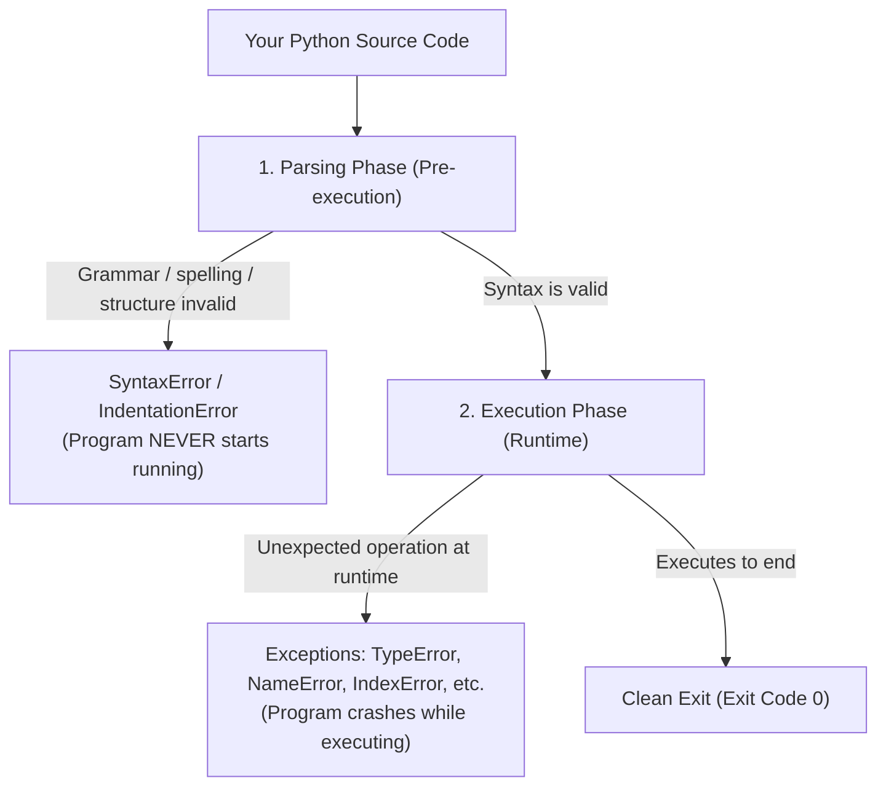
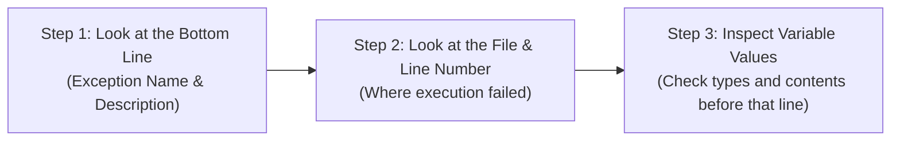

import { Callout } from "fumadocs-ui/components/callout";
import { Tabs, Tab } from "fumadocs-ui/components/tabs";
import { Accordion, Accordions } from "fumadocs-ui/components/accordion";

Every software engineer — from junior developers to senior staff architects — writes code that breaks.

When your Python code crashes and prints red text across your terminal, it is not a sign of failure. **It is Python acting as an interactive debugger, pinpointing the exact file, line number, and cause of the problem.**

In this lesson, you will learn to read error messages calmly and systematically fix the most common errors in Python.

---

## 1. Syntax Errors vs. Runtime Exceptions

Errors in Python fall into two broad phases:



### Phase 1: Syntax Errors (Compile-Time / Parsing)

A **SyntaxError** occurs before your program even starts executing. Python parses your code against the grammatical rules of the language. If you forget a colon, leave an open quote, or mismatch parentheses, Python halts immediately:

```python
# Missing closing quote
print("Hello world)
```

Terminal output:

```text
  File "app.py", line 1
    print("Hello world)
          ^
SyntaxError: unterminated string literal (detected at line 1)
```

Notice the little caret `^`: Python points directly to the unclosed string!

### Phase 2: Runtime Exceptions

A runtime **exception** occurs when your syntax is 100% grammatically valid, but Python encounters an illegal operation while executing a line:

```python
# Syntax is completely valid, but dividing by zero is mathematically impossible:
result = 100 / 0
```

Terminal output:

```text
Traceback (most recent call last):
  File "app.py", line 1, in <module>
    result = 100 / 0
ZeroDivisionError: division by zero
```

---

## 2. Catalog of Common Python Errors

Here are the nine errors you will encounter most frequently:

### 1. `NameError`

**What it means:** You referenced a variable or function name that has not been defined yet, or you misspelled a name.

```python
user_name = "Alice"
print(username)  # Misspelled! Python doesn't recognize 'username'
```

Output:

```text
NameError: name 'username' is not defined. Did you mean: 'user_name'?
```

<Callout type="tip" title="Python 3.10+ Smart Suggestions">
  Notice the helpful suggestion: <code>Did you mean: 'user_name'?</code>. Modern
  Python compares undefined names against known variables in scope using
  Levenshtein string distance!
</Callout>

### 2. `TypeError`

**What it means:** An operation or function was applied to an object of an inappropriate data type.

```python
age = 25
message = "I am " + age + " years old"
```

Output:

```text
TypeError: can only concatenate str (not "int") to str
```

**Fix:** Convert the integer using `str(age)` or use an f-string: `f"I am {age} years old"`.

### 3. `ValueError`

**What it means:** The data type is correct, but the specific value is invalid for that operation.

```python
# int() expects a string of numeric digits, not words
number = int("twenty")
```

Output:

```text
ValueError: invalid literal for int() with base 10: 'twenty'
```

### 4. `IndexError`

**What it means:** You attempted to access an index that lies beyond the bounds of a sequence (like a list or tuple).

```python
fruits = ["apple", "banana"]
print(fruits[5])  # Valid indices are only 0 and 1!
```

Output:

```text
IndexError: list index out of range
```

### 5. `KeyError`

**What it means:** You attempted to look up a key in a dictionary using `[]`, but that key does not exist.

```python
user = {"name": "Mosh", "role": "admin"}
print(user["email"])  # 'email' does not exist in user dict!
```

Output:

```text
KeyError: 'email'
```

**Fix:** Use `.get()`: `user.get("email", "not_provided@example.com")`.

### 6. `AttributeError`

**What it means:** You attempted to call a method or access an attribute that does not exist on that object.

```python
numbers = [1, 2, 3]
numbers.upper()  # .upper() exists on strings, NOT lists!
```

Output:

```text
AttributeError: 'list' object has no attribute 'upper'
```

### 7. `IndentationError`

**What it means:** Python's indentation structure was violated (e.g. inconsistent spaces, missing indentation under an `if` or `def`).

```python
def greet():
print("Hello!")  # Missing 4 spaces indentation!
```

Output:

```text
IndentationError: expected an indented block after function definition on line 1
```

### 8. `ZeroDivisionError`

**What it means:** You attempted to divide a number or compute a modulus using `0` as the denominator.

```python
ratio = count / total_items  # Crashes if total_items is 0!
```

Output:

```text
ZeroDivisionError: division by zero
```

### 9. `FileNotFoundError`

**What it means:** You told Python to open a file from disk that does not exist at the specified path.

```python
with open("missing_dataset.csv") as f:
    data = f.read()
```

Output:

```text
FileNotFoundError: [Errno 2] No such file or directory: 'missing_dataset.csv'
```

---

## 3. The 3-Step Traceback Reading Protocol

Whenever a traceback appears in your terminal, read it using this 3-step checklist:



1. **Start from the bottom**: The very last line of the traceback tells you the exact exception type and a descriptive message (e.g. `KeyError: 'email'`).
2. **Find the last file you wrote**: Tracebacks can pass through deep library files. Look for the last line in the stack that points to **your code** (e.g. `File "app.py", line 42`).
3. **Inspect the variables**: Check what values and types the offending variables held immediately before that line executed.

---

## Practice Questions & Challenges

Test your ability to read tracebacks, diagnose syntax vs runtime errors, and troubleshoot Python exceptions.

### Question 1: Traceback Anatomy & Failure Location

Examine the following real-world terminal traceback:

```text
Traceback (most recent call last):
  File "server.py", line 45, in <module>
    app.dispatch(request)
  File "/var/app/router.py", line 112, in dispatch
    response = handler.execute(payload)
  File "controllers/billing.py", line 28, in execute
    invoice_total = self.calculate_total(payload["items"])
  File "controllers/billing.py", line 14, in calculate_total
    return sum(item["price"] * item["qty"] for item in items)
KeyError: 'qty'
```

Answer the following diagnostic questions:

1. What exact exception was raised, and what specific dictionary key caused the crash?
2. Which file and line number in your application code caused the failure?
3. Where should you place a defensive inspection check to prevent this crash?

<Accordions>
<Accordion title="Reveal Solution & Explanation">

**1. Exception & Failing Key:**
The exception is `KeyError: 'qty'`. One of the dictionary objects in the `items` list did not contain the key `'qty'`.

**2. File & Line Number:**
The error occurred at `controllers/billing.py`, line 14, inside the generator expression in `calculate_total`.

**3. Defensive Prevention:**
In `controllers/billing.py`, line 14, use `.get()` with a safe default value, or validate payload schemas before computing:

```python
return sum(item["price"] * item.get("qty", 1) for item in items if "price" in item)
```

</Accordion>
</Accordions>

---

### Question 2: Spot and Fix the Bug (The 3-Bug Diagnostic Challenge)

Identify the exact exception name raised by each snippet, explain why it failed, and provide the fix:

```python
# Snippet A:
total = 100
print("Total is: " + total)

# Snippet B:
colors = ("red", "green", "blue")
colors.append("yellow")

# Snippet C:
scores = {"Alice": 95, "Bob": 88}
print(scores["Charlie"])
```

<Accordions>
<Accordion title="Reveal Solution & Explanation">

1. **Snippet A**:
   - **Exception:** `TypeError: can only concatenate str (not "int") to str`.
   - **Why:** In Python, string concatenation with `+` does not automatically coerce integers to strings.
   - **Fix:** Use an f-string: `print(f"Total is: {total}")` or `str(total)`.

2. **Snippet B**:
   - **Exception:** `AttributeError: 'tuple' object has no attribute 'append'`.
   - **Why:** `colors` is defined with parentheses `(...)`, making it an immutable **tuple**. Tuples cannot be modified after creation.
   - **Fix:** Use a mutable **list** with square brackets: `colors = ["red", "green", "blue"]`.

3. **Snippet C**:
   - **Exception:** `KeyError: 'Charlie'`.
   - **Why:** Looking up a missing key with square brackets (`scores["Charlie"]`) immediately raises a `KeyError`.
   - **Fix:** Use the safe lookup method `.get()`: `print(scores.get("Charlie", 0))`.

</Accordion>
</Accordions>

---

### Question 3: Conceptual Question (Compile-Time vs Runtime Exceptions)

Consider this script:

```python
# script.py
print("Step 1: Initialization complete.")
print("Step 2: Connecting...")

# Notice the missing closing parenthesis below:
print("Step 3: Loading configuration"
```

When you execute `python script.py`, will Step 1 and Step 2 print before Python crashes? What about if line 6 was `x = 10 / 0` instead? Explain the difference.

<Accordions>
<Accordion title="Reveal Solution & Explanation">

**Case 1: Missing Parenthesis (`SyntaxError`):**

- **Output:** **Nothing prints at all.**
- **Reason:** A `SyntaxError` is detected during the **compilation / parsing phase** before any bytecode is executed. Because Python cannot construct a valid Abstract Syntax Tree (AST), execution never begins, so lines 1 and 2 never run.

**Case 2: `x = 10 / 0` (`ZeroDivisionError`):**

- **Output:**
  ```text
  Step 1: Initialization complete.
  Step 2: Connecting...
  ZeroDivisionError: division by zero
  ```
- **Reason:** `ZeroDivisionError` is a **runtime exception**. The code compiles successfully into valid bytecode, and CPython executes instructions line by line until it attempts the illegal division operation at runtime.

</Accordion>
</Accordions>

---

### Question 4: Interactive Debugging with `breakpoint()`

Since Python 3.7, the built-in `breakpoint()` function drops you directly into Python's interactive debugger (`pdb`).

Given this function that calculates an average but produces an unexpected answer:

```python
def calculate_grade_average(grades):
    total = sum(grades)
    breakpoint()  # <-- Pauses execution here
    average = total / len(grades)
    return average

print(calculate_grade_average([85, 90, 78]))
```

When the terminal stops at `(Pdb)`:

1. How do you print the value of `total`?
2. How do you step forward to the next line of code?
3. How do you continue normal execution to the end?

<Accordions>
<Accordion title="Reveal Solution & Explanation">

- **1. Print a variable:** Type `p total` or simply `total` to display its current value (`253`).
- **2. Step to the next line:** Type `n` (for _next_). The debugger executes line 4 and stops at line 5 without leaving the debugger.
- **3. Continue execution:** Type `c` (for _continue_). Python resumes running at normal speed until the program completes or hits another breakpoint. (Type `q` to quit immediately).

</Accordion>
</Accordions>

---

### Question 5: Code Challenge (The Defensive Pipeline Validator)

Write a Python function `safe_process_transaction(txn: dict) -> float` that processes a transaction payload.

A valid transaction dictionary looks like:

```python
{"user_id": 104, "amount": "149.50", "tax_rate": 0.08}
```

The function must:

1. Verify that `"user_id"`, `"amount"`, and `"tax_rate"` keys exist. If any key is missing, raise a `KeyError` with the message: `Missing required transaction key: <key_name>`.
2. Convert `"amount"` to a `float`. If conversion fails, raise a `ValueError` with: `Invalid currency amount: <amount>`.
3. If `"tax_rate"` is less than `0.0` or greater than `1.0`, raise a `ValueError` with: `Tax rate must be between 0.0 and 1.0`.
4. Calculate and return the total: `amount * (1 + tax_rate)`, rounded to 2 decimal places.

<Accordions>
<Accordion title="Reveal Solution & Code">

```python
def safe_process_transaction(txn: dict) -> float:
    required_keys = ("user_id", "amount", "tax_rate")
    for key in required_keys:
        if key not in txn:
            raise KeyError(f"Missing required transaction key: {key}")

    try:
        amount = float(txn["amount"])
    except (ValueError, TypeError):
        raise ValueError(f"Invalid currency amount: {txn.get('amount')}")

    tax_rate = txn["tax_rate"]
    if not isinstance(tax_rate, (int, float)) or not (0.0 <= tax_rate <= 1.0):
        raise ValueError(f"Tax rate must be between 0.0 and 1.0. Found: {tax_rate}")

    total = amount * (1 + tax_rate)
    return round(total, 2)

# Verification Test Cases
if __name__ == "__main__":
    valid_txn = {"user_id": 104, "amount": "149.50", "tax_rate": 0.08}
    print("Total:", safe_process_transaction(valid_txn))  # Total: 161.46

    try:
        safe_process_transaction({"user_id": 104, "amount": "invalid"})
    except (KeyError, ValueError) as err:
        print("Caught expected error:", err)
```

</Accordion>
</Accordions>

---

## Summary Reference

| Error Name          | Cause                                                    | Typical Fix                                 |
| :------------------ | :------------------------------------------------------- | :------------------------------------------ |
| `SyntaxError`       | Invalid Python grammar (missing colon, open quotes).     | Check commas, colons, brackets, and quotes. |
| `IndentationError`  | Inconsistent or missing indentation.                     | Use 4 spaces per indentation level.         |
| `NameError`         | Variable referenced before assignment or misspelled.     | Check variable spelling and scope.          |
| `TypeError`         | Incompatible types used together.                        | Check types with `type()`, use conversions. |
| `ValueError`        | Right type, but inappropriate value (e.g. `int("abc")`). | Validate input before casting.              |
| `IndexError`        | Sequence index beyond range.                             | Check length with `len(seq)`.               |
| `KeyError`          | Missing dictionary key.                                  | Use `dict.get(key, default)`.               |
| `AttributeError`    | Calling method not defined on this object type.          | Check object type and available methods.    |
| `ZeroDivisionError` | Division by 0.                                           | Guard against `0` with an `if` check.       |

Now that you understand errors, let's learn how to catch and handle them gracefully in **[12. Error Handling: Defending Code with try & except](/docs/learn-python/01-fundamentals/12-error-handling-try-except)**!
