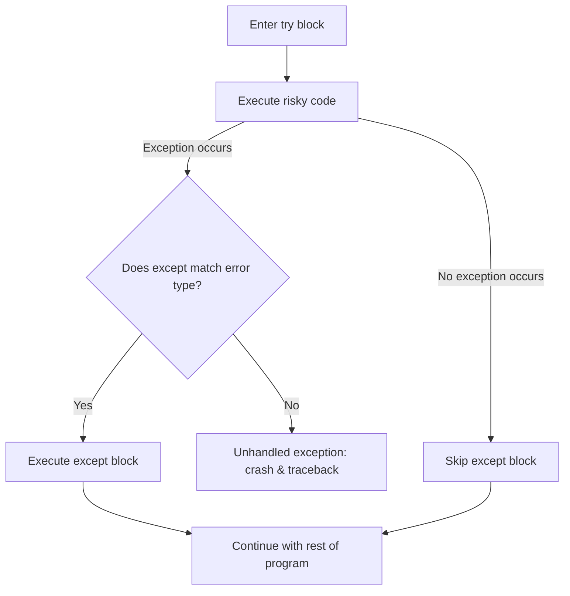
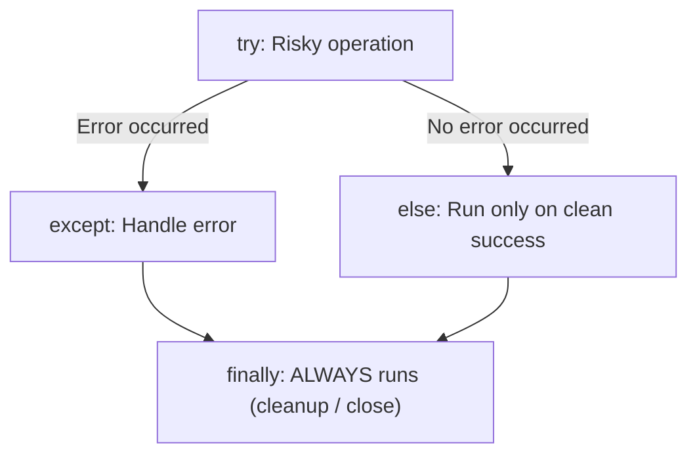

import { Callout } from "fumadocs-ui/components/callout";
import { Tabs, Tab } from "fumadocs-ui/components/tabs";
import { Accordion, Accordions } from "fumadocs-ui/components/accordion";

When an unhandled exception occurs in Python, your program immediately crashes, dumps a red traceback into the terminal, and terminates.

In production applications — whether an e-commerce checkout system, an autonomous agent, or a backend API — **unhandled crashes are unacceptable**. If an external database connection times out or a user types `"abc"` into an age input, the application should recover gracefully, show a friendly notification, and keep running.

Python achieves this resilience through **exception handling** with the `try` and `except` statements.

---

## 1. The Core `try ... except` Block

Wrap any code that might fail inside a `try` block. If an exception occurs, Python halts execution of the `try` block and jumps into the matching `except` block:

```python
try:
    age = int(input("Age: "))
    print(f"You are {age} years old.")
except ValueError:
    print("Invalid input! Please enter whole numeric digits.")

print("Program execution continues smoothly...")
```

If the user types `twenty`:

```text
Age: twenty
Invalid input! Please enter whole numeric digits.
Program execution continues smoothly...
```

Notice that the program **did not crash**. It caught the `ValueError`, displayed a friendly message, and continued running the final print statement!



---

## 2. Catching Multiple Specific Exceptions

Real-world code can fail in multiple different ways. You can define multiple `except` blocks to handle different failure modes distinctly:

```python
try:
    numerator = float(input("Enter numerator: "))
    denominator = float(input("Enter denominator: "))
    result = numerator / denominator
    print(f"Result: {result:.2f}")

except ValueError:
    print("Error: Please enter valid numbers.")

except ZeroDivisionError:
    print("Error: Denominator cannot be zero.")
```

Terminal execution tests:

- Input `10` and `abc` → Triggers `ValueError`.
- Input `10` and `0` → Triggers `ZeroDivisionError`.
- Input `10` and `2` → Success (`Result: 5.00`).

### Combining Exceptions in a Tuple

If two exceptions should share the identical recovery logic, group them into a single tuple:

```python
try:
    val = process_data()
except (KeyError, IndexError) as err:
    print(f"Missing required data point: {err}")
```

---

## 3. The Anti-Pattern: Bare `except:`

Never write a bare `except:` without specifying the exception class:

```python
# ❌ NEVER DO THIS:
try:
    run_mission_critical_job()
except:
    print("Something broke...")
```

<Callout type="warn" title="Why Bare Except is Dangerous">
  A bare <code>except:</code> catches <b>everything</b>, including{" "}
  <code>KeyboardInterrupt</code> (when the user presses <kbd>Ctrl</kbd> +{" "}
  <kbd>C</kbd> to stop the program) and <code>SystemExit</code>. It swallows
  typos, masking real bugs and making programs impossible to debug.
</Callout>

Always catch specific exceptions, or at least catch `Exception`:

```python
# ✅ Acceptable fallback if you must catch any standard runtime failure:
except Exception as err:
    print(f"Unexpected runtime failure: {err}")
```

---

## 4. The Complete 4-Part Structure: `try`, `except`, `else`, `finally`

Python provides two additional clauses for advanced control flow:



1. **`try`**: Code that might raise an exception.
2. **`except`**: Executes **only if** a matching exception occurs.
3. **`else`**: Executes **only if** the `try` block succeeded with **zero** exceptions.
4. **`finally`**: **Always** executes, whether an exception occurred, was handled, or even if `return` was called! Ideal for closing files or database sockets.

```python
def process_user_file(filename: str):
    file = None
    try:
        print(f"Opening {filename}...")
        file = open(filename, "r")
        content = file.read()
    except FileNotFoundError:
        print(f"Error: {filename} does not exist.")
    else:
        print(f"Successfully read {len(content)} characters.")
    finally:
        if file is not None:
            file.close()
            print("File handle safely closed.")
```

---

## 5. Raising Exceptions Deliberately with `raise`

Sometimes your function needs to validate rules and **intentionally signal** that an invalid state occurred:

```python
def set_account_balance(amount: float) -> None:
    if amount < 0:
        raise ValueError(f"Account balance cannot be negative. Got: {amount}")

    print(f"Account balance updated to ${amount:.2f}")

try:
    set_account_balance(-50.0)
except ValueError as e:
    print(f"Transaction rejected: {e}")
```

Output:

```text
Transaction rejected: Account balance cannot be negative. Got: -50.0
```

---

## 6. Defining Custom Application Exceptions

In production applications, creating domain-specific exception classes makes error handling expressive and clean:

```python
class InsufficientFundsError(Exception):
    """Raised when a bank account cannot cover a withdrawal."""
    def __init__(self, balance: float, withdrawal_amount: float):
        self.balance = balance
        self.withdrawal_amount = withdrawal_amount
        super().__init__(
            f"Cannot withdraw ${withdrawal_amount:.2f}; available balance is only ${balance:.2f}."
        )

def withdraw(balance: float, amount: float) -> float:
    if amount > balance:
        raise InsufficientFundsError(balance=balance, withdrawal_amount=amount)
    return balance - amount

try:
    withdraw(balance=100.0, amount=250.0)
except InsufficientFundsError as e:
    print(f"ATM Error: {e}")
```

Output:

```text
ATM Error: Cannot withdraw $250.00; available balance is only $100.00.
```

---

## Practice Questions & Challenges

Test your mastery of exception propagation, control flow across `try/except/else/finally`, anti-patterns like bare `except`, and custom domain exceptions.

### Question 1: Output Prediction (Control Flow with `try / except / else / finally`)

Trace the exact execution order and return values of this function across two test runs:

```python
def process_transaction(amount_str: str) -> str:
    try:
        amount = float(amount_str)
        result = 100.0 / amount
    except ValueError:
        print("[Handler] Invalid numeric string")
        return "ERR_FORMAT"
    except ZeroDivisionError:
        print("[Handler] Division by zero")
        return "ERR_ZERO"
    else:
        print(f"[Handler] Calculation successful: {result:.1f}")
        return "OK"
    finally:
        print("[Cleanup] Transaction channel closed")

print("--- Run 1 ('20') ---")
res1 = process_transaction("20")
print("Returned:", res1)

print("\n--- Run 2 ('invalid') ---")
res2 = process_transaction("invalid")
print("Returned:", res2)
```

1. What is printed to the terminal for Run 1 and Run 2?
2. In Run 1, `return "OK"` is located in the `else` block. Does `finally` execute _before_ or _after_ the function returns?

<Accordions>
<Accordion title="Reveal Solution & Explanation">

**Terminal Output:**

```text
--- Run 1 ('20') ---
[Handler] Calculation successful: 5.0
[Cleanup] Transaction channel closed
Returned: OK

--- Run 2 ('invalid') ---
[Handler] Invalid numeric string
[Cleanup] Transaction channel closed
Returned: ERR_FORMAT
```

**Key Architectural Rule for `finally`:**
The `finally` block **always executes before control leaves the function**, even when a `return` statement has already been reached in a `try`, `except`, or `else` block!
Python stages the return value, executes the `finally` block to guarantee database/socket/file cleanup, and only then actually exits the function back to the caller.

</Accordion>
</Accordions>

---

### Question 2: Spot and Fix the Bug (The Dangerous Bare `except:`)

A developer writes a network client helper:

```python
def fetch_user_data(user_id: int) -> dict:
    try:
        # Imagine an API call:
        response = get_api_client().request_user(user_id)
        return response.json()
    except:
        print("Network request failed, returning cached fallback")
        return {"id": user_id, "status": "offline"}
```

1. What happens if there is a typo in the code itself (e.g., `get_api_clinet()` instead of `get_api_client()`)?
2. What happens if the developer presses `Ctrl+C` (SIGINT) in their terminal while the request is hanging?
3. How should `except` be properly scoped?

<Accordions>
<Accordion title="Reveal Solution & Explanation">

**The Disasters Caused by Bare `except:`:**

1. **Silent Bug Masking**: If there is a typo (`NameError`), syntax issue, or `AttributeError` inside the `try` block, bare `except:` catches it and silently returns the fallback dictionary. You will spend hours trying to debug why production is returning cached data when in reality your code simply has a spelling error!
2. **Unstoppable Program**: Bare `except:` catches `BaseException`, which includes `KeyboardInterrupt` (`Ctrl+C`) and `SystemExit`. The user cannot cleanly terminate the process because the `except` block catches the abort signal and continues running.

**The Fix (Catch Specific Domain Exceptions):**
Never catch bare `except:`. At minimum, catch `Exception` (which ignores system signals), or preferably only the specific network/parse errors expected:

```python
import requests

def fetch_user_data(user_id: int) -> dict:
    try:
        response = get_api_client().request_user(user_id)
        return response.json()
    except (requests.RequestException, ValueError) as err:
        # Only catches actual network transport errors or JSON decoding failures
        print(f"Network error: {err}. Using fallback.")
        return {"id": user_id, "status": "offline"}
```

</Accordion>
</Accordions>

---

### Question 3: Exception Re-raising & Chaining (`raise` vs `raise ... from`)

Analyze these two patterns of re-raising exceptions in production code:

```python
# Pattern A:
try:
    load_secrets()
except FileNotFoundError:
    logger.error("Secret vault missing!")
    raise

# Pattern B:
try:
    port = int(raw_config["PORT"])
except (KeyError, ValueError) as err:
    raise ConfigurationError("Invalid server configuration") from err
```

1. What does a bare `raise` do in Pattern A?
2. What is the benefit of `from err` in Pattern B (Exception Chaining)?

<Accordions>
<Accordion title="Reveal Solution & Explanation">

**1. Bare `raise` in Pattern A:**
A standalone `raise` without arguments inside an `except` block re-raises the **active exception** that was just caught, preserving its original traceback and stack frame intact. This allows you to inspect or log an error while still letting it propagate up to higher-level crash reporters.

**2. Exception Chaining (`from err`) in Pattern B:**
Pattern B translates low-level technical exceptions (`KeyError`, `ValueError`) into clean, high-level business exceptions (`ConfigurationError`).
By writing `from err`, Python records both exceptions in the traceback (`The above exception was the direct cause of the following exception:`), providing complete diagnostic visibility for developers without confusing consumers of the API.

</Accordion>
</Accordions>

---

### Question 4: Code Challenge (Resilient List Sanitizer)

Write a function `sanitize_scores(raw_scores: list[str]) -> dict` that parses a list of messy user inputs:

```python
raw_scores = ["95", "100", "absent", "82", "N/A", "150", "-5", "74"]
```

Requirements:

1. Parse each string as an integer (`int(score)`).
2. Scores must be between `0` and `100` inclusive. If a score is `< 0` or `> 100`, raise a `ValueError("Score out of range [0, 100]")`.
3. Use `try ... except ValueError` to gracefully handle both non-numeric strings and out-of-range scores without crashing.
4. Return a summary dictionary:
   ```python
   {
       "valid": [95, 100, 82, 74],
       "invalid": ["absent", "N/A", "150", "-5"],
       "average": 87.75
   }
   ```

<Accordions>
<Accordion title="Reveal Solution & Code">

```python
def sanitize_scores(raw_scores: list[str]) -> dict:
    valid = []
    invalid = []

    for item in raw_scores:
        try:
            score = int(item)
            if not (0 <= score <= 100):
                raise ValueError(f"Score {score} out of valid range 0-100")
            valid.append(score)
        except ValueError:
            invalid.append(item)

    avg = sum(valid) / len(valid) if valid else 0.0

    return {
        "valid": valid,
        "invalid": invalid,
        "average": round(avg, 2)
    }

raw_scores = ["95", "100", "absent", "82", "N/A", "150", "-5", "74"]
print(sanitize_scores(raw_scores))
# Output: {'valid': [95, 100, 82, 74], 'invalid': ['absent', 'N/A', '150', '-5'], 'average': 87.75}
```

</Accordion>
</Accordions>

---

### Question 5: Production Custom Exception with Metadata

Design a custom exception `RateLimitExceededError` that inherits from `Exception` and contains machine-readable metadata:

- Store attributes: `endpoint: str` and `retry_after: int`.
- Write a function `simulate_api_request(endpoint: str, calls_made: int)` that raises `RateLimitExceededError` if `calls_made > 5`.
- Write a `try ... except` block that catches this exception and prints: `"Rate limit exceeded on /api/v1/search. Back off for 30s."` accessing the exception attributes directly.

<Accordions>
<Accordion title="Reveal Solution & Code">

```python
class RateLimitExceededError(Exception):
    """Raised when an external API threshold is breached."""
    def __init__(self, endpoint: str, retry_after: int):
        self.endpoint = endpoint
        self.retry_after = retry_after
        super().__init__(
            f"Rate limit exceeded on '{endpoint}'. Retry after {retry_after}s."
        )

def simulate_api_request(endpoint: str, calls_made: int) -> str:
    if calls_made > 5:
        raise RateLimitExceededError(endpoint=endpoint, retry_after=30)
    return "200 OK"

# Client handling code:
try:
    simulate_api_request(endpoint="/api/v1/search", calls_made=9)
except RateLimitExceededError as err:
    # Access structured metadata without messy string parsing!
    print(f"Rate limit exceeded on {err.endpoint}. Back off for {err.retry_after}s.")
```

**Key Takeaway:** Custom exceptions should carry relevant context objects as instance attributes. This empowers calling layers to implement automatic retries, back-off timers, or custom alert notifications easily.

</Accordion>
</Accordions>

---

## Summary Reference

- **`try`**: Enclose code that could fail.
- **`except ExceptionType as err:`**: Handle specific failure modes.
- **`else`**: Runs code that should only execute when the `try` block encounters no errors.
- **`finally`**: Guaranteed to run regardless of outcome — essential for resource cleanup.
- **`raise`**: Signal an error condition explicitly.
- **Custom exceptions**: Inherit from `Exception` for domain-specific error handling.

Next, learn how to structure real-world Python repositories in **[13. Project Structure & Repository Layout](/docs/learn-python/01-fundamentals/13-project-structure)**!
