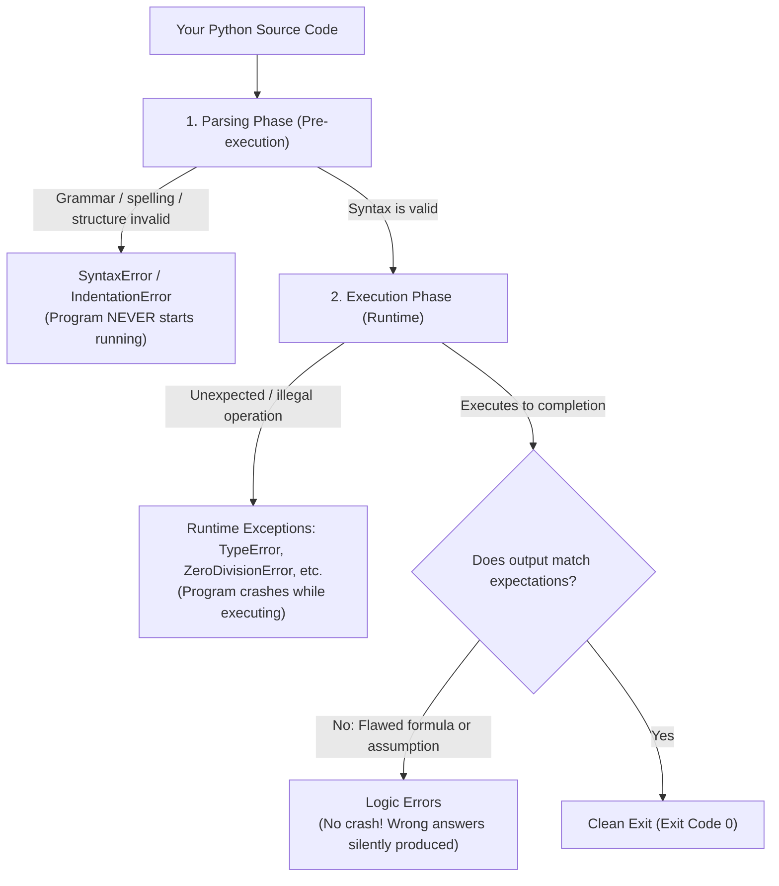
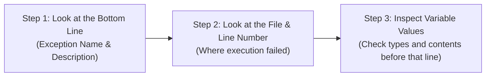

import { Callout } from "fumadocs-ui/components/callout";
import { Tabs, Tab } from "fumadocs-ui/components/tabs";
import { Accordion, Accordions } from "fumadocs-ui/components/accordion";

Every software engineer — from junior developers to senior staff architects — writes code that breaks.

When your Python code crashes and prints red text across your terminal, it is not a sign of failure. **It is Python acting as an interactive debugger, pinpointing the exact file, line number, and cause of the problem.**

In this lesson, you will learn to read error messages calmly and systematically fix the most common errors in Python.

---

## 1. The Three Categories of Errors: Syntax, Runtime & Logic

Errors in programming fall into three distinct categories:



### Category A: Syntax Errors (Compile-Time / Parsing)

A **SyntaxError** occurs before your program even starts executing. Python parses your source code against the formal grammar of the language. If you forget a colon, leave an open string quote, or mismatch parentheses, Python halts immediately during the parsing pass:

```python
# Missing closing quote
print("Hello world)
```

Terminal output:

```text
  File "app.py", line 1
    print("Hello world)
          ^
SyntaxError: unterminated string literal (detected at line 1)
```

Notice the caret (`^`): Python points directly to the unclosed string literal. Because syntax errors prevent Python from constructing an Abstract Syntax Tree (AST), **zero lines of code execute**.

### Category B: Runtime Errors (Exceptions)

A runtime **exception** occurs when your syntax is 100% grammatically valid, but Python encounters an illegal operation while executing a statement:

```python
# Syntax is completely valid, but dividing by zero is mathematically impossible:
result = 100 / 0
```

Terminal output:

```text
Traceback (most recent call last):
  File "app.py", line 1, in <module>
    result = 100 / 0
ZeroDivisionError: division by zero
```

Runtime exceptions are the primary target of **exception handling** (`try` / `except`). If left unhandled, they terminate execution immediately and emit a traceback.

### Category C: Logic Errors (Semantic Bugs)

A **logic error** occurs when the code is syntactically valid and runs without raising any exceptions, but produces **incorrect results** due to flawed developer assumptions:

```python
price = 100
discount = 20

# Logic bug: accidentally added the discount instead of subtracting it!
final_price = price + discount

print(f"Final discounted price: ${final_price}")  # Prints $120 instead of $80!
```

Output:

```text
Final discounted price: $120
```

<Callout type="warn" title="Why Logic Errors Are the Hardest to Find">
  Python raises <strong>no error message and prints no traceback</strong> for
  logic errors. Python does exactly what you told it to do (add two numbers),
  not what you intended. Finding logic errors requires unit tests, assertions,
  and interactive debugging.
</Callout>

### The Three Terms You Must Know: Raise, Catch & Handle

When discussing runtime errors, developers use three specific verbs:

| Term       | What It Means                                                                                                           | Real-World Analogy                                                   |
| :--------- | :---------------------------------------------------------------------------------------------------------------------- | :------------------------------------------------------------------- |
| **Raise**  | Python (or your code) detects an invalid operation and throws an exception object into the execution context.           | A fire alarm begins ringing in the building.                         |
| **Catch**  | An exception handler (`except`) intercepts the active exception before it crashes the application.                      | A security team hears the alarm and locates the room.                |
| **Handle** | Your code executes a corrective action: falling back to safe data, displaying a friendly message, or closing resources. | The team safely puts out the fire so the building stays operational. |

Catching an exception without handling it (e.g. `except: pass`) simply ignores the alarm while the kitchen burns down!

---

## 2. Catalog of Common Python Errors

Here are the nine errors you will encounter most frequently:

### 1. `NameError`

**What it means:** You referenced a variable or function name that has not been defined yet, or you misspelled a name.

```python
user_name = "Alice"
print(username)  # Misspelled! Python doesn't recognize 'username'
```

Output:

```text
NameError: name 'username' is not defined. Did you mean: 'user_name'?
```

<Callout type="tip" title="Python 3.10+ Smart Suggestions">
  Notice the helpful suggestion: <code>Did you mean: 'user_name'?</code>. Modern
  Python compares undefined names against known variables in scope using
  Levenshtein string distance!
</Callout>

### 2. `TypeError`

**What it means:** An operation or function was applied to an object of an inappropriate data type.

```python
age = 25
message = "I am " + age + " years old"
```

Output:

```text
TypeError: can only concatenate str (not "int") to str
```

**Fix:** Convert the integer using `str(age)` or use an f-string: `f"I am {age} years old"`.

### 3. `ValueError`

**What it means:** The data type is correct, but the specific value is invalid for that operation.

```python
# int() expects a string of numeric digits, not words
number = int("twenty")
```

Output:

```text
ValueError: invalid literal for int() with base 10: 'twenty'
```

### 4. `IndexError`

**What it means:** You attempted to access an index that lies beyond the bounds of a sequence (like a list or tuple).

```python
fruits = ["apple", "banana"]
print(fruits[5])  # Valid indices are only 0 and 1!
```

Output:

```text
IndexError: list index out of range
```

### 5. `KeyError`

**What it means:** You attempted to look up a key in a dictionary using `[]`, but that key does not exist.

```python
user = {"name": "Mosh", "role": "admin"}
print(user["email"])  # 'email' does not exist in user dict!
```

Output:

```text
KeyError: 'email'
```

**Fix:** Use `.get()`: `user.get("email", "not_provided@example.com")`.

### 6. `AttributeError`

**What it means:** You attempted to call a method or access an attribute that does not exist on that object.

```python
numbers = [1, 2, 3]
numbers.upper()  # .upper() exists on strings, NOT lists!
```

Output:

```text
AttributeError: 'list' object has no attribute 'upper'
```

### 7. `IndentationError`

**What it means:** Python's indentation structure was violated (e.g. inconsistent spaces, missing indentation under an `if` or `def`).

```python
def greet():
print("Hello!")  # Missing 4 spaces indentation!
```

Output:

```text
IndentationError: expected an indented block after function definition on line 1
```

### 8. `ZeroDivisionError`

**What it means:** You attempted to divide a number or compute a modulus using `0` as the denominator.

```python
ratio = count / total_items  # Crashes if total_items is 0!
```

Output:

```text
ZeroDivisionError: division by zero
```

### 9. `FileNotFoundError`

**What it means:** You told Python to open a file from disk that does not exist at the specified path.

```python
with open("missing_dataset.csv") as f:
    data = f.read()
```

Output:

```text
FileNotFoundError: [Errno 2] No such file or directory: 'missing_dataset.csv'
```

### 10. `PermissionError`

**What it means:** The operating system denied permission to open, modify, or delete a file or directory (e.g. attempting to write to a read-only system file or directory without administrator privileges).

```python
with open("/etc/shadow", "w") as f:
    f.write("test")
```

Output:

```text
PermissionError: [Errno 13] Permission denied: '/etc/shadow'
```

### 11. `ModuleNotFoundError` and `ImportError`

**What it means:** You tried to `import` a third-party package or module that has not been installed in your virtual environment, or the module exists but does not export the specific function/class you requested.

```python
import non_existent_library
```

Output:

```text
ModuleNotFoundError: No module named 'non_existent_library'
```

### 12. `TimeoutError`

**What it means:** A network request, database query, socket read, or sub-process exceeded its allocated waiting deadline before completing.

```python
import socket

s = socket.socket()
s.settimeout(0.5)
s.connect(("10.255.255.1", 80))  # Unreachable host
```

Output:

```text
TimeoutError: [Errno 110] Connection timed out
```

---

### Deep Dive: `ValueError` vs. `TypeError`

These two are frequently confused by new Python developers. Here is the golden rule to distinguish them:

<Tabs items={["ValueError (Bad Value)", "TypeError (Bad Type)"]}>
<Tab value="ValueError (Bad Value)">

The **data type** is appropriate, but the **specific contents or magnitude** are invalid for that operation.

```python
# int() accepts strings! The type (str) is valid.
# But "hello" cannot be converted into base-10 digits.
number = int("hello")
```

Output:

```text
ValueError: invalid literal for int() with base 10: 'hello'
```

**Rule of thumb:** The function was happy to receive a string, but couldn't make sense of _what was inside_ that string.

</Tab>
<Tab value="TypeError (Bad Type)">

The **data type itself** is completely unsupported by the operation or function.

```python
# You cannot perform arithmetic addition between a string and an integer:
result = "hello" + 5
```

Output:

```text
TypeError: can only concatenate str (not "int") to str
```

**Rule of thumb:** Python refuses the operation before even inspecting the values, because the types are fundamentally incompatible.

</Tab>
</Tabs>

---

## 3. The 3-Step Traceback Reading Protocol

Whenever a traceback appears in your terminal, read it using this 3-step checklist:



1. **Start from the bottom**: The very last line of the traceback tells you the exact exception type and a descriptive message (e.g. `KeyError: 'email'`).
2. **Find the last file you wrote**: Tracebacks can pass through deep library files. Look for the last line in the stack that points to **your code** (e.g. `File "app.py", line 42`).
3. **Inspect the variables**: Check what values and types the offending variables held immediately before that line executed.

---

## 4. Assertions: Verifying Internal Invariants with `assert`

An **assertion** is a developer sanity check. It states: _"This condition MUST be true at this point in the program. If it is not, stop everything immediately because there is a bug in the code."_

### The `assert` Syntax

```python
assert condition, "Optional error message if condition evaluates to False"
```

If the condition is `True`, Python continues silently. If `False`, Python immediately raises an **`AssertionError`**:

```python
def calculate_discount(price: float, discount_percent: float) -> float:
    # Developer invariant: discount percentage must be between 0% and 100%
    assert 0 <= discount_percent <= 100, f"Invalid discount: {discount_percent}%"
    assert price >= 0, f"Price cannot be negative: {price}"

    return price * (1 - discount_percent / 100)

# Valid call:
print("Discounted price:", calculate_discount(100.0, 20.0))  # 80.0

# Buggy call:
# calculate_discount(100.0, 150.0)  # ❌ AssertionError: Invalid discount: 150.0%
```

```text
Discounted price: 80.0
```

> [!WARNING] Assertions vs. Exceptions
> Never use `assert` to validate user input or web requests. Assertions can be globally disabled by running Python with the `-O` (optimize) flag. Use `if` statements with `raise ValueError(...)` for user-facing input validation, and reserve `assert` for internal internal sanity checks and testing.

---

## 5. Automated Unit Testing with Built-in `unittest`

Instead of manually running scripts and visually checking `print()` outputs, automated tests run your functions against expected outcomes and immediately report any regressions.

Python includes **`unittest`** in its standard library (often called PyUnit, modeled after Java's JUnit).

### Writing Your First Unit Test

Suppose you have a simple math utility function in `calculator.py`:

```python
# calculator.py
def add(a: int, b: int) -> int:
    return a + b

def divide(a: float, b: float) -> float:
    if b == 0:
        raise ValueError("Cannot divide by zero!")
    return a / b
```

You create a test file named `test_calculator.py`:

```python
# test_calculator.py
import unittest
from calculator import add, divide

class TestCalculator(unittest.TestCase):

    # Each test method MUST start with the prefix 'test_'
    def test_add_positive_numbers(self):
        result = add(10, 5)
        self.assertEqual(result, 15)

    def test_add_negative_numbers(self):
        result = add(-3, -7)
        self.assertEqual(result, -10)

    def test_divide_valid(self):
        result = divide(10, 2)
        self.assertEqual(result, 5.0)

    def test_divide_by_zero_raises_error(self):
        # Verify that divide(10, 0) correctly raises a ValueError:
        with self.assertRaises(ValueError):
            divide(10, 0)

if __name__ == "__main__":
    unittest.main()
```

### Running Your Tests

Execute your test suite directly from your terminal:

```bash
python -m unittest test_calculator.py
```

```text
....
----------------------------------------------------------------------
Ran 4 tests in 0.001s

OK
```

Each dot `.` represents a passing test. If a test fails, `unittest` displays an `F`, shows the expected vs actual value, and pinpoints the exact line number!

### Essential `unittest.TestCase` Assertion Methods

| Method                      | What it Checks     | Example                                   |
| :-------------------------- | :----------------- | :---------------------------------------- |
| `self.assertEqual(a, b)`    | $a == b$           | `self.assertEqual(len(cart), 3)`          |
| `self.assertNotEqual(a, b)` | $a \ne b$          | `self.assertNotEqual(status, 500)`        |
| `self.assertTrue(x)`        | `bool(x) is True`  | `self.assertTrue(user.is_active)`         |
| `self.assertFalse(x)`       | `bool(x) is False` | `self.assertFalse(account.is_locked)`     |
| `self.assertIn(item, seq)`  | `item in seq`      | `self.assertIn("admin", user_roles)`      |
| `self.assertIsNone(x)`      | `x is None`        | `self.assertIsNone(response.error)`       |
| `self.assertRaises(Err)`    | Code raises `Err`  | `with self.assertRaises(IndexError): ...` |

### Test Lifecycle: `setUp()` and `tearDown()`

If multiple tests share the same test data or database connection, define `setUp()` and `tearDown()`:

```python
class TestShoppingList(unittest.TestCase):
    def setUp(self):
        # Runs BEFORE every individual test method:
        self.cart = ["apple", "banana"]

    def tearDown(self):
        # Runs AFTER every individual test method:
        self.cart.clear()

    def test_add_item(self):
        self.cart.append("orange")
        self.assertEqual(len(self.cart), 3)

    def test_remove_item(self):
        self.cart.remove("apple")
        self.assertEqual(len(self.cart), 1)
```

---

## 6. Isolating Dependencies with `unittest.mock`

In real-world applications, functions often talk to external systems: sending emails, charging credit cards via Stripe, or calling third-party REST APIs.

You **do not** want your unit tests to make real web requests because:

1. Tests would fail whenever your internet connection drops.
2. External API rate limits could be exceeded.
3. Tests would run slowly.

The standard library **`unittest.mock`** lets you replace slow or destructive external calls with dummy objects called **Mocks**.

### 1. Basic `Mock` Object

A `Mock` object simulates any Python object, records every call made to it, and returns pre-configured fake responses:

```python
from unittest.mock import Mock

# Create a fake payment gateway service:
fake_payment_gateway = Mock()

# Configure what calling .charge() should return:
fake_payment_gateway.charge.return_value = {"status": "success", "transaction_id": "tx_999"}

# Call the mock just like real code would:
response = fake_payment_gateway.charge(amount=50.00, currency="USD")

print("Fake response:", response)
# Verify the method was actually called with the exact expected arguments:
fake_payment_gateway.charge.assert_called_once_with(amount=50.00, currency="USD")
```

```text
Fake response: {'status': 'success', 'transaction_id': 'tx_999'}
```

### 2. Mocking an External Function with `@patch`

Use the `@patch` decorator to temporarily replace an external function during a single test:

Suppose you have a function `get_weather_temperature()` that fetches live weather from a remote API:

```python
# weather.py
import urllib.request
import json

def get_current_temperature(city: str) -> float:
    # Real code calls external API:
    url = f"https://api.weather.example.com/{city}"
    with urllib.request.urlopen(url) as response:
        data = json.loads(response.read().decode())
        return data["temp"]
```

You can test this without touching the internet by patching `urllib.request.urlopen`:

```python
# test_weather.py
import unittest
from unittest.mock import patch, MagicMock
from weather import get_current_temperature

class TestWeather(unittest.TestCase):

    @patch("urllib.request.urlopen")
    def test_get_current_temperature(self, mock_urlopen):
        # 1. Create a fake response context manager
        fake_response = MagicMock()
        fake_response.read.return_value = b'{"temp": 72.5}'
        fake_response.__enter__.return_value = fake_response

        # 2. Tell the mock to return our fake response
        mock_urlopen.return_value = fake_response

        # 3. Call our function:
        temp = get_current_temperature("Seattle")

        # 4. Assertions:
        self.assertEqual(temp, 72.5)
        mock_urlopen.assert_called_once_with("https://api.weather.example.com/Seattle")

if __name__ == "__main__":
    unittest.main()
```

---

## 7. Interactive Debugging with `breakpoint()` & `pdb`

When code crashes or produces the wrong numbers, you don't have to guess or litter your code with temporary `print()` statements. Python 3.7+ includes the built-in **`breakpoint()`** function, which immediately pauses execution and opens the **Python Debugger (`pdb`)** right in your terminal.

```python
# debug_demo.py
def process_order(items: list[dict], tax_rate: float) -> float:
    subtotal = 0.0
    for item in items:
        # Pause execution before calculating line item price:
        breakpoint()  # <-- Execution STOPS here!
        subtotal += item["price"] * item["qty"]
    return subtotal * (1 + tax_rate)

orders = [{"name": "Keyboard", "price": 80.0, "qty": 2}]
process_order(orders, 0.08)
```

### Essential `pdb` Interactive Commands

When Python hits `breakpoint()`, your terminal pauses with a `(Pdb)` prompt:

```text
> /workspace/debug_demo.py(7)process_order()
-> subtotal += item["price"] * item["qty"]
(Pdb)
```

| Command            |    Key    | Description                                                                |
| :----------------- | :-------: | :------------------------------------------------------------------------- |
| **Print variable** | `p <var>` | Evaluates and prints any variable (e.g. `p item`, `p subtotal`)            |
| **Next line**      |    `n`    | Executes the current line and pauses at the next line in the same function |
| **Step into**      |    `s`    | Steps inside the function currently being called                           |
| **Continue**       |    `c`    | Resumes normal execution until the next breakpoint or program termination  |
| **Where am I?**    |    `w`    | Displays the current call stack trace                                      |
| **Quit**           |    `q`    | Immediately terminates the program                                         |

---

## 8. Testing Comparison: `unittest` vs. `pytest`

Modern Python engineering uses two primary testing frameworks:

| Feature              | Standard Library `unittest`                         | Community Standard `pytest`                      |
| :------------------- | :-------------------------------------------------- | :----------------------------------------------- |
| **Installation**     | Built-in (no `pip install` required)                | Requires `pip install pytest` or `uv add pytest` |
| **Test Structure**   | Object-Oriented (`class TestX(unittest.TestCase):`) | Simple standalone functions (`def test_x():`)    |
| **Assertions**       | Named methods (`self.assertEqual(a, b)`)            | Plain Python `assert a == b`                     |
| **Setup / Teardown** | `setUp()` and `tearDown()` methods                  | Reusable `@pytest.fixture` decorators            |
| **Terminal Output**  | Traditional dot summary (`....`)                    | Colorful progress, rich failure diffs            |
| **Runner Command**   | `python -m unittest`                                | `pytest`                                         |

---

## Practice Questions & Challenges

Test your ability to read tracebacks, diagnose syntax vs runtime errors, and troubleshoot Python exceptions.

### Question 1: Traceback Anatomy & Failure Location

Examine the following real-world terminal traceback:

```text
Traceback (most recent call last):
  File "server.py", line 45, in <module>
    app.dispatch(request)
  File "/var/app/router.py", line 112, in dispatch
    response = handler.execute(payload)
  File "controllers/billing.py", line 28, in execute
    invoice_total = self.calculate_total(payload["items"])
  File "controllers/billing.py", line 14, in calculate_total
    return sum(item["price"] * item["qty"] for item in items)
KeyError: 'qty'
```

Answer the following diagnostic questions:

1. What exact exception was raised, and what specific dictionary key caused the crash?
2. Which file and line number in your application code caused the failure?
3. Where should you place a defensive inspection check to prevent this crash?

<Accordions>
<Accordion title="Reveal Solution & Explanation">

**1. Exception & Failing Key:**
The exception is `KeyError: 'qty'`. One of the dictionary objects in the `items` list did not contain the key `'qty'`.

**2. File & Line Number:**
The error occurred at `controllers/billing.py`, line 14, inside the generator expression in `calculate_total`.

**3. Defensive Prevention:**
In `controllers/billing.py`, line 14, use `.get()` with a safe default value, or validate payload schemas before computing:

```python
return sum(item["price"] * item.get("qty", 1) for item in items if "price" in item)
```

</Accordion>
</Accordions>

---

### Question 2: Spot and Fix the Bug (The 3-Bug Diagnostic Challenge)

Identify the exact exception name raised by each snippet, explain why it failed, and provide the fix:

```python
# Snippet A:
total = 100
print("Total is: " + total)

# Snippet B:
colors = ("red", "green", "blue")
colors.append("yellow")

# Snippet C:
scores = {"Alice": 95, "Bob": 88}
print(scores["Charlie"])
```

<Accordions>
<Accordion title="Reveal Solution & Explanation">

1. **Snippet A**:
   - **Exception:** `TypeError: can only concatenate str (not "int") to str`.
   - **Why:** In Python, string concatenation with `+` does not automatically coerce integers to strings.
   - **Fix:** Use an f-string: `print(f"Total is: {total}")` or `str(total)`.

2. **Snippet B**:
   - **Exception:** `AttributeError: 'tuple' object has no attribute 'append'`.
   - **Why:** `colors` is defined with parentheses `(...)`, making it an immutable **tuple**. Tuples cannot be modified after creation.
   - **Fix:** Use a mutable **list** with square brackets: `colors = ["red", "green", "blue"]`.

3. **Snippet C**:
   - **Exception:** `KeyError: 'Charlie'`.
   - **Why:** Looking up a missing key with square brackets (`scores["Charlie"]`) immediately raises a `KeyError`.
   - **Fix:** Use the safe lookup method `.get()`: `print(scores.get("Charlie", 0))`.

</Accordion>
</Accordions>

---

### Question 3: Conceptual Question (Compile-Time vs Runtime Exceptions)

Consider this script:

```python
# script.py
print("Step 1: Initialization complete.")
print("Step 2: Connecting...")

# Notice the missing closing parenthesis below:
print("Step 3: Loading configuration"
```

When you execute `python script.py`, will Step 1 and Step 2 print before Python crashes? What about if line 6 was `x = 10 / 0` instead? Explain the difference.

<Accordions>
<Accordion title="Reveal Solution & Explanation">

**Case 1: Missing Parenthesis (`SyntaxError`):**

- **Output:** **Nothing prints at all.**
- **Reason:** A `SyntaxError` is detected during the **compilation / parsing phase** before any bytecode is executed. Because Python cannot construct a valid Abstract Syntax Tree (AST), execution never begins, so lines 1 and 2 never run.

**Case 2: `x = 10 / 0` (`ZeroDivisionError`):**

- **Output:**
  ```text
  Step 1: Initialization complete.
  Step 2: Connecting...
  ZeroDivisionError: division by zero
  ```
- **Reason:** `ZeroDivisionError` is a **runtime exception**. The code compiles successfully into valid bytecode, and CPython executes instructions line by line until it attempts the illegal division operation at runtime.

</Accordion>
</Accordions>

---

### Question 4: Interactive Debugging with `breakpoint()`

Since Python 3.7, the built-in `breakpoint()` function drops you directly into Python's interactive debugger (`pdb`).

Given this function that calculates an average but produces an unexpected answer:

```python
def calculate_grade_average(grades):
    total = sum(grades)
    breakpoint()  # <-- Pauses execution here
    average = total / len(grades)
    return average

print(calculate_grade_average([85, 90, 78]))
```

When the terminal stops at `(Pdb)`:

1. How do you print the value of `total`?
2. How do you step forward to the next line of code?
3. How do you continue normal execution to the end?

<Accordions>
<Accordion title="Reveal Solution & Explanation">

- **1. Print a variable:** Type `p total` or simply `total` to display its current value (`253`).
- **2. Step to the next line:** Type `n` (for _next_). The debugger executes line 4 and stops at line 5 without leaving the debugger.
- **3. Continue execution:** Type `c` (for _continue_). Python resumes running at normal speed until the program completes or hits another breakpoint. (Type `q` to quit immediately).

</Accordion>
</Accordions>

---

### Question 5: Code Challenge (The Defensive Pipeline Validator)

Write a Python function `safe_process_transaction(txn: dict) -> float` that processes a transaction payload.

A valid transaction dictionary looks like:

```python
{"user_id": 104, "amount": "149.50", "tax_rate": 0.08}
```

The function must:

1. Verify that `"user_id"`, `"amount"`, and `"tax_rate"` keys exist. If any key is missing, raise a `KeyError` with the message: `Missing required transaction key: <key_name>`.
2. Convert `"amount"` to a `float`. If conversion fails, raise a `ValueError` with: `Invalid currency amount: <amount>`.
3. If `"tax_rate"` is less than `0.0` or greater than `1.0`, raise a `ValueError` with: `Tax rate must be between 0.0 and 1.0`.
4. Calculate and return the total: `amount * (1 + tax_rate)`, rounded to 2 decimal places.

<Accordions>
<Accordion title="Reveal Solution & Code">

```python
def safe_process_transaction(txn: dict) -> float:
    required_keys = ("user_id", "amount", "tax_rate")
    for key in required_keys:
        if key not in txn:
            raise KeyError(f"Missing required transaction key: {key}")

    try:
        amount = float(txn["amount"])
    except (ValueError, TypeError):
        raise ValueError(f"Invalid currency amount: {txn.get('amount')}")

    tax_rate = txn["tax_rate"]
    if not isinstance(tax_rate, (int, float)) or not (0.0 <= tax_rate <= 1.0):
        raise ValueError(f"Tax rate must be between 0.0 and 1.0. Found: {tax_rate}")

    total = amount * (1 + tax_rate)
    return round(total, 2)

# Verification Test Cases
if __name__ == "__main__":
    valid_txn = {"user_id": 104, "amount": "149.50", "tax_rate": 0.08}
    print("Total:", safe_process_transaction(valid_txn))  # Total: 161.46

    try:
        safe_process_transaction({"user_id": 104, "amount": "invalid"})
    except (KeyError, ValueError) as err:
        print("Caught expected error:", err)
```

</Accordion>
</Accordions>

---

## Summary Reference

| Error Name            | Cause                                                    | Typical Fix                                  |
| :-------------------- | :------------------------------------------------------- | :------------------------------------------- |
| `SyntaxError`         | Invalid Python grammar (missing colon, open quotes).     | Check commas, colons, brackets, and quotes.  |
| `IndentationError`    | Inconsistent or missing indentation.                     | Use 4 spaces per indentation level.          |
| `NameError`           | Variable referenced before assignment or misspelled.     | Check variable spelling and scope.           |
| `TypeError`           | Incompatible types used together.                        | Check types with `type()`, use conversions.  |
| `ValueError`          | Right type, but inappropriate value (e.g. `int("abc")`). | Validate input before casting.               |
| `IndexError`          | Sequence index beyond range.                             | Check length with `len(seq)`.                |
| `KeyError`            | Missing dictionary key.                                  | Use `dict.get(key, default)`.                |
| `AttributeError`      | Calling method not defined on this object type.          | Check object type and available methods.     |
| `ZeroDivisionError`   | Division by 0.                                           | Guard against `0` with an `if` check.        |
| `FileNotFoundError`   | Target file does not exist at path.                      | Verify path with `os.path.exists()` or Path. |
| `PermissionError`     | OS permission denied to read/write resource.             | Check file access permissions or sudo/admin. |
| `ModuleNotFoundError` | Package or module is not installed.                      | Install with `uv add` or `pip install`.      |
| `TimeoutError`        | Network or I/O request exceeded allotted time.           | Verify network connectivity or retry logic.  |

Now that you understand errors, let's learn how to catch and handle them gracefully in **[13. Error Handling: Defending Code with try & except](/docs/learn-python/01-fundamentals/13-error-handling-try-except)**!
