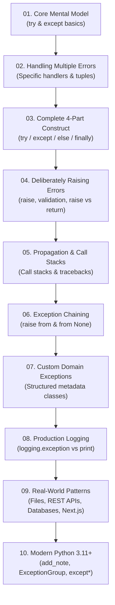
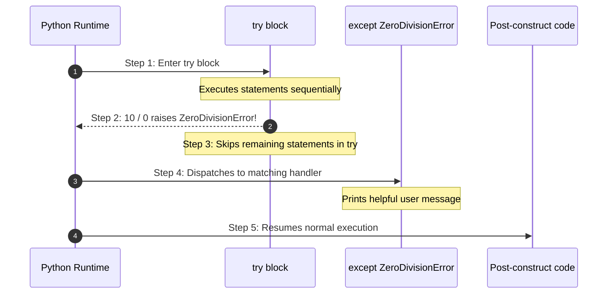
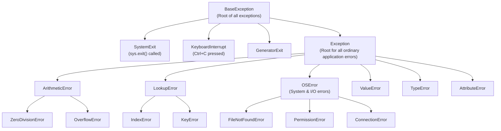
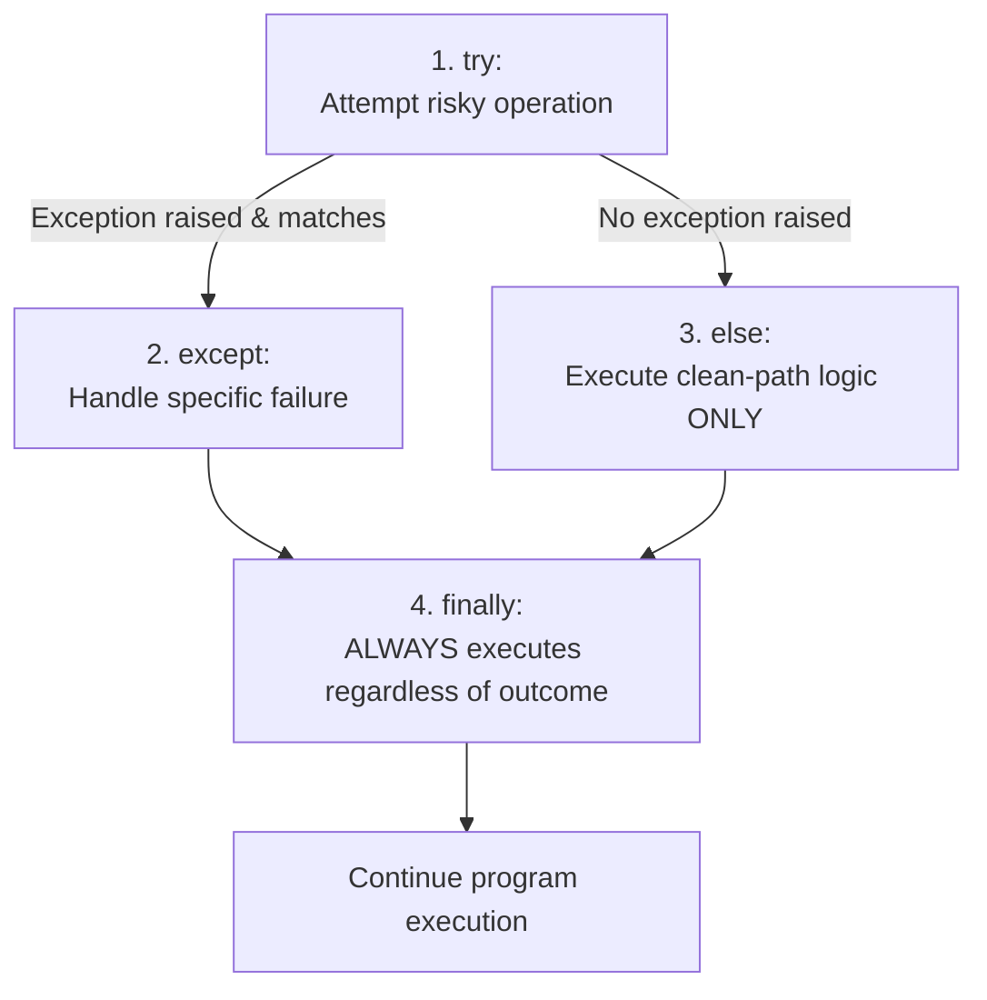
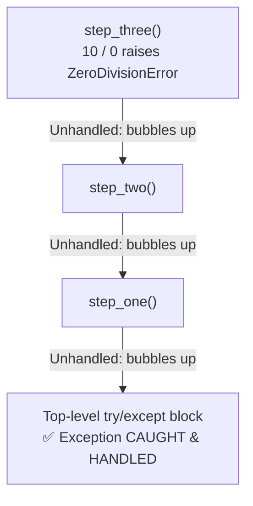

import { Callout } from "fumadocs-ui/components/callout";
import { Tabs, Tab } from "fumadocs-ui/components/tabs";
import { Accordion, Accordions } from "fumadocs-ui/components/accordion";

In production software—whether an e-commerce checkout engine, an autonomous AI pipeline, or a backend API—**unhandled crashes are unacceptable**. If an external database connection drops, a user supplies malformed input, or an API server times out, your program must intercept the failure, clean up acquired resources, log diagnostic telemetry, and recover gracefully.

Error handling means **teaching your program what to do when something goes wrong**, instead of letting it crash unexpectedly.

Imagine building a login system. A user enters their password, but the authentication database is temporarily unreachable.

- **Without error handling:** The server crashes, throwing a terrifying 50-line traceback into the user's browser.
- **With error handling:** The program catches the database timeout, logs the incident internally, and displays a friendly message:
  > _"We're having trouble connecting to our servers right now. Please try again in a few moments."_

That is the essence of professional error handling: **detect problems, handle them appropriately, and keep the application running safely.**

---

## The Learning Roadmap



---

## 1. First Steps: The Anatomy of `try` and `except`

Python provides two primary keywords to intercept runtime exceptions:

- **`try`**: Wraps the code that might fail or raise an exception.
- **`except`**: Contains the fallback code that executes if a matching exception occurs.

Consider this division operation:

```python
try:
    a = 10
    b = 0
    print(a / b)
except ZeroDivisionError:
    print("You cannot divide by zero!")
```

Output:

```text
You cannot divide by zero!
```

### The 5-Step Execution Lifecycle



When an exception is raised inside a `try` block, **Python immediately stops executing subsequent statements inside that `try` block** and jumps directly to the matching `except` handler. Statements _after_ the entire `try/except` block continue running normally:

```python
try:
    print("Step 1: Starting calculation...")
    print(10 / 0)  # 💥 ZeroDivisionError raised here!
    print("Step 2: This line NEVER executes!")
except ZeroDivisionError:
    print("Step 3: Something went wrong, but we caught it!")

print("Step 4: The program continues executing cleanly.")
```

Output:

```text
Step 1: Starting calculation...
Step 3: Something went wrong, but we caught it!
Step 4: The program continues executing cleanly.
```

### Handling User Input Gracefully

A classic real-world use case is parsing user input from the terminal:

```python
try:
    age = int(input("Enter your age: "))
    print(f"You are {age} years old.")
except ValueError:
    print("Please enter a valid whole number (e.g., 25).")
```

If the user enters `21`, the conversion succeeds and Python skips the `except` block. If the user enters `twenty`, `int()` raises a `ValueError`, the `except` block catches it, and the script exits without a crash traceback.

### Accessing Exception Details (`as err`)

To inspect the error message generated by Python, capture the exception instance using the `as` keyword:

```python
try:
    number = int("hello")
except ValueError as err:
    print("Error kind:    ", type(err).__name__)
    print("Error message: ", err)
    print("Raw arguments: ", err.args)
```

Output:

```text
Error kind:     ValueError
Error message:  invalid literal for int() with base 10: 'hello'
Raw arguments:  ("invalid literal for int() with base 10: 'hello'",)
```

<Callout type="tip" title="The Mental Distinction">
  - <code>ValueError</code> identifies the **class/category** of problem. -{" "}
  <code>err</code> is the specific **instance** holding diagnostic details about
  *this specific failure*.
</Callout>

---

## 2. Handling Multiple Exceptions & Catching Tuples

Real programs perform operations where multiple things can go wrong independently. You can write multiple `except` blocks or combine them into a tuple.

### Strategy A: Distinct Responses for Distinct Errors

Use multiple `except` blocks when each error requires a different recovery action:

```python
try:
    number = int(input("Enter a divisor: "))
    result = 100 / number
    print(f"Result: {result}")
except ValueError:
    print("Error: Input must be numeric digits only.")
except ZeroDivisionError:
    print("Error: Zero is not allowed as a divisor.")
```

Python checks `except` blocks **from top to bottom** and executes only the first matching handler.

### Strategy B: Grouping Exceptions in a Tuple

When multiple errors should be handled with the exact same recovery logic, combine them into a tuple:

```python
try:
    number = int(input("Enter a divisor: "))
    result = 100 / number
    print(f"Result: {result}")
except (ValueError, ZeroDivisionError) as err:
    print(f"Calculation aborted due to invalid input: {err}")
```

---

## 3. The Python Exception Class Hierarchy & Handler Ordering

All exceptions in Python are classes organized in an inheritance hierarchy derived from **`BaseException`**.



### The Exception Catching Rule

An `except` clause matches any exception that is an **instance of that class or any of its subclasses**.

Because `ZeroDivisionError` inherits from `ArithmeticError`, catching `ArithmeticError` will also catch `ZeroDivisionError`:

```python
try:
    10 / 0
except ArithmeticError:
    print("Caught an arithmetic calculation error!")
```

### The Critical Ordering Rule: Most Specific First

Because Python selects the **first matching block**, you must always order handlers from **most specific (subclass) to most general (parent class)**:

```python
# ✅ CORRECT ORDER: Specific subclass before broad parent
try:
    with open("config.json", "r", encoding="utf-8") as f:
        data = f.read()
except FileNotFoundError:
    print("Specific handler: File does not exist on disk.")
except OSError as err:
    print(f"General OS handler: Disk/permission error: {err}")
except Exception as err:
    print(f"Catch-all fallback: Unexpected application error: {err}")
```

<Callout type="error" title="Dead Code Hazard">
  Placing a broad superclass like <code>LookupError</code> or <code>Exception</code> above a specific subclass creates **dead code** that will never execute:
  ```python
  # ❌ INCORRECT: Broad parent masks specific child
  try:
      d = {"name": "Alice"}
      print(d["missing_key"])
  except LookupError:  # LookupError is the parent of KeyError!
      print("Caught generic lookup error")
  except KeyError:     # ⚠️ DEAD CODE: This block is NEVER REACHED!
      print("Caught KeyError")
  ```
</Callout>

### Why You Must Never Use Bare `except:`

```python
# ❌ CATASTROPHIC ANTI-PATTERN
try:
    process_payment()
except:
    pass
```

A bare `except:` (or `except BaseException:`) catches **everything without exception**, including:

1. `KeyboardInterrupt`: When the developer or operator presses <kbd>Ctrl</kbd> + <kbd>C</kbd> to stop a runaway script.
2. `SystemExit`: When `sys.exit()` is invoked.
3. Typos in code: `NameError`, `AttributeError`, or `TypeError` are silently hidden, making bugs impossible to debug.

**Rule:** Always catch specific exceptions (e.g. `except (KeyError, ValueError):`), or at minimum catch `except Exception as err:` when writing an intentional top-level fallback.

---

## 4. The Complete 4-Part Construct: `try`, `except`, `else`, `finally`

Python provides four interconnected blocks for complete failure recovery and deterministic cleanup:



### When Each Block Executes

| Block         | When Does It Run?                                                                       | Primary Purpose                                                                      |
| :------------ | :-------------------------------------------------------------------------------------- | :----------------------------------------------------------------------------------- |
| **`try`**     | Always entered.                                                                         | Wrap code that could fail (file operations, network calls, type conversions).        |
| **`except`**  | Only if a matching exception is raised inside `try`.                                    | Handle errors, log alerts, return fallbacks, or re-raise.                            |
| **`else`**    | Only if the `try` block finishes with **zero exceptions**.                              | Operations that must run _only on success_, but should not be shielded by the `try`. |
| **`finally`** | **Guaranteed to always run**, whether `try` succeeded, failed, was caught, or returned. | Resource cleanup: closing sockets, freeing locks, returning database connections.    |

### Step-by-Step Walkthrough: Success vs. Failure Path

<Tabs items={["Success Path ('25')", "Failure Path ('hello')"]}>
<Tab value="Success Path ('25')">

```python
try:
    number = int("25")
except ValueError:
    print("Conversion failed!")
else:
    print("Conversion successful:", number)
finally:
    print("Execution complete.")
```

Output:

```text
Conversion successful: 25
Execution complete.
```

**Execution trace:**

1. `try` succeeds: `"25"` is converted to integer `25`.
2. `except` is **skipped**.
3. `else` **runs** because no exception occurred.
4. `finally` **runs** at the conclusion.

</Tab>
<Tab value="Failure Path ('hello')">

```python
try:
    number = int("hello")
except ValueError:
    print("Conversion failed!")
else:
    print("Conversion successful:", number)
finally:
    print("Execution complete.")
```

Output:

```text
Conversion failed!
Execution complete.
```

**Execution trace:**

1. `try` raises `ValueError` on `int("hello")`.
2. `except` **runs** to handle the `ValueError`.
3. `else` is **skipped** because an error occurred.
4. `finally` **runs** at the conclusion.

</Tab>
</Tabs>

### Why Does `else` Exist?

Why not simply put success code inside the `try` block?

```python
# ❌ SUB-OPTIMAL: try block is too broad
try:
    raw_age = input("Enter age: ")
    age = int(raw_age)
    save_to_database(age)  # If this raises a ValueError internally, it gets misclassified!
except ValueError:
    print("Invalid age entered.")
```

```python
# ✅ OPTIMAL: Only the risky conversion is protected
try:
    raw_age = input("Enter age: ")
    age = int(raw_age)
except ValueError:
    print("Invalid age entered.")
else:
    # Runs ONLY if the int conversion succeeded cleanly:
    save_to_database(age)
```

Using `else` keeps `try` blocks minimal and prevents bugs in downstream logic from being accidentally caught by an input-validation `except` block.

### Cleanup: `finally` vs. Context Managers (`with`)

The `finally` block is Python's general cleanup mechanism:

```python
file = None
try:
    file = open("transactions.log", "r", encoding="utf-8")
    content = file.read()
except FileNotFoundError:
    print("Log file not found.")
finally:
    if file is not None:
        file.close()
        print("File safely closed.")
```

However, whenever a resource supports Python's **context manager protocol** (`with` statement), prefer `with` over manual `finally` closing:

```python
try:
    with open("transactions.log", "r", encoding="utf-8") as file:
        content = file.read()
except FileNotFoundError:
    print("Log file not found.")
else:
    print(f"Read {len(content)} characters.")
```

The `with` statement automatically invokes `file.close()` the instant execution exits the block—even if an exception occurs inside the `with` block!

<Callout type="warn" title="The Dangerous finally Return Trap">
  Never put a <code>return</code> or <code>raise</code> statement inside a <code>finally</code> block!
  <br />
  If a <code>finally</code> block executes a <code>return</code>, it **silently suppresses and discards any active exception** that was raised in the <code>try</code> block:
  ```python
  def dangerous_func():
      try:
          raise ValueError("Database credentials rejected!")
      finally:
          return "All good"  # ⚠️ SILENTLY WIPES OUT THE VALUEERROR!

print(dangerous_func()) # Prints 'All good' with ZERO indication of failure!

````
</Callout>

---

## 5. Deliberately Raising Exceptions (`raise`)

So far, we have caught exceptions that Python raised automatically. However, professional code frequently needs to **signal when business rules or preconditions are violated**.

The syntax is straightforward:

```python
def withdraw_funds(balance: float, amount: float) -> float:
  if amount <= 0:
      raise ValueError("Withdrawal amount must be strictly greater than zero.")
  if amount > balance:
      raise ValueError(f"Insufficient funds. Balance: \${balance:.2f}, Requested: \${amount:.2f}")

  return balance - amount

try:
  new_balance = withdraw_funds(balance=100.0, amount=250.0)
except ValueError as err:
  print(f"Transaction rejected: {err}")
````

Output:

```text
Transaction rejected: Insufficient funds. Balance: $100.00, Requested: $250.00
```

### Architectural Decision: `raise` vs. `return`

A frequent dilemma for developers is deciding whether a function should return a status value (like `None` or `False`) or raise an exception:

```python
# Approach A: Returning a status
def find_user_by_email(email: str) -> dict | None: ...

# Approach B: Raising an exception
def authenticate_user(email: str, password: str) -> UserSession: ...
```

| Decision Metric  | Use `return None` / `return False`                                                                    | Use `raise Exception(...)`                                                                        |
| :--------------- | :---------------------------------------------------------------------------------------------------- | :------------------------------------------------------------------------------------------------ |
| **Expectation**  | The condition is a routine, expected outcome (e.g. searching a cache, querying if an email is taken). | The condition violates a contractual invariant (invalid state, corrupted payload, network crash). |
| **Consequences** | The caller naturally branches with an `if result is None:`.                                           | Failing to handle the situation could lead to data corruption or silent security bypasses.        |
| **Context**      | No rich diagnostic data is needed; simple absence suffices.                                           | Callers need to know _why_ the operation failed (e.g., token expired vs signature invalid).       |

### Re-raising Exceptions: Bare `raise`

Sometimes you want to log an error at a low level, but still allow higher layers (such as a web framework or queue worker) to handle or retry the failure.

Use a **bare `raise`** inside the `except` block:

```python
def fetch_remote_configuration():
    try:
        with open("config.json", "r", encoding="utf-8") as f:
            return f.read()
    except OSError as err:
        print(f"[Telemetry] Failed to read configuration from disk: {err}")
        raise  # Re-raises the active OSError with its original traceback!
```

<Callout type="tip" title="Bare raise vs. raise err">
  Always use bare <code>raise</code> instead of <code>raise err</code>.
  <br />
  Bare <code>raise</code> preserves the **original line number and stack frame**
  where the exception occurred. Writing <code>raise err</code> replaces the
  starting point with the line where <code>raise err</code> was called!
</Callout>

---

## 6. Exception Propagation & The Call Stack

When an exception is raised inside a nested function and not caught, Python **propagates it up the call stack** to the calling function, and then to that function's caller, until a matching handler is found:

```python
def step_three():
    return 10 / 0  # 💥 ZeroDivisionError raised here

def step_two():
    return step_three()

def step_one():
    return step_two()

try:
    step_one()
except ZeroDivisionError:
    print("Caught division by zero at top-level boundary!")
```



### Where Should You Handle an Exception?

Handle an exception at the **layer that has enough contextual knowledge to respond intelligently**:

- A JSON parsing function should not decide how to inform the user; it should let `ValueError` bubble up.
- A service function should translate low-level I/O errors into domain terms (`AccountNotFoundError`).
- A web controller should catch domain errors and return HTTP status codes (`400 Bad Request` or `404 Not Found`).
- A top-level script runner should catch unhandled fallbacks, log the traceback, and exit with code 1.

---

## 7. Exception Chaining: `raise ... from`

When building libraries or layered architectures, you often catch a low-level technical exception (`KeyError`, `sqlite3.OperationalError`) and convert it into a meaningful domain error (`ConfigurationError`).

Python's **`from`** clause creates an explicit causal chain (PEP 3134):

```python
class ConfigurationError(Exception):
    """Raised when server settings are invalid or missing."""
    pass

def load_server_port(config: dict) -> int:
    try:
        return int(config["PORT"])
    except (KeyError, ValueError) as err:
        # Explicitly links the original exception as the cause:
        raise ConfigurationError("Server PORT setting is missing or not a valid integer.") from err
```

When Python prints the traceback, it displays both exceptions and clearly states the causal connection:

```text
ValueError: invalid literal for int() with base 10: 'eight-thousand'

The above exception was the direct cause of the following exception:

Traceback (most recent call last):
  File "app.py", line 10, in <module>
    load_server_port({"PORT": "eight-thousand"})
  File "app.py", line 8, in load_server_port
    raise ConfigurationError("Server PORT setting is missing...") from err
ConfigurationError: Server PORT setting is missing or not a valid integer.
```

### Suppressing Internal Implementation Details (`from None`)

If the original exception exposes sensitive internal details or unnecessary stack noise, suppress it completely using `from None`:

```python
def get_secret_credential(vault: dict, key: str) -> str:
    try:
        return vault[key]
    except KeyError:
        # Hides the original KeyError completely from the end user:
        raise PermissionError(f"Access to secret key '{key}' is unauthorized.") from None
```

---

## 8. Defining Robust Custom Exceptions

In professional software development, never rely solely on standard built-in exceptions like `Exception` or `ValueError` for domain failures. Build a structured exception hierarchy for your application or package.

### Best Practices for Custom Exceptions

1. **Create an Application Base Exception**: Inherit from `Exception` (never `BaseException`).
2. **Derive Specific Domain Errors**: Group related errors under common sub-parents.
3. **Store Structured Metadata**: Attach diagnostic fields to `self` so callers can inspect properties programmatically without parsing strings!

```python
class PaymentGatewayError(Exception):
    """Base exception for all payment-related failures."""
    pass

class InsufficientBalanceError(PaymentGatewayError):
    """Raised when an account lacks enough funds for a charge."""
    def __init__(self, account_id: str, balance: float, required: float):
        self.account_id = account_id
        self.balance = balance
        self.required = required
        self.shortfall = required - balance
        super().__init__(
            f"Account '{account_id}' has \${balance:.2f}, but transaction requires \${required:.2f}."
        )

class GatewayTimeoutError(PaymentGatewayError):
    """Raised when third-party payment provider exceeds timeout deadline."""
    def __init__(self, provider: str, timeout_seconds: float):
        self.provider = provider
        self.timeout_seconds = timeout_seconds
        super().__init__(
            f"Provider '{provider}' failed to respond within {timeout_seconds}s."
        )
```

### Consuming Structured Custom Exceptions

Callers can now inspect attributes programmatically to formulate dynamic responses or automated top-up suggestions:

```python
def process_checkout(account_id: str, amount: float, current_balance: float):
    if amount > current_balance:
        raise InsufficientBalanceError(account_id, current_balance, amount)
    print("Charge approved.")

try:
    process_checkout(account_id="acc_982", amount=500.0, current_balance=120.0)
except InsufficientBalanceError as err:
    # Access structured attributes directly—no messy string regex needed!
    print(f"Payment rejected for {err.account_id}.")
    print(f"Please deposit at least \${err.shortfall:.2f} to complete this purchase.")
except PaymentGatewayError as err:
    print(f"Payment gateway error: {err}")
```

Output:

```text
Payment rejected for acc_982.
Please deposit at least $380.00 to complete this purchase.
```

---

## 9. Production Debugging & Logging

In toy scripts, `print(err)` is common. In production services, **always use Python's built-in `logging` module**:

```python
import logging

# Configure logger format and severity threshold
logging.basicConfig(
    level=logging.INFO,
    format="%(asctime)s [%(levelname)s] %(name)s: %(message)s"
)
logger = logging.getLogger("BillingEngine")

def divide_funds(total: float, parts: int) -> float:
    try:
        return total / parts
    except ZeroDivisionError:
        # logging.exception() automatically records the full traceback at ERROR level!
        logger.exception("Division calculation failed.")
        return 0.0
```

### Standard Logging Levels

| Level      | When to Use                                                                           |
| :--------- | :------------------------------------------------------------------------------------ |
| `DEBUG`    | Detailed low-level diagnostic output for local development.                           |
| `INFO`     | Routine operational confirmations (e.g., "Worker 3 started", "Order 101 processed").  |
| `WARNING`  | Something unusual happened, but execution continues (e.g. "Rate limit 80% consumed"). |
| `ERROR`    | An operation failed, but the application remains running.                             |
| `CRITICAL` | Severe catastrophic failure (e.g., "Database disk full", "Security vault offline").   |

### The Duplicate Logging Anti-Pattern

Avoid logging an exception and immediately re-raising it at every single layer of your application:

```python
# ❌ ANTI-PATTERN: Results in 3 identical error messages in logs!
def layer_three():
    try:
        do_work()
    except Exception as e:
        logger.error(f"Error in layer 3: {e}")
        raise

def layer_two():
    try:
        layer_three()
    except Exception as e:
        logger.error(f"Error in layer 2: {e}")
        raise
```

**Rule:** Log an exception at the boundary where it is **handled**, or let it bubble up to a single centralized top-level logging handler.

---

## 10. Real-World Error Handling Scenarios

### Scenario 1: Resilient File Processing

```python
from pathlib import Path

def load_user_manifest(filepath: str) -> str | None:
    path = Path(filepath)
    try:
        with path.open("r", encoding="utf-8") as f:
            return f.read()
    except FileNotFoundError:
        logger.warning("Manifest '%s' does not exist.", filepath)
        return None
    except PermissionError:
        logger.error("Read permission denied for '%s'.", filepath)
        raise
    except OSError as err:
        logger.error("OS error reading '%s': %s", filepath, err)
        raise
```

### Scenario 2: External REST API Calls with `requests`

```python
import requests

def fetch_exchange_rate(base: str, target: str) -> float | None:
    url = f"https://api.frankfurter.app/latest?from={base}&to={target}"
    try:
        response = requests.get(url, timeout=3.0)  # Always set an explicit timeout!
        response.raise_for_status()               # Raises HTTPError for 4xx/5xx responses
        data = response.json()                    # Raises requests.JSONDecodeError if not JSON
        return float(data["rates"][target])
    except requests.Timeout:
        logger.warning("Currency API timed out after 3.0s.")
        return None
    except requests.HTTPError as err:
        logger.error("Currency API returned HTTP %s: %s", response.status_code, err)
        return None
    except (requests.RequestException, KeyError, ValueError) as err:
        logger.error("Failed to parse exchange rate payload: %s", err)
        return None
```

### Scenario 3: Python vs. Next.js / TypeScript Error Handling

For developers working in fullstack environments, here is how Python error handling translates directly to TypeScript and Next.js:

| Concept                | Python                               | TypeScript / Next.js                                                    |
| :--------------------- | :----------------------------------- | :---------------------------------------------------------------------- |
| **Try / Catch**        | `try: ... except Exception as err:`  | `try { ... } catch (err: unknown) { ... }`                              |
| **Cleanup Block**      | `finally:`                           | `finally { ... }`                                                       |
| **Throwing / Raising** | `raise ValueError("Invalid amount")` | `throw new Error("Invalid amount")`                                     |
| **Exception Chaining** | `raise AppError(...) from err`       | `throw new AppError("...", { cause: err })`                             |
| **Custom Exceptions**  | `class AppError(Exception): pass`    | `class AppError extends Error { ... }`                                  |
| **Context Managers**   | `with open(...) as f:`               | `using handle = openResource();` (TS 5.2+ Explicit Resource Management) |
| **Observability**      | `logging.exception("...")`           | `console.error(err)` / Sentry / Winston                                 |

---

## 11. Python's Core Architectural Philosophies: EAFP vs. LBYL

In traditional languages (C, C++, Java), developers often follow **LBYL ("Look Before You Leap")**: checking every precondition before executing an operation.

In Python, the dominant, idiomatic style is **EAFP ("Easier to Ask for Forgiveness than Permission")**: attempting the operation directly and handling the exception if it fails.

<Tabs items={["EAFP (Pythonic Standard)", "LBYL (Traditional Pre-Checking)"]}>
<Tab value="EAFP (Pythonic Standard)">

```python
# Assume the best, catch the specific exception:
def get_primary_role(user: dict) -> str:
    try:
        return user["roles"][0]
    except (KeyError, IndexError, TypeError):
        return "guest"
```

</Tab>
<Tab value="LBYL (Traditional Pre-Checking)">

```python
# Check every single precondition manually with nested ifs:
def get_primary_role(user: dict) -> str:
    if isinstance(user, dict) and "roles" in user:
        if isinstance(user["roles"], list) and len(user["roles"]) > 0:
            return user["roles"][0]
    return "guest"
```

</Tab>
</Tabs>

### Why Python Prefers EAFP

1. **Eliminates Race Conditions (TOCTOU - Time Of Check To Time Of Use)**:
   In file I/O or networking, checking `if os.path.exists("data.csv")` before `open("data.csv")` is unsafe. Another process or thread could delete the file in the microsecond between the check and the `open` call! With EAFP, `try: with open(...)` handles it atomically.
2. **Superior Readability**:
   The "happy path" code remains clean and prominent rather than buried under layers of defensive nested checks.
3. **Zero-Cost Exceptions in Python 3.11+**:
   Entering a `try` block that does not raise an exception incurs zero runtime overhead in Python 3.11+. Defensive pre-checks (`isinstance`, `len`, `in`) consume CPU cycles on every single invocation.

---

## 12. Modern Python 3.11+ Exception Features

### 1. Attaching Context with Exception Notes (`add_note()`)

Python 3.11 introduced `add_note()`, allowing you to attach contextual diagnostic metadata to an active exception without altering its type or modifying its string message:

```python
def process_order(order_id: str, account_id: str):
    try:
        int("invalid_amount")
    except ValueError as err:
        # Attach rich diagnostic context before re-raising:
        err.add_note(f"Transaction Order ID: {order_id}")
        err.add_note(f"Customer Account ID: {account_id}")
        err.add_note("Server Pod: worker-us-east-04")
        raise

process_order("ORD-9842", "ACC-104")
```

Output traceback in terminal or Sentry:

```text
Traceback (most recent call last):
  File "app.py", line 4, in process_order
    int("invalid_amount")
ValueError: invalid literal for int() with base 10: 'invalid_amount'
Transaction Order ID: ORD-9842
Customer Account ID: ACC-104
Server Pod: worker-us-east-04
```

### 2. Exception Groups & `except*` (PEP 654)

In concurrent or parallel programming (e.g. `asyncio.TaskGroup` or multi-threading), multiple independent tasks can fail simultaneously. A classic `try ... except` can only intercept a single exception.

Python 3.11 introduced **`ExceptionGroup`** and the **`except*`** syntax to handle concurrent errors independently:

```python
def run_concurrent_batch():
    raise ExceptionGroup(
        "Worker batch encountered multiple failures",
        [
            ValueError("Worker A: Invalid payload format"),
            ConnectionError("Worker B: Redis timeout"),
            ValueError("Worker C: Negative balance"),
        ]
    )

try:
    run_concurrent_batch()
except* ValueError as eg:
    # Catches and handles ALL ValueErrors in the group:
    print(f"Handled {len(eg.exceptions)} validation errors: {eg.exceptions}")
except* ConnectionError as eg:
    # Catches connection failures in the same group:
    print(f"Handled network error: {eg.exceptions}")
```

---

## 13. Common Anti-Patterns & Best Practices Checklist

|  #  | Anti-Pattern                            | Correct Practice                                                                                |
| :-: | :-------------------------------------- | :---------------------------------------------------------------------------------------------- |
|  1  | **Bare `except:` or `except: pass`**    | Always catch specific exceptions (`except (ValueError, KeyError):`).                            |
|  2  | **Over-broad `try` blocks**             | Keep `try` scoped strictly to the line that performs the risky operation.                       |
|  3  | **Returning in `finally`**              | Never use `return` or `raise` inside `finally`; it discards active exceptions.                  |
|  4  | **Logging and re-raising repeatedly**   | Log at the handling boundary, or re-raise with bare `raise` for the top-level runner.           |
|  5  | **Using string matching on error text** | Store structured attributes on custom exception classes (`err.status_code`, `err.retry_after`). |
|  6  | **Treating exceptions as flow control** | Don't use exceptions for expected conditions where simple `if/else` is faster and clearer.      |

---

## 14. Practice Questions & Real-World Challenges

Test your mastery of control flow, exception chaining, custom exceptions, and production logging.

### Question 1: Output Prediction (Control Flow with `try/except/else/finally`)

Trace the exact output of this function across two invocations:

```python
def calculate_metric(val: str) -> str:
    try:
        num = float(val)
        res = 100.0 / num
    except ValueError:
        print("[Handler] Invalid format")
        return "ERR_FORMAT"
    except ZeroDivisionError:
        print("[Handler] Zero division")
        return "ERR_ZERO"
    else:
        print(f"[Success] Metric: {res:.1f}")
        return "OK"
    finally:
        print("[Cleanup] Releasing channel")

print("--- Test 1 ('25') ---")
res1 = calculate_metric("25")
print("Return:", res1)

print("\n--- Test 2 ('bad') ---")
res2 = calculate_metric("bad")
print("Return:", res2)
```

<Accordions>
<Accordion title="Reveal Solution & Explanation">

**Terminal Output:**

```text
--- Test 1 ('25') ---
[Success] Metric: 4.0
[Cleanup] Releasing channel
Return: OK

--- Test 2 ('bad') ---
[Handler] Invalid format
[Cleanup] Releasing channel
Return: ERR_FORMAT
```

**Key Insight for `finally`:**
The `finally` block **always runs before the function returns**, even when a `return` statement was reached inside `try`, `except`, or `else`. Python evaluates the return value, pauses, executes the `finally` cleanup logic, and then completes the return to the caller.

</Accordion>
</Accordions>

---

### Question 2: Spot and Fix the Bug (The Bare `except:` Trap)

A developer wrote this caching helper:

```python
def load_cached_profile(user_id: int) -> dict:
    try:
        data = get_cache_clinet().fetch_user(user_id)
        return data
    except:
        return {"id": user_id, "status": "offline"}
```

1. What occurs if there is a typo in the function name (`get_cache_clinet` instead of `get_cache_client`)?
2. What happens if the developer presses <kbd>Ctrl</kbd> + <kbd>C</kbd> while this function is running?
3. How should this be written safely?

<Accordions>
<Accordion title="Reveal Solution & Explanation">

**1. Typo Masking:**
`get_cache_clinet` raises a `NameError`. Because bare `except:` catches all exceptions, the `NameError` is swallowed! The function returns the offline fallback dictionary, making it look like the cache missed when the code actually had a syntax/naming bug.

**2. Trapped Process:**
Bare `except:` intercepts `BaseException`, which includes `KeyboardInterrupt`. The user cannot stop the script via <kbd>Ctrl</kbd> + <kbd>C</kbd>!

**3. The Clean Fix:**

```python
from cache_library import CacheConnectionError, CacheKeyNotFoundError

def load_cached_profile(user_id: int) -> dict:
    try:
        return get_cache_client().fetch_user(user_id)
    except (CacheConnectionError, CacheKeyNotFoundError) as err:
        logger.warning(f"Cache lookup failed for user {user_id}: {err}")
        return {"id": user_id, "status": "offline"}
```

</Accordion>
</Accordions>

---

### Question 3: Exception Chaining (`raise ... from`)

Analyze these two error-raising patterns:

```python
# Pattern A:
try:
    load_secrets()
except FileNotFoundError:
    logger.critical("Secret vault file missing!")
    raise

# Pattern B:
try:
    port = int(config["PORT"])
except (KeyError, ValueError) as err:
    raise ConfigurationError("PORT setting is invalid or absent") from err
```

1. What is the operational purpose of the bare `raise` in Pattern A?
2. What does `from err` achieve in Pattern B?

<Accordions>
<Accordion title="Reveal Solution & Explanation">

1. **Bare `raise` (Pattern A):**
   Re-raises the active `FileNotFoundError` without altering its original stack frame or line number. This allows local logging while letting the crash propagate to higher-level monitors.

2. **Exception Chaining `from err` (Pattern B):**
   Translates low-level implementation details (`KeyError`, `ValueError`) into a high-level domain error (`ConfigurationError`), while explicitly preserving the causal relationship in the traceback for debugging.

</Accordion>
</Accordions>

---

### Question 4: Code Challenge (Resilient User Input Loop)

Write a function `prompt_integer(prompt_text: str, min_val: int, max_val: int, max_attempts: int = 3) -> int` that:

1. Prompts the user for an integer input.
2. Catches `ValueError` if the user enters non-numeric text.
3. If the number is not within `[min_val, max_val]`, prints an informative message and retries.
4. If the user fails `max_attempts` times, raises a `RuntimeError("Maximum retry attempts exceeded.")`.

<Accordions>
<Accordion title="Reveal Solution & Code">

```python
def prompt_integer(prompt_text: str, min_val: int, max_val: int, max_attempts: int = 3) -> int:
    attempts = 0
    while attempts < max_attempts:
        attempts += 1
        raw_val = input(f"{prompt_text} [{min_val}-{max_val}]: ")
        try:
            val = int(raw_val)
        except ValueError:
            print(f"Invalid input: '{raw_val}' is not a valid integer. (Attempt {attempts}/{max_attempts})")
            continue

        if not (min_val <= val <= max_val):
            print(f"Out of range: {val} is not between {min_val} and {max_val}. (Attempt {attempts}/{max_attempts})")
            continue

        return val

    raise RuntimeError(f"Maximum retry attempts ({max_attempts}) exceeded.")

# Example usage:
if __name__ == "__main__":
    try:
        user_choice = prompt_integer("Choose an option", min_val=1, max_val=5)
        print(f"Selected option: {user_choice}")
    except RuntimeError as err:
        print(f"Aborted: {err}")
```

</Accordion>
</Accordions>

---

### Question 5: Code Challenge (Resilient List Sanitizer)

Write a function `sanitize_scores(raw_scores: list[str]) -> dict` that parses a list of messy user inputs:

```python
raw_scores = ["95", "100", "absent", "82", "N/A", "150", "-5", "74"]
```

Requirements:

1. Convert each string to an integer.
2. If conversion fails (`ValueError`) or the score is not between `0` and `100`, record it as invalid.
3. Compute and return a summary dictionary:
   ```python
   {
       "valid": [95, 100, 82, 74],
       "invalid": ["absent", "N/A", "150", "-5"],
       "average": 87.75
   }
   ```

<Accordions>
<Accordion title="Reveal Solution & Code">

```python
def sanitize_scores(raw_scores: list[str]) -> dict:
    valid: list[int] = []
    invalid: list[str] = []

    for item in raw_scores:
        try:
            score = int(item)
            if not (0 <= score <= 100):
                raise ValueError(f"Score {score} out of bounds.")
            valid.append(score)
        except ValueError:
            invalid.append(item)

    average = sum(valid) / len(valid) if valid else 0.0

    return {
        "valid": valid,
        "invalid": invalid,
        "average": round(average, 2)
    }

# Verification:
scores = ["95", "100", "absent", "82", "N/A", "150", "-5", "74"]
print(sanitize_scores(scores))
# Output: {'valid': [95, 100, 82, 74], 'invalid': ['absent', 'N/A', '150', '-5'], 'average': 87.75}
```

</Accordion>
</Accordions>

---

### Question 6: Production Custom Exception with Metadata & Backoff

Design a custom exception `RateLimitExceededError` that inherits from `Exception`:

- Carries structured attributes: `endpoint: str` and `retry_after: int`.
- Write a function `simulate_api_call(endpoint: str, requests_count: int)` that raises `RateLimitExceededError` when `requests_count > 10`.
- Catch the exception and print: `"Rate limit on /v1/chat. Back off for 45s."` using the exception instance attributes.

<Accordions>
<Accordion title="Reveal Solution & Code">

```python
class RateLimitExceededError(Exception):
    """Raised when client exceeds API rate limits."""
    def __init__(self, endpoint: str, retry_after: int):
        self.endpoint = endpoint
        self.retry_after = retry_after
        super().__init__(
            f"Rate limit exceeded on endpoint '{endpoint}'. Retry after {retry_after}s."
        )

def simulate_api_call(endpoint: str, requests_count: int) -> str:
    if requests_count > 10:
        raise RateLimitExceededError(endpoint=endpoint, retry_after=45)
    return "200 OK"

try:
    simulate_api_call(endpoint="/v1/chat", requests_count=15)
except RateLimitExceededError as err:
    print(f"Rate limit on {err.endpoint}. Back off for {err.retry_after}s.")
```

</Accordion>
</Accordions>

---

## 15. The Master Revision Cheat Sheet

| Keyword / Concept         | Operational Meaning                                 | Best Practice                                                      |
| :------------------------ | :-------------------------------------------------- | :----------------------------------------------------------------- |
| **`try`**                 | Wraps risky code that may fail.                     | Keep scope minimal; never wrap hundreds of unrelated lines.        |
| **`except`**              | Intercepts matching exceptions.                     | Always name specific classes (e.g., `except ValueError:`).         |
| **`else`**                | Executes only when `try` finished with zero errors. | Place downstream success logic here to avoid broadening the `try`. |
| **`finally`**             | Executes unconditionally on exit.                   | Clean up external resources; never use `return` inside `finally`.  |
| **`raise`**               | Signals an error or rule violation.                 | Use when function contracts or business invariants are broken.     |
| **Bare `raise`**          | Re-raises active exception.                         | Preserves original traceback and stack frame.                      |
| **`raise ... from err`**  | Chains new exception to original cause.             | Use when translating low-level errors to high-level domain errors. |
| **`raise ... from None`** | Suppresses original exception context.              | Use to hide sensitive internal implementation stack details.       |
| **`as err`**              | Binds caught exception instance to variable.        | Inspect `err` attributes and messages programmatically.            |
| **`err.add_note(...)`**   | Appends diagnostic notes (Python 3.11+).            | Attach host IDs, order numbers, or telemetry to tracebacks.        |
| **`except*`**             | Intercepts subgroups within `ExceptionGroup`.       | Used for concurrent workflows (`asyncio.TaskGroup`).               |
| **EAFP**                  | "Easier to Ask for Forgiveness than Permission".    | Preferred Pythonic style for atomicity and readability.            |
| **`logging.exception`**   | Records message + traceback at ERROR level.         | Call strictly from within active `except` handlers.                |

Now that you have mastered error resilience and defense, let's explore how to structure real-world Python applications in **[14. Project Structure & Repository Layout](/docs/learn-python/01-fundamentals/14-project-structure)**!
