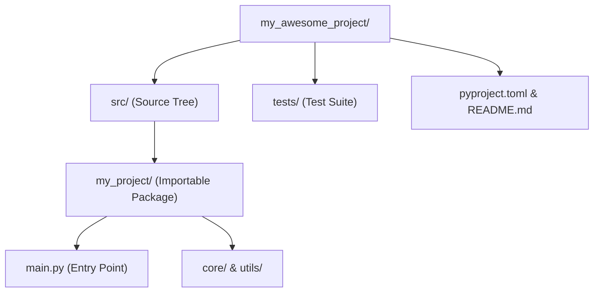

import { Callout } from "fumadocs-ui/components/callout";
import { Tabs, Tab } from "fumadocs-ui/components/tabs";
import { Accordion, Accordions } from "fumadocs-ui/components/accordion";

When starting with Python, putting all your code into a single file like `app.py` or `main.py` is convenient. But as soon as your project grows beyond a hundred lines or needs helper functions, configuration files, and automated tests, an unorganized folder becomes a liability.

A professional project structure provides three immediate benefits:

1. **Separation of Concerns**: Business logic, tests, configuration, and data live in dedicated folders.
2. **Preventing Import Collisions**: Ensures Python imports code from your installed package rather than accidentally loading files from your current working directory.
3. **Reproducibility**: Team members can clone the repo, install dependencies, and run the project immediately.

---

## 1. The Industry Standard: The `src/` Layout

The Python packaging authority (PyPA) recommends the **`src/` layout** for both applications and libraries:

```text
my_awesome_project/
├── .gitignore               # Files git should ignore (.venv, __pycache__, .env)
├── README.md                # Human documentation and setup instructions
├── pyproject.toml           # Project metadata, build tool, and dependencies
├── .env.example             # Template for environment variables (never commit secrets!)
├── src/
│   └── my_project/          # Your actual package code (snake_case)
│       ├── __init__.py      # Marks this directory as a Python package
│       ├── main.py          # Application entry point / CLI trigger
│       ├── config.py        # Settings and environment configuration
│       ├── core/            # Core business domain logic
│       │   ├── __init__.py
│       │   └── processor.py
│       └── utils/           # Shared helper functions (dates, strings, etc.)
│           ├── __init__.py
│           └── helpers.py
├── tests/                   # Automated test suite (mirrors src structure)
│   ├── __init__.py
│   ├── test_processor.py
│   └── test_helpers.py
└── data/                    # Local storage (excluded from git)
    ├── raw/
    └── processed/
```



---

## 2. Critical Root Files Explained

### 1. `pyproject.toml`

Since PEP 518 and PEP 621, `pyproject.toml` is the universal, declarative configuration file for modern Python tooling (replacing legacy `setup.py` and `requirements.txt`):

```toml
[project]
name = "my-project"
version = "0.1.0"
description = "High-performance data pipeline"
readme = "README.md"
requires-python = ">=3.11"
dependencies = [
    "httpx>=0.27.0",
    "pydantic>=2.0.0",
]

[project.scripts]
my-cli = "my_project.main:run_cli"
```

### 2. `.gitignore`

Never commit temporary files or sensitive credentials to GitHub. A standard Python `.gitignore` always includes:

```gitignore
# Virtual environments
.venv/
env/

# Python bytecode caches
__pycache__/
*.py[cod]

# Sensitive credentials & environment files
.env
*.pem
*.key

# Local databases and runtime outputs
*.sqlite3
data/
logs/
```

---

## 3. Virtual Environments: Isolating Dependencies

Never install packages directly into your computer's global Python installation. If Project A requires `pydantic 1.10` and Project B requires `pydantic 2.8`, a global install causes breaking dependency conflicts.

A **virtual environment** is a self-contained folder (`.venv/`) that holds its own isolated Python interpreter and libraries.

<Tabs items={["Modern (uv)", "Standard (python -m venv)"]}>
<Tab value="Modern (uv)">

```bash
# 1. Initialize project with uv
uv init my_project
cd my_project

# 2. Add dependencies (automatically creates .venv and updates pyproject.toml)
uv add httpx rich

# 3. Run your code inside the virtual environment
uv run python src/my_project/main.py
```

</Tab>
<Tab value="Standard (python -m venv)">

```bash
# 1. Create a virtual environment named .venv
python -m venv .venv

# 2. Activate the virtual environment
# Windows (PowerShell):
.venv\Scripts\Activate.ps1
# macOS / Linux (bash/zsh):
source .venv/bin/activate

# 3. Notice your terminal prompt now shows (.venv)
# Install dependencies into this sandbox:
pip install httpx rich

# 4. Run your application:
python src/my_project/main.py
```

</Tab>
</Tabs>

---

## Practice Questions & Challenges

Test your understanding of modern repository architecture, virtual environment sandboxing, import shadowing, and configuration standards.

### Question 1: Command & State Prediction (Virtual Environment Paths)

An engineer executes the following shell commands in their terminal:

```bash
python -m venv .venv
source .venv/bin/activate  # (or .venv\Scripts\Activate.ps1 on Windows)
python -c "import sys; print(sys.prefix == sys.base_prefix)"
```

1. What will `sys.prefix == sys.base_prefix` evaluate to (`True` or `False`)?
2. What is the fundamental difference between `sys.prefix` and `sys.base_prefix`?
3. Where will subsequent `pip install` packages be stored on disk?

<Accordions>
<Accordion title="Reveal Solution & Explanation">

**1. Output:**

```text
False
```

**2. Explanation:**

- `sys.base_prefix` points to the global, root Python installation on the host operating system (e.g. `/usr/local` or `C:\Program Files\Python312`).
- `sys.prefix` points to the active environment. When a virtual environment is active, `sys.prefix` points to the local `.venv/` directory. Because `sys.prefix != sys.base_prefix`, the expression evaluates to `False`.

**3. Package Location:**
Installed packages are stored strictly within the local environment's `site-packages` directory (e.g. `.venv/lib/python3.12/site-packages/` or `.venv\Lib\site-packages\`), ensuring the host operating system's system Python remains untouched.

</Accordion>
</Accordions>

---

### Question 2: Spot and Fix the Bug (The Import Shadowing Trap)

A developer creates a new folder to test mathematical utilities. In the project root, they create a script named `math.py`:

```python
# math.py
def calculate_double(x: int) -> int:
    return x * 2

import math
print("Pi is:", math.pi)
```

When they run `python math.py`, Python crashes with:

```text
AttributeError: partially initialized module 'math' has no attribute 'pi' (most likely due to a circular import)
```

1. Why did this happen when `import math` is part of Python's standard library?
2. How does the `src/` layout prevent this issue when running tests or CLI tools?
3. What is the immediate fix?

<Accordions>
<Accordion title="Reveal Solution & Explanation">

**1. Root Cause:**
When Python evaluates `import math`, it searches the current working directory (`sys.path[0]`) **before** searching the standard library. Because the file itself is named `math.py`, Python attempts to import itself recursively before `math.pi` exists, causing an `AttributeError` circular import crash.

**2. How `src/` Layout Protects You:**
In a `src/` layout, all your package code is isolated under `src/<package_name>/`. The root directory where you launch commands contains only configuration files (`pyproject.toml`, `README.md`), preventing files in the root from hijacking standard library module names.

**3. Immediate Fix:**
Rename the local script to something non-conflicting, such as `math_utils.py` or `calculations.py`, and delete any compiled `__pycache__/math.cpython-*.pyc` files.

</Accordion>
</Accordions>

---

### Question 3: Architecture Question (Why `pyproject.toml` Replaced `requirements.txt`)

In modern Python (PEP 517, 518, and 621), `pyproject.toml` is the official standard for Python projects.

Why has the Python community moved away from keeping separate `requirements.txt`, `setup.py`, and `setup.cfg` files in favor of a single `pyproject.toml`?

<Accordions>
<Accordion title="Reveal Solution & Explanation">

**Key Architectural Reasons:**

1. **Unified Configuration**: Historically, tools each needed their own dotfiles (`.flake8`, `pytest.ini`, `setup.py`, `setup.cfg`, `black.toml`). `pyproject.toml` centralizes dependencies, build system specifications, and tool configurations (Ruff, pytest, coverage) in one declarative TOML file.
2. **Deterministic Build-System Decoupling**: In legacy Python, `setup.py` was an arbitrary executable script. If it needed third-party tools to build, there was no standard way to install those build tools before executing `setup.py`. `[build-system]` in `pyproject.toml` declares build dependencies _before_ the package installation begins.
3. **Declarative Metadata (PEP 621)**: Metadata (project name, version, authors, license, python version requirement) is cleanly parsed without needing to execute untrusted code.

</Accordion>
</Accordions>

---

### Question 4: Hands-On Challenge (The `.gitignore` Safety Audit)

Inspect the following list of items found inside a developer's repository folder:

```text
src/
tests/
.venv/
__pycache__/
.env
pyproject.toml
README.md
.coverage
```

1. Which 4 items from this list **must always be excluded** via `.gitignore`?
2. What disaster could occur if `.env` is committed to a public GitHub repository?
3. Write a minimal, standard `.gitignore` file for a Python repository.

<Accordions>
<Accordion title="Reveal Solution & Explanation">

**1. Items to Ignore:**

- `.venv/` (Virtual environment binaries and library copies)
- `__pycache__/` (Machine-specific compiled bytecode `.pyc` files)
- `.env` (Local secrets, API keys, database credentials)
- `.coverage` (Local test instrumentation temporary binary)

**2. The `.env` Risk:**
`.env` files typically store live secrets (OpenAI API keys, AWS credentials, database passwords). Committing `.env` to a repository exposes these credentials to anyone with read access; automated web bots scrape public GitHub commits in seconds and can rack up thousands of dollars in fraudulent cloud bills.

**3. Minimal Python `.gitignore`:**

```gitignore
# Virtual environments
.venv/
env/
venv/

# Bytecode & caches
__pycache__/
*.py[cod]

# Local environment secrets
.env
.env.*
!.env.example

# Testing & coverage artifacts
.pytest_cache/
.coverage
htmlcov/
dist/
build/
*.egg-info/
```

</Accordion>
</Accordions>

---

### Question 5: Code Challenge (Automated Project Scaffolder)

Write a Python script `scaffold.py` that automatically sets up a production-ready project folder structure using standard library tools (`os`, `pathlib`).

Given a project name (e.g. `analytics_core`), the script must generate:

```text
analytics_core/
├── pyproject.toml
├── README.md
├── .gitignore
├── src/
│   └── analytics_core/
│       ├── __init__.py
│       └── app.py
└── tests/
    ├── __init__.py
    └── test_app.py
```

`pyproject.toml` must include valid basic metadata with `[project]`, and `app.py` should contain a default `def main(): print("analytics_core initialized")`.

<Accordions>
<Accordion title="Reveal Solution & Code">

```python
# scaffold.py
from pathlib import Path
import sys

def create_project_scaffold(project_name: str) -> None:
    root = Path(project_name)
    pkg_dir = root / "src" / project_name
    test_dir = root / "tests"

    # 1. Create directories
    pkg_dir.mkdir(parents=True, exist_ok=True)
    test_dir.mkdir(parents=True, exist_ok=True)

    # 2. Populate package files
    (pkg_dir / "__init__.py").write_text('"""Package initialization."""\n', encoding="utf-8")
    app_code = (
        'def main() -> None:\n'
        f'    print("{project_name} initialized successfully.")\n\n'
        'if __name__ == "__main__":\n'
        '    main()\n'
    )
    (pkg_dir / "app.py").write_text(app_code, encoding="utf-8")

    # 3. Populate test files
    (test_dir / "__init__.py").write_text("", encoding="utf-8")
    test_code = (
        f'from {project_name}.app import main\n\n'
        'def test_smoke():\n'
        '    """Basic smoke test."""\n'
        '    assert True\n'
    )
    (test_dir / "test_app.py").write_text(test_code, encoding="utf-8")

    # 4. Root configuration files
    (root / "README.md").write_text(f"# {project_name}\n\nProduction Python application.\n", encoding="utf-8")
    (root / ".gitignore").write_text(".venv/\n__pycache__/\n*.py[cod]\n.env\n", encoding="utf-8")

    toml_content = f"""[project]
name = "{project_name}"
version = "0.1.0"
description = "A modern Python project"
readme = "README.md"
requires-python = ">=3.12"
dependencies = []

[build-system]
requires = ["hatchling"]
build-backend = "hatchling.build"
"""
    (root / "pyproject.toml").write_text(toml_content, encoding="utf-8")
    print(f"✅ Successfully scaffolded project at: {root.resolve()}")

if __name__ == "__main__":
    name = sys.argv[1] if len(sys.argv) > 1 else "demo_app"
    create_project_scaffold(name)
```

</Accordion>
</Accordions>

---

## Summary Reference

- **`src/` layout**: Shields your project from accidental local import shadowing and enforces clean package boundaries.
- **`pyproject.toml`**: The modern unified standard for defining dependencies and tools.
- **`.venv/`**: Isolated sandbox for dependencies; never commit it to source control.
- **`__init__.py`**: Signals to Python that a directory is an importable package.

Next, learn how to reference files safely across operating systems in **[14. Python Paths & pathlib](/docs/learn-python/01-fundamentals/14-python-paths)**!
