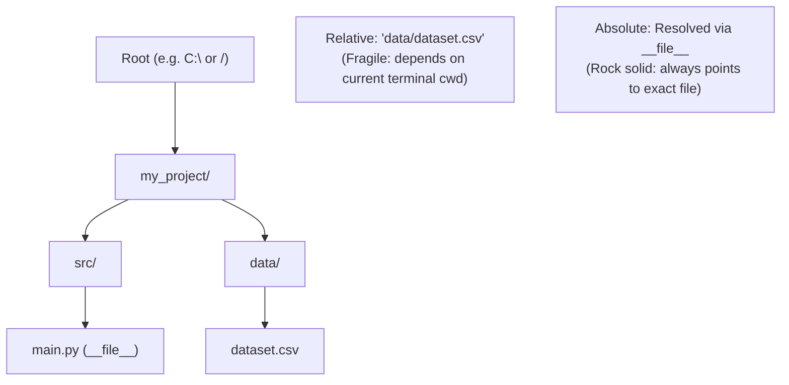

import { Callout } from "fumadocs-ui/components/callout";
import { Tabs, Tab } from "fumadocs-ui/components/tabs";
import { Accordion, Accordions } from "fumadocs-ui/components/accordion";

One of the most frequent sources of crashes when deploying code to production is **broken file paths**.

Code written on a Windows laptop using backslashes (`"data\\sales.csv"`) immediately crashes when deployed to a Linux server or macOS container (which use forward slashes `/`). Furthermore, relative paths like `"data/sales.csv"` depend on whichever directory you were in when running the terminal command!

Python solves this elegantly with the standard library module **`pathlib`**.

---

## 1. Why `pathlib` Replaces String Paths

In older Python tutorials, you will see `os.path.join()` or raw strings. Since Python 3.4, **`pathlib.Path`** is the universal object-oriented standard.

```python
from pathlib import Path

# Create a Path object pointing to current working directory:
current_dir = Path.cwd()
print("Current Directory:", current_dir)

# Create a Path pointing to a file using the cross-platform / operator:
data_file = Path("data") / "sales" / "transactions.csv"
print("Data File Path:", data_file)
```

<Callout type="tip" title="The / Operator in pathlib">
  Notice how <code>Path("data") / "sales" / "transactions.csv"</code> uses the
  forward-slash division operator! <code>pathlib</code> overrides the{" "}
  <code>/</code> operator to join path segments automatically using the current
  operating system's native directory separator.
</Callout>

---

## 2. Absolute vs. Relative Paths



- **Relative Path**: Defined relative to your **current working directory** (where your terminal prompt was launched). If you run `python src/main.py` from the root folder, `"data/dataset.csv"` works; if you `cd src` and run `python main.py`, it crashes with `FileNotFoundError`!
- **Absolute Path**: The full, unambiguous location on the disk (e.g. `C:\Users\...\my_project\data\dataset.csv` or `/home/user/my_project/data/dataset.csv`).

### The Production Idiom: Anchoring to `__file__`

Every Python script automatically has access to a special variable called `__file__`, which holds the path to the script itself.

By resolving `__file__`, you can locate any project asset reliably, regardless of where the command was executed:

```python
from pathlib import Path

# 1. Absolute path of THIS script (e.g., /my_project/src/main.py):
CURRENT_FILE = Path(__file__).resolve()

# 2. Project root folder (go up two parent folders):
PROJECT_ROOT = CURRENT_FILE.parent.parent

# 3. Locate the data file relative to the project root:
DATA_PATH = PROJECT_ROOT / "data" / "dataset.csv"

print("Guaranteed Asset Path:", DATA_PATH)
```

---

## 3. Essential `Path` Properties & Methods

A `Path` object provides rich methods to inspect and manipulate filenames:

```python
from pathlib import Path

p = Path("src/services/billing_worker.py")

print("Name (filename + ext):", p.name)         # billing_worker.py
print("Stem (filename only):  ", p.stem)         # billing_worker
print("Suffix (extension):    ", p.suffix)       # .py
print("Parent directory:      ", p.parent)       # src/services
```

### Inspecting the Filesystem

```python
target = Path("data/raw_data.csv")

# 1. Check if it exists on disk:
if target.exists():
    print("Found file!")

# 2. Check if it is a file or a folder:
print("Is File?", target.is_file())
print("Is Directory?", target.is_dir())
```

### Creating Directories Safely

To create nested folders without crashing if they already exist, use `mkdir(parents=True, exist_ok=True)`:

```python
output_dir = Path("output/reports/weekly")
# Creates output/, output/reports/, and output/reports/weekly/ automatically
output_dir.mkdir(parents=True, exist_ok=True)
```

---

## 4. Searching Files with `.glob()`

Need to find all JSON or CSV files inside a folder? Use `.glob()`:

```python
from pathlib import Path

data_folder = Path("data")

# Find all .csv files in this directory:
for csv_path in data_folder.glob("*.csv"):
    print(f"Found CSV: {csv_path.name}")

# Recursive search (all .json files in this folder AND subfolders):
for json_path in data_folder.rglob("*.json"):
    print(f"Found JSON: {json_path}")
```

---

## 5. Instant Reading & Writing Shortcuts

For small text files, `Path` provides convenience methods so you don't even need to open a file handle manually:

```python
from pathlib import Path

notes = Path("scratch.txt")

# Write text to disk (encodes with UTF-8):
notes.write_text("Hello from Python Pathlib!", encoding="utf-8")

# Read text from disk:
contents = notes.read_text(encoding="utf-8")
print(contents)
```

---

## Practice Questions & Challenges

Test your understanding of `pathlib.Path`, cross-platform path resolution, script anchoring with `__file__`, and glob searching.

### Question 1: Output Prediction (Path Decomposition)

Without running Python, determine the exact output for each attribute query:

```python
from pathlib import Path

p = Path("analytics/reports/2026/q1_summary.final.csv")

print("1. name   :", p.name)
print("2. stem   :", p.stem)
print("3. suffix :", p.suffix)
print("4. suffixes:", p.suffixes)
print("5. parent :", p.parent)
```

<Accordions>
<Accordion title="Reveal Solution & Explanation">

```text
1. name   : q1_summary.final.csv
2. stem   : q1_summary.final
3. suffix : .csv
4. suffixes: ['.final', '.csv']
5. parent : analytics/reports/2026
```

**Explanations:**

- `.name`: The final path component including all extensions (`q1_summary.final.csv`).
- `.stem`: The final component with the _last_ suffix stripped (`q1_summary.final`).
- `.suffix`: The final dot-extension (`.csv`).
- `.suffixes`: A list of all dot-separated extensions (`['.final', '.csv']`).
- `.parent`: The logical directory containing the file (`analytics/reports/2026`).

</Accordion>
</Accordions>

---

### Question 2: Spot and Fix the Bug (The CWD Fragility Trap)

An engineer writes this script inside `src/analytics/loader.py`:

```python
# src/analytics/loader.py
from pathlib import Path

def load_schema():
    # Attempting to load schema.json from the same directory as loader.py:
    schema_path = Path("schema.json")
    return schema_path.read_text(encoding="utf-8")

if __name__ == "__main__":
    print(load_schema())
```

When the engineer is in `src/analytics/` and runs `python loader.py`, it works. But when running from the project root: `python -m src.analytics.loader`, it crashes with:

```text
FileNotFoundError: [Errno 2] No such file or directory: 'schema.json'
```

1. Why does `Path("schema.json")` fail when invoked from a different directory?
2. How do you anchor path resolution relative to the script file itself regardless of the current working directory?
3. Rewrite `load_schema()` to be 100% resilient.

<Accordions>
<Accordion title="Reveal Solution & Explanation">

**1. Root Cause:**
A bare relative path like `Path("schema.json")` resolves relative to the **Current Working Directory (`os.getcwd()`)**, which is the directory where you typed the terminal command. When launched from the root directory, Python looks for `schema.json` in the project root rather than `src/analytics/`.

**2. Script Anchoring with `__file__`:**
The special global variable `__file__` always contains the path to the current Python script. Wrapping it in `Path(__file__).resolve().parent` gives the exact absolute directory containing the code, completely immune to wherever the user launches the command.

**3. Corrected Code:**

```python
from pathlib import Path

def load_schema() -> str:
    # Anchor to the folder containing loader.py:
    schema_path = Path(__file__).resolve().parent / "schema.json"
    return schema_path.read_text(encoding="utf-8")
```

</Accordion>
</Accordions>

---

### Question 3: Architecture Question (Why `pathlib` Overloads the `/` Operator)

In standard Python, `/` represents mathematical division (`10 / 2 == 5.0`).

How does `pathlib` allow syntax like `Path("data") / "raw" / "file.csv"`? Why is this preferred over string concatenation like `"data" + "/" + "raw"`?

<Accordions>
<Accordion title="Reveal Solution & Explanation">

**1. Operator Overloading via `__truediv__`:**
In Python's data model, the `/` operator is implemented by the `__truediv__` dunder method. `pathlib.Path` defines `__truediv__(self, other)` to join path segments using the host operating system's native path separator rules.

**2. Why It's Superior to String Concatenation:**

- **Cross-Platform Compatibility**: String concatenation with `+ "/"` creates broken paths on legacy Windows systems expecting `\`. `pathlib` creates a `WindowsPath` on Windows and a `PosixPath` on Linux/macOS automatically.
- **Handling Trailing / Leading Slashes**: String concatenation often creates accidental duplicate slashes (e.g. `"folder/" + "/file.txt"` $\rightarrow$ `"folder//file.txt"`). The `/` operator normalizes and strips redundant separators automatically.

</Accordion>
</Accordions>

---

### Question 4: Hands-On Challenge (`.glob()` vs `.rglob()`)

Given a nested directory structure containing logs:

```text
logs/
├── 2026-01.log
├── archive/
│   ├── 2025-11.log
│   └── 2025-12.log
└── temp.txt
```

Write a Python snippet using `pathlib` that:

1. Lists only `.log` files in the top-level `logs/` directory.
2. Lists all `.log` files in `logs/` and all of its subdirectories recursively.
3. Prints the total aggregate byte size of all matching recursive log files using `.stat().st_size`.

<Accordions>
<Accordion title="Reveal Solution & Code">

```python
from pathlib import Path

logs_dir = Path("logs")

# 1. Non-recursive (top-level only)
top_level_logs = list(logs_dir.glob("*.log"))
print("Top level:", [p.name for p in top_level_logs])

# 2. Recursive (all subfolders)
all_logs = list(logs_dir.rglob("*.log"))
print("All recursive logs:", [p.name for p in all_logs])

# 3. Aggregate file size calculation
total_bytes = sum(p.stat().st_size for p in all_logs if p.is_file())
print(f"Total Log Volume: {total_bytes / 1024:.2f} KB")
```

</Accordion>
</Accordions>

---

### Question 5: Code Challenge (Automated Directory File Organizer)

Write a Python function `organize_downloads(directory_path: str | Path) -> dict[str, int]` that organizes files in a messy folder based on their file extensions.

Rules:

1. File categories:
   - Images (`.png`, `.jpg`, `.jpeg`, `.gif`, `.webp`) $\rightarrow$ move into `images/`
   - Documents (`.pdf`, `.docx`, `.txt`, `.md`) $\rightarrow$ move into `documents/`
   - Datasets (`.csv`, `.json`, `.parquet`, `.xlsx`) $\rightarrow$ move into `data/`
2. Create target directories idempotently (`mkdir(parents=True, exist_ok=True)`).
3. Do not move subdirectories, only top-level files.
4. Return a dictionary reporting the count of files moved into each category (e.g. `{"images": 4, "documents": 2, "data": 1}`).

<Accordions>
<Accordion title="Reveal Solution & Code">

```python
from pathlib import Path

def organize_downloads(directory_path: str | Path) -> dict[str, int]:
    root = Path(directory_path).resolve()
    if not root.is_dir():
        raise NotADirectoryError(f"Target path is not a directory: {root}")

    category_map = {
        "images": {".png", ".jpg", ".jpeg", ".gif", ".webp"},
        "documents": {".pdf", ".docx", ".txt", ".md"},
        "data": {".csv", ".json", ".parquet", ".xlsx"},
    }

    counts: dict[str, int] = {cat: 0 for cat in category_map}

    # Iterate through only top-level items:
    for item in root.iterdir():
        if item.is_file():
            ext = item.suffix.lower()

            # Find matching category
            for category, extensions in category_map.items():
                if ext in extensions:
                    target_folder = root / category
                    target_folder.mkdir(parents=True, exist_ok=True)

                    target_destination = target_folder / item.name
                    # Safe move using rename
                    item.rename(target_destination)
                    counts[category] += 1
                    break  # Matched category

    return counts

# Quick test demonstration:
if __name__ == "__main__":
    demo_dir = Path("messy_folder")
    demo_dir.mkdir(exist_ok=True)
    (demo_dir / "invoice.pdf").write_text("dummy", encoding="utf-8")
    (demo_dir / "photo.png").write_text("dummy", encoding="utf-8")
    (demo_dir / "records.csv").write_text("dummy", encoding="utf-8")

    report = organize_downloads(demo_dir)
    print("Organization Report:", report)
    # Output: Organization Report: {'images': 1, 'documents': 1, 'data': 1}
```

</Accordion>
</Accordions>

---

## Summary Reference

- **`Path("a") / "b"`**: Cross-platform path concatenation.
- **`Path(__file__).resolve()`**: Unambiguous absolute path to current script.
- **`.parent`**: Access the enclosing directory.
- **`.exists()`, `.is_file()`, `.is_dir()`**: Inspect path state on disk.
- **`.mkdir(parents=True, exist_ok=True)`**: Idempotently create nested directories.
- **`.glob("*.ext")`**: Pattern search for matching files.

Now let's explore deep file I/O operations in **[15. Working with Files: Reading, Writing & Streaming](/docs/learn-python/01-fundamentals/15-working-with-files)**!
